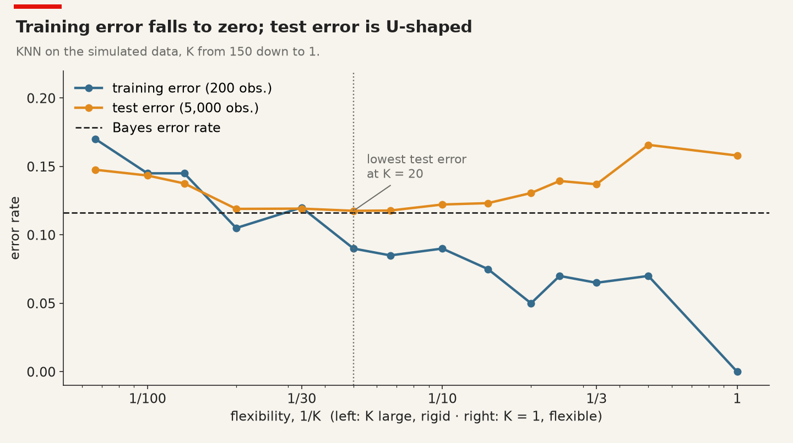
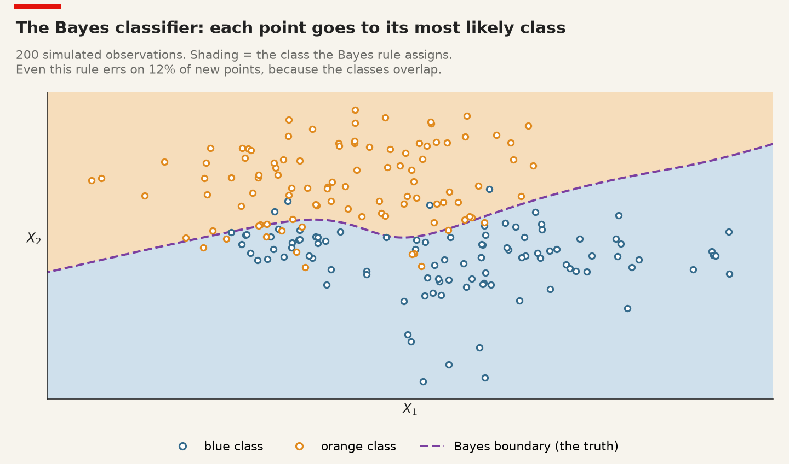
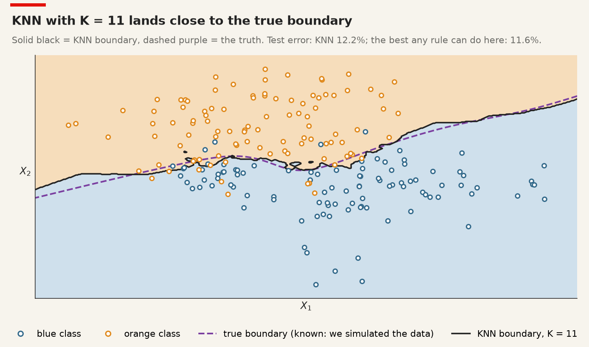
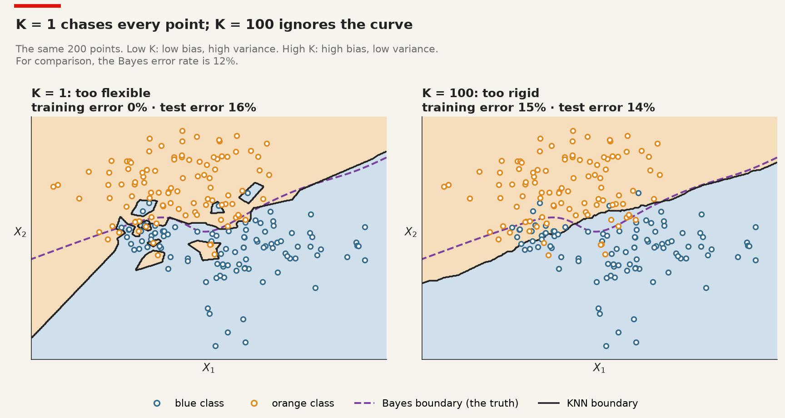
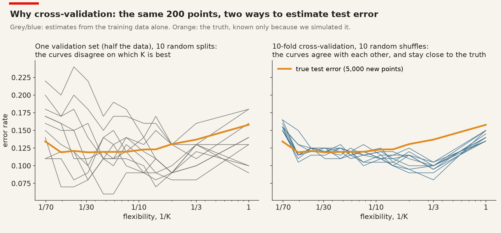

<!-- Imported from https://warin.ca/quant/en/session8_cours/. The code cells below are live: they execute
     at render time, so the output on the slides is the output the students' own
     machines produce. Every visible cell is plain Python with the four packages
     by name and the data read by URL — no qmib, no repository — so a student can
     copy it into a file of their own and run it. The same code, in order, is
     session08_knn.py beside this deck, published on the site.
     The KNN figures are computed by economist-assets/build_knn_figures.py. -->
```{python}
#| label: setup
#| echo: false

# Hidden: keep library warnings off the slides, and print tables wide.
import warnings
warnings.filterwarnings("ignore")
import pandas as pd
pd.set_option("display.width", 96)
pd.set_option("display.max_columns", 10)
```

<!-- BEGIN deck-frontmatter · scripts/build_deck_frontmatter.py -->

## Outline · The hour ahead {.center .scrollable}

1. The bias–variance trade-off
2. Classification
3. K-nearest neighbours
4. KNN by hand (you are the algorithm)
5. Cross-validation
6. KNN in code (you are no longer the algorithm)
7. Big lessons from ML

## What session 8 is for {.scrollable}
::::: columns

:::: {.column width="33%"}

### The mathematics

- State the **Bayes classifier** and say why no rule can beat it
- Find nearest neighbours **by hand** from a Euclidean distance
- Decompose test error into **squared bias, variance and irreducible error**
- Say what happens to KNN as the number of predictors grows

::::

:::: {.column width="33%"}

### The Python

- Standardise, split, and choose $k$ by cross-validation
- Measure a classifier with **AUC** rather than accuracy alone
- Fit the simple alternative too, and let it win if it does

::::

:::: {.column width="33%"}

### The international business

- Classify firms or countries when you have no theory of the boundary
- Say why a flexible method that scores 0.51 has told you something
- Justify complexity against a simpler model that was actually fitted

::::

:::::

## Your Python so far {.scrollable}

Everything you need to type is on one sheet — how to start Python in VS Codium on
your platform, how to make a file and run it, the DataFrame basics, and every name from sessions 1 to 8, each with a line showing it in use.

> **[Python Cheatsheet · Session 08](https://warint.github.io/quantitative-methods/python-cheatsheet-08.pdf)** (PDF) ·
> in the repository at `08-…/PYTHON-CHEATSHEET.pdf`

**One sheet per package, functions explained with pictures:** [pandas](https://warint.github.io/quantitative-methods/python-cheatsheets/pandas.pdf) · [NumPy](https://warint.github.io/quantitative-methods/python-cheatsheets/numpy.pdf) · [matplotlib](https://warint.github.io/quantitative-methods/python-cheatsheets/matplotlib.pdf) · [scikit-learn](https://warint.github.io/quantitative-methods/python-cheatsheets/sklearn.pdf)

::: {.muted}
Print it, or keep it open beside the editor. Nothing on it is examinable; all of it is
assumed.
:::

<!-- END deck-frontmatter -->

## Quote of the day {#imported-s08-001 .scrollable}

> \"If you live 5 minutes away from Bill Gates, I bet you are rich.\"

## The bias–variance trade-off {.center .scrollable}

## Bias and variance, in four pictures {#imported-s08-002 .scrollable}

::::::::: panel-tabset
### Bias and variance

{style="display: block; margin: auto;" width="78%"}

### Underfitting

{style="display: block; margin: auto;" width="78%"}

### Overfitting

{style="display: block; margin: auto;" width="78%"}

### Error against complexity

{style="display: block; margin: auto;" width="78%"}

:::::::::

## Classification {.center .scrollable}

## Training error and test error {#imported-s08-009 .scrollable}

The bias–variance trade-off carries over to classification, with one change: $y_i$ is now a **category**, not a number. Accuracy is counted in mistakes.

::: {.tight}
- The **training error rate** is the share of mistakes on the observations used to fit the model:
:::

$$\frac{1}{n}\sum_{i=1}^{n} I(y_i \neq \hat y_i)$$

where $I(y_i \neq \hat y_i)$ is 1 if observation $i$ is misclassified and 0 otherwise.

::: {.tight}
- The **test error rate** is the same share on observations the model has **not** seen, $\text{Ave}\big(I(y_0 \neq \hat y_0)\big)$
:::

::: {.check}
As in regression, the test error is the one we care about. A good classifier is the one whose **test** error is smallest.
:::

## The Bayes classifier {#imported-s08-010 .scrollable}

::::::::: panel-tabset
### The rule

The test error rate is minimised, on average, by a very simple rule: **assign each observation to its most likely class, given its predictors.** That is, give $x_0$ the class $j$ for which

$$\Pr(Y = j \mid X = x_0)$$

is largest. This is the **Bayes classifier**.

::: {.tight}
- It is a *conditional probability*: the probability that $Y = j$, given the observed predictors $x_0$
- With two classes, predict class 1 when $\Pr(Y = 1 \mid X = x_0) > 0.5$, and class 2 otherwise
:::

### Example

{style="display: block; margin: auto;" width="80%"}

::: {.muted}
Simulated data: 100 observations in each of two classes, two predictors $X_1$ and $X_2$.
Because we wrote the simulation, we know $\Pr(Y = \text{blue} \mid X = x)$ everywhere,
so we can draw the Bayes boundary (purple, dashed): the curve where that probability is
exactly $0.5$. The shading is the class the rule assigns. Some points still sit on the wrong side:
the classes overlap, so even the best possible rule makes mistakes — the **Bayes error rate**.
:::

:::::::::

## Watch a decision boundary being built {#playground}

Everything on the last four slides — a boundary, a class region, the cost of
flexibility — can be watched happening, in a browser, in about four minutes.

::: {.step}
**[playground.tensorflow.org](https://playground.tensorflow.org/#activation=tanh&batchSize=10&dataset=circle&regDataset=reg-plane&learningRate=0.03&regularizationRate=0&noise=0&networkShape=4,2&seed=0.69510&showTestData=false&discretize=false&percTrainData=50&x=true&y=true&xTimesY=false&xSquared=false&ySquared=false&cosX=false&sinX=false&cosY=false&sinY=false&collectStats=false&problem=classification&initZero=false&hideText=false)** — the link is pre-set to the exercise
below. Press the play button.
:::

The problem is two concentric rings, and the inputs are only $X_1$ and $X_2$ —
the raw coordinates, nothing engineered.

::: {.muted}
It is a neural network rather than anything this course fits, and that does not
matter here. What is on screen is a decision boundary and a test error, which
are the two objects of this session.
:::

## Four things to try, and what each one shows {.scrollable}

::: {.step}
**1 · Remove both hidden layers**, leaving the inputs wired straight to the
output. Run it. The boundary is a **straight line**, and it cannot separate a
ring from its centre — the error stalls near 0.5. This is the limit that made
session 4's logistic regression a line, and it is why we need something else.
:::

::: {.step}
**2 · Put the layers back and run it again.** A closed curve forms. Nothing told
it to draw a circle; the hidden units composed one out of straight pieces. That
is what "flexible" buys you.
:::

::: {.step}
**3 · Now add capacity** — eight neurons in each of four layers. Watch the two
loss numbers separate: **training loss keeps falling while test loss turns
upward**, and the boundary starts bulging toward individual points. You are
watching variance, live. It is the same curve as $k$ getting too small in the
next section.
:::

::: {.step}
**4 · Reset, and instead tick the $X_1^2$ and $X_2^2$ input features.** Now even
*no* hidden layer separates the rings almost perfectly — because $X_1^2 + X_2^2$
is the radius, and in that coordinate the problem was always linear.
:::

## What step 4 was really about {.scrollable}

::: {.tight}
You can buy the non-linearity with **model flexibility**, or with **a feature you
thought of yourself**. They are substitutes.
:::

::: {.check}
The second is cheaper, more stable and easier to defend — when you can think of
the feature. Knowing that $X_1^2 + X_2^2$ is a radius is subject knowledge, not
statistics, and it is the part a model cannot supply for you.
:::

::: {.warn}
Which is the session's argument in one sentence: **complexity is what you spend
when understanding runs out.** Session 5 penalised that spending; session 6 wrote
the non-linearity in by hand as a quadratic; this session measures what it costs
when you cannot.
:::

## K-nearest neighbours {.center .scrollable}

## From the Bayes classifier to KNN {#imported-s08-012 .scrollable}

::::::::: panel-tabset
### The idea

In theory we would always like to predict qualitative responses using the Bayes classifier.

But for real data, we do not know the conditional distribution of $Y$ given $X$, and so computing the Bayes classifier is impossible.

Therefore, the Bayes classifier serves as an unattainable gold standard against which to compare other methods.

Many approaches attempt to estimate the conditional distribution of $Y$ given $X$, and then classify a given observation to the class with highest estimated probability.

> One such method is the K-nearest neighbors (KNN) classifier.

### The rule

Given a positive integer $K$ and a test observation $x_0$, KNN finds the $K$ training points closest to $x_0$ — call them $N_0$ — and estimates each class's probability as its share of them:

$$\Pr(Y = j \mid X = x_0) = \frac{1}{K}\sum_{i \in N_0} I(y_i = j)$$

It then applies the Bayes rule to that estimate: $x_0$ goes to the class with the largest share.

:::::::::

## KNN with K = 3 {#imported-s08-013 .scrollable}

{style="display: block; margin: auto;" width="88%"}

::: {.tight}
- **Left.** We want to classify the black cross, with $K = 3$. KNN finds the three closest observations (the circle): two blue, one orange. So $\widehat{\Pr}(\text{blue}) = 2/3$, $\widehat{\Pr}(\text{orange}) = 1/3$, and the cross is predicted **blue**.
- **Right.** Do the same vote at every point of the plane: where blue wins is shaded blue, where orange wins is shaded orange. The line between them is the $K = 3$ **decision boundary**.
:::

## How close KNN gets, and the choice of K {#imported-s08-014 .scrollable}

::::::::: panel-tabset
### Close to Bayes

{style="display: block; margin: auto;" width="78%"}

::: {.muted}
KNN with $K = 11$ on the same 200 simulated points as the Bayes slide. It knows nothing about how
the data were generated, yet its boundary (solid black) follows the Bayes boundary (purple, dashed)
closely, and its test error is only a little above the Bayes error rate.
:::

### Choice of K

{style="display: block; margin: auto;" width="92%"}

::: {.tight}
- **$K = 1$**: each point is classified by its single nearest neighbour, so the boundary wraps around every stray blue point in orange territory, and every stray orange point in blue. Training error is 0, yet test error is higher than with $K = 11$. **Low bias, high variance.**
- **$K = 100$**: half the data votes on every point, so the boundary is nearly a straight line and misses the curve of the Bayes boundary. **High bias, low variance.**
:::

:::::::::

## Training error is not test error {#imported-s08-015 .scrollable}

::: pull-left
With $K = 1$ the KNN training error rate is 0, but the test error rate may be quite high. In general, as a classifier becomes more flexible, the training error falls but the test error may not.

The figure: training error (blue, 200 observations) and test error (orange, 5,000 observations) as flexibility, $1/K$, increases. The black dashed line is the Bayes error rate.

::: {.check}
Choosing the level of flexibility is the whole game, and the U-shape of the test error is what makes it hard.
:::
:::

::: pull-right
{style="display: block; margin: auto;" width="100%"}
:::

## KNN by hand (you are the algorithm) {.center .scrollable}

## Six observations and a test point {#imported-s08-017 .scrollable}

::::::::: panel-tabset
### The data

::: pull-left
A training set of six observations, three predictors and one qualitative response.

We want to predict $Y$ for the test point $X_1 = X_2 = X_3 = 0$ using $K$-nearest neighbours.

**First step:** compute the Euclidean distance between each observation and the test point:

$$d(a, b) = \sqrt{\sum_{j=1}^{p} (a_j - b_j)^2}$$

With $b = (0, 0, 0)$ this is just $\sqrt{X_1^2 + X_2^2 + X_3^2}$.
:::

::: pull-right
| Obs. | $X_1$ | $X_2$ | $X_3$ | $Y$ |
|:---:|:---:|:---:|:---:|:---:|
| 1 | 0 | 3 | 0 | Red |
| 2 | 2 | 0 | 0 | Red |
| 3 | 0 | 1 | 3 | Red |
| 4 | 0 | 1 | 2 | Green |
| 5 | −1 | 0 | 1 | Green |
| 6 | 1 | 1 | 1 | Red |
:::

### The distances

::: pull-left
| Obs. | $X_1$ | $X_2$ | $X_3$ | $Y$ | $d$ to $(0,0,0)$ |
|:---:|:---:|:---:|:---:|:---:|:---|
| 1 | 0 | 3 | 0 | Red | $\sqrt{9} = 3.000$ |
| 2 | 2 | 0 | 0 | Red | $\sqrt{4} = 2.000$ |
| 3 | 0 | 1 | 3 | Red | $\sqrt{10} = 3.162$ |
| 4 | 0 | 1 | 2 | Green | $\sqrt{5} = 2.236$ |
| 5 | −1 | 0 | 1 | Green | $\sqrt{2} = 1.414$ |
| 6 | 1 | 1 | 1 | Red | $\sqrt{3} = 1.732$ |
:::

::: pull-right
The same, in Python:

```{python}
#| echo: true

import numpy as np
import pandas as pd

# The six observations, and their colour
by_hand = pd.DataFrame({
    "X1": [0, 2, 0, 0, -1, 1],
    "X2": [3, 0, 1, 1, 0, 1],
    "X3": [0, 0, 3, 2, 1, 1],
    "Y":  ["Red", "Red", "Red", "Green", "Green", "Red"],
}, index=[1, 2, 3, 4, 5, 6])

# Distance to the test point (0, 0, 0)
by_hand["distance"] = np.sqrt(
    by_hand["X1"]**2 + by_hand["X2"]**2 + by_hand["X3"]**2)

# Nearest first
by_hand = by_hand.sort_values("distance")
print(by_hand.round(3))
```
:::

:::::::::

## Predict with K = 1, then K = 3 {#imported-s08-018 .scrollable}

::::::::: panel-tabset
### K = 1

**What is our prediction with $K = 1$? Why?**

::: {.check}
**Green.** The single nearest neighbour of the test point is observation 5 ($d = 1.414$), and it is Green.
:::

| Obs. | $Y$ | $d$ | nearest? |
|:---:|:---:|:---:|:---:|
| **5** | **Green** | **1.414** | **✔ 1st** |
| 6 | Red | 1.732 | |
| 2 | Red | 2.000 | |
| 4 | Green | 2.236 | |
| 1 | Red | 3.000 | |
| 3 | Red | 3.162 | |

### K = 3

**What is our prediction with $K = 3$? Why?**

::: {.check}
**Red.** The three nearest neighbours are observations 5, 6 and 2. Two of the three are Red, so $\widehat{\Pr}(\text{Red}) = 2/3$.
:::

| Obs. | $Y$ | $d$ | nearest? |
|:---:|:---:|:---:|:---:|
| **5** | **Green** | **1.414** | **✔ 1st** |
| **6** | **Red** | **1.732** | **✔ 2nd** |
| **2** | **Red** | **2.000** | **✔ 3rd** |
| 4 | Green | 2.236 | |
| 1 | Red | 3.000 | |
| 3 | Red | 3.162 | |

### In Python

```{python}
#| echo: true

# Continues from the previous slide: by_hand is sorted, nearest first.
# The prediction is the most common colour among the K nearest rows.
print("K = 1 predicts:", by_hand["Y"].iloc[:1].mode()[0])
print("K = 3 predicts:", by_hand["Y"].iloc[:3].mode()[0])
```

:::::::::

## A nonlinear boundary: large K or small? {#imported-s08-020 .scrollable}

**If the Bayes decision boundary in this problem is highly nonlinear, would we expect the best value for $K$ to be large or small? Why?**

::: {.check}
**Small.** A small $K$ is flexible: the boundary is drawn by a few nearby points, so it can bend wherever the true boundary bends. A large $K$ averages over many points, which smooths the boundary towards a straight line — exactly what a highly nonlinear problem cannot afford. (Too small, though, and it bends around noise: that is the $K = 1$ picture.)
:::

## Cross-validation {.center .scrollable}

## The problem: choosing K needs a test error we are not allowed to use {.scrollable}

::: {.tight}
- **Training error** cannot choose $K$: it is always lowest at $K = 1$ (zero — every point is its own nearest neighbour).
- **Test error** is what we want, but the test set may be used **once**, at the very end. Choose $K$ on it, and it has become training data: the score it gives is no longer honest.
- So we need an estimate of the test error **from the training data alone**.
:::

::: {.step}
**The idea:** pretend part of the training data is new. Hide it, fit on the rest, and measure the error on what was hidden. That hidden part is a **validation set**.
:::

::: {.check}
**Cross-validation** does this several times, hiding a different part each time — so that every observation is used both to fit and to check, and no single unlucky split decides.
:::

## k-fold cross-validation, in one picture {.scrollable}

{style="display: block; margin: auto;" width="86%"}

Cut the training data into $k$ folds. Fit on $k - 1$ of them, measure the error rate on the one left out, rotate, and average:

$$\text{CV}_{(k)} = \frac{1}{k}\sum_{i=1}^{k} \text{Err}_i, \qquad \text{Err}_i = \frac{1}{n_i}\sum_{j \in \text{fold } i} I(y_j \neq \hat y_j)$$

::: {.muted}
$k = 5$ or $k = 10$ are the usual choices. $k = n$ — every observation left out on its own — is *leave-one-out* cross-validation.
:::

## Why not just one validation set? {.scrollable}

{style="display: block; margin: auto;" width="92%"}

::: {.tight}
- **Left.** Hide half the data once, and the answer depends on *which* half: ten splits, ten different "best" $K$. And each fit uses only half the data.
- **Right.** 10-fold CV uses 90% of the data in every fit and averages ten errors: the estimates agree with one another and stay close to the true test error (orange) — which, in real life, you never get to see.
:::

## Why cross-validation is a superpower for machine learning {.scrollable}

::: {.tight}
1. **It needs no theory.** No formula for the variance, no distributional assumption. The one assumption: the data you have look like the data you will predict.
2. **It tunes anything.** $K$ in KNN, $\lambda$ in ridge and lasso (session 5), the depth of a tree, the size of a network — the same loop chooses them all.
3. **It referees between models.** KNN against a logit against a random forest, each scored on data it did not see, on equal footing.
4. **It uses every observation twice** — once to fit, once to check — which matters when data are scarce.
5. **It tells you how sure to be.** $k$ errors, not one: their spread says whether a difference between two models is real or noise.
:::

::: {.warn}
**Three rules, or it lies.** (1) Everything learned from data — standardising, choosing variables — happens **inside** each fold: that is what the `Pipeline` is for. (2) With time series, folds respect time: never fit on the future to predict the past. (3) CV **chooses**; the test set **judges**, once.
:::

## Cross-validation in code {.scrollable}

::::::::: panel-tabset
### By hand

```{python}
#| echo: true

import numpy as np
from sklearn.datasets import load_breast_cancer
from sklearn.model_selection import KFold, cross_val_score
from sklearn.neighbors import KNeighborsClassifier
from sklearn.pipeline import make_pipeline
from sklearn.preprocessing import StandardScaler

# 569 tumours, 30 measurements each: malignant or benign? (ships with scikit-learn)
X, y = load_breast_cancer(return_X_y=True)
model = make_pipeline(StandardScaler(), KNeighborsClassifier(n_neighbors=5))

# Five rounds, each holding out a different fifth of the data
folds = KFold(n_splits=5, shuffle=True, random_state=0)
errors = []
for r, (fit_rows, check_rows) in enumerate(folds.split(X), start=1):
    model.fit(X[fit_rows], y[fit_rows])                     # fit on four fifths
    error = 1 - model.score(X[check_rows], y[check_rows])   # error on the fifth left out
    errors.append(error)
    print(f"round {r}: fit on {len(fit_rows)} rows, error on the other {len(check_rows)} = {error:.3f}")

print(f"CV error = {np.mean(errors):.3f}   (spread across folds: sd {np.std(errors):.3f})")
```

### In one line

```{python}
#| echo: true

# Continues from "By hand": cross_val_score runs the same five rounds.
# It returns accuracies, so 1 - accuracy gives the same five errors as the loop.
scores = cross_val_score(model, X, y, cv=folds)
print("the five errors:", (1 - scores).round(3))
print(f"CV error = {1 - scores.mean():.3f}")
```

### Choosing K

```{python}
#| echo: true

# Continues from "By hand". One CV error per K: the lowest wins.
for k in [1, 5, 15, 51, 151]:
    model_k = make_pipeline(StandardScaler(), KNeighborsClassifier(n_neighbors=k))
    cv_error = 1 - cross_val_score(model_k, X, y, cv=folds).mean()
    print(f"K = {k:3}:  CV error {cv_error:.3f}")

# GridSearchCV, in the next section, is exactly this loop —
# plus refitting the winning K on all the training data.
```

:::::::::

## KNN in code (you are no longer the algorithm) {.center .scrollable}

## Copy, paste, run {.scrollable}

Every code block from here on is plain Python with four packages. Copy them **in order**
into one file of your own and run it: each block uses what the earlier blocks created.

::: {.step}
**Once**, in the VS Codium terminal: `pip install pandas numpy matplotlib scikit-learn`
:::

::: {.warn}
**macOS, Python from python.org:** if reading the data fails with `CERTIFICATE_VERIFY_FAILED`,
run its certificate installer once, then try again:
`open /Applications/Python\ 3*/Install\ Certificates.command`
:::

::: {.step}
**Or download the whole thing:** [session08_knn.py](https://warint.github.io/quantitative-methods/session-08/session08_knn.py) —
every block of this lecture, in order, with comments. Save it in a folder of your own and press Run.
:::

::: {.muted}
The data is read from the internet, so you need a connection — nothing else. In a `.py` file, a
result only appears if you `print()` it, which is why every block prints what it wants you to see.
:::

## The data: the stock market {#imported-s08-023 .scrollable}

> How does an AI work? The KNN mathematics, now inside an algorithm — what does it change?

::::::::: panel-tabset
### Data collection

```{python}
#| echo: true

import numpy as np
import pandas as pd
import matplotlib.pyplot as plt

# Smarket: 1,250 trading days of the S&P 500, 2001-2005 (ISLR textbook data)
URL = "https://raw.githubusercontent.com/intro-stat-learning/ISLP/main/ISLP/data/Smarket.csv"
smarket = pd.read_csv(URL)

print(smarket.shape)                         # (rows, columns)
print(smarket.head())
print(smarket["Direction"].value_counts())   # how many Up days, how many Down
```

### Data description

1,250 trading days, 9 variables. We predict `Direction` from the returns of the days before.

| Variable | Description |
|:---|:---|
| `Year` | The year of the observation |
| `Lag1` | % return of the market the previous day |
| `Lag2` | % return two days before |
| `Lag3` … `Lag5` | % return three to five days before |
| `Volume` | Shares traded (billions) |
| `Today` | % return that day |
| `Direction` | `Up` or `Down`: did the market rise that day? — **the label** |

::: {.muted}
`Today` is the answer in disguise (`Direction` is just its sign), so it must never be a predictor.
:::

:::::::::

## The workflow, and how it is scored {#imported-s08-024 .scrollable}

::::::::: panel-tabset
### Four steps

1. **Data**: load it, and split it into a training set and a test set
2. **Training**: choose $K$ by cross-validation on the training set only, with the pre-processing inside
3. **Testing**: score the chosen model on the test set — once
4. **Prediction**: use it on a new observation of your own

### What KNN needs

1. The predictors of the **training** data — `X_train` below
2. The class labels of the training data — `y_train` (Up / Down)
3. The predictors of the data to predict — `X_test`
4. A value for $K$, the number of neighbours — chosen by cross-validation

### Confusion matrix

{style="display: block; margin: auto;" width="62%"}

### Reading it

From the four cells of the confusion matrix:

$$\text{Accuracy} = \frac{TP + TN}{TP + FP + TN + FN}$$

$$\text{Recall (sensitivity, TPR)} = \frac{TP}{TP + FN} \qquad \text{Precision} = \frac{TP}{TP + FP}$$

$$\text{Specificity} = \frac{TN}{TN + FP} \qquad \text{False positive rate} = 1 - \text{Specificity} = \frac{FP}{TN + FP}$$

$$F_1 = \frac{2\,TP}{2\,TP + FP + FN} = \frac{2 \times \text{Precision} \times \text{Recall}}{\text{Precision} + \text{Recall}}$$

### Pre-processing

KNN measures **distances**, so a predictor in large units would dominate one in small units. Put them on the same scale first:

$$\text{Normalisation: } x_{\text{normalised}} = \frac{x - x_{\min}}{x_{\max} - x_{\min}} \qquad \text{Standardisation: } x_{\text{standardised}} = \frac{x - \mu}{\sigma}$$

In scikit-learn, standardisation is `StandardScaler()`.

:::::::::

## Step 1: a time split, not a random one {#imported-s08-025 .scrollable}

```{python}
#| echo: true

# Continues from "Data collection": smarket is loaded.
# Train on 2001-2004, test on 2005. Never shuffle a time series: a random split
# would let tomorrow's market help "predict" yesterday's (leakage).
train = smarket[smarket["Year"] < 2005]
test  = smarket[smarket["Year"] == 2005]

predictors = ["Lag1", "Lag2"]          # the two previous days' returns
X_train, y_train = train[predictors], train["Direction"]
X_test,  y_test  = test[predictors],  test["Direction"]

print(f"training set: {len(train)} days (2001-2004)")
print(f"test set:     {len(test)} days (2005)")
```

## Step 2: choose K by cross-validation {#imported-s08-026 .scrollable}

::::::::: panel-tabset
### Code

```{python}
#| echo: true

from sklearn.neighbors import KNeighborsClassifier
from sklearn.model_selection import GridSearchCV
from sklearn.pipeline import make_pipeline
from sklearn.preprocessing import StandardScaler

# Standardise, then KNN. The scaler sits INSIDE the pipeline, so it is refitted
# on each cross-validation fold and never sees the fold it is scored on.
pipeline = make_pipeline(StandardScaler(), KNeighborsClassifier())

# Try K = 1, 3, 5, ..., 101 (odd: no ties in a two-class vote), 5-fold CV.
# "kneighborsclassifier__n_neighbors" = the n_neighbors setting of the KNN step.
k_values = list(range(1, 102, 2))
search = GridSearchCV(pipeline, {"kneighborsclassifier__n_neighbors": k_values}, cv=5)
search.fit(X_train, y_train)

best_k = search.best_params_["kneighborsclassifier__n_neighbors"]
majority = y_train.value_counts(normalize=True).max()
print(f"best K = {best_k}")
print(f"cross-validated accuracy at that K = {search.best_score_:.3f}")
print(f"always predicting the commonest class = {majority:.3f}   <- the bar to beat")
```

### Plot

```{python}
#| echo: true

# Continues from "Code": the cross-validated accuracy for every K tried.
plt.figure(figsize=(8, 3))
plt.plot(k_values, search.cv_results_["mean_test_score"], "o-", label="KNN, 5-fold CV")
plt.axhline(majority, color="red", linestyle="--", label="always predict the commonest class")
plt.xlabel("K (number of neighbours)")
plt.ylabel("cross-validated accuracy")
plt.legend()
plt.tight_layout()
plt.show()
```

### Reading it

::: {.tight}
- **Small $K$** (left): low bias, high variance — the boundary follows single days, and the accuracy is noisy.
- **Large $K$** (right): high bias, low variance — the prediction flattens towards the majority class.
- The chosen $K$ is where that trade-off is best **on held-out folds**. Here even the best $K$ barely clears the red line: yesterday's returns carry almost no signal about today's direction.
:::

:::::::::

## Step 2 (cont.): which inputs matter? {.scrollable}

```{python}
#| echo: true

from sklearn.inspection import permutation_importance

# KNN has no coefficients. Instead: shuffle one column and see how much the
# test accuracy drops. Big drop = the model relied on it. Near zero = no signal.
importance = permutation_importance(search, X_test, y_test, n_repeats=10, random_state=0)
for name, mean, sd in zip(predictors, importance.importances_mean, importance.importances_std):
    print(f"{name}: accuracy drop {mean:+.4f}  (sd {sd:.4f})")
```

::: {.muted}
Both are close to zero. A negative value is not a paradox: it means shuffling the column *helped*, which is what removing noise does.
:::

## Step 3: test, once {#imported-s08-027 .scrollable}

::::::::: panel-tabset
### Predictions

```{python}
#| echo: true

# search.predict uses the best K, refitted on all of 2001-2004.
y_pred = search.predict(X_test)

# The prediction next to the truth, first five days of 2005
print(test.assign(predicted=y_pred)[["Year", "Lag1", "Lag2", "Direction", "predicted"]].head())
```

### Confusion matrix

```{python}
#| echo: true

from sklearn.metrics import confusion_matrix, classification_report

# Rows = what really happened, columns = what we predicted
table = pd.DataFrame(confusion_matrix(y_test, y_pred, labels=["Down", "Up"]),
                     index=["actual Down", "actual Up"],
                     columns=["predicted Down", "predicted Up"])
print(table)
print(classification_report(y_test, y_pred))

# Compare with the majority class, not with 50%
accuracy = (y_pred == y_test).mean()
baseline = y_test.value_counts(normalize=True).max()
print(f"KNN test accuracy:                   {accuracy:.3f}")
print(f"always predicting the commonest day: {baseline:.3f}")
```

:::::::::

## Step 4: predict a day of your own {#imported-s08-028 .scrollable}

```{python}
#| echo: true

# Change these two numbers: yesterday's return and the day before's, in %.
my_day = pd.DataFrame({"Lag1": [1.5], "Lag2": [-0.8]})

print("prediction:", search.predict(my_day)[0])
for label, prob in zip(search.classes_, search.predict_proba(my_day)[0]):
    print(f"Pr({label}) = {prob:.3f}")
```

::: {.muted}
The probabilities are the shares of Up and Down days among the $K$ nearest days in the training set — the $\frac{1}{K}\sum_{i \in N_0} I(y_i = j)$ of the KNN rule.
:::

## The whole workflow in one block {.scrollable}

Everything above, from an empty file: copy this block alone and it runs.

```{python}
#| echo: true

import pandas as pd
from sklearn.neighbors import KNeighborsClassifier
from sklearn.model_selection import GridSearchCV
from sklearn.pipeline import make_pipeline
from sklearn.preprocessing import StandardScaler

# 1 · Data, split by time
URL = "https://raw.githubusercontent.com/intro-stat-learning/ISLP/main/ISLP/data/Smarket.csv"
smarket = pd.read_csv(URL)
train = smarket[smarket["Year"] < 2005]
test  = smarket[smarket["Year"] == 2005]

# 2 · Training: choose K by 5-fold CV, scaler inside the pipeline
search = GridSearchCV(make_pipeline(StandardScaler(), KNeighborsClassifier()),
                      {"kneighborsclassifier__n_neighbors": range(1, 102, 2)}, cv=5)
search.fit(train[["Lag1", "Lag2"]], train["Direction"])

# 3 · Testing, once
print("chosen K:", search.best_params_["kneighborsclassifier__n_neighbors"])
print(f"test accuracy: {search.score(test[['Lag1', 'Lag2']], test['Direction']):.3f}")

# 4 · Prediction for a new day
print("new day:", search.predict(pd.DataFrame({"Lag1": [1.5], "Lag2": [-0.8]}))[0])
```

## You survived your second session on machine learning {#imported-s08-031 .scrollable}

> Wait! I am not an expert! I will never be!!!
>
> I only know the K-Nearest-Neighbor classification technique!!!

OK, let\'s step back first\...

## Big lessons from ML {.center .scrollable}

## Big lessons {#imported-s08-033 .scrollable}

-   Machine Learning is about:

    -   regressions

    -   classifications

-   Machine Learning is about:

    -   a process: the 7 principles of ML (see the previous session)

-   You can run the regressions of sessions 2–6 — `smf.ols`, `smf.logit`, panel models — in the context of ML: k-fold cross-validation, training/testing, predictions

-   ML aims at:

    -   reducing the model and data biases in **sampling with regards to the populations**

    -   as such, it is a **GIGANTIC improvement** of current quantitative studies

## Beyond one classifier {#imported-s08-034 .scrollable}

::::::::: panel-tabset
### Classification: iris

```{python}
#| echo: true

# Data with a real signal: three iris species from four flower measurements.
# The data ships with scikit-learn, so there is nothing to download.
from sklearn.datasets import load_iris
from sklearn.neighbors import KNeighborsClassifier
from sklearn.model_selection import GridSearchCV
from sklearn.pipeline import make_pipeline
from sklearn.preprocessing import StandardScaler

iris = load_iris(as_frame=True)
iris_search = GridSearchCV(make_pipeline(StandardScaler(), KNeighborsClassifier()),
                           {"kneighborsclassifier__n_neighbors": range(1, 16)}, cv=10)
iris_search.fit(iris.data, iris.target)

print("best K:", iris_search.best_params_["kneighborsclassifier__n_neighbors"])
print(f"CV accuracy: {iris_search.best_score_:.3f}")
```

### Regression: house prices

```{python}
#| echo: true

# KNN can predict a number too: the average of the K nearest houses' prices.
import pandas as pd
from sklearn.neighbors import KNeighborsRegressor
from sklearn.linear_model import LinearRegression
from sklearn.model_selection import cross_val_score
from sklearn.pipeline import make_pipeline
from sklearn.preprocessing import StandardScaler

URL = "https://www.warin.ca/datalake/courses_data/qmibr/session5/Real_Estate_Sample.csv"
houses = pd.read_csv(URL, index_col=0).dropna()
X = houses[["Living.area", "bedrooms", "bathrooms", "year", "garage"]]
y = houses["Price"]

models = {
    "KNN, K = 5": make_pipeline(StandardScaler(), KNeighborsRegressor(n_neighbors=5)),
    "KNN, K = 25": make_pipeline(StandardScaler(), KNeighborsRegressor(n_neighbors=25)),
    "linear regression": LinearRegression(),
}
for name, model in models.items():
    # scikit-learn returns NEGATIVE errors (it always maximises); the minus undoes it
    rmse = -cross_val_score(model, X, y, cv=5, scoring="neg_root_mean_squared_error").mean()
    print(f"{name:18}  RMSE = {rmse:10,.0f}")
print(f"price standard deviation = {y.std():,.0f}   <- the cost of predicting the average")
```

### A random forest

```{python}
#| echo: true

# Continues from the stock-market steps: X_train, y_train, search, majority.
from sklearn.ensemble import RandomForestClassifier
from sklearn.model_selection import cross_val_score

# 500 trees, on every core of the machine (n_jobs=-1)
forest = RandomForestClassifier(n_estimators=500, n_jobs=-1, random_state=0)
forest_accuracy = cross_val_score(forest, X_train, y_train, cv=5).mean()

print(f"random forest CV accuracy = {forest_accuracy:.3f}")
print(f"KNN CV accuracy           = {search.best_score_:.3f}")
print(f"commonest class           = {majority:.3f}")
```

::: {.muted}
Five hundred trees, every core busy, and nothing beats the constant rule by much. The lesson is
not about the method: these two lags may carry no signal, and no amount of compute manufactures one.
:::

:::::::::


## Before the next session {.scrollable}

::: {.warn}
**Required:** the next session's article, its Dataverse package, and the
self-check. That is the pre-session deck.
:::

::: {.step}
**Optional:** the **QMIB Lab** for this session — a knowledge check on the hour
you have just sat through: **[warin.ca/qmib-labs](https://warin.ca/qmib-labs/qmib-lab-08.html)**
:::

::: {.muted}
Never a prerequisite, never marked for correctness. A completed report counts
toward participation because attempting it is the engagement being measured.
:::
