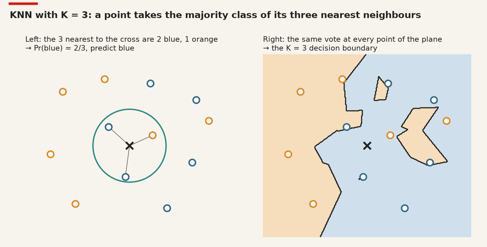
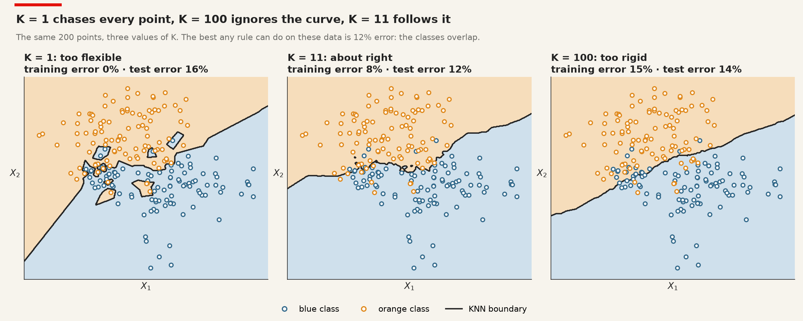
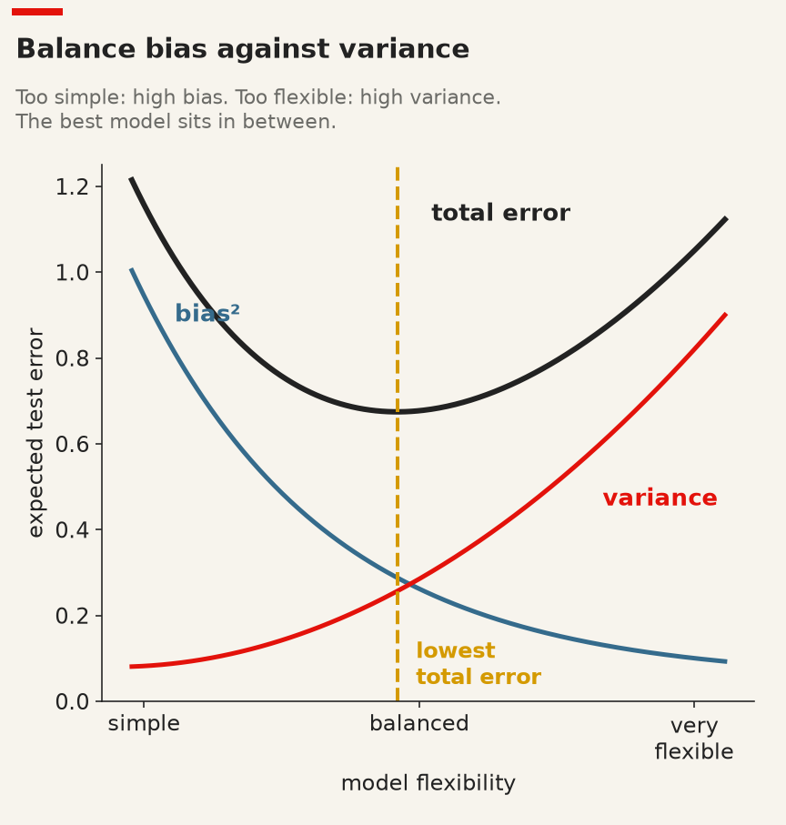
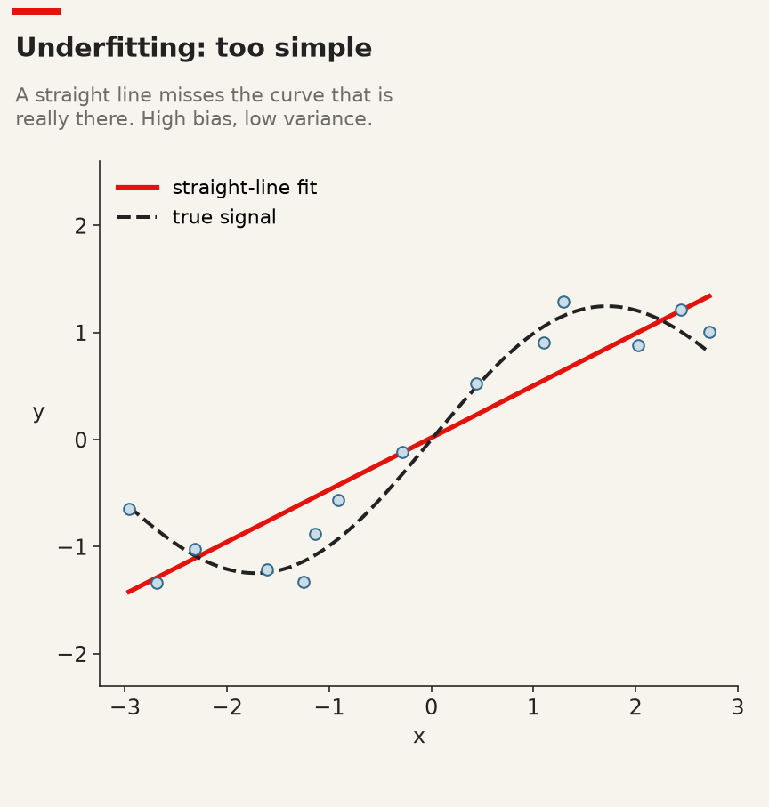
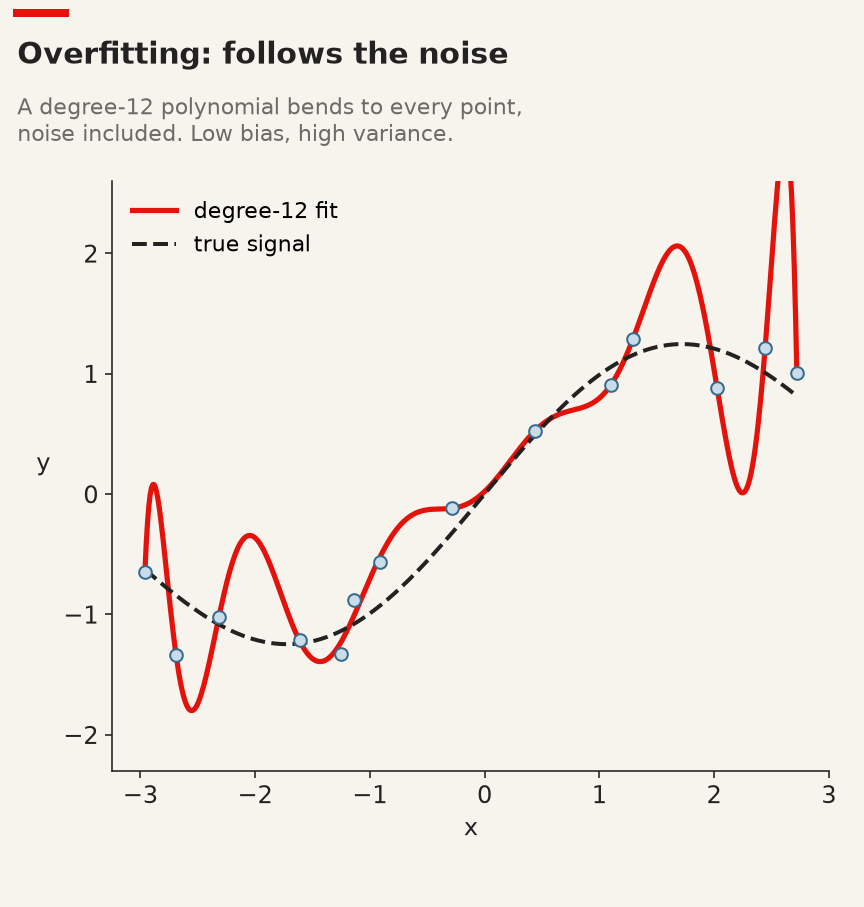
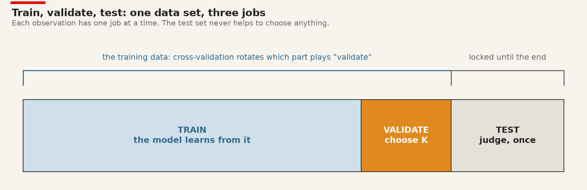
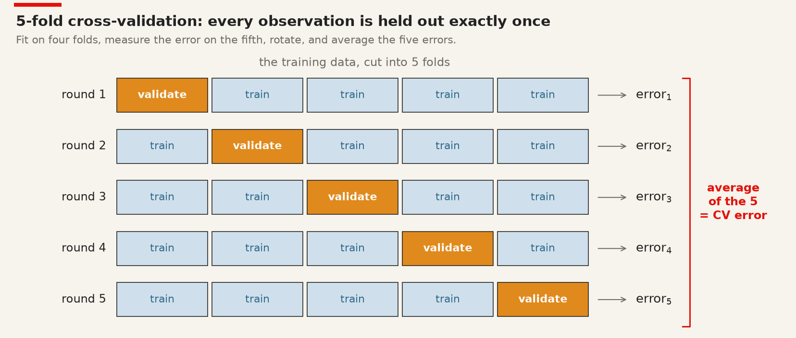
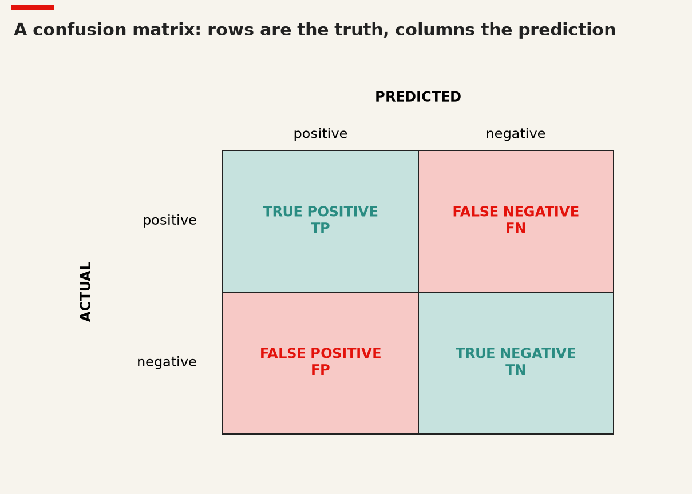
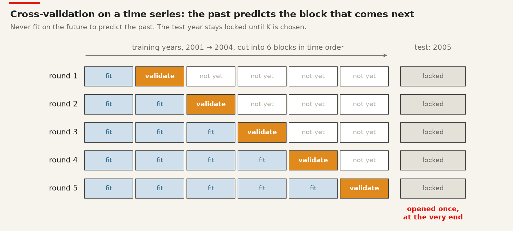

<!-- Imported from https://warin.ca/quant/en/session8_cours/. The code cells below are live: they execute
     at render time, so the output on the slides is the output the students' own
     machines produce. Every visible cell is plain Python with the four packages
     by name and the data read by URL — no qmib, no repository — so a student can
     copy it into a file of their own and run it. The financial example is the two
     scripts beside this deck, session08_1_train.py and session08_2_predict.py,
     published on the site.
     The KNN figures are computed by economist-assets/build_knn_figures.py. -->
```{python}
#| label: setup
#| echo: false

# Hidden: keep library warnings off the slides, and print tables wide.
import warnings
warnings.filterwarnings("ignore")
import pandas as pd
pd.set_option("display.width", 96)
pd.set_option("display.max_columns", 10)
```

<!-- BEGIN deck-frontmatter · scripts/build_deck_frontmatter.py -->

## Outline · The hour ahead {.center .scrollable}

1. K-nearest neighbours, explained
2. Cross-validation: why it is magical
3. A financial example: can KNN predict the stock market?
4. Big lessons from ML

## What session 8 is for {.scrollable}
::::: columns

:::: {.column width="33%"}

### The mathematics

- Explain how KNN classifies, by **the vote of the $K$ nearest neighbours**
- Find nearest neighbours **by hand** from a Euclidean distance
- Decompose test error into **squared bias, variance and irreducible error**
- Say why **cross-validation** estimates out-of-sample error, and what classical in-sample fit cannot tell you

::::

:::: {.column width="33%"}

### The Python

- Standardise, split, and choose $k$ by cross-validation
- Measure a classifier with **AUC** rather than accuracy alone
- Fit the simple alternative too, and let it win if it does

::::

:::: {.column width="33%"}

### The international business

- Classify firms or countries when you have no theory of the boundary
- Say why a flexible method that scores 0.51 has told you something
- Justify complexity against a simpler model that was actually fitted

::::

:::::

## Your Python so far {.scrollable}

Everything you need to type is on one sheet — how to start Python in VS Codium on
your platform, how to make a file and run it, the DataFrame basics, and every name from sessions 1 to 8, each with a line showing it in use.

> **[Python Cheatsheet · Session 08](https://warint.github.io/quantitative-methods/python-cheatsheet-08.pdf)** (PDF) ·
> in the repository at `08-…/PYTHON-CHEATSHEET.pdf`

**One sheet per package, functions explained with pictures:** [pandas](https://warint.github.io/quantitative-methods/python-cheatsheets/pandas.pdf) · [NumPy](https://warint.github.io/quantitative-methods/python-cheatsheets/numpy.pdf) · [matplotlib](https://warint.github.io/quantitative-methods/python-cheatsheets/matplotlib.pdf) · [scikit-learn](https://warint.github.io/quantitative-methods/python-cheatsheets/sklearn.pdf)

::: {.muted}
Print it, or keep it open beside the editor. Nothing on it is examinable; all of it is
assumed.
:::

<!-- END deck-frontmatter -->

## Quote of the day {#imported-s08-001 .scrollable}

> \"If you live 5 minutes away from Bill Gates, I bet you are rich.\"


::: {.muted}
The quote is the whole idea of this session. To guess something about you, look at the people who live
closest to you. That is K-nearest neighbours.
:::

## K-nearest neighbours, explained {.center .scrollable}

## Classification: predicting a category {#imported-s08-009 .scrollable}

In sessions 2 to 6, most of what we predicted was a **number**: a wage, a volume of exports, a price.
Today the outcome is a **category**: Up or Down, crisis or no crisis, red or green. Predicting a
category is called **classification**, and a model that does it is a **classifier**.

A classifier is judged by its mistakes. We count how often its prediction $\hat y_i$ differs from the truth $y_i$:

::: {.tight}
- The **training error rate** is the share of mistakes on the observations used to fit the model:
:::

$$\frac{1}{n}\sum_{i=1}^{n} I(y_i \neq \hat y_i)$$

where $I(y_i \neq \hat y_i)$ is 1 if observation $i$ is misclassified and 0 otherwise. So the formula simply counts the mistakes and divides by $n$.

::: {.tight}
- The **test error rate** is the same share, computed on observations the model has **not** seen: $\text{Ave}\big(I(y_0 \neq \hat y_0)\big)$
:::

::: {.check}
Keep this distinction in mind for the whole session. The training error tells us how well the model
remembers the past. The test error tells us how well it will do on new cases, and that is the
only one we care about.
:::

## The idea: tell me who your neighbours are {#imported-s08-012 .scrollable}

::::::::: panel-tabset
### In words

KNN has no equation, no coefficients and no theory of how the data were produced. It rests on one
intuition: **observations that look alike tend to belong to the same class.**

To classify a new observation, KNN does three things:

1. It measures the **distance** between the new observation and every observation in the training data.
2. It keeps the $K$ **closest** ones, its "nearest neighbours". $K$ is a number we choose: 1, 3, 25, …
3. It lets them **vote**. The new observation gets the class that most of its neighbours have.

::: {.check}
That is the whole algorithm. Everything else in this session is about two questions: how to measure
"close", and how many neighbours to ask.
:::

### In symbols

Given a positive integer $K$ and a new observation $x_0$, KNN finds the $K$ training points closest
to $x_0$ (call that set $N_0$). It estimates the probability of each class $j$ as the share of the
neighbours that belong to it:

$$\widehat{\Pr}(Y = j \mid X = x_0) = \frac{1}{K}\sum_{i \in N_0} I(y_i = j)$$

Then $x_0$ goes to the class with the largest share.

::: {.muted}
Read the formula out loud: "among my $K$ neighbours, count those of class $j$, and divide by $K$."
With $K = 5$ and three blue neighbours, $\widehat{\Pr}(\text{blue}) = 3/5 = 0.6$, so the prediction is blue.
:::

:::::::::

## KNN with K = 3, in a picture {#imported-s08-013 .scrollable}

{style="display: block; margin: auto;" width="88%"}

::: {.tight}
- **Left.** We want to classify the black cross, with $K = 3$. KNN finds the three closest observations (the circle): two blue, one orange. So $\widehat{\Pr}(\text{blue}) = 2/3$, $\widehat{\Pr}(\text{orange}) = 1/3$, and the cross is predicted **blue**.
- **Right.** Now do the same vote at every point of the plane. Where blue wins, the plane is shaded blue; where orange wins, orange. The line between the two colours is the $K = 3$ **decision boundary**: on one side of it, KNN says blue; on the other, orange.
:::

## KNN by hand: you are the algorithm {#imported-s08-017 .scrollable}

Before a computer does it, we do it ourselves, with a pencil. Six observations, one new point, and the three steps of KNN: distance, nearest, vote.


::::::::: panel-tabset
### The data

::: pull-left
A training set of six observations, three predictors and one qualitative response.

We want to predict $Y$ for the test point $X_1 = X_2 = X_3 = 0$ using $K$-nearest neighbours.

**First step:** compute the Euclidean distance between each observation and the test point:

$$d(a, b) = \sqrt{\sum_{j=1}^{p} (a_j - b_j)^2}$$

With $b = (0, 0, 0)$ this is just $\sqrt{X_1^2 + X_2^2 + X_3^2}$.
:::

::: pull-right
| Obs. | $X_1$ | $X_2$ | $X_3$ | $Y$ |
|:---:|:---:|:---:|:---:|:---:|
| 1 | 0 | 3 | 0 | Red |
| 2 | 2 | 0 | 0 | Red |
| 3 | 0 | 1 | 3 | Red |
| 4 | 0 | 1 | 2 | Green |
| 5 | −1 | 0 | 1 | Green |
| 6 | 1 | 1 | 1 | Red |
:::

### The distances

::: pull-left
| Obs. | $X_1$ | $X_2$ | $X_3$ | $Y$ | $d$ to $(0,0,0)$ |
|:---:|:---:|:---:|:---:|:---:|:---|
| 1 | 0 | 3 | 0 | Red | $\sqrt{9} = 3.000$ |
| 2 | 2 | 0 | 0 | Red | $\sqrt{4} = 2.000$ |
| 3 | 0 | 1 | 3 | Red | $\sqrt{10} = 3.162$ |
| 4 | 0 | 1 | 2 | Green | $\sqrt{5} = 2.236$ |
| 5 | −1 | 0 | 1 | Green | $\sqrt{2} = 1.414$ |
| 6 | 1 | 1 | 1 | Red | $\sqrt{3} = 1.732$ |
:::

::: pull-right
The same, in Python:

```{python}
#| echo: true

import numpy as np
import pandas as pd

# The six observations, and their colour
by_hand = pd.DataFrame({
    "X1": [0, 2, 0, 0, -1, 1],
    "X2": [3, 0, 1, 1, 0, 1],
    "X3": [0, 0, 3, 2, 1, 1],
    "Y":  ["Red", "Red", "Red", "Green", "Green", "Red"],
}, index=[1, 2, 3, 4, 5, 6])

# Distance to the test point (0, 0, 0)
by_hand["distance"] = np.sqrt(
    by_hand["X1"]**2 + by_hand["X2"]**2 + by_hand["X3"]**2)

# Nearest first
by_hand = by_hand.sort_values("distance")
print(by_hand.round(3))
```
:::

:::::::::

## Predict with K = 1, then K = 3 {#imported-s08-018 .scrollable}

::::::::: panel-tabset
### K = 1

**What is our prediction with $K = 1$? Why?**

::: {.check}
**Green.** The single nearest neighbour of the test point is observation 5 ($d = 1.414$), and it is Green.
:::

| Obs. | $Y$ | $d$ | nearest? |
|:---:|:---:|:---:|:---:|
| **5** | **Green** | **1.414** | **✔ 1st** |
| 6 | Red | 1.732 | |
| 2 | Red | 2.000 | |
| 4 | Green | 2.236 | |
| 1 | Red | 3.000 | |
| 3 | Red | 3.162 | |

### K = 3

**What is our prediction with $K = 3$? Why?**

::: {.check}
**Red.** The three nearest neighbours are observations 5, 6 and 2. Two of the three are Red, so $\widehat{\Pr}(\text{Red}) = 2/3$.
:::

| Obs. | $Y$ | $d$ | nearest? |
|:---:|:---:|:---:|:---:|
| **5** | **Green** | **1.414** | **✔ 1st** |
| **6** | **Red** | **1.732** | **✔ 2nd** |
| **2** | **Red** | **2.000** | **✔ 3rd** |
| 4 | Green | 2.236 | |
| 1 | Red | 3.000 | |
| 3 | Red | 3.162 | |

### In Python

```{python}
#| echo: true

# Continues from the previous slide: by_hand is sorted, nearest first.
# The prediction is the most common colour among the K nearest rows.
print("K = 1 predicts:", by_hand["Y"].iloc[:1].mode()[0])
print("K = 3 predicts:", by_hand["Y"].iloc[:3].mode()[0])
```

:::::::::


## The choice of K: how many neighbours? {#imported-s08-014 .scrollable}

{style="display: block; margin: auto; max-height:none;" width="90%"}

::: {.tight}
- **$K = 1$**: each point is classified by its single nearest neighbour. The boundary wraps around every stray blue point in orange territory, and every stray orange point in blue. The training error is 0, because every point is its own nearest neighbour, yet on new points it makes 16% mistakes. **Low bias, high variance**: the model believes every detail of the sample, including the noise.
- **$K = 11$**: the boundary follows the curve in the data, and the test error, 12%, is about the best any rule can do on these data. KNN knows nothing about how the data were generated, yet it finds the shape.
- **$K = 100$**: half the data votes on every point, so the boundary is almost a straight line and misses the bend in the data. **High bias, low variance**: the model is stable, but too simple.
:::

## Bias and variance, in three pictures {#imported-s08-002 .scrollable}

What we just saw with $K$ is a general law of statistical learning, the **bias–variance trade-off**.
A rigid model is wrong in the same way every time (bias). A flexible model is right on average but
changes a lot from one sample to the next (variance). The best model sits in between.

:::::: columns
::: {.column width="33%"}
{width="100%" style="max-height:none;"}
:::
::: {.column width="33%"}
{width="100%" style="max-height:none;"}
:::
::: {.column width="33%"}
{width="100%" style="max-height:none;"}
:::
::::::

## Watch a decision boundary being built {#playground}

Everything in this section — a boundary, a class region, the cost of
flexibility — can be watched happening, in a browser, in about four minutes.

::: {.step}
**[playground.tensorflow.org](https://playground.tensorflow.org/#activation=tanh&batchSize=10&dataset=circle&regDataset=reg-plane&learningRate=0.03&regularizationRate=0&noise=0&networkShape=4,2&seed=0.69510&showTestData=false&discretize=false&percTrainData=50&x=true&y=true&xTimesY=false&xSquared=false&ySquared=false&cosX=false&sinX=false&cosY=false&sinY=false&collectStats=false&problem=classification&initZero=false&hideText=false)** — the link is pre-set to the exercise
below. Press the play button.
:::

The problem is two concentric rings, and the inputs are only $X_1$ and $X_2$ —
the raw coordinates, nothing engineered.

::: {.muted}
It is a neural network rather than anything this course fits, and that does not
matter here. What is on screen is a decision boundary and a test error, which
are the two objects of this session.
:::

## Four things to try, and what each one shows {.scrollable}

::: {.step}
**1 · Remove both hidden layers**, leaving the inputs wired straight to the
output. Run it. The boundary is a **straight line**, and it cannot separate a
ring from its centre — the error stalls near 0.5. This is the limit that made
session 4's logistic regression a line, and it is why we need something else.
:::

::: {.step}
**2 · Put the layers back and run it again.** A closed curve forms. Nothing told
it to draw a circle; the hidden units composed one out of straight pieces. That
is what "flexible" buys you.
:::

::: {.step}
**3 · Now add capacity** — eight neurons in each of four layers. Watch the two
loss numbers separate: **training loss keeps falling while test loss turns
upward**, and the boundary starts bulging toward individual points. You are
watching variance, live. It is the same curve as $K$ getting too small, a few slides back.
:::

::: {.step}
**4 · Reset, and instead tick the $X_1^2$ and $X_2^2$ input features.** Now even
*no* hidden layer separates the rings almost perfectly — because $X_1^2 + X_2^2$
is the radius, and in that coordinate the problem was always linear.
:::

## What step 4 was really about {.scrollable}

::: {.tight}
You can buy the non-linearity with **model flexibility**, or with **a feature you
thought of yourself**. They are substitutes.
:::

::: {.check}
The second is cheaper, more stable and easier to defend — when you can think of
the feature. Knowing that $X_1^2 + X_2^2$ is a radius is subject knowledge, not
statistics, and it is the part a model cannot supply for you.
:::

::: {.warn}
Which is the session's argument in one sentence: **complexity is what you spend
when understanding runs out.** Session 5 penalised that spending; session 6 wrote
the non-linearity in by hand as a quadratic; this session measures what it costs
when you cannot.
:::


## Cross-validation: why it is magical {.center .scrollable}

## The question every model must answer {.scrollable}

> **How well will this model do on data it has never seen?**

::: pull-left
**The classical approach (sessions 2 to 6).** We fitted a model on *all* the data, then judged it
on that **same** data: the $R^2$, the $t$-statistics, the $p$-values, the standard errors.

Those numbers describe how well the model fits the **sample**. To say anything about new data, they
lean on **assumptions**: the model is correctly specified, the errors are normal and independent, and so on.
If the assumptions fail, the numbers can mislead, and nothing in them warns us.
:::

::: pull-right
**The problem with flexible models.** A flexible model can *always* fit the sample better. KNN with
$K = 1$ has a training error of 0. A polynomial of degree 20 has an $R^2$ close to 1. In-sample fit
rewards exactly the models that will predict worst.

**What we really want** is the error on new data, the *out-of-sample* error. But new data have not
arrived yet, and the test set may be used only once, at the very end.
:::

::: {.check}
So we need to estimate the out-of-sample error **from the data we already have**. That is what
cross-validation does.
:::

## Train, validate, test: three words to know {.scrollable}

Every machine-learning project cuts its data into parts, and gives each part **one job**. The three
words below come back in every course, paper and piece of code on the subject.

{style="display: block; margin: auto; max-height:265px;"}

| | **What it is** | **What it is used for** | **In the stock-market example** |
|:---|:---|:---|:---|
| **Training set** | The observations the model **learns from** | Fitting the model. For KNN, the neighbours are looked for here | The days of 2002–2004 |
| **Validation set** | Observations **hidden from the fit**, but taken from the training data | **Choosing** a setting, such as $K$: the setting with the fewest mistakes on it wins | Each round's hidden block, in cross-validation |
| **Test set** | Observations kept **locked away** until everything is decided | **Judging** the final model, once, as if it were new data | The days of 2005 |

::: {.check}
**Cross-validation** is a way to get a validation set without losing training data: it cuts the
training data into folds and lets **each fold play "validation" in turn**. So the validation set is not
a fixed part of the data, but a role that moves.
:::

::: {.warn}
The golden rule: the test set must never help to choose anything. Once you change the model because of
its test score, the test set has become a validation set, and you no longer have an honest measure of
how well the model predicts.
:::

## The power of sampling {.scrollable}

The trick is simple and powerful: **if we cannot get new data, we manufacture some from our own sample.**
Hide part of the data, fit the model on the rest, and test it on the hidden part. For the model,
the hidden part *is* new data. Then do it again with a different part hidden, and again.

{style="display: block; margin: auto;" width="80%"}

Cut the training data into $k$ folds. Fit on $k - 1$ of them, count the mistakes on the one left out,
rotate, and average:

$$\text{CV}_{(k)} = \frac{1}{k}\sum_{i=1}^{k} \text{Err}_i, \qquad \text{Err}_i = \frac{1}{n_i}\sum_{j \in \text{fold } i} I(y_j \neq \hat y_j)$$

::: {.muted}
$k = 5$ or $k = 10$ are the usual choices. Every observation is used to fit the model $k - 1$ times
and to test it exactly once. With $k = n$, each observation is left out on its own: *leave-one-out*
cross-validation.
:::

## Classical fit against cross-validation {.scrollable}

| | **Classical, in-sample** | **Cross-validation, out-of-sample** |
|:---|:---|:---|
| The question it answers | How well does the model describe *this* sample? | How well will it predict a *new* observation? |
| What it needs | A formula for the model, and assumptions about the errors | Only that new data look like the data we have |
| Which models it works for | Those with a theory: OLS, logit, … | Any model: KNN, trees, forests, networks, … |
| What it does with a more flexible model | Rewards it: fit always improves | Penalises it as soon as it starts fitting noise |
| What it says about uncertainty | A standard error, if the assumptions hold | $k$ errors: their spread shows how stable the result is |

::: {.check}
The two are not enemies. Cross-validation does not replace the coefficients and $p$-values of an
explanatory model. It answers a different question, the one that matters when the goal is to **predict**.
:::

## Why it is magical {.scrollable}

::: {.tight}
1. **It needs no theory.** No formula for the variance, no assumption on the errors. One idea, sampling, replaces pages of mathematics.
2. **It tunes anything.** $K$ in KNN, $\lambda$ in ridge and lasso (session 5), the depth of a tree, the size of a neural network: the same loop chooses them all.
3. **It referees between models.** KNN against a logit against a random forest, each scored on data it did not see, on equal terms.
4. **It uses every observation twice**, once to fit and once to check. That matters when data are scarce, as they usually are in international business.
5. **It tells you how sure to be.** It gives $k$ errors, not one. If two models differ by less than the spread of those errors, the difference may be noise.
:::

::: {.warn}
**Three rules, or it lies.**
(1) Everything learned from data, such as standardising, happens **inside** each fold: that is what the `Pipeline` does in the code.
(2) With time series, the folds respect time: never fit on the future to predict the past.
(3) Cross-validation **chooses**; the test set **judges**, once, at the very end.
:::


## A financial example: can KNN predict the stock market? {.center .scrollable}

## The question, and the plan {.scrollable}

> Can the market's return of two days ago tell us whether it will go **up or down today**?

We will answer the way a data scientist at a bank would. The work is split into **two files**,
because in real life the two jobs happen at different times:

::: pull-left
::: {.step}
**File 1 · [session08_1_train.py](https://warint.github.io/quantitative-methods/session-08/session08_1_train.py)**
— *the laboratory.* It loads the data, chooses $K$ by cross-validation, judges the model
once on a year it never saw, and **saves** the trained model in a file.
:::
:::

::: pull-right
::: {.step}
**File 2 · [session08_2_predict.py](https://warint.github.io/quantitative-methods/session-08/session08_2_predict.py)**
— *the trading desk.* No data to download, no training. It loads the saved model and predicts
**one new date**: a genuine out-of-sample prediction.
:::
:::

::: {.tight}
- Save both files in **one folder of your own**, open that folder in VS Codium, run File 1, then File 2.
- **Once**, in the VS Codium terminal: `pip install pandas numpy matplotlib scikit-learn`
:::

::: {.warn}
**macOS, Python from python.org:** if reading the data fails with `CERTIFICATE_VERIFY_FAILED`,
run its certificate installer once, then try again:
`open /Applications/Python\ 3*/Install\ Certificates.command`
:::

::: {.muted}
The slides that follow show the two files step by step, with their output. In a `.py` file a result
only appears if you `print()` it, which is why every step prints what it wants you to see.
:::

## The workflow, and how a classifier is scored {#imported-s08-024 .scrollable}

::::::::: panel-tabset
### Eight steps, two files

**File 1, the laboratory**

1. **Load** the data and look at it
2. **Put one late day aside**: it plays "tomorrow" for File 2
3. **Split by time**: learn from 2002–2004, test on 2005
4. **Cut the training years into folds**, in time order
5. **Cross-validate by hand**, for one $K$, to see the loop
6. **Cross-validate every $K$** at once, and keep the best
7. **Open the test year, once**, and judge the chosen model
8. **Refit on all the history**, and save the model

**File 2, the trading desk**: load the model, predict one new date.

### What KNN needs

1. The predictors of the **training** data — `X_train` below
2. The class labels of the training data — `y_train` (Up / Down)
3. The predictors of the data to predict — `X_test`
4. A value for $K$, the number of neighbours — chosen by cross-validation

### Confusion matrix

{style="display: block; margin: auto;" width="62%"}

### Reading it

From the four cells of the confusion matrix:

$$\text{Accuracy} = \frac{TP + TN}{TP + FP + TN + FN}$$

$$\text{Recall (sensitivity, TPR)} = \frac{TP}{TP + FN} \qquad \text{Precision} = \frac{TP}{TP + FP}$$

$$\text{Specificity} = \frac{TN}{TN + FP} \qquad \text{False positive rate} = 1 - \text{Specificity} = \frac{FP}{TN + FP}$$

$$F_1 = \frac{2\,TP}{2\,TP + FP + FN} = \frac{2 \times \text{Precision} \times \text{Recall}}{\text{Precision} + \text{Recall}}$$

### Pre-processing

KNN measures **distances**, so a predictor in large units would dominate one in small units. Put them on the same scale first:

$$\text{Normalisation: } x_{\text{normalised}} = \frac{x - x_{\min}}{x_{\max} - x_{\min}} \qquad \text{Standardisation: } x_{\text{standardised}} = \frac{x - \mu}{\sigma}$$

In scikit-learn, standardisation is `StandardScaler()`.

:::::::::
## File 1 · Step 1: the data {#imported-s08-023 .scrollable}

**Smarket**: the S&P 500 index, every trading day from 2001 to 2005, from the textbook *An Introduction to Statistical Learning*. Each row is one day. We want to predict its `Direction` from the returns of the days before.

::::::::: panel-tabset
### Data collection

```{python}
#| echo: true

import numpy as np
import pandas as pd
import matplotlib.pyplot as plt

# Smarket: 1,250 trading days of the S&P 500, 2001-2005 (ISLR textbook data)
URL = "https://raw.githubusercontent.com/intro-stat-learning/ISLP/main/ISLP/data/Smarket.csv"
smarket = pd.read_csv(URL)

print(smarket.shape)                         # (rows, columns)
print(smarket.head())
print(smarket["Direction"].value_counts())   # how many Up days, how many Down
```

### Data description

1,250 trading days, 9 variables. We will keep 2002–2005 and give KNN a single predictor, `Lag2`, the return two days before. Why that slice is explained at the end of the example.

| Variable | Description |
|:---|:---|
| `Year` | The year of the observation |
| `Lag1` | % return of the market the previous day |
| `Lag2` | % return two days before |
| `Lag3` … `Lag5` | % return three to five days before |
| `Volume` | Shares traded (billions) |
| `Today` | % return that day |
| `Direction` | `Up` or `Down`: did the market rise that day? — **the label** |

::: {.muted}
`Today` is the answer in disguise (`Direction` is just its sign), so it must never be a predictor.
:::

:::::::::


## File 1 · Steps 2–3: one day aside, then a split by time {#imported-s08-025 .scrollable}

Two decisions before any model is fitted, and both protect us from fooling ourselves.

::: {.tight}
- **Step 2.** We hide one late day, 28 December 2005. File 1 never sees it. File 2 will predict it, as if it were tomorrow. The two days after it are dropped too: on the morning of the 28th, they are the future.
- **Step 3.** We split the rest **by time**: the model learns from 2002–2004 and is judged on 2005. Never shuffle a time series. A random split would put days of 2005 in the training data, and the model would learn from the future to "predict" the past: its score would be too good to be true.
:::

```{python}
#| echo: true

# Continues from Step 1 (paste the steps into one script, in order): smarket is loaded.
# The slice we chose (why: see "How this example was chosen")
smarket = smarket[smarket["Year"] >= 2002]
predictors = ["Lag2"]                         # the market's return two days before

# Step 2 · Put one late day aside: File 2 will predict it
new_day = smarket.iloc[[-3]]                  # 28 December 2005
history = smarket.iloc[:-3]                   # every day before it
print(new_day[["Year", "Lag2", "Direction"]])

# Step 3 · Split by time: learn from 2002-2004, test on 2005
train = history[history["Year"] < 2005]
test = history[history["Year"] == 2005]
X_train, y_train = train[predictors], train["Direction"]
X_test, y_test = test[predictors], test["Direction"]

print(f"training set: {len(train)} days (2002-2004)  <- used to learn and to choose K")
print(f"test set:     {len(test)} days (2005)       <- locked away until Step 7")
```

## File 1 · Step 4: cross-validation folds, in time order {.scrollable}

We must choose $K$ without touching 2005. Cross-validation does it inside the training years. But
this is a time series, so the standard folds would break rule (2): they would fit on 2004 to predict
2002. Instead, each round fits on **everything up to a date**, and validates on **the block that comes next**.

{style="display: block; margin: auto;" width="78%"}

```{python}
#| echo: true

# Continues from Steps 2-3: X_train and y_train exist.
from sklearn.model_selection import TimeSeriesSplit

folds = TimeSeriesSplit(n_splits=5)           # 6 blocks in time order, 5 rounds
for r, (fit_rows, check_rows) in enumerate(folds.split(X_train), start=1):
    print(f"round {r}: fit on days 1 to {fit_rows[-1] + 1}, "
          f"validate on days {check_rows[0] + 1} to {check_rows[-1] + 1}")
```

## File 1 · Step 5: cross-validation by hand, for one K {.scrollable}

Before letting scikit-learn do it for us, we do it once **by hand**, for $K = 25$, to see that there
is no magic inside, only a loop.

```{python}
#| echo: true

# Continues from Step 4: folds exists.
import numpy as np
from sklearn.neighbors import KNeighborsClassifier
from sklearn.pipeline import make_pipeline
from sklearn.preprocessing import StandardScaler

# Standardise, then KNN, glued into ONE model: the scaler is refitted with
# the model each time, on the fitting rows only, so it never peeks at the hidden block.
model = make_pipeline(StandardScaler(), KNeighborsClassifier(n_neighbors=25))

errors = []
for r, (fit_rows, check_rows) in enumerate(folds.split(X_train), start=1):
    model.fit(X_train.iloc[fit_rows], y_train.iloc[fit_rows])          # learn
    accuracy = model.score(X_train.iloc[check_rows], y_train.iloc[check_rows])  # test on the hidden block
    errors.append(1 - accuracy)
    print(f"round {r}: error on the hidden block = {1 - accuracy:.3f}")

print(f"K = 25: cross-validated error = {np.mean(errors):.3f}")
```

::: {.check}
**What 0.533 means.** Each round's error is the share of days in the hidden block that the model
called wrongly: 0.500 is 50 wrong days out of 100. The cross-validated error is the average of the
five rounds, $(0.500 + 0.571 + 0.540 + 0.492 + 0.563)/5 = 0.533$. So with $K = 25$ the model is
wrong on about **53% of days it has not seen**: worse than flipping a coin (50%). $K = 25$ is not a
good choice here; Step 6 tries every $K$. An error is $1 -$ accuracy, so 0.533 error is 0.467 accuracy.
:::

::: {.muted}
The five rounds do not agree exactly, and that spread is information: it says how much the error
of one $K$ moves from one period to the next. The average is our estimate of how $K = 25$ would do
on days it has not seen. Why the scaler? KNN measures distances, so a predictor in large units
would outvote one in small units. `StandardScaler` puts every column on the same scale, $(x - \mu)/\sigma$.
:::

## File 1 · Step 6: cross-validation for every K at once {#imported-s08-026 .scrollable}

::::::::: panel-tabset
### Code

`GridSearchCV` is exactly the loop of Step 5, run for every $K$ in a list. It keeps the $K$ with the
best cross-validated accuracy, and refits the model with it on all the training days.

```{python}
#| echo: true

# Continues from Step 5: make_pipeline, StandardScaler, KNeighborsClassifier are imported.
from sklearn.model_selection import GridSearchCV

# K = 1, 3, 5, ..., 125: odd numbers, so a two-class vote can never tie. It stops at 125
# because the first round fits on only 126 days, and K cannot be larger than that.
# "kneighborsclassifier__n_neighbors" = inside the pipeline, the KNN step's n_neighbors.
k_values = list(range(1, 126, 2))
search = GridSearchCV(make_pipeline(StandardScaler(), KNeighborsClassifier()),
                      {"kneighborsclassifier__n_neighbors": k_values},
                      cv=folds)
search.fit(X_train, y_train)

best_k = search.best_params_["kneighborsclassifier__n_neighbors"]
majority = y_train.value_counts(normalize=True).max()   # share of the commonest class
print(f"best K = {best_k}")
print(f"cross-validated accuracy at that K = {search.best_score_:.3f}")
print(f"always predicting the commonest direction = {majority:.3f}   <- the bar to beat")
```

::: {.check}
**What "best K = 123" means.** `GridSearchCV` ran the loop of Step 5 for each of the 63 values
$K = 1, 3, \dots, 125$, and kept the one with the highest average accuracy on the five hidden blocks.
That is $K = 123$: to predict a day, the model finds the 123 past days whose `Lag2` was closest, and
follows their majority. With so many voters, the boundary is nearly flat. It scored **0.511**: right
on 51.1% of the hidden days. "Best" means *best of the $K$ values tried*, not *good*: it is still
just below the 0.516 of always predicting the commonest direction.
:::

### The curve

```{python}
#| echo: true

# Continues from the Code tab: k_values, search, best_k, majority exist.
plt.figure(figsize=(8, 3))
plt.plot(k_values, search.cv_results_["mean_test_score"], "o-", markersize=3,
         label="KNN, cross-validated accuracy")
plt.axhline(majority, color="red", linestyle="--", label="always predict the commonest direction")
plt.axvline(best_k, color="grey", linestyle=":", label=f"chosen K = {best_k}")
plt.xlabel("K (number of neighbours)")
plt.ylabel("accuracy on the hidden blocks")
plt.legend()
plt.tight_layout()
plt.show()          # in a script: close the plot window to let it continue
```

### Reading it

::: {.tight}
- **Small $K$** (left): flexible, low bias, high variance. The boundary follows single days, and the accuracy jumps around.
- **Large $K$** (right): rigid, high bias, low variance. The prediction flattens towards "the market usually goes up".
- The chosen $K$ is the best compromise **on hidden blocks**, not on the data used to fit. Notice that even the best $K$ does not clear the red line: cross-validation is already telling us that `Lag2` says little about today.
:::

:::::::::

## File 1 · Step 7: open the test year, once {#imported-s08-027 .scrollable}

$K$ is chosen. Only now do we look at 2005, and we do it **once**. If we went back and changed $K$
after seeing this score, 2005 would have become training data, and the score would no longer be honest.

```{python}
#| echo: true

# Continues from Step 6: search, X_test, y_test exist.
from sklearn.metrics import confusion_matrix

y_pred = search.predict(X_test)

# Rows = what really happened, columns = what the model said
table = pd.DataFrame(confusion_matrix(y_test, y_pred, labels=["Down", "Up"]),
                     index=["actual Down", "actual Up"],
                     columns=["predicted Down", "predicted Up"])
print(table)

accuracy = (y_pred == y_test).mean()
baseline = y_test.value_counts(normalize=True).max()
print(f"KNN accuracy on 2005:                      {accuracy:.3f}")
print(f"always predicting the commonest direction: {baseline:.3f}")
```

::: {.muted}
**Reading the confusion matrix.** Each of the 249 days of 2005 lands in one cell: its row is what the
market did, its column is what the model said. The diagonal holds the right calls: 35 Down days called
Down, and 109 Up days called Up, so accuracy $= (35 + 109)/249 = 0.578$. Off the diagonal are the
mistakes: 74 Down days the model called Up, and 31 Up days it called Down. Read by row, the model
catches **78%** of the Up days ($109/140$) but only **32%** of the Down days ($35/109$). It says "Up"
on 183 days out of 249, so much of its accuracy comes from the market rising more often than not
(140 Up days: the 0.562 of "always Up").
:::

::: {.check}
KNN is right on **57.8%** of the days of 2005: better than a coin (50%), and a little better than the
simple rule "the market goes up" (56.2%). A positive result, but hold the applause until
"How this example was chosen", after File 2.
:::

## File 1 · Step 8: refit on all the history, and save {.scrollable}

The test year has done its job: it gave us an honest score. Before using the model, we let it learn
from **everything we know**, 2 January 2002 to 27 December 2005, with the $K$ that
cross-validation chose. Then we save it in a file, so that File 2 can use it without training again.

```{python}
#| echo: true

# Continues from Steps 2-6: history, predictors, best_k exist.
import joblib                      # installed together with scikit-learn: saves a model to a file

final_model = make_pipeline(StandardScaler(), KNeighborsClassifier(n_neighbors=best_k))
final_model.fit(history[predictors], history["Direction"])

joblib.dump(final_model, "knn_smarket.joblib")
print(f"Saved: knn_smarket.joblib  (KNN with K = {best_k}, learned from {len(history)} days)")
```

::: {.muted}
The file holds the whole pipeline: the scaler with the means and standard deviations it learned, the
chosen $K$, and the days among which KNN will look for neighbours.
:::

## File 2: predict one new date {#imported-s08-028 .scrollable}

A new morning: **28 December 2005**. The model has never seen this day. All it needs is what the
market did two trading days before: it rose 0.043% on 23 December (26 December was a holiday).

```{python}
#| echo: true

# File 2: a new script. Run it in the folder where File 1 saved knn_smarket.joblib.
import pandas as pd
import joblib

model = joblib.load("knn_smarket.joblib")    # the model File 1 saved, in the same folder
k = model.named_steps["kneighborsclassifier"].n_neighbors

# The new date: the returns of the two days before (in %)
new_day = pd.DataFrame({"Lag2": [0.043]})

prediction = model.predict(new_day)[0]
probabilities = model.predict_proba(new_day)[0]
print(f"Prediction for 28 December 2005: {prediction}")
for label, prob in zip(model.classes_, probabilities):
    print(f"   Pr({label}) = {prob:.3f}   "
          f"-> about {round(prob * k)} of the {k} nearest past days went {label}")
```

```{python}
#| echo: false
# Hidden: remove the model file the render just wrote, so it does not land in the repository.
import os
os.remove("knn_smarket.joblib")
```

::: {.check}
The probabilities are the votes of the $K$ nearest past days, the $\frac{1}{K}\sum_{i \in N_0} I(y_i = j)$
of the KNN rule. On 28 December 2005 the S&P 500 in fact **rose** 0.130%, so this prediction was right.
One date proves nothing either way. File 1's test year is how the model is **judged**; File 2 is how
it is **used**.
:::

::: {.muted}
Your turn: change the number (for example `Lag2 = 1.5`, then `Lag2 = -2`) and run File 2 again.
Does a big move two days ago change the vote?
:::

## How this example was chosen, and why it matters {.scrollable}

The example you just ran was **built to work**. The natural first try (both lags, all five years,
the very last day as the new date) gave **50.6%** on 2005, *below* the 56.2% of "always Up", and
File 2 got its date wrong. So we tried **54 slices** of the data (predictors × training years × test
year) and kept one that wins: `Lag2` only, 2002–2004, and 28 December as the new date, because the
model gets 30 December wrong.

::: {.tight}
- **Luck alone produces a winner.** On 249 test days, accuracy wobbles by about ±3 points from chance alone ($\sqrt{0.25/249} \approx 0.032$). With 54 tries, a winner that beats the baseline by 1.6 points is easy to find even if there is no signal at all.
- **Every look at 2005 made 2005 training data.** Step 7 says: open the test year *once*. We opened it 54 times, so 57.8% is no longer an honest test score.
- **Cross-validation had already warned us.** On the training years, the best $K$ scored 0.511, below the 0.516 of "always Up" (Step 6).
:::

::: {.warn}
This is how most "strategies that beat the market" are found: try many slices, publish the one that
works. The steps of Files 1 and 2 are right. The evidence is not. An honest report says how many
things were tried.
:::

## What the financial example taught us {.scrollable}

::: {.tight}
1. **Cross-validation chose $K$ without touching the test year.** It is the only honest way to tune a model, and it took five lines of code.
2. **With time series, the folds follow time.** The past predicts the block that comes next, never the reverse.
3. **A test year only judges if it is opened once.** Our slice beat "always Up", but only after 54 looks: a winner found that way is luck until proven otherwise. A flexible method cannot create information that is not in the data.
4. **Training and predicting are two different jobs.** File 1 is done once, carefully. File 2 can then run every morning, on each new date, in a fraction of a second.
:::

::: {.check}
Swap the stock market for your own question: crisis or no crisis, a firm that exports or not, a
country falling behind or not. The two files stay the same; only the data and the predictors change.
That is what the practice asks you to do.
:::

## You survived your second session on machine learning {#imported-s08-031 .scrollable}

> Wait! I am not an expert! I will never be!!!
>
> I only know the K-Nearest-Neighbor classification technique!!!

OK, let\'s step back first\...

## Big lessons from ML {.center .scrollable}

## Big lessons {#imported-s08-033 .scrollable}

-   Machine Learning is about:

    -   regressions

    -   classifications

-   Machine Learning is about:

    -   a process: the 7 principles of ML (see the previous session)

-   You can run the regressions of sessions 2–6 — `smf.ols`, `smf.logit`, panel models — in the context of ML: k-fold cross-validation, training/testing, predictions

-   ML aims at:

    -   reducing the model and data biases in **sampling with regards to the populations**

    -   as such, it is a **GIGANTIC improvement** of current quantitative studies

## Beyond one classifier {#imported-s08-034 .scrollable}

::::::::: panel-tabset
### Classification: iris

```{python}
#| echo: true

# Data with a real signal: three iris species from four flower measurements.
# The data ships with scikit-learn, so there is nothing to download.
from sklearn.datasets import load_iris
from sklearn.neighbors import KNeighborsClassifier
from sklearn.model_selection import GridSearchCV
from sklearn.pipeline import make_pipeline
from sklearn.preprocessing import StandardScaler

iris = load_iris(as_frame=True)
iris_search = GridSearchCV(make_pipeline(StandardScaler(), KNeighborsClassifier()),
                           {"kneighborsclassifier__n_neighbors": range(1, 16)}, cv=10)
iris_search.fit(iris.data, iris.target)

print("best K:", iris_search.best_params_["kneighborsclassifier__n_neighbors"])
print(f"CV accuracy: {iris_search.best_score_:.3f}")

# Predict a new flower. GridSearchCV has already refitted the best K on all 150 flowers.
import pandas as pd
new_flower = pd.DataFrame({"sepal length (cm)": [6.0], "sepal width (cm)": [2.9],
                           "petal length (cm)": [4.5], "petal width (cm)": [1.5]})
species = iris.target_names[iris_search.predict(new_flower)[0]]
print("new flower:", species)
for name, prob in zip(iris.target_names, iris_search.predict_proba(new_flower)[0]):
    print(f"   Pr({name}) = {prob:.2f}")
```

### Regression: house prices

```{python}
#| echo: true

# KNN can predict a number too: the average of the K nearest houses' prices.
import pandas as pd
from sklearn.neighbors import KNeighborsRegressor
from sklearn.linear_model import LinearRegression
from sklearn.model_selection import cross_val_score
from sklearn.pipeline import make_pipeline
from sklearn.preprocessing import StandardScaler

URL = "https://www.warin.ca/datalake/courses_data/qmibr/session5/Real_Estate_Sample.csv"
houses = pd.read_csv(URL, index_col=0).dropna()
X = houses[["Living.area", "bedrooms", "bathrooms", "year", "garage"]]
y = houses["Price"]

models = {
    "KNN, K = 5": make_pipeline(StandardScaler(), KNeighborsRegressor(n_neighbors=5)),
    "KNN, K = 25": make_pipeline(StandardScaler(), KNeighborsRegressor(n_neighbors=25)),
    "linear regression": LinearRegression(),
}
for name, model in models.items():
    # scikit-learn returns NEGATIVE errors (it always maximises); the minus undoes it
    rmse = -cross_val_score(model, X, y, cv=5, scoring="neg_root_mean_squared_error").mean()
    print(f"{name:18}  RMSE = {rmse:10,.0f}")
print(f"price standard deviation = {y.std():,.0f}   <- the cost of predicting the average")

# Predict a new house with the model of lowest RMSE above, refitted on all the houses.
best = models["KNN, K = 25"].fit(X, y)
new_house = pd.DataFrame({"Living.area": [2400], "bedrooms": [4], "bathrooms": [2.5],
                          "year": [1970], "garage": [2]})
print(f"new house (2,400 sq ft, 4 bedrooms, 2.5 bathrooms, 1970, 2-car garage): "
      f"{best.predict(new_house)[0]:,.0f}")
```

### A random forest

```{python}
#| echo: true

# Continues from File 1 (session08_1_train.py): X_train, y_train, search, majority.
from sklearn.ensemble import RandomForestClassifier
from sklearn.model_selection import cross_val_score

# 500 trees, on every core of the machine (n_jobs=-1)
forest = RandomForestClassifier(n_estimators=500, n_jobs=-1, random_state=0)
# cv=folds: the same time-ordered folds as KNN, so the past always predicts the future
forest_accuracy = cross_val_score(forest, X_train, y_train, cv=folds).mean()

print(f"random forest CV accuracy = {forest_accuracy:.3f}")
print(f"KNN CV accuracy           = {search.best_score_:.3f}")
print(f"commonest class           = {majority:.3f}")

# Predict File 2's date, 28 December 2005, with the forest fitted on the training years
forest.fit(X_train, y_train)
new_day = pd.DataFrame({"Lag2": [0.043]})
print("forest's prediction for 28 December 2005:", forest.predict(new_day)[0],
      f"(Pr(Up) = {forest.predict_proba(new_day)[0][1]:.2f}); what happened: Up")
```

::: {.muted}
Five hundred trees, every core busy, and nothing beats the constant rule by much. The lesson is
not about the method: this lag may carry no signal, and no amount of compute manufactures one.
:::

:::::::::


## Before the next session {.scrollable}

::: {.warn}
**Required:** the next session's article, its Dataverse package, and the
self-check. That is the pre-session deck.
:::

::: {.step}
**Optional:** the **QMIB Lab** for this session — a knowledge check on the hour
you have just sat through: **[warin.ca/qmib-labs](https://warin.ca/qmib-labs/qmib-lab-08.html)**
:::

::: {.muted}
Never a prerequisite, never marked for correctness. A completed report counts
toward participation because attempting it is the engagement being measured.
:::
