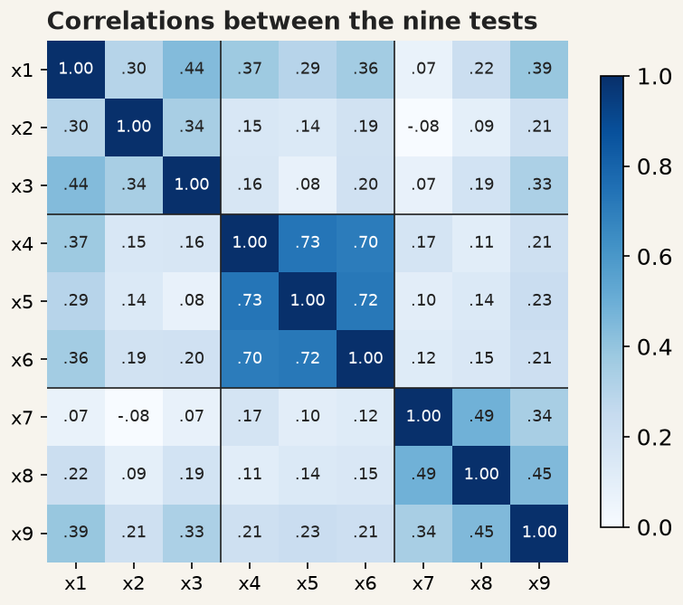
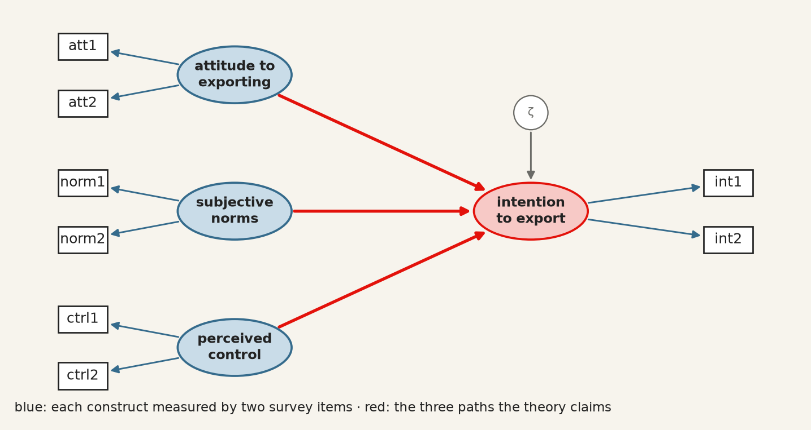
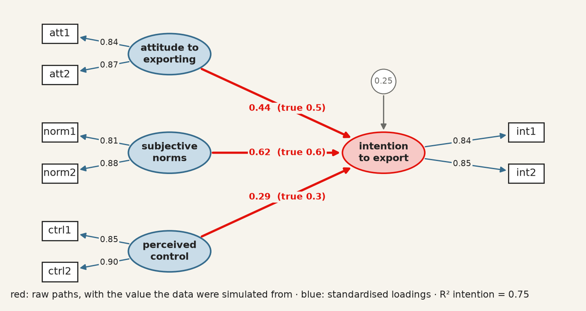
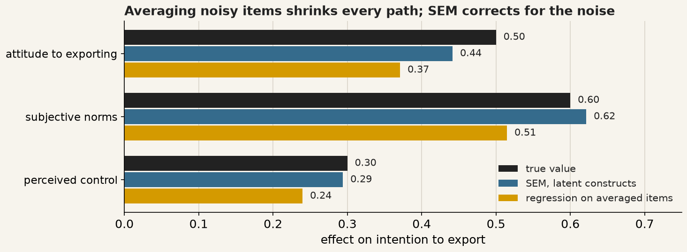

<!-- The deck teaches through three examples first, with no code on screen:
     Holzinger-Swineford (a measurement model), Political Democracy (a
     structural model) and a simulated Theory of Planned Behaviour survey
     (a known truth, to show what SEM gains over averaged items). The code
     comes last, in the in-class part, where every cell is live: it executes
     at render time, so the output on the slides is the output the students'
     own machines produce. Every visible cell is plain Python with packages by
     name, and data that ship inside semopy or are simulated in the cell, so
     a student can copy any one cell into a file and run it.
     The path diagrams and charts are drawn by economist-assets/build_sem_figures.py,
     from the same models fitted on the same data, so every number on a picture
     is the number the matching cell prints. -->
```{python}
#| label: setup
#| echo: false

# Hidden: keep library warnings off the slides, and print tables wide.
import warnings
warnings.filterwarnings("ignore")
import pandas as pd
pd.set_option("display.width", 96)
pd.set_option("display.max_columns", 10)
```

<!-- BEGIN deck-frontmatter · scripts/build_deck_frontmatter.py -->

## Outline · The hour ahead {.center .scrollable}

1. Part 1 · The language of SEM
2. Example 1 · Nine tests, three abilities
3. Example 2 · Does industrialisation bring democracy?
4. Example 3 · Will this firm export?
5. What a good fit does not prove
6. In class · The code behind the three examples

## What session 9 is for {.scrollable}
::::: columns

:::: {.column width="33%"}

### The mathematics

- Distinguish the **measurement** model from the **structural** model
- Read `=~` as "is measured by", and write a model description
- Interpret a **standardised loading**, and say when an indicator is weak
- Report **CFI, TLI and RMSEA**, and say what each would have to be
- Decompose a **mediation** into direct and indirect paths
- Explain why averaging noisy items **shrinks** a path, and why SEM does not

::::

:::: {.column width="33%"}

### The Python

- Look at the correlation matrix with `.corr()` and `plt.imshow` before fitting anything
- Turn a drawing into a model description, fit it with `semopy.Model`, and read `.inspect()`
- Pull fit indices with `semopy.calc_stats` and report them all
- Fit two models with opposite arrows and watch the fit not decide between them
- Simulate survey data from a known model and check that SEM recovers it

::::

:::: {.column width="33%"}

### The international business

- Measure a construct — trust, capability, institutional quality — you cannot observe
- State why good fit is not evidence that the model is correct
- Name the alternative model you rejected, and on what grounds

::::

:::::

## Your Python so far {.scrollable}

Everything you need to type is on one sheet — how to start Python in VS Codium on
your platform, how to make a file and run it, the DataFrame basics, and every name from sessions 1 to 9, each with a line showing it in use.

> **[Python Cheatsheet · Session 09](https://warint.github.io/quantitative-methods/python-cheatsheet-09.pdf)** (PDF) ·
> in the repository at `09-…/PYTHON-CHEATSHEET.pdf`

**One sheet per package, functions explained with pictures:** [pandas](https://warint.github.io/quantitative-methods/python-cheatsheets/pandas.pdf) · [NumPy](https://warint.github.io/quantitative-methods/python-cheatsheets/numpy.pdf) · [matplotlib](https://warint.github.io/quantitative-methods/python-cheatsheets/matplotlib.pdf) · [semopy](https://warint.github.io/quantitative-methods/python-cheatsheets/semopy.pdf) · [statsmodels](https://warint.github.io/quantitative-methods/python-cheatsheets/statsmodels.pdf) · [SciPy](https://warint.github.io/quantitative-methods/python-cheatsheets/scipy.pdf)

::: {.muted}
Print it, or keep it open beside the editor. Nothing on it is examinable; all of it is
assumed.
:::

<!-- END deck-frontmatter -->

## Part 1 · The language of SEM {.center}

## The problem: the thing you care about is not in your data {.scrollable}

*Institutional quality*, *trust between partners*, *absorptive capacity*, *verbal ability*:
each is real, each explains things, and **none of them is a column in a data set**.
What you have instead is a few **indicators**, each a noisy reflection of the thing.

{.big fig-alt="One latent variable, verbal ability, with arrows to three observed test scores, each with its own error."}

::: {.check}
**SEM (structural equation modelling) in one sentence:** the construct is *what the indicators have in common*. Three tests of
verbal ability agree with one another because they all measure verbal ability; the part on which they
disagree is error.
:::

## Five symbols are the whole language {.scrollable}

{fig-alt="The five symbols of a path diagram: rectangle, ellipse, one-headed arrow, two-headed arrow, error circle."}

Every diagram you will ever see in an SEM paper is made of these five. And each drawing has
an exact translation into one line of text, which is what semopy reads:

| You draw | You write | Read it as |
|---|---|---|
| ellipse → rectangles | `visual =~ x1 + x2 + x3` | "visual **is measured by** x1, x2 and x3" |
| ellipse → ellipse | `dem65 ~ dem60` | "dem65 **is regressed on** dem60" |
| two-headed arrow | `y1 ~~ y5` | "y1 **covaries with** y5" |
| error circles | nothing | semopy adds one for every endogenous variable, on its own |

## Five words to name what you draw {.scrollable}

| Term | What it is | On the diagram | In this session's examples |
|---|---|---|---|
| **Observed variable** (indicator) | A column you measured: a survey item, a test score. It is the data the constructs are estimated from | rectangle | the nine test scores `x1` … `x9`; the eleven country scores `x1` … `x3`, `y1` … `y8` |
| **Latent variable** (factor, construct) | A concept no one measures directly, inferred from what its indicators have in common | ellipse | `visual`, `textual`, `speed`; `ind60`, `dem60`, `dem65`; `attitude`, `intention` |
| **Exogenous** / **endogenous** | Exogenous: arrows only leave it, like an independent variable. Endogenous: at least one arrow points *into* it, like a dependent variable | where the arrowheads land | `ind60` is exogenous; `dem60` and `dem65` are endogenous |
| **Path** | A one-headed arrow: a directional effect, read like a regression coefficient. A two-headed arrow is a covariance, with no direction | → and ↔ | `dem65 ~ dem60` is a path; `y1 ~~ y5` is a covariance |
| **Error** (disturbance) | The part of a variable the model does not explain | a small circle with an arrow into the variable | semopy adds one for every endogenous variable, on its own |

::: {.check}
**Endogenous is a fact about the drawing, not about the world.** `dem65` is never measured, yet it is
endogenous, because arrows from `ind60` and `dem60` point into it. And every indicator is endogenous
too: the arrow from its construct points into it, and so does its error.
:::

## Every SEM has two halves {.scrollable}

{.mid fig-alt="A measurement model on each side, shaded blue, and a structural path between the two constructs, shaded red."}

- **Measurement model** (blue): do my indicators measure one thing, and how well does each one do it? Its numbers are **loadings**.
- **Structural model** (red): once measured, does one construct move another? Its numbers are **path coefficients**, read like regression coefficients.

::: {.muted}
The three examples climb this picture: Example 1 is **only** a measurement model; Example 2 adds the
structural half; Example 3 shows, on data where we know the answer, why fitting both halves at once matters.
:::

## What SEM actually fits: the correlations {.scrollable}

A model never sees your rows one by one. It sees the **correlation (covariance) matrix** of your
indicators, and asks: *could my diagram have produced it?*

::: columns
::: {.column width="50%"}
For one indicator $x_j$ of a construct $F$:

$$x_j = \lambda_j F + e_j$$

Standardise everything, and two indicators of the same construct must correlate by

$$\text{corr}(x_i, x_j) = \lambda_i \times \lambda_j$$

because $F$ is the only thing they share.
:::

::: {.column width="50%"}
::: {.step}
**So a diagram is a prediction.** Each arrow you draw, and each one you leave out, implies
a number for every pair of indicators. Fitting chooses the loadings that make those numbers as
close as possible to the real ones.
:::

::: {.check}
**And it can be tested:** nine indicators have 36 correlations. If the model uses fewer
parameters than that, the leftover is a test of whether the diagram is right.
:::
:::
:::

## Example 1 · Nine tests, three abilities {.center}

## The data: 301 children, nine tests {.scrollable}

Holzinger and Swineford (1939) gave nine ability tests to seventh- and eighth-graders in two
schools, Pasteur and Grant-White. The data ship with semopy, so there is nothing to download.

| Column | Test | Meant to measure |
|---|---|---|
| `x1` · `x2` · `x3` | visual perception · cubes · lozenges | **visual** ability |
| `x4` · `x5` · `x6` | paragraph comprehension · sentence completion · word meaning | **textual** ability |
| `x7` · `x8` · `x9` | speeded addition · speeded dot counting · straight vs curved capitals | **speed** |

::: {.step .question}
**The question:** do nine scores really reduce to **three abilities**, or to one general
"cleverness", or to something else? This is a **confirmatory factor analysis** (CFA): a measurement
model with no structural arrows at all.
:::

## Look at the correlations before you model anything {.scrollable}

::: columns
::: {.column width="52%"}
{.big fig-alt="Heat map of the nine tests' correlations, with three darker blocks on the diagonal."}
:::

::: {.column width="48%"}
::: {.check}
**Reading it:** three dark squares on the diagonal. x4–x6 correlate at about 0.7 with each other and
0.1–0.4 with everything else; x1–x3 and x7–x9 form weaker blocks.
:::

::: {.step}
That is three groups, *before* any model. If you cannot see your constructs in this picture, no fit
index will find them for you.
:::
:::
:::

## The drawing, and its translation {.scrollable}

::: columns
::: {.column width="62%"}
{.big fig-alt="The three-factor model: visual, textual and speed, each with three tests, the three abilities linked by dashed two-headed arrows."}
:::

::: {.column width="38%"}
The whole model, as semopy reads it:

```
visual  =~ x1 + x2 + x3
textual =~ x4 + x5 + x6
speed   =~ x7 + x8 + x9
```

**What semopy adds without being asked:**

1. **One loading per construct fixed to 1** (x1, x4, x7): a construct has no units of its own, so it borrows its first indicator's.
2. **An error for every test**: the circles.
3. **The three abilities may correlate**: the dashed arrows.
:::
:::

::: {.step}
**Every arrow is a claim, and so is every missing arrow.** No arrow from *visual* to x9 says "the
capitals test has nothing to do with visual ability". The data will get a say on that.
:::

## The results, on the drawing {.scrollable}

{.big fig-alt="The three-factor diagram with standardised loadings on the arrows, factor correlations on the dashed arrows and unexplained shares in the error circles."}

::: {.check}
**Check the rule from Part 1:** x4 and x5 both measure *textual*, so the model says
corr(x4, x5) = 0.85 × 0.86 = **0.73**. The correlation in the heat map is **0.73**.
:::

## Reading the loadings {.scrollable}

A **standardised loading** is the **correlation between the test and its ability**; its square is the
**share of the test the ability explains**.

| Ability | Loadings | Reading |
|---|---|---|
| **textual** | 0.84 – 0.86 | measured well: about 72% of each test is textual ability |
| **visual** | 0.77 · **0.42** · 0.58 | cubes, x2, is the weak one: $0.42^2 = 0.18$, so 82% of a child's cubes score is something else |
| **speed** | 0.57 – 0.72 | adequate; addition, x7, is the weakest |

::: {.muted}
Rule of thumb: above 0.7 is strong, below 0.4 is a candidate to drop. The share left unexplained
is the number in each error circle: 1 − loading².
:::

## Reading the factor correlations: are the abilities really different? {.scrollable}

The dashed arrows are **correlations between the abilities themselves**, cleaned of measurement error, so
they are larger than the correlations between averaged test scores would be.

| Pair | Correlation | 95% interval | Shared variance | HTMT | Reading |
|---|---|---|---|---|---|
| visual ↔ textual | 0.46 | 0.28 – 0.59 | 21% | 0.42 | related, clearly distinct |
| visual ↔ speed | 0.47 | 0.24 – 0.67 | 22% | 0.42 | related, clearly distinct; the widest interval |
| textual ↔ speed | 0.28 | 0.12 – 0.43 | 8% | 0.29 | the most distinct pair |

::: columns
::: {.column width="50%"}
::: {.check}
**Rules of thumb (discriminant validity):**

1. **Below about 0.85** (0.80 for the strict): distinct constructs. Above it, you may be measuring one thing twice.
2. **The 95% interval must exclude 1.** The p-value in the output tests "different from **0**", which is not the question.
3. **HTMT below 0.85** (0.90 lenient). The *heterotrait–monotrait ratio*: the average correlation between the two constructs' items, divided by the average correlation within each. The newer standard many journals now ask for.
4. **Fornell–Larcker:** each construct's AVE, its *average variance extracted* (the mean squared loading of its indicators), must exceed its squared correlation with every other.
:::
:::

::: {.column width="50%"}
| Ability | AVE = mean loading² | Largest r² | Fornell–Larcker |
|---|---|---|---|
| visual | **0.37** | 0.22 | passes |
| textual | **0.72** | 0.21 | passes |
| speed | **0.43** | 0.22 | passes |

::: {.warn}
**But AVE should be at least 0.5** (convergent validity). Visual and speed fall short: on average
their tests are more noise than ability. The cubes problem, seen from the construct's side.
:::
:::
:::

::: {.muted}
Also check the **sign** against theory, and treat a correlation **above 1** as an inadmissible solution
(a Heywood case), not as "very similar". Interval: 500 bootstrap resamples of the 301 children.
:::

## Does the model fit? One test, three indices {.scrollable}

| | Kind | What it measures | Judged by | Here | Verdict |
|---|---|---|---|---|---|
| $\chi^2$ | **a test** | $H_0$: the model reproduces the covariances **exactly** | p-value: reject if p < 0.05 | 85.3 on 24 df, p < 0.001 | exact fit rejected |
| **CFI** · comparative fit index | an index | share of the **baseline's** misfit the model removes | convention: > 0.95 | 0.931 | close, not there |
| **TLI** · Tucker–Lewis index | an index | the same comparison, **per degree of freedom** | convention: > 0.95 | 0.896 | short |
| **RMSEA** · root mean square error of approximation | an index | misfit **per degree of freedom**, no baseline | convention: < 0.06 good, > 0.10 poor | 0.092 | mediocre |

::: {.check}
**Only χ² is a test.** It has a null hypothesis and a p-value. CFI, TLI and RMSEA have neither: they are
**distances**, measured from different starting points, and the thresholds are conventions from a simulation
study (Hu and Bentler, 1999), not significance levels. "TLI is significant" means nothing.
:::

::: {.muted}
**The baseline** is the worst sensible model: nine tests, **no correlation between any of them**. Here it scores
χ² = 918.9 on 36 df. CFI and TLI ask how far your model moves from it toward perfect fit.
:::

::: {.warn}
**Report all four, and say which convention you applied.** Quoting only the one that passes loses marks.
:::

## The three indices, by hand {.scrollable}

A correct model has $E[\chi^2] = \mathrm{df}$, so the **excess** $\chi^2 - \mathrm{df}$, or the ratio $\chi^2 / \mathrm{df}$ against 1, is the misfit.
Subscript $m$ is your model (85.3 on 24 df), $0$ the baseline (918.9 on 36 df), $n = 301$.

| | Formula | Here | Reading |
|---|---|---|---|
| **CFI** | $1 - \dfrac{\chi^2_m - \mathrm{df}_m}{\chi^2_0 - \mathrm{df}_0}$ | $1 - \dfrac{61.3}{882.9} = 0.931$ | the model removes 93% of the baseline's excess misfit |
| **TLI** | $\dfrac{\chi^2_0/\mathrm{df}_0 \,-\, \chi^2_m/\mathrm{df}_m}{\chi^2_0/\mathrm{df}_0 \,-\, 1}$ | $\dfrac{25.52 - 3.55}{25.52 - 1} = 0.896$ | the same, in misfit **per df**: a parameter that does not earn the df it costs **lowers** TLI |
| **RMSEA** | $\sqrt{\dfrac{\max(\chi^2_m - \mathrm{df}_m,\, 0)}{\mathrm{df}_m\,(n-1)}}$ | $\sqrt{\dfrac{61.3}{24 \times 300}} = 0.092$ | typical misfit per df and per observation; 0 is perfect |

::: columns
::: {.column width="50%"}
::: {.check}
**Why TLI is below CFI:** TLI divides by df first, so it charges for every parameter; CFI does not.
That is why TLI is the one to watch when a model gains fit by adding arrows.
:::
:::

::: {.column width="50%"}
::: {.step}
**TLI is "non-normed":** it can exceed 1 (when $\chi^2_m < \mathrm{df}_m$, common in small samples) or fall below 0.
CFI is clipped to $[0, 1]$. A TLI of 1.02 is not "better than perfect"; it is noise.
:::
:::
:::

## Where does the model miss? {.scrollable}

{fig-alt="Three heat maps: the observed correlations, the correlations the model implies, and their difference, which is largest between x9 and the visual tests."}

::: columns
::: {.column width="50%"}
::: {.check}
**Reading it:** the model reproduces the textual block almost perfectly (differences of 0.00). The biggest
misses are in the last row: **x9 correlates with x1 and x3 by 0.15 more than the model allows**.
:::
:::

::: {.column width="50%"}
::: {.step}
**Is there a reason?** x9 asks children to tell straight from curved capital letters, fast. That is a
*speed* task that also needs *visual* discrimination, so an arrow from visual to x9 can be argued
from what the test is, not just from the numbers.
:::
:::
:::

## Three drawings, one data set {.scrollable}

::: columns
::: {.column width="50%"}
{.big fig-alt="The one-factor model and the three-factor model side by side, with their fit indices."}
:::

::: {.column width="50%"}
| Model | χ² (df) | CFI | TLI | RMSEA |
|---|---|---|---|---|
| one general ability | 312.3 (27) | 0.677 | 0.569 | 0.188 |
| three abilities | 85.3 (24) | 0.931 | 0.896 | 0.092 |
| three + x9 on visual | 52.4 (23) | **0.967** | 0.948 | 0.065 |

::: {.check}
**One general ability** is clearly rejected: the tests do not all measure one thing.
**Three abilities** is far better. **x9 on visual too** passes CFI and nearly RMSEA.
:::

::: {.warn}
The third model was chosen *after looking at the misfit*. Report it as such, and confirm it on new
data (the other school, next year's class) before you believe it.
:::
:::
:::

## Example 1 · Plain summary {.scrollable}

- The nine tests **do** sort into three abilities: the one-factor story is rejected, the three-factor story fits reasonably.
- **Textual** ability is measured very well; **visual** ability has a weak indicator (cubes, 0.42).
- The three abilities are **positively related** (0.28–0.47), but distinct: children good at one tend to be good at the others, not identical in all three.
- The fit is **not perfect**, and the main miss (x9) has a reason that can be argued from the test itself. Any fix made after looking is **exploratory**.

::: {.step}
**What this example teaches:** a measurement model answers *"do my indicators measure what I say they
measure, and how well?"*. That question comes **before** any arrow between constructs.
:::

## Example 2 · Does industrialisation bring democracy? {.center}

## The data: 75 countries, 1960 and 1965 {.scrollable}

Bollen's (1989) classic, also bundled with semopy. Neither industrialisation nor democracy is a column;
both are measured by indicators.

| Construct | Indicators |
|---|---|
| **ind60** · industrialisation, 1960 | `x1` GNP (gross national product) per capita · `x2` energy per capita · `x3` share of labour in industry |
| **dem60** · democracy, 1960 | `y1` press freedom · `y2` freedom of opposition · `y3` fair elections · `y4` effective legislature |
| **dem65** · democracy, 1965 | `y5`–`y8`: **the same four questions, five years later** |

::: {.step .question}
**The question:** does a more industrialised country become more democratic, and does it do so
directly, or because it was already more democratic?
:::

## The theory, then the drawing {.scrollable}

{.big fig-alt="Industrialisation in 1960 measured by x1 to x3, with arrows to democracy in 1960 and 1965, each measured by four indicators; the same-question indicators linked by dashed arrows."}

::: {.step}
**Three structural claims (red):** industrialisation raises democracy; democracy persists; and
industrialisation may also act on 1965 directly. **One claim from the design (gold):** y1 and y5 are the
same question rated by the same experts, so their errors may move together. That is decided
*before* fitting, from how the data were collected.
:::

## The drawing, as text: all three operators {.scrollable}

::: columns
::: {.column width="45%"}
```
# measurement: each construct and its indicators
ind60 =~ x1 + x2 + x3
dem60 =~ y1 + y2 + y3 + y4
dem65 =~ y5 + y6 + y7 + y8
# structural: arrows between constructs
dem60 ~ ind60
dem65 ~ ind60 + dem60
# the same question, five years apart
y1 ~~ y5
y2 ~~ y6
y3 ~~ y7
y4 ~~ y8
```
:::

::: {.column width="55%"}
| Operator | Says | Lines here |
|---|---|---|
| `=~` | is **measured by** | 3: the blue arrows |
| `~` | is **explained by** | 2: the red arrows |
| `~~` | **covaries with** | 4: the gold arrows |

::: {.check}
**Exogenous or endogenous?** `ind60` has no arrow in: exogenous. `dem60` and `dem65` both receive
arrows: endogenous, so each gets a disturbance ζ.
:::
:::
:::

## The results, on the drawing {.scrollable}

{.big fig-alt="The democracy model with standardised loadings, path coefficients, and the unexplained share of each democracy construct."}

::: {.check}
**Measurement:** all eleven loadings are above 0.69: the indicators measure their constructs well.
**Structure:** `dem60 ← ind60` at **0.45**: a country one standard deviation more industrialised in 1960
was 0.45 standard deviations more democratic that year. `dem65 ← dem60` at **0.87**: democracy is very
persistent. `dem65 ← ind60` at **0.17** (p = 0.015): a smaller direct push, on top of persistence.
:::

## How much is explained: R² {.scrollable}

The number in each ζ circle is the share **left unexplained**, so R² = 1 − that number.

| Construct | Explained by | R² | Reading |
|---|---|---|---|
| **dem60** | ind60 | **0.20** | industrialisation explains a fifth of democracy in 1960 |
| **dem65** | ind60 and dem60 | **0.91** | democracy five years later is almost entirely predictable |

::: {.muted}
A high R² for dem65 is mostly persistence: the best predictor of a country's democracy is its
democracy five years earlier. That is a finding, not a flaw.
:::

## Direct and indirect effects {.scrollable}

{fig-alt="Two routes from ind60 to dem65: the direct path c, and the indirect route through dem60, a times b."}

::: {.check}
**Reading it:** an indirect effect is the **product of the paths along the road**. Two-thirds of what
1960 industrialisation does for 1965 democracy (0.39 of 0.56) goes *through* 1960 democracy. This is a
**mediation**: dem60 carries the effect.
:::

## Justify every extra arrow {.scrollable}

| Model | χ² (df) | p | CFI | TLI | RMSEA | ind60 → dem60 | dem60 → dem65 | ind60 → dem65 |
|---|---|---|---|---|---|---|---|---|
| without the 4 gold arrows | 72.5 (41) | 0.002 | 0.953 | 0.938 | 0.102 | 0.45 | 0.91 | 0.15 |
| with them | 50.8 (37) | 0.064 | 0.980 | 0.970 | 0.071 | 0.45 | 0.87 | 0.17 |

::: columns
::: {.column width="50%"}
::: {.check}
**With them:** χ² no longer rejects, CFI and TLI pass, RMSEA is acceptable. The structural paths
hardly move: the conclusions do not depend on them.
:::
:::

::: {.column width="50%"}
::: {.warn}
**Legitimate here, because the design says so:** same question, same raters. Adding `~~` lines
*because they raise the CFI* is fitting noise, and it loses marks.
:::
:::
:::

## Turn an arrow around: the fit does not change {.scrollable}

{.short fig-alt="Industry causes democracy, and democracy causes industry: two diagrams with identical fit."}

::: {.warn}
**Identical, to the last decimal.** "Industry builds democracy" and "democracy builds industry" imply the
same correlations, so no fit index can choose. **The direction of an arrow is your assumption**; it comes
from theory, timing (a 1960 cause cannot follow a 1965 effect) or design, never from the fit.
:::

## Example 2 · Plain summary {.scrollable}

- The model **fits well** once the same-question covariances, justified by the design, are in.
- The indicators **measure their constructs well** (all loadings above 0.69).
- Industrialisation in 1960 goes with **more democracy**, in 1960 (0.45) and, mostly **through** that, in 1965 (total 0.56, of which 0.39 indirect).
- Democracy is **highly persistent** (0.87).
- The direction of the arrows comes from **timing and theory**, not from the fit: the reversed model fits exactly as well.

::: {.step}
**What this example teaches:** once the constructs are measured, arrows between them are read like
regression coefficients, with two new tools, **indirect effects** and **R² for a construct**.
:::

## Example 3 · Will this firm export? {.center}

## A theory from management research {.scrollable}

The **Theory of Planned Behaviour** (Ajzen, 1991) says a decision-maker's **intention** to act comes from
three things. Applied to exporting:

| Construct | Means | Survey items (1–7 scale) |
|---|---|---|
| **attitude** | the manager thinks exporting is good for the firm | `att1` "Exporting would be profitable" · `att2` "…would be good for us" |
| **norms** | people who matter expect it | `norm1` "Our board expects us to export" · `norm2` "Our bank / peers do" |
| **control** | the firm feels able to do it | `ctrl1` "We have the resources" · `ctrl2` "We know how" |
| **intention** | the firm plans to export | `int1` "We plan to export within two years" · `int2` "…are preparing to" |

::: {.step .question}
**The question:** which of the three drives the intention to export, and by how much? Four constructs,
none observed, two items each: 400 managers of SMEs (small and medium-sized enterprises).
:::

## The data are simulated, so we know the answer {.scrollable}

::: columns
::: {.column width="50%"}
We **built** the data from a known model:

$$\text{intention} = 0.5\,\text{attitude} + 0.6\,\text{norms} + 0.3\,\text{control} + \text{noise}$$

and each survey item = its construct + its own noise.
:::

::: {.column width="50%"}
::: {.check}
**Why simulate?** On real data you never know whether a method got the answer right. Here we do, so we
can watch two methods side by side and see which one finds 0.5, 0.6 and 0.3.
:::
:::
:::

::: {.muted}
The same trick as session 10: before you trust a method on data where the truth is unknown, check it
on data where the truth is known.
:::

## The drawing {.scrollable}

{.big fig-alt="Attitude, norms and control, each measured by two items, with red arrows to intention to export, measured by two items."}

```
attitude  =~ att1 + att2
norms     =~ norm1 + norm2
control   =~ ctrl1 + ctrl2
intention =~ int1 + int2
intention ~ attitude + norms + control
```

## The results, against the truth {.scrollable}

{.big fig-alt="The fitted model: paths 0.44, 0.62 and 0.29 against true values 0.5, 0.6 and 0.3; loadings 0.81 to 0.90; R-squared 0.75."}

::: {.check}
**SEM finds the truth, up to sampling noise:** 0.44, 0.62 and 0.29 for 0.5, 0.6 and 0.3. Every
loading is above 0.8. The fit is excellent (χ² = 18.2 on 14 df, p = 0.20; CFI 0.997; RMSEA 0.027),
as it should be: the model **is** the one that made the data.
:::

## Why not just average the items and run a regression? {.scrollable}

{fig-alt="Bar chart: true paths, SEM estimates close to them, and regression on averaged items about 15 to 20 percent smaller for all three."}

::: columns
::: {.column width="50%"}
::: {.check}
**The regression on averaged items gets every path too small**, by 15–25%: 0.37, 0.51, 0.24.
An average of two noisy items is still noisy, and **noise in a regressor shrinks its coefficient
toward zero** (attenuation bias, session 6).
:::
:::

::: {.column width="50%"}
::: {.step}
**SEM estimates the path between the constructs themselves**, after separating each item into
construct and error. That is the payoff from Part 1's "two halves": the measurement model cleans
the structural model.
:::
:::
:::

## Example 3 · Plain summary {.scrollable}

- All three constructs **drive the intention to export**; subjective norms most (0.62), perceived control least (0.29).
- Together they explain **75%** of intention (R² = 0.75).
- **SEM recovers the true paths**; averaging the items and running a regression **understates every one of them**.
- Perfect fit here is no surprise: we simulated from this model. On real survey data, expect worse, and look for the reasons as in Example 1.

::: {.step}
**What this example teaches:** measurement error is not a nuisance to average away. Model it, and the
structural paths come out right.
:::

## Why SEM, and not a regression? {.scrollable}

A regression (session 3) needs **one column per variable** and **one outcome per model**. SEM drops both
requirements. What that buys, shown in the three examples:

| | Linear or logistic regression | SEM | Seen in |
|---|---|---|---|
| **Measurement error** | assumes every regressor is measured without error: noisy ones shrink their coefficients toward zero | separates each item into construct + error, and estimates the path between the constructs | Ex. 3: 0.37 instead of 0.5; SEM 0.44 |
| **Several items per concept** | one column, so you average or sum the items: equal weights, and no check that they measure one thing | one **loading per item**, and a test of whether the items belong together | Ex. 1: cubes loads 0.42 |
| **Chains of effects** | one equation per model; a mediation takes several regressions and multiplying by hand | the whole system in **one fit**: direct, indirect and total effects together | Ex. 2: 0.17 direct, 0.39 indirect |
| **Testing the model** | always "fits": R² describes, it does not test the structure | an over-identified model is a **prediction** of every correlation, with χ², CFI, TLI, RMSEA | Ex. 1: the x9 misfit |
| **Correlated errors** | assumed away | written down when the design predicts them: `y1 ~~ y5` | Ex. 2: same question twice |
| **Comparing groups** | the same scale is assumed to mean the same thing in every country | **measurement invariance** can be tested: loadings constrained equal across groups | What SEM does not fix |

::: {.check}
**Underneath all six:** a regression treats the column as the concept. SEM treats the column as
*evidence about* the concept, and says how good that evidence is.
:::

## And with a yes/no outcome? When is a regression enough? {.scrollable}

::: columns
::: {.column width="50%"}
### A binary outcome

*Did the firm export, yes or no?* Logistic regression (session 4) models it, but **with observed
predictors only**: averaging the attitude items before a logit carries the same attenuation as in
Example 3.

SEM handles a binary or ordinal outcome, or ordinal survey items, through a **probit** link with a
categorical estimator (WLSMV, weighted least squares with mean- and variance-adjusted statistics, in R's lavaan or in Mplus), so the predictors can stay latent.

::: {.muted}
Logit coefficients are on a log-odds scale, probit ones on a latent-normal scale: compare signs and
significance across the two, not raw sizes.
:::
:::

::: {.column width="50%"}
### When a regression is enough

- **Every variable is a single, well-measured column**: exports in dollars, GDP, distance. With no
  latent constructs, an SEM of observed variables gives the regression's coefficients back.
- **One outcome, no mediators** to decompose.
- **Prediction is the goal** (session 8): SEM is built to explain a structure, not to minimise out-of-sample error.
- **The sample is small**: SEM wants 200 or more; a regression on 75 rows is honest about what it can do.

::: {.warn}
**SEM is not a better regression.** It is a regression that takes measurement seriously; when
nothing is measured with error, the extra machinery buys nothing.
:::
:::
:::

## What a good fit does not prove {.center}

## What SEM does not fix {.scrollable}

- **Confounding.** A cause left out of the diagram biases the paths exactly as it biases a regression.
  Latent variables absorb *measurement error*, not omitted causes. That is sessions 10 and 11.
- **Direction.** The reversed model in Example 2 fits identically. With everything measured on the same day,
  an arrow has a direction only because you drew one.
- **Small samples.** With 75 countries the χ² test has little power: "good fit" in a small sample is weak
  evidence. Aim for 200 or more, and 5–10 observations per parameter.
- **Comparisons across countries.** Comparing *trust* between Canada and Japan assumes the questions mean the
  same thing in both, **measurement invariance**, which has to be tested, not assumed.
- **Non-normal data.** The default estimator assumes multivariate normality; skewed survey items make χ² too
  large and p-values too small. Say which estimator you used.

::: {.warn}
**Good fit means the diagram is *consistent* with the data. It does not mean the diagram is right.**
:::

## Seven steps, the same in all three examples {.scrollable}

{fig-alt="Seven steps from theory to judging the fit, with an arrow back from the fit to the theory."}

| Step | What you do | In Python |
|---|---|---|
| 1–3 | argue which indicators measure which construct, draw it, write one line per ellipse | a string with `=~`, `~`, `~~` |
| 4 | look at the correlations: can you see your groups? | `data[cols].corr()`, `plt.imshow` |
| 5 | fit | `model = semopy.Model(description)` · `model.fit(data)` |
| 6 | read loadings and paths, **standardised** | `model.inspect(std_est=True)` |
| 7 | judge the fit, all four indices | `semopy.calc_stats(model)` |

## In class · The code behind the three examples {.center}

## How this part works {.scrollable}

::: columns
::: {.column width="50%"}
Every cell that follows **runs on its own**: copy it into a new file in VS Codium, run it, and you
should see exactly the output on the slide. Three packages, by name: `semopy`, `pandas`,
`matplotlib` (and `statsmodels` once, in Example 3). The data ship with semopy or are simulated in
the cell: nothing to download.
:::

::: {.column width="50%"}
::: {.step}
**For each example:**

1. run the cells and check you get the numbers from the lecture;
2. do the **Your turn** task under the last cell, changing one thing at a time.
:::
:::
:::

## Reading a model description: `=~`, `~`, `~~` {.scrollable}

A model description is a **plain text string**, one relation per line. semopy (like R's lavaan) reads three operators:

| Operator | Read it as | On the diagram | Example | Says |
|---|---|---|---|---|
| **`=~`** | "**is measured by**" | ellipse → rectangles | `visual =~ x1 + x2 + x3` | the construct *visual* exists, and x1, x2, x3 are its indicators. **Left: a latent; right: observed columns** |
| **`~`** | "**is regressed on**", "depends on" | arrow **into** the left side | `dem65 ~ ind60 + dem60` | dem65 is explained by ind60 and dem60: a regression, like `smf.ols`, but between constructs |
| **`~~`** | "**covaries with**" | two-headed arrow | `y1 ~~ y5` | the errors of y1 and y5 may move together. With the same name twice, `y1 ~~ y1`, it is a **variance** |

::: columns
::: {.column width="50%"}
**The small print of the syntax:**

- `+` lists several variables on the right of one operator.
- `1*x2` **fixes** a parameter to 1: here x2, not x1, sets the construct's scale.
- `#` starts a comment, as in Python.
- Names on the right of `=~` must be **columns** of your DataFrame; names on the left must **not** be.
:::

::: {.column width="50%"}
::: {.warn}
**The arrow points the other way from the operator.** `visual =~ x1` is drawn visual → x1 (the ability causes
the score). `dem65 ~ dem60` is drawn dem60 → dem65 (the left side receives the arrow). Read `=~` from left to
right, `~` from right to left.
:::
:::
:::

## Reading `.inspect()`: the same operators, written back {.scrollable}

`model.inspect(std_est=True)` returns one row per parameter, with three columns naming it: `lval`, `op`, `rval`.
semopy writes **everything as `~` or `~~`**, so a loading comes back turned around:

| You wrote | `.inspect()` shows | What the row is |
|---|---|---|
| `visual =~ x2` | `x2  ~  visual` | a **loading**: "x2 depends on visual" |
| `dem60 ~ ind60` | `dem60  ~  ind60` | a **structural path** |
| `y1 ~~ y5` | `y1  ~~  y5` | a **covariance** between two errors |
| (added for you) | `x2  ~~  x2` | x2's **error variance**: the share left unexplained, in `Est. Std` |
| (added for you) | `visual  ~~  textual` | the **factor covariance**: in `Est. Std`, the factor correlation |

::: columns
::: {.column width="50%"}
**So the filters in the cells mean:**

- `est[est["op"] == "~"]`: loadings **and** paths
- `... & est["lval"].isin(["dem60", "dem65"])`: only the paths, since a loading's left side is an indicator
- `est[(est["op"] == "~~") & (est["lval"] != est["rval"])]`: covariances, not variances
:::

::: {.column width="50%"}
**And the columns:**

- `Estimate`: in the indicator's units; `1.0` with `-` as standard error = fixed, not estimated
- `Est. Std`: standardised, **the one to read**
- `p-value`: tests "different from **0**"

Plain Python around it: `"""..."""` is a string over several lines; `"\n"` is a line break inside one.
:::
:::

## Example 1 in Python · Load and look {.scrollable}

```{python}
#| echo: true

# Example 1 · Load the data
import semopy
from semopy.examples import holzinger39

data = holzinger39.get_data()
print(data.shape)
print(data[["school", "x1", "x2", "x3", "x4", "x5", "x6", "x7", "x8", "x9"]].head().round(2))
```

## Example 1 in Python · The correlation picture {.scrollable}

```{python}
#| echo: true
#| output-location: column
#| fig-width: 5.6
#| fig-height: 4.8

# Example 1 · A picture of the correlation matrix
import matplotlib.pyplot as plt
from semopy.examples import holzinger39

data = holzinger39.get_data()
tests = ["x1", "x2", "x3", "x4", "x5",
         "x6", "x7", "x8", "x9"]
corr = data[tests].corr()

plt.imshow(corr, cmap="Blues", vmin=0, vmax=1)
plt.colorbar()
plt.xticks(range(9), tests)
plt.yticks(range(9), tests)
for i in range(9):
    for j in range(9):
        plt.text(j, i, round(corr.iloc[i, j], 2),
                 ha="center", va="center", fontsize=7)
plt.title("Correlations between the nine tests")
plt.show()
```

## Example 1 in Python · Fit and inspect {.scrollable}

```{python}
#| echo: true

# Example 1 · Model(), then .fit(), then .inspect()
import semopy
from semopy.examples import holzinger39

data = holzinger39.get_data()
model = semopy.Model("""
visual  =~ x1 + x2 + x3
textual =~ x4 + x5 + x6
speed   =~ x7 + x8 + x9
""")
model.fit(data)
# std_est=True adds the standardised column, Est. Std
estimates = model.inspect(std_est=True)
print(estimates)
```

| Column | Means |
|---|---|
| `lval op rval` | the parameter. semopy writes a loading as `x2 ~ visual`: "x2 depends on visual" |
| `Estimate` | in the indicator's own units; `1.0` and a `-` standard error = fixed, not estimated |
| `Est. Std` | **standardised**: comparable across indicators. This is the column you read |
| `p-value` | is the estimate different from zero? (`0.0` means below 0.0000005) |

## Example 1 in Python · The loadings {.scrollable}

```{python}
#| echo: true
#| output-location: column
#| fig-width: 5.4
#| fig-height: 4.2

# Example 1 · The loadings are the rows with op "~"
import matplotlib.pyplot as plt
import semopy
from semopy.examples import holzinger39

data = holzinger39.get_data()
model = semopy.Model("""
visual  =~ x1 + x2 + x3
textual =~ x4 + x5 + x6
speed   =~ x7 + x8 + x9
""")
model.fit(data)
estimates = model.inspect(std_est=True)

loadings = estimates[estimates["op"] == "~"]
print(loadings[["lval", "rval", "Est. Std"]].round(2))

plt.barh(loadings["lval"], loadings["Est. Std"])
plt.axvline(0.7, color="grey", linestyle="--")
plt.gca().invert_yaxis()
plt.xlabel("standardised loading")
plt.show()
```

## Example 1 in Python · Are the abilities distinct? {.scrollable}

```{python}
#| echo: true

# Example 1 · AVE, and a bootstrap interval for each factor correlation
import numpy as np
import pandas as pd
import semopy
from semopy.examples import holzinger39

data = holzinger39.get_data()
description = """
visual  =~ x1 + x2 + x3
textual =~ x4 + x5 + x6
speed   =~ x7 + x8 + x9
"""
abilities = ["visual", "textual", "speed"]

def factor_correlations(d):
    model = semopy.Model(description)
    model.fit(d)
    est = model.inspect(std_est=True)
    pairs = est[(est["op"] == "~~") & (est["lval"] != est["rval"])
                & est["lval"].isin(abilities) & est["rval"].isin(abilities)]
    return dict(zip(pairs["lval"] + " ~~ " + pairs["rval"], pairs["Est. Std"])), est

corr, est = factor_correlations(data)

# AVE: the mean squared standardised loading of each ability
loadings = est[est["op"] == "~"]
print((loadings["Est. Std"] ** 2).groupby(loadings["rval"]).mean().round(2))

# Bootstrap: resample the children, refit, keep the correlations
rng = np.random.default_rng(9)
boot = pd.DataFrame([factor_correlations(data.sample(len(data), replace=True,
                                                     random_state=rng))[0]
                     for _ in range(500)])
print(pd.DataFrame({"r": corr, "lower": boot.quantile(0.025),
                    "upper": boot.quantile(0.975)}).round(2))
```

::: {.step}
**Your turn.** Add `+ x4` to the *visual* line, so that paragraph comprehension measures both. What happens
to the visual ↔ textual correlation, and why?
:::

## Example 1 in Python · Fit, and three drawings compared {.scrollable}

```{python}
#| echo: true

# Example 1 · Same data, three different drawings, every fit index
import semopy
from semopy.examples import holzinger39

data = holzinger39.get_data()
models = {
    "one factor":     "ability =~ x1 + x2 + x3 + x4 + x5 + x6 + x7 + x8 + x9",
    "three factors":  "visual =~ x1 + x2 + x3 \n textual =~ x4 + x5 + x6 \n speed =~ x7 + x8 + x9",
    "three + x9 vis": "visual =~ x1 + x2 + x3 + x9 \n textual =~ x4 + x5 + x6 \n speed =~ x7 + x8 + x9",
}
for name, description in models.items():
    model = semopy.Model(description)
    model.fit(data)
    fit = semopy.calc_stats(model)
    print(f"{name:15} chi2 = {fit['chi2'].iloc[0]:6.1f}  df = {fit['DoF'].iloc[0]:.0f}"
          f"  CFI = {fit['CFI'].iloc[0]:.3f}  TLI = {fit['TLI'].iloc[0]:.3f}"
          f"  RMSEA = {fit['RMSEA'].iloc[0]:.3f}")
```

::: {.step}
**Your turn.** (1) Fit the three-factor model on **one school only**:
`data[data["school"] == "Pasteur"]`, then Grant-White. Does x9 still misfit in both?
(2) Drop x2, the weak cubes test, from *visual*. What happens to the CFI, and to the other two visual loadings?
:::

## Example 2 in Python · Load, fit, read the paths {.scrollable}

```{python}
#| echo: true

# Example 2 · =~ measures, ~ explains, ~~ covaries
import semopy
from semopy.examples import political_democracy

countries = political_democracy.get_data()
print(countries.shape)

description = """
# measurement: each construct and its indicators
ind60 =~ x1 + x2 + x3
dem60 =~ y1 + y2 + y3 + y4
dem65 =~ y5 + y6 + y7 + y8
# structural: arrows between constructs
dem60 ~ ind60
dem65 ~ ind60 + dem60
# the same question, five years apart
y1 ~~ y5
y2 ~~ y6
y3 ~~ y7
y4 ~~ y8
"""
model = semopy.Model(description)
model.fit(countries)
estimates = model.inspect(std_est=True)

# The structural paths: the rows whose left side is a construct
paths = estimates[(estimates["op"] == "~") & estimates["lval"].isin(["dem60", "dem65"])]
print(paths[["lval", "op", "rval", "Estimate", "Est. Std", "p-value"]].round(3))
```

## Example 2 in Python · Direct and indirect effects {.scrollable}

```{python}
#| echo: true

# Example 2 · An indirect effect is the product of the paths along the road
import semopy
from semopy.examples import political_democracy

countries = political_democracy.get_data()
model = semopy.Model("""
ind60 =~ x1 + x2 + x3
dem60 =~ y1 + y2 + y3 + y4
dem65 =~ y5 + y6 + y7 + y8
dem60 ~ ind60
dem65 ~ ind60 + dem60
y1 ~~ y5
y2 ~~ y6
y3 ~~ y7
y4 ~~ y8
""")
model.fit(countries)
est = model.inspect(std_est=True)

a = est.loc[(est["lval"] == "dem60") & (est["rval"] == "ind60"), "Est. Std"].iloc[0]
b = est.loc[(est["lval"] == "dem65") & (est["rval"] == "dem60"), "Est. Std"].iloc[0]
c = est.loc[(est["lval"] == "dem65") & (est["rval"] == "ind60"), "Est. Std"].iloc[0]
print(f"direct    c     = {c:.2f}")
print(f"indirect  a * b = {a:.2f} * {b:.2f} = {a * b:.2f}")
print(f"total     c + a * b = {c + a * b:.2f}")
```

::: {.muted}
`est.loc[condition, "Est. Std"]` picks one number out of the table: the row where the left side is
dem60 and the right side ind60. Standardised paths multiply; raw ones would mix units.
:::

## Example 2 in Python · With and without the extra arrows {.scrollable}

```{python}
#| echo: true

# Example 2 · The model with and without the four same-question covariances
import semopy
from semopy.examples import political_democracy

countries = political_democracy.get_data()
base = """
ind60 =~ x1 + x2 + x3
dem60 =~ y1 + y2 + y3 + y4
dem65 =~ y5 + y6 + y7 + y8
dem60 ~ ind60
dem65 ~ ind60 + dem60
"""
same_question = "y1 ~~ y5 \n y2 ~~ y6 \n y3 ~~ y7 \n y4 ~~ y8"

for name, description in {"without": base, "with": base + same_question}.items():
    model = semopy.Model(description)
    model.fit(countries)
    fit = semopy.calc_stats(model)
    print(f"{name:8} chi2 = {fit['chi2'].iloc[0]:5.1f}  df = {fit['DoF'].iloc[0]:.0f}"
          f"  p = {fit['chi2 p-value'].iloc[0]:.3f}  CFI = {fit['CFI'].iloc[0]:.3f}"
          f"  TLI = {fit['TLI'].iloc[0]:.3f}  RMSEA = {fit['RMSEA'].iloc[0]:.3f}")
```

## Example 2 in Python · Turn the arrow around {.scrollable}

```{python}
#| echo: true

# Example 2 · Two opposite causal stories, fitted to the same data
import semopy
from semopy.examples import political_democracy

countries = political_democracy.get_data()
measurement = "ind60 =~ x1 + x2 + x3 \n dem60 =~ y1 + y2 + y3 + y4 \n"
for arrow in ["dem60 ~ ind60", "ind60 ~ dem60"]:
    model = semopy.Model(measurement + arrow)
    model.fit(countries)
    fit = semopy.calc_stats(model)
    print(f"{arrow}:  chi2 = {fit['chi2'].iloc[0]:.2f}  CFI = {fit['CFI'].iloc[0]:.3f}"
          f"  RMSEA = {fit['RMSEA'].iloc[0]:.3f}")
```

::: {.step}
**Your turn.** (1) Remove the direct path: write `dem65 ~ dem60` instead of `dem65 ~ ind60 + dem60`.
Does the fit get worse? Is the whole effect of ind60 on dem65 now indirect?
(2) Compute the R² of dem65 yourself: find the row `dem65 ~~ dem65` in `Est. Std` and take 1 minus it.
:::

## Example 3 in Python · Simulate the data {.scrollable}

```{python}
#| echo: true

# Example 3 · 400 managers, four constructs, two survey items each
import numpy as np
import pandas as pd

rng = np.random.default_rng(9)
n = 400
attitude = rng.normal(size=n)
norms = rng.normal(size=n)
control = rng.normal(size=n)
# the truth: 0.5, 0.6 and 0.3
intention = (0.5 * attitude + 0.6 * norms + 0.3 * control
             + rng.normal(scale=0.5, size=n))

def item(latent):
    # what a survey sees: the construct plus its own noise
    return latent + rng.normal(scale=0.6, size=n)

firms = pd.DataFrame({
    "att1": item(attitude), "att2": item(attitude),
    "norm1": item(norms), "norm2": item(norms),
    "ctrl1": item(control), "ctrl2": item(control),
    "int1": item(intention), "int2": item(intention),
})
print(firms.head().round(2))
print(firms.corr().round(2))
```

::: {.muted}
In your own analysis this cell is replaced by `pd.read_csv(...)`: one row per respondent, one column per item.
Only the four unobserved columns, `attitude` … `intention`, never reach the data set.
:::

## Example 3 in Python · SEM against averaged items {.scrollable}

```{python}
#| echo: true

# Example 3 · Same data, two methods, one known truth
import numpy as np
import pandas as pd
import semopy
import statsmodels.formula.api as smf

rng = np.random.default_rng(9)
n = 400
attitude, norms, control = rng.normal(size=n), rng.normal(size=n), rng.normal(size=n)
intention = 0.5 * attitude + 0.6 * norms + 0.3 * control + rng.normal(scale=0.5, size=n)
item = lambda latent: latent + rng.normal(scale=0.6, size=n)
firms = pd.DataFrame({"att1": item(attitude), "att2": item(attitude),
                      "norm1": item(norms), "norm2": item(norms),
                      "ctrl1": item(control), "ctrl2": item(control),
                      "int1": item(intention), "int2": item(intention)})

# 1 · SEM: the paths between the constructs
model = semopy.Model("""
attitude  =~ att1 + att2
norms     =~ norm1 + norm2
control   =~ ctrl1 + ctrl2
intention =~ int1 + int2
intention ~ attitude + norms + control
""")
model.fit(firms)
est = model.inspect(std_est=True)
print(est[est["lval"] == "intention"][["lval", "op", "rval", "Estimate", "Est. Std"]].round(2))
fit = semopy.calc_stats(model)
print(fit[["chi2", "DoF", "chi2 p-value", "CFI", "TLI", "RMSEA"]].T.round(3))

# 2 · The shortcut: average the items, then a regression
firms["att"] = (firms["att1"] + firms["att2"]) / 2
firms["norm"] = (firms["norm1"] + firms["norm2"]) / 2
firms["ctrl"] = (firms["ctrl1"] + firms["ctrl2"]) / 2
firms["intent"] = (firms["int1"] + firms["int2"]) / 2
print(smf.ols("intent ~ att + norm + ctrl", data=firms).fit().params.round(2))
```

::: {.step}
**Your turn.** (1) Make the survey noisier: change `scale=0.6` in `item` to `scale=1.0`. Which method
moves further from 0.5, 0.6, 0.3? (2) Set `n = 100`. Are the SEM estimates still close? Is the fit still good?
:::

## The whole recipe, in one cell to copy {.scrollable}

```{python}
#| echo: true

# A measurement model, start to finish: change the data and the description for your project
import matplotlib.pyplot as plt
import semopy
from semopy.examples import holzinger39

data = holzinger39.get_data()                       # 1 · your data: one column per indicator
description = """
visual  =~ x1 + x2 + x3
textual =~ x4 + x5 + x6
speed   =~ x7 + x8 + x9
"""                                                 # 2 · your drawing, as text

model = semopy.Model(description)                   # 3 · fit
model.fit(data)

estimates = model.inspect(std_est=True)             # 4 · the loadings, standardised
loadings = estimates[estimates["op"] == "~"]
print(loadings[["lval", "rval", "Estimate", "Est. Std", "p-value"]].round(3))

fit = semopy.calc_stats(model)                      # 5 · the fit, all of it
print(fit[["chi2", "DoF", "chi2 p-value", "CFI", "TLI", "RMSEA"]].T.round(3))

weak = loadings[loadings["Est. Std"] < 0.4]         # 6 · which indicators would you drop?
print("weak indicators:", list(weak["lval"]))
```

## What to report {.scrollable}

1. **The diagram**, or the description. Every arrow is a claim the reader must be able to see.
2. **How the scale was set**: one loading fixed to 1, so nobody reads it as "the strongest indicator".
3. **Every standardised loading**, the weak ones too, and what you did about them.
4. **χ² with its df and p-value, CFI, TLI and RMSEA**, and the convention you judged them against.
5. **Every change made after the first fit**, and why. A model changed to fit is exploratory.
6. **One alternative model you rejected**, and on what grounds, if only the arrow turned around.

::: {.warn}
**Good fit means the diagram is *consistent* with the data. It does not mean the diagram is right.**
:::

## Before the next session {.scrollable}

::: {.warn}
**Required:** the next session's article, its Dataverse package, and the
self-check. That is the pre-session deck.
:::

::: {.step}
**Optional:** the **QMIB Lab** for this session — a knowledge check on the hour
you have just sat through: **[warin.ca/qmib-labs](https://warin.ca/qmib-labs/qmib-lab-09.html)**
:::

::: {.muted}
Never a prerequisite, never marked for correctness. A completed report counts
toward participation because attempting it is the engagement being measured.
:::
