<!-- The code cells below are live: they execute at render time, so the output
     on the slides is the output the students' own machines produce. Every
     visible cell is plain Python with three packages by name — semopy, pandas,
     matplotlib — and data that ships inside semopy, so a student can copy any
     one cell into a file of their own and run it, with nothing to download and
     no function of the instructor's to import.
     The path diagrams are drawn by economist-assets/build_sem_figures.py, from
     the same models fitted on the same data, so every number on a picture is
     the number the matching cell prints. -->
```{python}
#| label: setup
#| echo: false

# Hidden: keep library warnings off the slides, and print tables wide.
import warnings
warnings.filterwarnings("ignore")
import pandas as pd
pd.set_option("display.width", 96)
pd.set_option("display.max_columns", 10)
```

<!-- BEGIN deck-frontmatter · scripts/build_deck_frontmatter.py -->

## Outline · The hour ahead {.center .scrollable}

1. Part 1 · The idea, in pictures
2. Part 2 · A measurement model, step by step
3. Part 3 · Adding arrows between constructs
4. Part 4 · What a good fit does not prove
5. Part 5 · Your recipe

## What session 9 is for {.scrollable}
::::: columns

:::: {.column width="33%"}

### The mathematics

- Distinguish the **measurement** model from the **structural** model
- Read `=~` as "is measured by", and write a model description
- Interpret a **standardised loading**, and say when an indicator is weak
- Report **CFI, TLI and RMSEA**, and say what each would have to be
- Decompose a **mediation** into direct and indirect paths

::::

:::: {.column width="33%"}

### The Python

- Look at the correlation matrix with `.corr()` and `plt.imshow` before fitting anything
- Turn a drawing into a model description, fit it with `semopy.Model`, and read `.inspect()`
- Pull fit indices with `semopy.calc_stats` and report them all
- Fit two models with opposite arrows and watch the fit not decide between them

::::

:::: {.column width="33%"}

### The international business

- Measure a construct — trust, capability, institutional quality — you cannot observe
- State why good fit is not evidence that the model is correct
- Name the alternative model you rejected, and on what grounds

::::

:::::

## Your Python so far {.scrollable}

Everything you need to type is on one sheet — how to start Python in VS Codium on
your platform, how to make a file and run it, the DataFrame basics, and every name from sessions 1 to 9, each with a line showing it in use.

> **[Python Cheatsheet · Session 09](https://warint.github.io/quantitative-methods/python-cheatsheet-09.pdf)** (PDF) ·
> in the repository at `09-…/PYTHON-CHEATSHEET.pdf`

**One sheet per package, functions explained with pictures:** [pandas](https://warint.github.io/quantitative-methods/python-cheatsheets/pandas.pdf) · [NumPy](https://warint.github.io/quantitative-methods/python-cheatsheets/numpy.pdf) · [matplotlib](https://warint.github.io/quantitative-methods/python-cheatsheets/matplotlib.pdf) · [semopy](https://warint.github.io/quantitative-methods/python-cheatsheets/semopy.pdf) · [SciPy](https://warint.github.io/quantitative-methods/python-cheatsheets/scipy.pdf)

::: {.muted}
Print it, or keep it open beside the editor. Nothing on it is examinable; all of it is
assumed.
:::

<!-- END deck-frontmatter -->

## Part 1 · The idea, in pictures {.center}

## The problem: the thing you care about is not in your data {.scrollable}

*Institutional quality*, *trust between partners*, *absorptive capacity*, *verbal ability*:
each is real, each explains things, and **none of them is a column in a data set**.
What you have instead is a few **indicators**, each a noisy reflection of the thing.

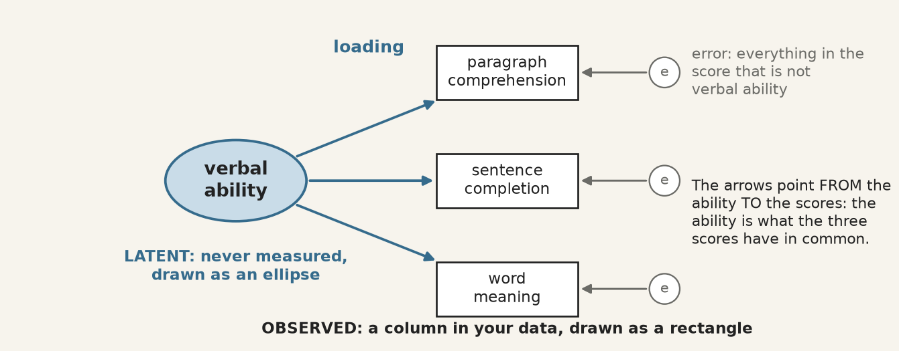{.big fig-alt="One latent variable, verbal ability, with arrows to three observed test scores, each with its own error."}

::: {.check}
**SEM in one sentence:** the construct is *what the indicators have in common*. Three tests of
verbal ability agree with one another because they all measure verbal ability; the part on which they
disagree is error.
:::

## Five symbols are the whole language {.scrollable}

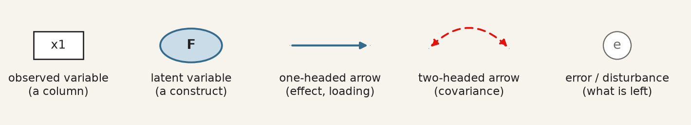{fig-alt="The five symbols of a path diagram: rectangle, ellipse, one-headed arrow, two-headed arrow, error circle."}

Every diagram you will ever see in an SEM paper is made of these five. And each drawing has
an exact translation into one line of text, which is what semopy reads:

| You draw | You write | Read it as |
|---|---|---|
| ellipse → rectangles | `visual =~ x1 + x2 + x3` | "visual **is measured by** x1, x2 and x3" |
| ellipse → ellipse | `dem65 ~ dem60` | "dem65 **is regressed on** dem60" |
| two-headed arrow | `y1 ~~ y5` | "y1 **covaries with** y5" |
| error circles | nothing | semopy adds one for every indicator, on its own |

## Every SEM has two halves {.scrollable}

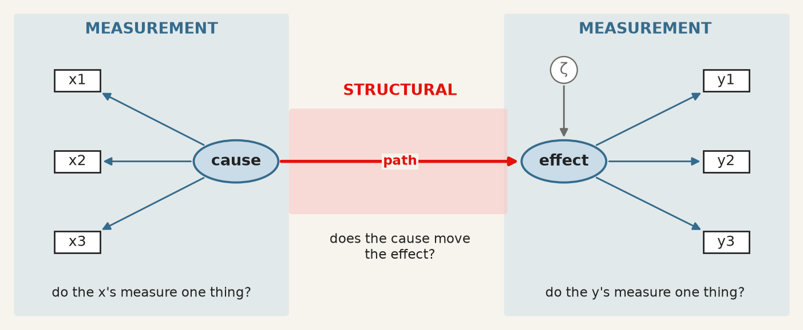{.mid fig-alt="A measurement model on each side, shaded blue, and a structural path between the two constructs, shaded red."}

- **Measurement model** (blue): do my indicators measure one thing, and how well does each one do it? Its numbers are **loadings**.
- **Structural model** (red): once measured, does one construct move another? Its numbers are **path coefficients**, read like regression coefficients.

::: {.muted}
Fitting both at once is the point: the path is estimated between the *constructs*, cleaned of the
measurement error in the indicators, which a regression on averaged scores does not do.
:::

## What SEM actually fits: the correlations {.scrollable}

A model never sees your rows one by one. It sees the **correlation (covariance) matrix** of your
indicators, and asks: *could my diagram have produced it?*

::: columns
::: {.column width="50%"}
For one indicator $x_j$ of a construct $F$:

$$x_j = \lambda_j F + e_j$$

Standardise everything, and two indicators of the same construct must correlate by

$$\text{corr}(x_i, x_j) = \lambda_i \times \lambda_j$$

because $F$ is the only thing they share.
:::

::: {.column width="50%"}
::: {.step}
**So a diagram is a prediction.** Each arrow you draw, and each one you leave out, implies
a number for every pair of indicators. Fitting chooses the loadings that make those numbers as
close as possible to the real ones.
:::

::: {.check}
**And it can be tested:** nine indicators have 36 correlations. If the model uses fewer
parameters than that, the leftover is a test of whether the diagram is right.
:::
:::
:::

## Part 2 · A measurement model, step by step {.center}

## The data: 301 children, nine tests {.scrollable}

Holzinger and Swineford (1939) gave nine ability tests to seventh- and eighth-graders in two
schools. The data ship with semopy, so there is nothing to download.

| Column | Test | Meant to measure |
|---|---|---|
| `x1` · `x2` · `x3` | visual perception · cubes · lozenges | **visual** ability |
| `x4` · `x5` · `x6` | paragraph comprehension · sentence completion · word meaning | **textual** ability |
| `x7` · `x8` · `x9` | speeded addition · speeded dot counting · straight vs curved capitals | **speed** |

```{python}
#| echo: true

# Step 1 · Load the data
import semopy
from semopy.examples import holzinger39

data = holzinger39.get_data()
print(data.shape)
print(data[["school", "x1", "x2", "x3", "x4", "x5", "x6", "x7", "x8", "x9"]].head().round(2))
```

## Step 2 · Look at the correlations before you model anything {.scrollable}

```{python}
#| echo: true
#| output-location: column
#| fig-width: 5.6
#| fig-height: 4.8

# Step 2 · A picture of the correlation matrix
import matplotlib.pyplot as plt
from semopy.examples import holzinger39

data = holzinger39.get_data()
tests = ["x1", "x2", "x3", "x4", "x5",
         "x6", "x7", "x8", "x9"]
corr = data[tests].corr()

plt.imshow(corr, cmap="Blues", vmin=0, vmax=1)
plt.colorbar()
plt.xticks(range(9), tests)
plt.yticks(range(9), tests)
for i in range(9):
    for j in range(9):
        plt.text(j, i, round(corr.iloc[i, j], 2),
                 ha="center", va="center", fontsize=7)
plt.title("Correlations between the nine tests")
plt.show()
```

::: {.check}
**Reading it:** three dark squares on the diagonal. x4–x6 correlate at about 0.7 with each other and
0.1–0.4 with everything else; x1–x3 and x7–x9 form weaker blocks. That is three groups, *before* any
model. If you cannot see your constructs in this picture, no fit index will find them for you.
:::

## Step 3 · Draw the model, on paper, first {.scrollable}

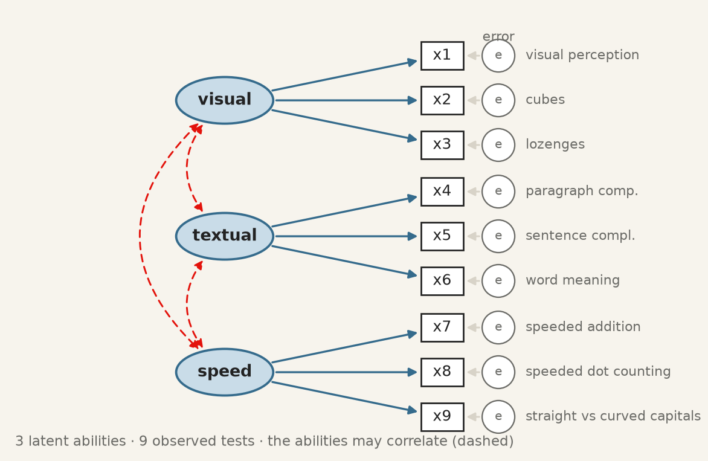{.big fig-alt="The three-factor model: visual, textual and speed, each with three tests, the three abilities linked by dashed two-headed arrows."}

::: {.step}
**Every arrow is a claim, and so is every missing arrow.** No arrow from *visual* to x9 says "the
capitals test has nothing to do with visual ability". You will test that claim in step 9.
:::

## Step 4 · Translate the drawing, one line per ellipse {.scrollable}

::: columns
::: {.column width="48%"}
```{python}
#| echo: true

# Step 4 · The model description: a plain string
description = """
visual  =~ x1 + x2 + x3
textual =~ x4 + x5 + x6
speed   =~ x7 + x8 + x9
"""
print(description)
```
:::

::: {.column width="52%"}
**What semopy adds without being asked**, so the three lines are a complete model:

1. **One loading per construct is fixed to 1** (x1, x4, x7). A construct has no units of its own; this lends it the units of its first indicator. That is why those rows will show no standard error.
2. **An error term for every indicator**: the circles you drew.
3. **The three constructs may correlate**: the dashed arrows.

::: {.muted}
semopy uses the same syntax as R's *lavaan*, so papers that print a lavaan model can be refitted
in Python as written.
:::
:::
:::

## Step 5 · Fit the model {.scrollable}

```{python}
#| echo: true

# Step 5 · Model(), then .fit(), then .inspect()
import semopy
from semopy.examples import holzinger39

data = holzinger39.get_data()
model = semopy.Model("""
visual  =~ x1 + x2 + x3
textual =~ x4 + x5 + x6
speed   =~ x7 + x8 + x9
""")
model.fit(data)
# std_est=True adds the standardised column, Est. Std
estimates = model.inspect(std_est=True)
print(estimates)
```

| Column | Means |
|---|---|
| `lval op rval` | the parameter. semopy writes a loading as `x2 ~ visual`: "x2 depends on visual" |
| `Estimate` | in the indicator's own units; `1.0` and a `-` standard error = fixed in step 4, not estimated |
| `Est. Std` | **standardised**: comparable across indicators. This is the column you read |
| `p-value` | is the estimate different from zero? (`0.0` means below 0.0000005) |

## Step 6 · Read the loadings {.scrollable}

```{python}
#| echo: true
#| output-location: column
#| fig-width: 5.4
#| fig-height: 4.2

# Step 6 · The loadings are the rows with op "~"
import matplotlib.pyplot as plt
import semopy
from semopy.examples import holzinger39

data = holzinger39.get_data()
model = semopy.Model("""
visual  =~ x1 + x2 + x3
textual =~ x4 + x5 + x6
speed   =~ x7 + x8 + x9
""")
model.fit(data)
estimates = model.inspect(std_est=True)

loadings = estimates[estimates["op"] == "~"]
print(loadings[["lval", "rval", "Est. Std"]].round(2))

plt.barh(loadings["lval"], loadings["Est. Std"])
plt.axvline(0.7, color="grey", linestyle="--")
plt.gca().invert_yaxis()
plt.xlabel("standardised loading")
plt.show()
```

::: {.check}
**Reading it:** a standardised loading is the **correlation between the test and its ability**;
its square is the **share of the test the ability explains**. Textual is measured well (0.84–0.86:
about 72% of each test). Cubes, x2, is the weak one: $0.42^2 = 0.18$, so 82% of a child's cubes
score is something other than visual ability. Above 0.7 is strong, below 0.4 is a candidate to drop.
:::

## Step 7 · Put the numbers back on the drawing {.scrollable}

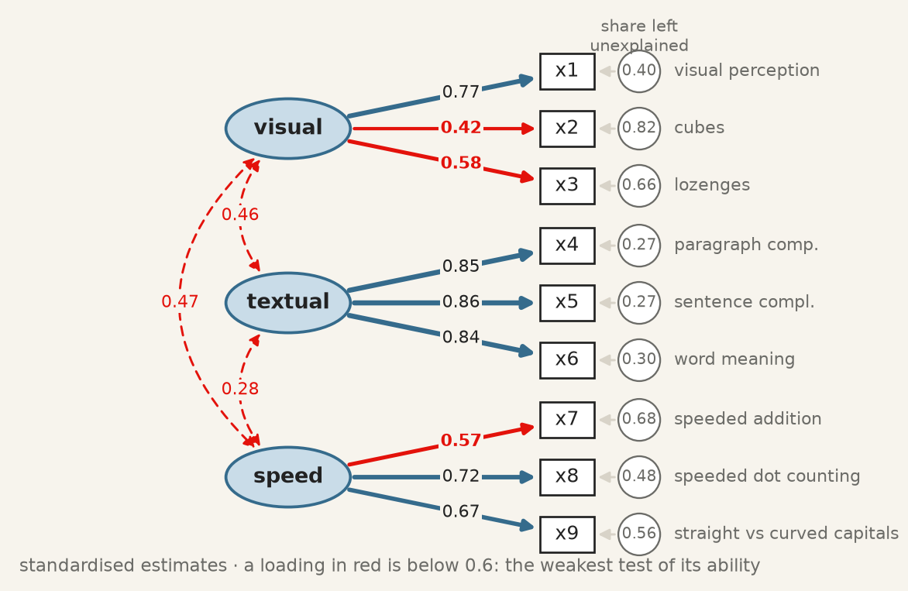{.big fig-alt="The three-factor diagram with standardised loadings on the arrows, factor correlations on the dashed arrows and unexplained shares in the error circles."}

::: {.check}
**Check the rule from Part 1:** x4 and x5 both measure *textual*, so the model says
corr(x4, x5) = 0.85 × 0.86 = **0.73**. The correlation in step 2 is **0.73**. The abilities correlate
0.28–0.47: related, but not the same thing.
:::

## Step 8 · Judge the fit {.scrollable}

```{python}
#| echo: true
#| output-location: column

# Step 8 · calc_stats() returns every fit index
import semopy
from semopy.examples import holzinger39

data = holzinger39.get_data()
model = semopy.Model("""
visual  =~ x1 + x2 + x3
textual =~ x4 + x5 + x6
speed   =~ x7 + x8 + x9
""")
model.fit(data)

fit = semopy.calc_stats(model)
columns = ["chi2", "DoF", "chi2 p-value",
           "CFI", "TLI", "RMSEA"]
print(fit[columns].T.round(3))
```

| Index | Question it answers | Convention | Here | Verdict |
|---|---|---|---|---|
| $\chi^2$ | could the model be *exactly* right? | p > 0.05 | 85.3 on 24 df, p < 0.001 | no |
| **CFI** | how far from "nothing correlates" toward perfect? | > 0.95 | 0.931 | close, not there |
| **TLI** | the same, penalised for extra parameters | > 0.95 | 0.896 | short |
| **RMSEA** | misfit per degree of freedom | < 0.06 good, > 0.10 poor | 0.092 | mediocre |

::: {.warn}
**Report all four, and say which convention you applied.** Quoting only the one that passes loses marks.
:::

## Step 9 · Where does the model miss? {.scrollable}

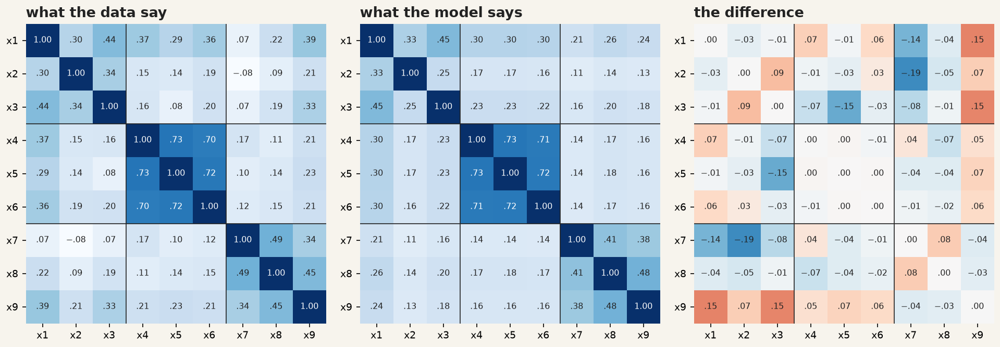{fig-alt="Three heat maps: the observed correlations, the correlations the model implies, and their difference, which is largest between x9 and the visual tests."}

::: columns
::: {.column width="50%"}
::: {.check}
**Reading it:** the model reproduces the textual block almost perfectly (differences of 0.00). The biggest
misses are in the last row: **x9 correlates with x1 and x3 by 0.15 more than the model allows**.
:::
:::

::: {.column width="50%"}
::: {.step}
**Is there a reason?** x9 asks children to tell straight from curved capital letters, fast. That is a
*speed* task that also needs *visual* discrimination, so an arrow from visual to x9 can be argued
from what the test is, not just from the numbers.
:::
:::
:::

## Step 10 · Compare with the alternatives {.scrollable}

```{python}
#| echo: true

# Step 10 · Same data, three different drawings
import semopy
from semopy.examples import holzinger39

data = holzinger39.get_data()
models = {
    "one factor":     "ability =~ x1 + x2 + x3 + x4 + x5 + x6 + x7 + x8 + x9",
    "three factors":  "visual =~ x1 + x2 + x3 \n textual =~ x4 + x5 + x6 \n speed =~ x7 + x8 + x9",
    "three + x9 vis": "visual =~ x1 + x2 + x3 + x9 \n textual =~ x4 + x5 + x6 \n speed =~ x7 + x8 + x9",
}
for name, description in models.items():
    model = semopy.Model(description)
    model.fit(data)
    fit = semopy.calc_stats(model)
    print(f"{name:15} chi2 = {fit['chi2'].iloc[0]:6.1f}  df = {fit['DoF'].iloc[0]:.0f}"
          f"  CFI = {fit['CFI'].iloc[0]:.3f}  TLI = {fit['TLI'].iloc[0]:.3f}"
          f"  RMSEA = {fit['RMSEA'].iloc[0]:.3f}")
```

## Step 10 · Reading the comparison {.scrollable}

::: columns
::: {.column width="50%"}
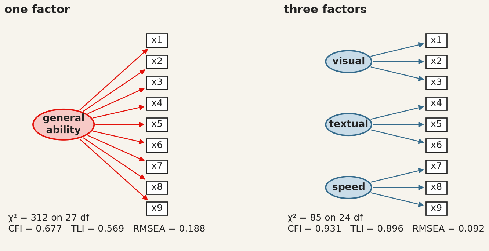{.big fig-alt="The one-factor model and the three-factor model side by side, with their fit indices."}
:::

::: {.column width="50%"}
::: {.check}
**One general ability** is clearly rejected (CFI 0.677): the tests do not all measure one thing.
**Three abilities** is far better. **x9 on visual too** passes CFI (0.967) and nearly RMSEA (0.065).
:::

::: {.warn}
The third model was chosen *after looking at the misfit*. Report it as such, and confirm it on new
data (the other school, next year's class) before you believe it.
:::
:::
:::

## Part 3 · Adding arrows between constructs {.center}

## The data: 75 countries, 1960 and 1965 {.scrollable}

Bollen's (1989) classic: does industrialisation bring democracy? Neither is a column; both are
measured by indicators. Also bundled with semopy.

| Construct | Indicators |
|---|---|
| **ind60** · industrialisation, 1960 | `x1` GNP per capita · `x2` energy per capita · `x3` share of labour in industry |
| **dem60** · democracy, 1960 | `y1` press freedom · `y2` freedom of opposition · `y3` fair elections · `y4` effective legislature |
| **dem65** · democracy, 1965 | `y5`–`y8`: **the same four questions, five years later** |

```{python}
#| echo: true

# Step 1 · Load the data
from semopy.examples import political_democracy

countries = political_democracy.get_data()
print(countries.shape)
print(countries.head().round(2))
```

## Step 2 · The theory, then the drawing {.scrollable}

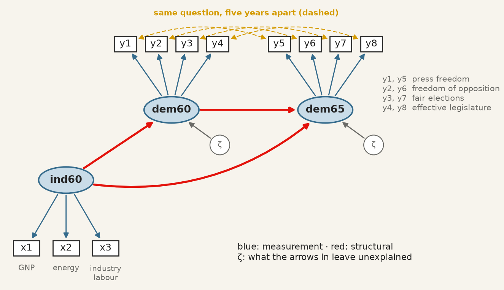{.big fig-alt="Industrialisation in 1960 measured by x1 to x3, with arrows to democracy in 1960 and 1965, each measured by four indicators; the same-question indicators linked by dashed arrows."}

::: {.step}
**Three structural claims (red):** industrialisation raises democracy; democracy persists; and
industrialisation may also act on 1965 directly. **One claim from the design (gold):** y1 and y5 are the
same question rated by the same experts, so their errors may move together. That is decided
*before* fitting, from how the data were collected.
:::

## Step 3 · All three operators in one description {.scrollable}

```{python}
#| echo: true

# Step 3 · =~ measures, ~ explains, ~~ covaries
import semopy
from semopy.examples import political_democracy

countries = political_democracy.get_data()
description = """
# measurement: each construct and its indicators
ind60 =~ x1 + x2 + x3
dem60 =~ y1 + y2 + y3 + y4
dem65 =~ y5 + y6 + y7 + y8
# structural: arrows between constructs
dem60 ~ ind60
dem65 ~ ind60 + dem60
# the same question, five years apart
y1 ~~ y5
y2 ~~ y6
y3 ~~ y7
y4 ~~ y8
"""
model = semopy.Model(description)
model.fit(countries)
estimates = model.inspect(std_est=True)

# The structural paths: the rows whose left side is a construct
paths = estimates[(estimates["op"] == "~") & estimates["lval"].isin(["dem60", "dem65"])]
print(paths[["lval", "op", "rval", "Estimate", "Est. Std", "p-value"]].round(3))
```

::: {.check}
**Reading it:** `dem60 ~ ind60` at **0.45**: a country one standard deviation more industrialised in 1960 was
0.45 standard deviations more democratic that year. `dem65 ~ dem60` at **0.87**: democracy is very
persistent. `dem65 ~ ind60` at **0.17** (p = 0.015): a smaller direct push, on top of persistence.
:::

## Step 4 · The numbers on the drawing {.scrollable}

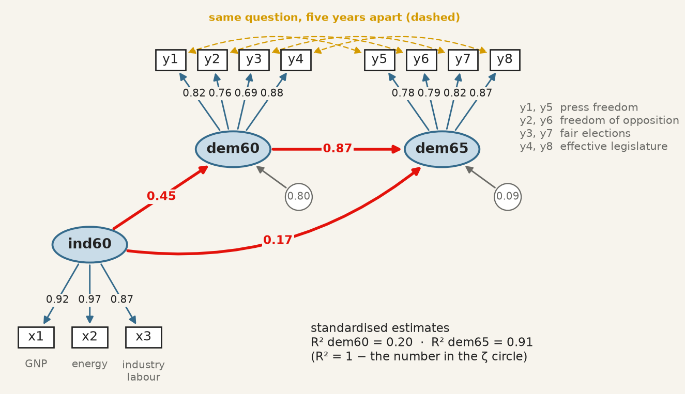{.big fig-alt="The democracy model with standardised loadings, path coefficients, and the unexplained share of each democracy construct."}

::: {.check}
**R², read from the ζ circles:** industrialisation explains **20%** of democracy in 1960 (1 − 0.80).
Democracy in 1960 and industrialisation together explain **91%** of democracy in 1965 (1 − 0.09).
All eleven loadings are above 0.69: the indicators measure their constructs well.
:::

## Step 5 · Direct and indirect effects {.scrollable}

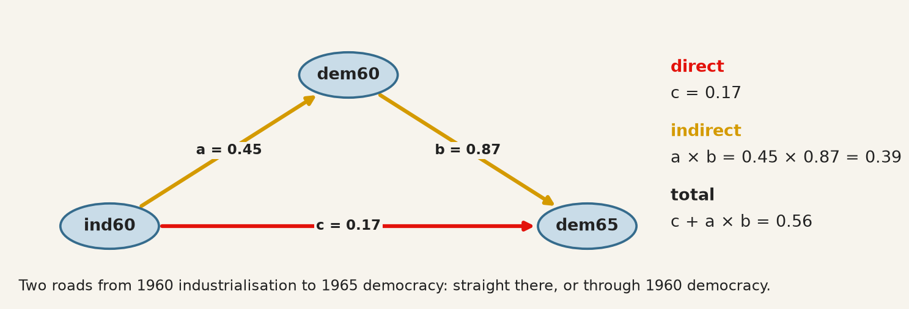{fig-alt="Two routes from ind60 to dem65: the direct path c, and the indirect route through dem60, a times b."}

::: {.check}
**Reading it:** two-thirds of what 1960 industrialisation does for 1965 democracy (0.39 of 0.56) goes
*through* 1960 democracy. This is a **mediation**: dem60 carries the effect.
:::

## Step 5 · The same arithmetic, in Python {.scrollable}

```{python}
#| echo: true

# Step 5 · An indirect effect is the product of the paths along the road
import semopy
from semopy.examples import political_democracy

countries = political_democracy.get_data()
model = semopy.Model("""
ind60 =~ x1 + x2 + x3
dem60 =~ y1 + y2 + y3 + y4
dem65 =~ y5 + y6 + y7 + y8
dem60 ~ ind60
dem65 ~ ind60 + dem60
y1 ~~ y5
y2 ~~ y6
y3 ~~ y7
y4 ~~ y8
""")
model.fit(countries)
est = model.inspect(std_est=True)

a = est.loc[(est["lval"] == "dem60") & (est["rval"] == "ind60"), "Est. Std"].iloc[0]
b = est.loc[(est["lval"] == "dem65") & (est["rval"] == "dem60"), "Est. Std"].iloc[0]
c = est.loc[(est["lval"] == "dem65") & (est["rval"] == "ind60"), "Est. Std"].iloc[0]
print(f"direct    c     = {c:.2f}")
print(f"indirect  a * b = {a:.2f} * {b:.2f} = {a * b:.2f}")
print(f"total     c + a * b = {c + a * b:.2f}")
```

::: {.muted}
`est.loc[condition, "Est. Std"]` picks one number out of the table: the row where the left side is
dem60 and the right side ind60. Standardised paths multiply; raw ones would mix units.
:::

## Step 6 · Judge the fit, and justify every extra arrow {.scrollable}

```{python}
#| echo: true

# Step 6 · The model with and without the four same-question covariances
import semopy
from semopy.examples import political_democracy

countries = political_democracy.get_data()
base = """
ind60 =~ x1 + x2 + x3
dem60 =~ y1 + y2 + y3 + y4
dem65 =~ y5 + y6 + y7 + y8
dem60 ~ ind60
dem65 ~ ind60 + dem60
"""
same_question = "y1 ~~ y5 \n y2 ~~ y6 \n y3 ~~ y7 \n y4 ~~ y8"

for name, description in {"without": base, "with": base + same_question}.items():
    model = semopy.Model(description)
    model.fit(countries)
    fit = semopy.calc_stats(model)
    print(f"{name:8} chi2 = {fit['chi2'].iloc[0]:5.1f}  df = {fit['DoF'].iloc[0]:.0f}"
          f"  p = {fit['chi2 p-value'].iloc[0]:.3f}  CFI = {fit['CFI'].iloc[0]:.3f}"
          f"  TLI = {fit['TLI'].iloc[0]:.3f}  RMSEA = {fit['RMSEA'].iloc[0]:.3f}")
```

::: columns
::: {.column width="50%"}
::: {.check}
**With them:** χ² no longer rejects (p = 0.064), CFI 0.980 and TLI 0.970 pass, RMSEA 0.071 is acceptable.
The structural paths hardly move (0.45, 0.87, 0.17): the conclusions do not depend on them.
:::
:::

::: {.column width="50%"}
::: {.warn}
**Legitimate here, because the design says so:** same question, same raters. Adding `~~` lines
*because they raise the CFI* is fitting noise, and it loses marks.
:::
:::
:::

## Part 4 · What a good fit does not prove {.center}

## Turn an arrow around: the fit does not change {.scrollable}

```{python}
#| echo: true

# Two opposite causal stories, fitted to the same data
import semopy
from semopy.examples import political_democracy

countries = political_democracy.get_data()
measurement = "ind60 =~ x1 + x2 + x3 \n dem60 =~ y1 + y2 + y3 + y4 \n"
for arrow in ["dem60 ~ ind60", "ind60 ~ dem60"]:
    model = semopy.Model(measurement + arrow)
    model.fit(countries)
    fit = semopy.calc_stats(model)
    print(f"{arrow}:  chi2 = {fit['chi2'].iloc[0]:.2f}  CFI = {fit['CFI'].iloc[0]:.3f}"
          f"  RMSEA = {fit['RMSEA'].iloc[0]:.3f}")
```

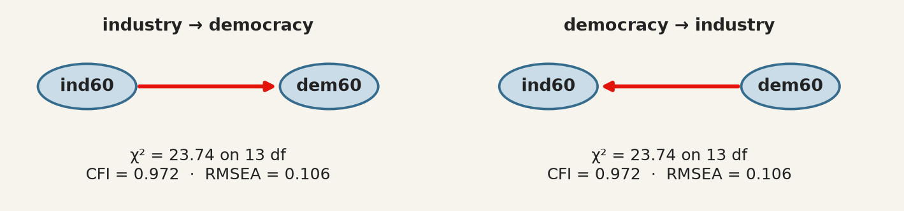{.short fig-alt="Industry causes democracy, and democracy causes industry: two diagrams with identical fit."}

::: {.warn}
**Identical, to the last decimal.** "Industry builds democracy" and "democracy builds industry" imply the
same correlations, so no fit index can choose. **The direction of an arrow is your assumption**; it comes
from theory, timing (a 1960 cause cannot follow a 1965 effect) or design, never from the fit.
:::

## What SEM does not fix {.scrollable}

- **Confounding.** A cause left out of the diagram biases the paths exactly as it biases a regression.
  Latent variables absorb *measurement error*, not omitted causes. That is sessions 10 and 11.
- **Cross-sectional data.** With everything measured on the same day, an arrow has a direction only because
  you drew one.
- **Small samples.** With 75 countries the χ² test has little power: "good fit" in a small sample is weak
  evidence. Aim for 200 or more, and 5–10 observations per parameter.
- **Comparisons across countries.** Comparing *trust* between Canada and Japan assumes the questions mean the
  same thing in both, **measurement invariance**, which has to be tested, not assumed.
- **Non-normal data.** The default estimator assumes multivariate normality; skewed survey items make χ² too
  large and p-values too small. Say which estimator you used.

## Part 5 · Your recipe {.center}

## Seven steps, and the one rule {.scrollable}

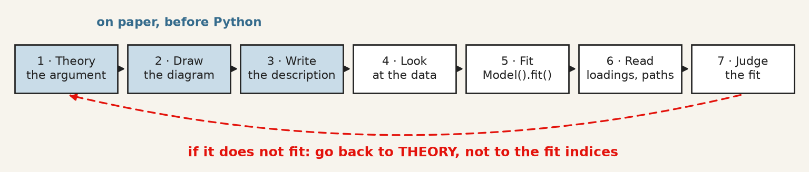{fig-alt="Seven steps from theory to judging the fit, with an arrow back from the fit to the theory."}

| Step | What you do | In Python |
|---|---|---|
| 1–3 | argue which indicators measure which construct, draw it, write one line per ellipse | a string with `=~`, `~`, `~~` |
| 4 | look at the correlations: can you see your groups? | `data[cols].corr()`, `plt.imshow` |
| 5 | fit | `model = semopy.Model(description)` · `model.fit(data)` |
| 6 | read loadings and paths, **standardised** | `model.inspect(std_est=True)` |
| 7 | judge the fit, all four indices | `semopy.calc_stats(model)` |

## The whole recipe, in one cell to copy {.scrollable}

```{python}
#| echo: true

# A measurement model, start to finish: change the data and the description for your project
import matplotlib.pyplot as plt
import semopy
from semopy.examples import holzinger39

data = holzinger39.get_data()                       # 1 · your data: one column per indicator
description = """
visual  =~ x1 + x2 + x3
textual =~ x4 + x5 + x6
speed   =~ x7 + x8 + x9
"""                                                 # 2 · your drawing, as text

model = semopy.Model(description)                   # 3 · fit
model.fit(data)

estimates = model.inspect(std_est=True)             # 4 · the loadings, standardised
loadings = estimates[estimates["op"] == "~"]
print(loadings[["lval", "rval", "Estimate", "Est. Std", "p-value"]].round(3))

fit = semopy.calc_stats(model)                      # 5 · the fit, all of it
print(fit[["chi2", "DoF", "chi2 p-value", "CFI", "TLI", "RMSEA"]].T.round(3))

weak = loadings[loadings["Est. Std"] < 0.4]         # 6 · which indicators would you drop?
print("weak indicators:", list(weak["lval"]))
```

## What to report {.scrollable}

1. **The diagram**, or the description. Every arrow is a claim the reader must be able to see.
2. **How the scale was set**: one loading fixed to 1, so nobody reads it as "the strongest indicator".
3. **Every standardised loading**, the weak ones too, and what you did about them.
4. **χ² with its df and p-value, CFI, TLI and RMSEA**, and the convention you judged them against.
5. **Every change made after the first fit**, and why. A model changed to fit is exploratory.
6. **One alternative model you rejected**, and on what grounds, if only the arrow turned around.

::: {.warn}
**Good fit means the diagram is *consistent* with the data. It does not mean the diagram is right.**
:::

## Before the next session {.scrollable}

::: {.warn}
**Required:** the next session's article, its Dataverse package, and the
self-check. That is the pre-session deck.
:::

::: {.step}
**Optional:** the **QMIB Lab** for this session — a knowledge check on the hour
you have just sat through: **[warin.ca/qmib-labs](https://warin.ca/qmib-labs/qmib-lab-09.html)**
:::

::: {.muted}
Never a prerequisite, never marked for correctness. A completed report counts
toward participation because attempting it is the engagement being measured.
:::
