## Measuring what cannot be observed

Some of the most important quantities in international business are not
measured, because they cannot be. *Absorptive capacity*, *institutional
quality*, *brand strength*, *digital maturity* — each is meant to be a real
property of a firm or a country, each is invoked in explanations, and none of
them appears in any dataset. What appears instead is a set of indicators, each a
noisy and partial reflection of the thing.

Chapter 7 met this and handled it descriptively: factor analysis found a small
number of common factors behind a battery of correlated items. This chapter
takes the same idea and makes it a model you can *state and test* — a set of
explicit claims about which indicators measure which construct, and about how the
constructs relate to one another. And it builds that model the way you should
build your own: on paper first, then in one line of text per construct, then in
four lines of Python, and only then with numbers.

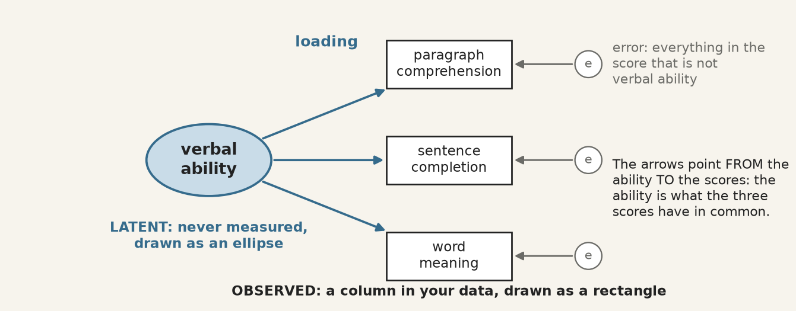{fig-alt="One latent variable, verbal ability, with arrows to three observed test scores, each with its own error."}

The apparatus divides into two parts, and keeping them apart is the first thing
to learn.

::: {.definition}
[**Measurement model**]{.term} — the part that links unobserved constructs to
observed indicators. It answers: *does this battery of questions measure one
thing, and how well does each item measure it?* Its coefficients are loadings.
:::

::: {.definition}
[**Structural model**]{.term} — the part that links constructs to each other. It
answers: *does this construct predict that one?* Its coefficients are path
coefficients, and they are regression coefficients between quantities that were
never observed.
:::

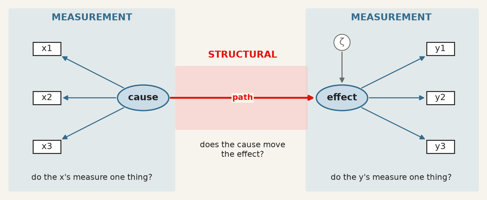{fig-alt="A measurement model on each side, shaded blue, and a structural path between the two constructs, shaded red."}

A model can have both, and much of what makes SEM valuable is estimating them
jointly: the structural relationships are corrected for the unreliability of the
measurement, which a two-step approach of "build a scale, then regress it" does
not do.

## Wright's diagrams, and what a path meant

::: {.archive}
[From the archive · Wright, 1918–1934]{.archive-label}

Sewall Wright was a geneticist working on the inheritance of coat colour in
guinea pigs, and he needed to express something regression could not: a system in
which variables cause each other in a specified pattern, some directly and some
through intermediaries. He drew it — variables as boxes, causal claims as
arrows — and worked out the algebra that lets the correlations be decomposed
along the paths [@wright1934].

Two features of that invention survive intact into every SEM package in use
today. The diagram *is* the model: each arrow is a parameter to be estimated,
and an arrow you do not draw is a claim that the effect is zero. And the
implied correlation between any two variables is the sum of the contributions
along every path connecting them, which is what makes the model testable — it
predicts a whole covariance matrix, not a single coefficient.

Wright was explicit that the method could not discover the diagram. It required
the causal structure to be supplied from outside, on subject-matter grounds, and
it then estimated the strengths and checked the implications. Ninety years of
software has not changed that, and the section on equivalent models below is what
happens when it is forgotten.
:::

## The language: five symbols and three operators

Wright's convention is still universal. Observed variables are rectangles,
unobserved ones ellipses, a one-headed arrow is a directed effect, a two-headed
arrow an unanalysed covariance, and a small circle the error left over.

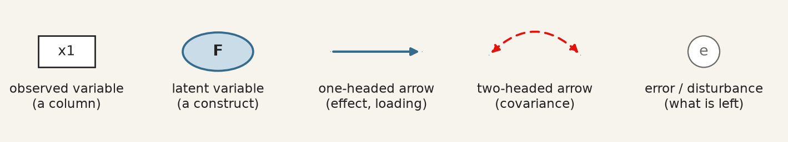{fig-alt="Rectangle, ellipse, one-headed arrow, two-headed arrow, error circle."}

Each drawing has an exact translation into text. The notation, standard since
`lavaan` made it so [@rosseel2012] and used by `semopy` in Python, is close to
readable English:

| You draw | You write | operator means |
|---|---|---|
| ellipse → rectangles | `visual =~ x1 + x2 + x3` | `=~` *is measured by* |
| ellipse → ellipse | `dem65 ~ dem60` | `~` *is regressed on* |
| two-headed arrow | `y1 ~~ y5` | `~~` *covaries with* |
| error circles | nothing | added by the software, one per indicator |

So `visual =~ x1 + x2 + x3` asserts that a construct called *visual* exists, that
these three observed scores are reflections of it, and — by what is absent — that
nothing else in the model measures it. The corresponding equation for indicator
$j$ of construct $\xi$ is

$$
x_j \thickspace=\thickspace \lambda_j \xi + \delta_j ,
$$

with $\lambda_j$ the loading and $\delta_j$ everything specific to that
indicator: its own content, and its measurement error. This is chapter 7's
factor model written one indicator at a time, and the interpretive move is the
same — the construct is what the indicators have in common, and nothing else.

**Identification.** A latent variable has no units, so a scale must be imposed
before anything can be estimated. Two conventions exist: fix one loading to 1,
which gives the construct the units of that indicator, or fix the construct's
variance to 1, which makes it standardised. Software picks the first by default,
which is why one loading in every output has no standard error — it was not
estimated. Reading it as "the strongest indicator" is a common and complete
misunderstanding.

## What is actually being fitted

The model does not fit the data. It fits the *covariance matrix* of the data.

Every parameter set $\theta$ implies a covariance matrix $\Sigma(\theta)$ among
the observed variables, and estimation chooses $\theta$ to make that as close as
possible to the observed $S$. The simplest case shows why a diagram is a
prediction. Standardise everything; two indicators of the same construct share
nothing but the construct, so the model says their correlation must be

$$
\operatorname{corr}(x_i, x_j) \thickspace=\thickspace \lambda_i \lambda_j .
$$

Every arrow you draw, and every one you leave out, implies a number of this kind
for every pair of indicators. The discrepancy between those numbers and the
observed ones is what all the fit statistics measure, and the $\chi^2$ test is a
formal test of

$$
H_0: \thickspace \Sigma = \Sigma(\theta) ,
$$

that is, of *exact* fit. Its degrees of freedom are the number of distinct
elements in the covariance matrix minus the number of free parameters: nine
indicators have $9 \times 10 / 2 = 45$ variances and covariances, the
three-factor model below estimates 21 parameters, and the 24 left over are what
make it testable. A model that says more about the covariances than it has
parameters to absorb can be wrong, and therefore can be checked.

## Building a measurement model, step by step

The data are the classic of the field: Holzinger and Swineford gave nine ability
tests to 301 seventh- and eighth-graders in two Chicago schools in 1939. They ship
with `semopy`, so every cell below runs as written, with nothing to download.

| Column | Test | Meant to measure |
|---|---|---|
| `x1` · `x2` · `x3` | visual perception · cubes · lozenges | **visual** ability |
| `x4` · `x5` · `x6` | paragraph comprehension · sentence completion · word meaning | **textual** ability |
| `x7` · `x8` · `x9` | speeded addition · speeded dot counting · straight vs curved capitals | **speed** |

**Step 1 and 2 · Load the data, and look before you model.** The correlation
matrix is what the model will try to reproduce, so it is the first thing to see.

```{python}
#| label: fig-hs-corr
#| code-summary: "Run it: the correlations the model has to reproduce"
#| fig-cap: "The correlations between the nine tests. Three blocks on the diagonal: the groups are visible before any model is fitted."

import warnings
warnings.filterwarnings("ignore")
import matplotlib.pyplot as plt
import semopy
from semopy.examples import holzinger39

data = holzinger39.get_data()
tests = ["x1", "x2", "x3", "x4", "x5", "x6", "x7", "x8", "x9"]
corr = data[tests].corr()

plt.figure(figsize=(6, 5))
plt.imshow(corr, cmap="Blues", vmin=0, vmax=1)
plt.colorbar()
plt.xticks(range(9), tests)
plt.yticks(range(9), tests)
for i in range(9):
    for j in range(9):
        plt.text(j, i, round(corr.iloc[i, j], 2), ha="center", va="center", fontsize=7)
plt.show()
```

Three dark squares sit on the diagonal. The textual tests correlate at about 0.7
with each other and 0.1–0.4 with everything else; the visual and speed tests form
weaker blocks. If you cannot see your constructs in this picture, no fit index
will find them for you.

**Step 3 · Draw the model on paper.** Each test measures one ability, and the
three abilities may correlate. Every missing arrow is a claim: no arrow from
*visual* to `x9` says the capitals test has nothing to do with visual ability.

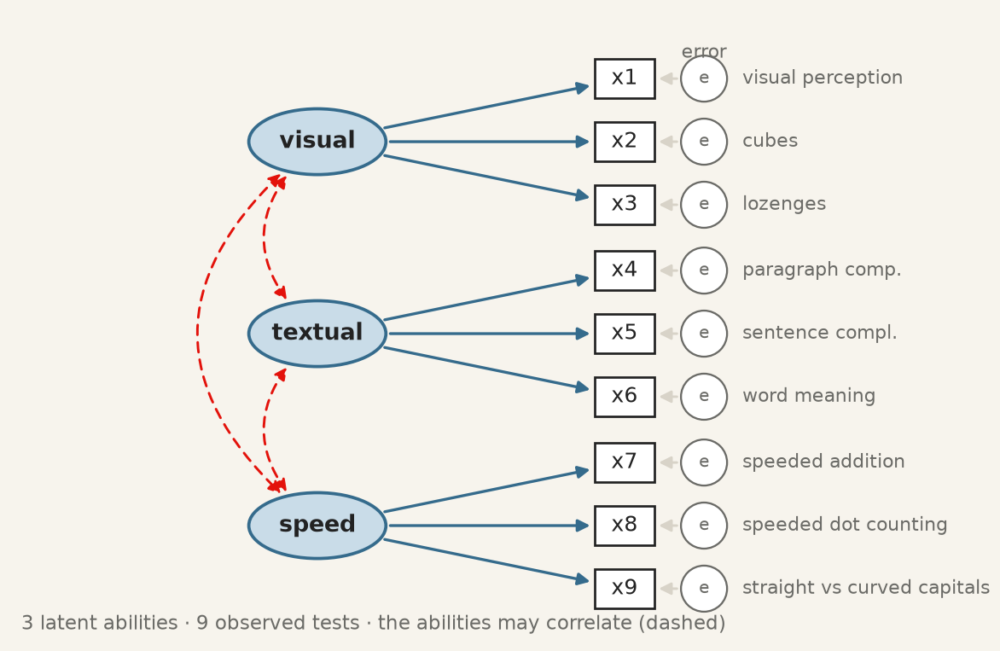{fig-alt="Visual, textual and speed, each with three tests; dashed two-headed arrows between the abilities."}

**Step 4 and 5 · Write it as text, and fit it.** One line per ellipse. `semopy`
adds the rest: one loading per construct fixed to 1, an error term for each
indicator, and covariances among the constructs.

```{python}
#| label: check-hs-fit
#| code-summary: "Run it: fit the three-factor model and read the loadings"

description = """
visual  =~ x1 + x2 + x3
textual =~ x4 + x5 + x6
speed   =~ x7 + x8 + x9
"""
model = semopy.Model(description)
model.fit(data)

estimates = model.inspect(std_est=True)
loadings = estimates[estimates["op"] == "~"]
print(loadings[["lval", "op", "rval", "Estimate", "Est. Std", "p-value"]].round(3))
```

`semopy` writes a loading as `x2 ~ visual` — "x2 depends on visual", which is
what `=~` means read from the other side. `Estimate` is in the indicator's own
units, and the rows equal to 1 with no $p$-value are the ones fixed in step 4.
`Est. Std` is the column to read: a standardised loading is the correlation
between the indicator and its construct, and its square is the share of the
indicator the construct explains.

**Step 6 · Put the numbers back on the drawing.**

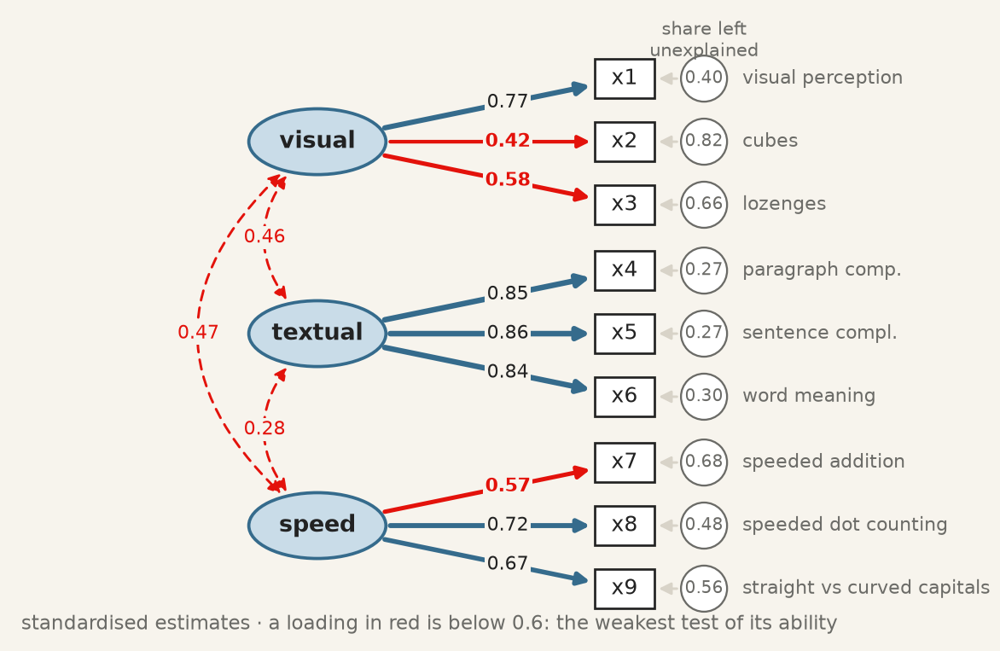{fig-alt="The three-factor diagram with standardised loadings, factor correlations and unexplained shares."}

Textual is measured well, each test sharing about 72% of its variance with the
construct. Cubes, `x2`, is the weak indicator: $0.42^2 = 0.18$, so 82% of a
child's cubes score is something other than visual ability. Below about 0.4 an
item has little to do with the thing it is supposed to measure, and keeping it
degrades the construct rather than enriching it.

The rule from the previous section can be checked by hand. `x4` and `x5` both
measure *textual*, so the model says their correlation is
$0.85 \times 0.86 = 0.73$ — and the correlation in the first figure is 0.73. The
three abilities correlate at 0.28 to 0.47: related, but distinct.

## The fit indices, and what each would have to be

The $\chi^2$ test is the only one with a null hypothesis, and it is almost never
used alone, for a reason worth being honest about: with a large sample it rejects
models that are approximately right, and with a small one it fails to reject
models that are badly wrong. It is a test of exact fit, and no model is exactly
right.

The alternatives are *approximate* fit indices, and three are conventionally
reported together.

::: {.definition}
[**CFI**]{.term} — comparative fit index [@bentler1990]. How far the model has
moved from a baseline in which all observed variables are uncorrelated, toward
perfect fit. Scaled to $[0,1]$; **above about 0.95** is the modern convention.
:::

::: {.definition}
[**TLI**]{.term} — Tucker–Lewis index, the same comparison with a penalty for
parameters, so adding a path that does not help can *lower* it. Not bounded
above by 1 in practice. **Above about 0.95.**
:::

::: {.definition}
[**RMSEA**]{.term} — root mean square error of approximation [@browne1992]. The
misfit per degree of freedom, so it rewards parsimony directly. **Below about
0.06** is good, above 0.10 poor.
:::

Those thresholds come from a simulation study [@hu1999] that has been cited tens
of thousands of times and whose authors were careful to say they were not
proposing universal cut-offs. They are conventions, and the honest use is to
report the numbers and the convention together, and let the reader apply their
own judgement.

```{python}
#| label: check-hs-indices
#| code-summary: "Run it: every fit index of the three-factor model"

fit = semopy.calc_stats(model)
print(fit[["chi2", "DoF", "chi2 p-value", "CFI", "TLI", "RMSEA"]].T.round(3))
```

| Index | Convention | Three-factor model | Verdict |
|---|---|---|---|
| $\chi^2$ | $p > 0.05$ | 85.3 on 24 df, $p < 0.001$ | rejects exact fit |
| CFI | $> 0.95$ | 0.931 | close, not there |
| TLI | $> 0.95$ | 0.896 | short |
| RMSEA | $< 0.06$ | 0.092 | mediocre |

A model drawn from a well-established theory of mental abilities, and it does not
quite fit. That is a normal outcome, and the useful question is where it misses.

## Where the model misses, and what you may do about it

The model implies a correlation for every pair of tests. Subtracting it from the
observed one shows where the diagram is wrong.

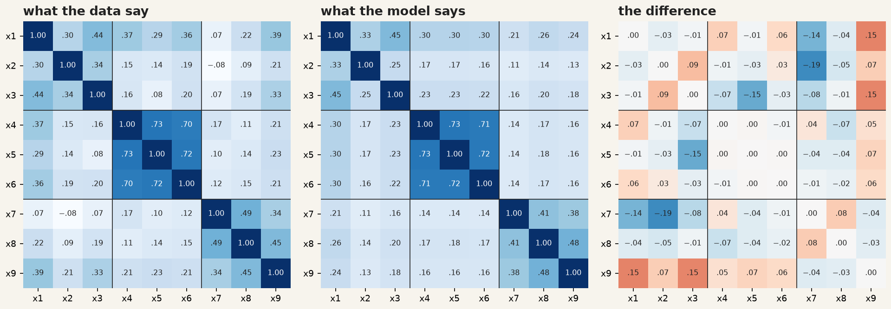{fig-alt="Three heat maps: observed, implied and residual correlations."}

`x9` correlates with `x1` and `x3` by about 0.15 more than the model allows. Is
there a reason? The test asks children to tell straight from curved capital
letters, quickly: a speed task that also needs visual discrimination. An arrow
from *visual* to `x9` can therefore be argued from what the test is, not merely
from the numbers. Comparing it with the alternatives is one loop:

```{python}
#| label: check-hs-compare
#| code-summary: "Run it: one factor, three factors, and three with x9 on visual"

models = {
    "one factor":     "ability =~ x1 + x2 + x3 + x4 + x5 + x6 + x7 + x8 + x9",
    "three factors":  "visual =~ x1 + x2 + x3 \n textual =~ x4 + x5 + x6 \n speed =~ x7 + x8 + x9",
    "three + x9 vis": "visual =~ x1 + x2 + x3 + x9 \n textual =~ x4 + x5 + x6 \n speed =~ x7 + x8 + x9",
}
for name, desc in models.items():
    m = semopy.Model(desc)
    m.fit(data)
    s = semopy.calc_stats(m)
    print(f"{name:15} chi2 = {s['chi2'].iloc[0]:6.1f}  df = {s['DoF'].iloc[0]:.0f}"
          f"  CFI = {s['CFI'].iloc[0]:.3f}  TLI = {s['TLI'].iloc[0]:.3f}"
          f"  RMSEA = {s['RMSEA'].iloc[0]:.3f}")
```

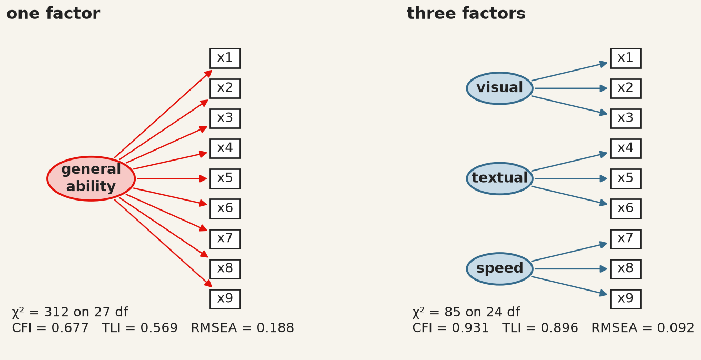{fig-alt="The one-factor and three-factor diagrams side by side with their fit indices."}

One general ability is rejected decisively. Three abilities are far better, and
`x9` on *visual* as well brings CFI to 0.967 and RMSEA to 0.065.

**What to do about a failing model.** Not, in the first instance, to modify it
until it passes. Software offers modification indices — the improvement in
$\chi^2$ from freeing each fixed parameter — and following them is how a
theoretical model becomes an atheoretical one that fits this sample. The third
model above was chosen *after looking at the misfit*, which makes it exploratory
however good its argument. The honest check is data it has not seen. The two
schools give a partial one:

```{python}
#| label: check-hs-schools
#| code-summary: "Run it: does the x9 change help in each school separately?"

for school in ["Pasteur", "Grant-White"]:
    one_school = data[data["school"] == school]
    for name in ["three factors", "three + x9 vis"]:
        m = semopy.Model(models[name])
        m.fit(one_school)
        s = semopy.calc_stats(m)
        print(f"{school:12} n = {len(one_school)}  {name:15} CFI = {s['CFI'].iloc[0]:.3f}"
              f"  RMSEA = {s['RMSEA'].iloc[0]:.3f}")
```

In Grant-White the modified model fits well (CFI 0.989, RMSEA 0.040). In Pasteur it
helps but still falls short (CFI 0.927, RMSEA 0.092). The change is real in one
school and only partial in the other — a finding about the tests, and the kind of
result that a single pooled fit would have hidden.

## Adding the structural part

A measurement model says what the constructs are. A structural model says what
they do to each other. Bollen's political-democracy data [@bollen1989], also
bundled with `semopy`, are the standard example: 75 developing countries, with
industrialisation in 1960 measured by three indicators and democracy measured by
the same four expert ratings in 1960 and again in 1965.

| Construct | Indicators |
|---|---|
| **ind60** · industrialisation, 1960 | `x1` GNP per capita · `x2` energy per capita · `x3` share of labour in industry |
| **dem60** · democracy, 1960 | `y1` press freedom · `y2` freedom of opposition · `y3` fair elections · `y4` effective legislature |
| **dem65** · democracy, 1965 | `y5`–`y8`: the same four questions, five years later |

The theory supplies three structural claims: industrialisation raises democracy,
democracy persists, and industrialisation may also act on 1965 directly. The
design supplies one more. `y1` and `y5` are the same question, rated by the same
experts, so whatever makes a rater generous on press freedom in 1960 plausibly
does so again in 1965: their errors may covary. That is decided before fitting,
from how the data were collected.

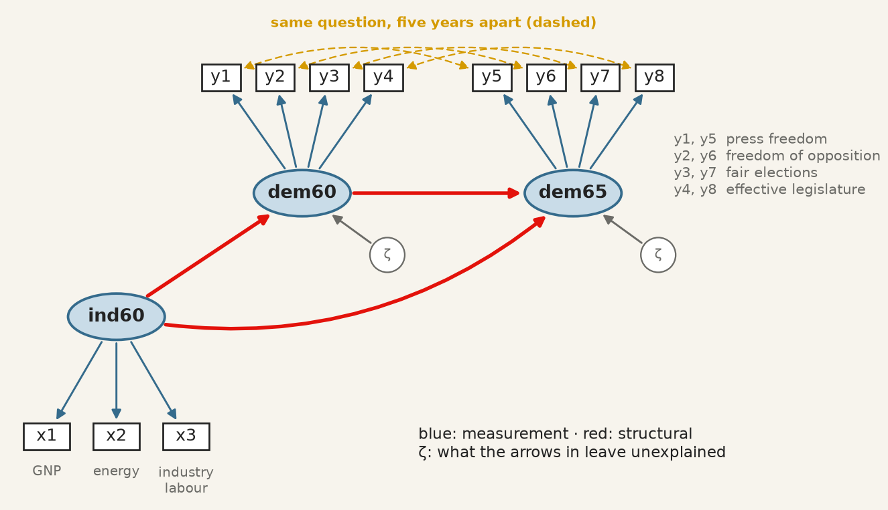{fig-alt="ind60 measured by x1 to x3, with arrows to dem60 and dem65, each measured by four indicators."}

All three operators now appear in one description:

```{python}
#| label: check-pd-fit
#| code-summary: "Run it: measurement, structure and covariances in one model"

from semopy.examples import political_democracy

countries = political_democracy.get_data()
description = """
ind60 =~ x1 + x2 + x3
dem60 =~ y1 + y2 + y3 + y4
dem65 =~ y5 + y6 + y7 + y8
dem60 ~ ind60
dem65 ~ ind60 + dem60
y1 ~~ y5
y2 ~~ y6
y3 ~~ y7
y4 ~~ y8
"""
pd_model = semopy.Model(description)
pd_model.fit(countries)
est = pd_model.inspect(std_est=True)

paths = est[(est["op"] == "~") & est["lval"].isin(["dem60", "dem65"])]
print(paths[["lval", "op", "rval", "Estimate", "Est. Std", "p-value"]].round(3))
```

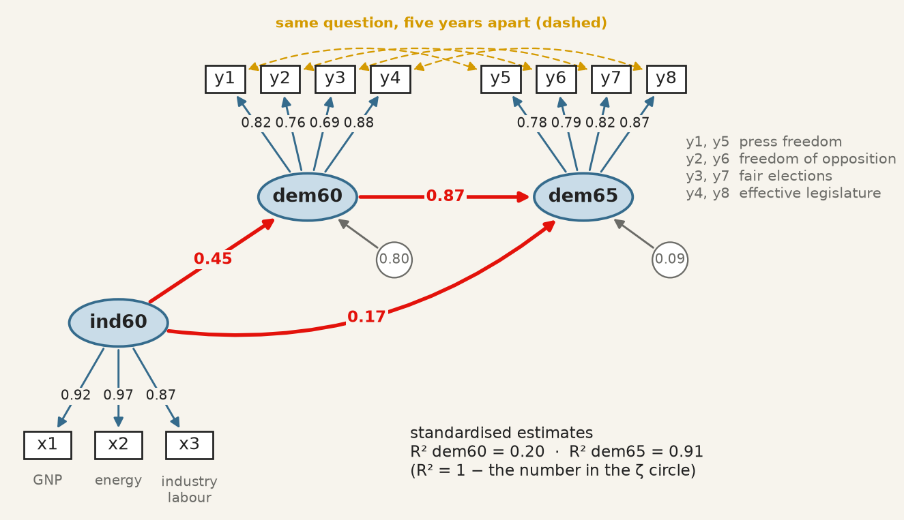{fig-alt="The democracy model with standardised loadings and paths."}

A country one standard deviation more industrialised in 1960 was 0.45 standard
deviations more democratic that year. Democracy is very persistent (0.87), and
industrialisation adds a smaller direct push to 1965 on top of that persistence
(0.17, $p = 0.015$). Industrialisation explains 20% of the variance of democracy in
1960; with 1960 democracy it explains 91% of 1965. All eleven loadings exceed
0.69.

**Direct and indirect effects.** Industrialisation reaches 1965 by two roads:
straight there, and through 1960 democracy. Along a road, standardised paths
multiply.

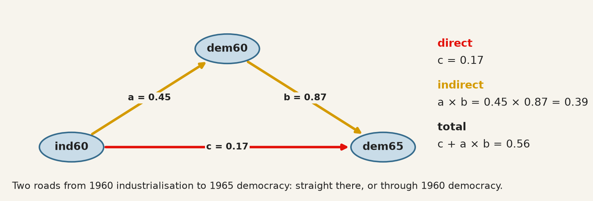{fig-alt="Direct path c and indirect route a times b."}

```{python}
#| label: check-pd-effects
#| code-summary: "Run it: direct, indirect and total effect"

a = est.loc[(est["lval"] == "dem60") & (est["rval"] == "ind60"), "Est. Std"].iloc[0]
b = est.loc[(est["lval"] == "dem65") & (est["rval"] == "dem60"), "Est. Std"].iloc[0]
c = est.loc[(est["lval"] == "dem65") & (est["rval"] == "ind60"), "Est. Std"].iloc[0]
print(f"direct    c         = {c:.2f}")
print(f"indirect  a * b     = {a:.2f} * {b:.2f} = {a * b:.2f}")
print(f"total     c + a * b = {c + a * b:.2f}")
```

Two-thirds of the total effect (0.39 of 0.56) runs through 1960 democracy: a
mediation, in which dem60 carries most of what industrialisation does for dem65.
The arithmetic is exact within the model; whether it is a causal decomposition
depends entirely on whether the arrows are, which is the subject of the next two
sections.

**Every extra arrow needs a reason.** The four same-question covariances changed
the fit, and it is worth seeing by how much:

```{python}
#| label: check-pd-covariances
#| code-summary: "Run it: the model with and without the same-question covariances"

base = """
ind60 =~ x1 + x2 + x3
dem60 =~ y1 + y2 + y3 + y4
dem65 =~ y5 + y6 + y7 + y8
dem60 ~ ind60
dem65 ~ ind60 + dem60
"""
same_question = "y1 ~~ y5 \n y2 ~~ y6 \n y3 ~~ y7 \n y4 ~~ y8"
for name, desc in {"without": base, "with": base + same_question}.items():
    m = semopy.Model(desc)
    m.fit(countries)
    s = semopy.calc_stats(m)
    print(f"{name:8} chi2 = {s['chi2'].iloc[0]:5.1f}  df = {s['DoF'].iloc[0]:.0f}"
          f"  p = {s['chi2 p-value'].iloc[0]:.3f}  CFI = {s['CFI'].iloc[0]:.3f}"
          f"  RMSEA = {s['RMSEA'].iloc[0]:.3f}")
```

With them, $\chi^2$ no longer rejects ($p = 0.064$), CFI reaches 0.980 and RMSEA
0.071, and the structural paths barely move. They are legitimate here because the
design predicts them. The same four lines added *because they raise the CFI* would
be fitting noise — and correlated residuals added until a model passes are the
most common way an SEM paper overstates its evidence.

## What the estimator assumes

Nothing above said how $\theta$ is chosen. The default, in `semopy` as in
`lavaan`, is **maximum likelihood**, and the likelihood it maximises is the
multivariate normal one. That assumption is not decoration: the $\chi^2$
statistic and every standard error in the output are derived from it.

When the data are not multivariate normal — and survey items with floor or
ceiling effects rarely are — the failure runs in one direction, which is what
makes it dangerous. The $\chi^2$ statistic is inflated, so a model that fits is
rejected. The standard errors are too small, so paths look more significant than
they are. Non-normality does not make you cautious. It makes you confident.

The first check is one test per indicator, with functions you already have:

```{python}
#| label: check-normality
#| code-summary: "Run it: Shapiro–Wilk, skewness and kurtosis for each test"

from scipy import stats

for t in tests:
    W, p = stats.shapiro(data[t])
    print(f"{t}  W = {W:.3f}  p = {p:.4f}  skew = {data[t].skew():5.2f}"
          f"  excess kurtosis = {data[t].kurt():5.2f}")
```

Six of the nine tests reject univariate normality at the 1% level, though none is
far from it: the skewness stays below 0.9 and the excess kurtosis below 1.3,
small enough that maximum likelihood is a defensible default here. Passing one
indicator at a time is not the assumption actually being made, which is joint.
Mardia's measures of multivariate skewness and kurtosis,

$$
b_1 = \frac{1}{n^2}\sum_i \sum_j d_{ij}^3 ,
\qquad
b_2 = \frac{1}{n}\sum_i d_{ii}^2 ,
\qquad
d_{ij} = (x_i - \bar x)^\top S^{-1} (x_j - \bar x),
$$

test it directly; under normality $b_2$ has mean $k(k+2)$, and every indicator can
pass Shapiro–Wilk while the joint distribution fails both.

The answer to non-normality is not to abandon the model but to change the
estimator. **Robust maximum likelihood** — `MLR`, resting on the Satorra–Bentler
scaled $\chi^2$ — keeps the ML point estimates and rescales the test statistic and
the standard errors by the non-normality actually observed. For ordinal
indicators, **WLSMV** treats a five-point item as a coarsened continuous variable
rather than pretending its categories are numbers. Either way, report the
estimator alongside the fit.

## Good fit is not evidence that the model is correct

This is the chapter's most important section and the objective most often
recited without being understood.

A model that fits well has demonstrated one thing: the covariances it implies
are close to the covariances observed. It has *not* demonstrated that its causal
structure is right, because **other models — with different, even opposite,
causal claims — can imply exactly the same covariance matrix.** They are called
equivalent models, they exist for almost every model anyone fits, and no amount
of data distinguishes them.

```{python}
#| label: check-equivalent
#| code-summary: "Run it: industry causes democracy, and democracy causes industry"

measurement = "ind60 =~ x1 + x2 + x3 \n dem60 =~ y1 + y2 + y3 + y4 \n"
for arrow in ["dem60 ~ ind60", "ind60 ~ dem60"]:
    m = semopy.Model(measurement + arrow)
    m.fit(countries)
    s = semopy.calc_stats(m)
    print(f"{arrow}:  chi2 = {s['chi2'].iloc[0]:.4f}  df = {s['DoF'].iloc[0]:.0f}"
          f"  CFI = {s['CFI'].iloc[0]:.4f}  RMSEA = {s['RMSEA'].iloc[0]:.4f}")
```

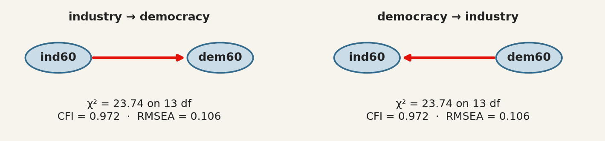{fig-alt="ind60 to dem60 and dem60 to ind60, with identical fit."}

Identical $\chi^2$, identical degrees of freedom, identical CFI and RMSEA — for
two models asserting opposite causal directions. No fit index can prefer one,
because fit indices measure distance from the observed covariances and both
reproduce them equally.

This is the same structural fact as chapter 7's rotation indeterminacy, in a more
dangerous costume: there, the alternatives were obviously arbitrary and everyone
knew a rotation had been chosen; here, the alternative is a different theory of
how the world works, and the output looks like a result.

The consequence for practice is exact. **The direction of the arrows is an
assumption you supply, and the fit statistics cannot audit it.** What can audit
it is subject knowledge, temporal order — a cause cannot follow its effect, which
is why the 1960-to-1965 arrow is more defensible than the 1960-to-1960 one — and
design, which is what chapters 10 and 11 are about.

## What SEM does not fix

**It does not make cross-sectional data longitudinal.** Estimating a path from
$A$ to $B$ measured at the same moment identifies a direction only because you
declared one.

**It does not remove confounding.** An omitted common cause of two constructs
biases the path between them exactly as it biases a regression coefficient. The
latent variables absorb measurement error, not confounders.

**It is demanding of sample size.** With a small $n$ the $\chi^2$ test has little
power to reject a wrong model, and the fit indices are themselves unstable — so
"good fit" in a small sample is the weakest possible evidence. Bollen's 75
countries are a small sample, and the good fit of the democracy model should be
read with that in mind.

**Comparisons across groups require an extra assumption.** Comparing a construct
between, say, countries presumes it is measured the same way in each. That is
*measurement invariance*, it is testable by fitting the model with loadings
constrained equal across groups, and comparing means without testing it can
manufacture a difference out of a translation [@cheung2002]. The two schools
above, where one modification helped in one and not the other, are a small
instance of the same problem.

## The recipe

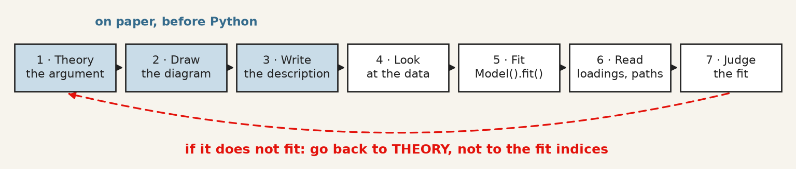{fig-alt="Seven boxes from theory to judging the fit, with a dashed arrow back to theory."}

| Step | What you do | In Python |
|---|---|---|
| 1–3 | argue which indicators measure which construct, draw it, write one line per ellipse | a string with `=~`, `~`, `~~` |
| 4 | look at the correlations: can you see your groups? | `data[cols].corr()`, `plt.imshow` |
| 5 | fit | `semopy.Model(description)`, `.fit(data)` |
| 6 | read loadings and paths, standardised | `.inspect(std_est=True)` |
| 7 | judge the fit, all four indices | `semopy.calc_stats(model)` |

## A short review of the literature

::: {.lit}
The method has two ancestors that met in the 1970s. @wright1934 developed path
analysis in genetics, with the diagram as the model and the decomposition of
correlations along paths; @spearman1904 and the factor-analytic tradition
supplied latent variables measured by indicators. @joreskog1971 combined them
into the general covariance-structure model that all current software
implements, @bollen1989 wrote the textbook that taught a generation to use it —
the political-democracy model above is its running example — and @rosseel2012
gave the modern open-source implementation whose syntax `semopy` follows in
Python.

Assessment of fit is where the applied literature has moved most. @bentler1990
introduced the comparative fit index and @browne1992 the RMSEA, both as responses
to the chi-square test's sensitivity to sample size. @hu1999 proposed the
cut-offs now universally quoted — CFI and TLI above 0.95, RMSEA below 0.06 —
while cautioning against exactly the mechanical application that followed.

@maccallum2000 reviewed a decade of applied practice and found the recurring
faults to be the ones this chapter warns about: models modified until they fit
and then reported as though specified in advance, equivalent models never
considered, and causal language attached to cross-sectional designs.
@cheung2002 supplies the invariance testing that any cross-group comparison
requires and most omit.
:::

## What to report

1. **The model, as a diagram or as its description.** Every arrow is a claim; a
   reader cannot evaluate claims they cannot see.
2. **How the latent scale was set** — a fixed loading or a fixed variance — so
   nobody misreads the parameter without a standard error.
3. **Standardised loadings for every indicator**, not only the significant ones,
   and what you did about weak items. Dropping an indicator after seeing its
   loading is a data-dependent decision; say so.
4. **The chi-square with its degrees of freedom and p-value**, alongside CFI, TLI
   and RMSEA, and the convention you judged them against. Reporting only the
   indices that pass is the single most common failure.
5. **Whether the model was modified after fitting**, and on what grounds. A model
   reached through modification indices or residuals is exploratory whatever its
   fit, until it holds on data it has not seen.
6. **At least one equivalent model, named.** If you cannot think of one, that is
   a reason to look harder rather than evidence there is none.
7. **What the arrows do not license.** Direction was assumed, not discovered.
   With cross-sectional data the model estimates the strength of a relationship
   under a causal structure you supplied, and a good fit is consistent with that
   structure being wrong.
