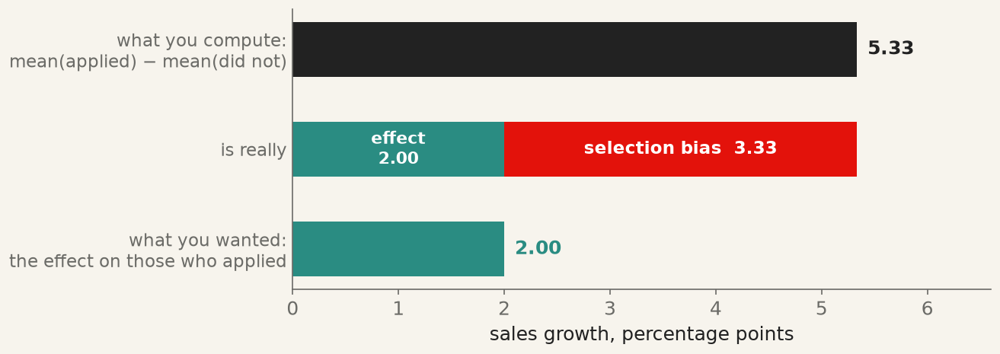
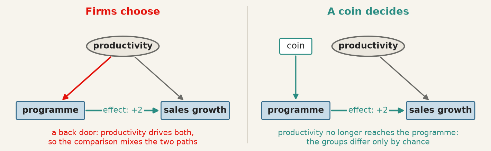
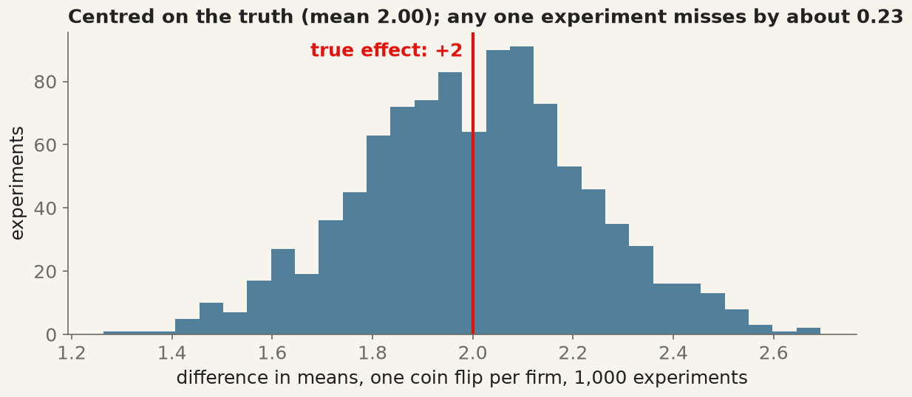
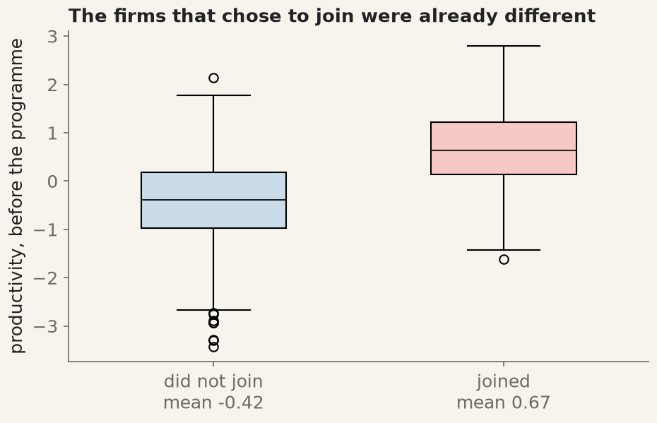
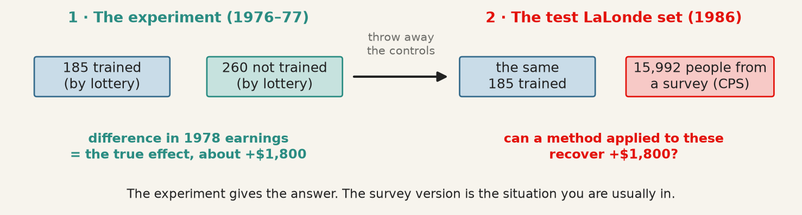
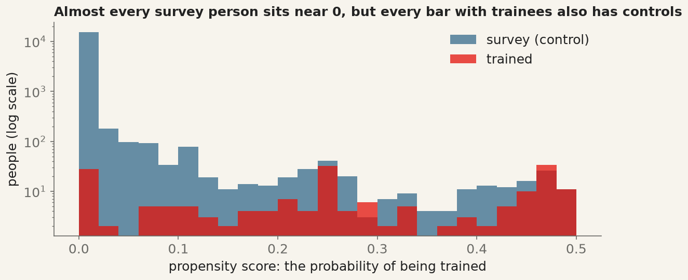
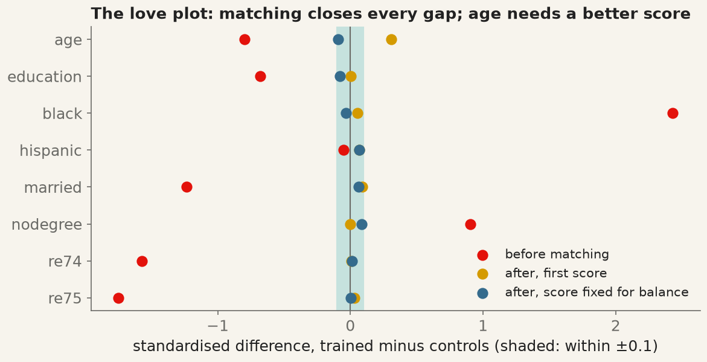
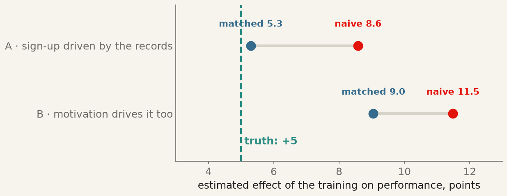
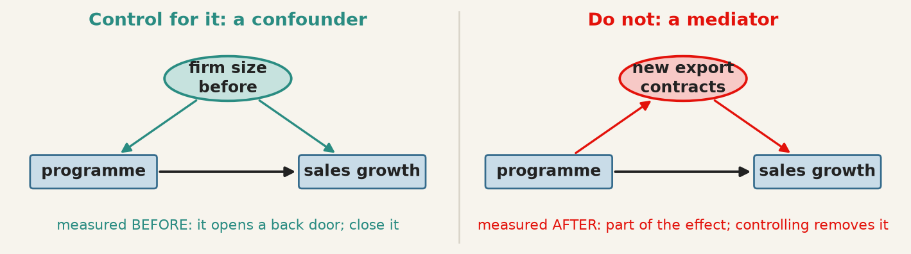
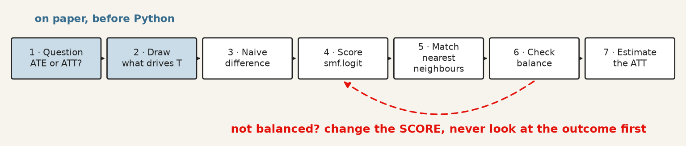

<!-- The deck teaches through three examples first, with no code on screen:
     simulated firms where the truth is known (randomisation against
     self-selection), LaLonde's job-training data (matching tested against an
     experiment), and a simulated HR training scheme (matching that works, then
     fails on an unmeasured confounder). The code comes last, in the in-class
     part, where every cell is live: it executes at render time, so the output
     on the slides is the output the students' own machines produce. Every
     visible cell is plain Python — numpy, pandas, statsmodels, scikit-learn,
     matplotlib — and either simulates its data or reads it straight from
     Rajeev Dehejia's NBER page with pd.read_stata, so a student can copy any
     one cell into a file and run it.
     The diagrams and charts are drawn by economist-assets/build_causal_figures.py,
     from the same simulations and the same data, so every number on a picture
     is the number the matching cell prints. -->
```{python}
#| label: setup
#| echo: false

# Hidden: keep library warnings off the slides, and print tables wide.
import warnings
warnings.filterwarnings("ignore")
import pandas as pd
pd.set_option("display.width", 96)
pd.set_option("display.max_columns", 10)
```

<!-- BEGIN deck-frontmatter · scripts/build_deck_frontmatter.py -->

## Outline · The hour ahead {.center .scrollable}

1. Part 1 · The language of causal inference
2. Example 1 · Did the export programme work?
3. Example 2 · LaLonde's test
4. Example 3 · Does analytics training raise performance?
5. Wrapping up · What matching does not fix
6. In class · The code behind the three examples

## What session 10 is for {.scrollable}
::::: columns

:::: {.column width="33%"}

### The mathematics

- State the **fundamental problem of causal inference**, and write the naive difference as effect plus **selection bias**
- Explain why **randomisation** solves it, and what it costs
- Estimate a **propensity score** and match treated to control units
- Report an **ATT**, and state the assumption it rests on
- Say why matching and regression rest on the **same assumption**, and where they differ

::::

:::: {.column width="33%"}

### The Python

- Simulate both potential outcomes and watch a coin flip recover the effect
- Fit a propensity score with `smf.logit` and match with `NearestNeighbors`
- Check **overlap** and **balance** (standardised differences) before reading any estimate
- Score the naive, regression and matched estimates against an experimental benchmark
- Simulate an **unmeasured confounder** and watch a perfect balance check miss it

::::

:::: {.column width="33%"}

### The international business

- Estimate the effect of a programme that firms chose rather than drew
- Say why the firms that joined were already different
- Report how far the naive comparison would have been wrong

::::

:::::

## Your Python so far {.scrollable}

Everything you need to type is on one sheet — how to start Python in VS Codium on
your platform, how to make a file and run it, the DataFrame basics, and every name from sessions 1 to 10, each with a line showing it in use.

> **[Python Cheatsheet · Session 10](https://warint.github.io/quantitative-methods/python-cheatsheet-10.pdf)** (PDF) ·
> in the repository at `10-…/PYTHON-CHEATSHEET.pdf`

**One sheet per package, functions explained with pictures:** [pandas](https://warint.github.io/quantitative-methods/python-cheatsheets/pandas.pdf) · [NumPy](https://warint.github.io/quantitative-methods/python-cheatsheets/numpy.pdf) · [matplotlib](https://warint.github.io/quantitative-methods/python-cheatsheets/matplotlib.pdf) · [statsmodels](https://warint.github.io/quantitative-methods/python-cheatsheets/statsmodels.pdf) · [scikit-learn](https://warint.github.io/quantitative-methods/python-cheatsheets/sklearn.pdf) · [SciPy](https://warint.github.io/quantitative-methods/python-cheatsheets/scipy.pdf)

::: {.muted}
Print it, or keep it open beside the editor. Nothing on it is examinable; all of it is
assumed.
:::

<!-- END deck-frontmatter -->

## Part 1 · The language of causal inference {.center}

## Did the programme work? {.scrollable}

A government runs an **export-promotion programme**: advice, trade missions, a subsidy for the first
foreign trade fair. Two years later, the firms that joined have grown their export sales **5.3 points
faster** than the firms that did not.

::: columns
::: {.column width="50%"}
::: {.step}
**The tempting reading:** the programme added 5.3 points of growth. Fund it again, and bigger.
:::
:::
::: {.column width="50%"}
::: {.warn}
**The question to ask first:** which firms *chose* to join? If the better firms joined, they would
have grown faster anyway, and the 5.3 points is partly the programme and partly the firms.
:::
:::
:::

::: {.check}
**Today's question:** *did the policy do anything, or were the groups different to begin with?* Three
examples answer it: simulated firms where we know the truth, a real training programme with an
experiment to check against, and a training scheme where the method quietly fails.
:::

## Every firm has two outcomes; you see one {.scrollable}

{.mid fig-alt="Six firms, each with sales growth with and without the programme. For each firm only one of the two is observed; the other, and the effect, are question marks."}

For firm $i$: $Y_i(1)$ is its sales growth **with** the programme, $Y_i(0)$ **without**. The effect
for that firm is $\tau_i = Y_i(1) - Y_i(0)$. A firm either joins or does not, so one of the two is
**always missing**, and so is $\tau_i$.

## The fundamental problem, and what we estimate instead {.scrollable}

::: {.warn}
**No individual effect is ever observed** (Holland, 1986). Causal inference is a **missing-data
problem**: we fill in the missing column with *other firms* who look like this one, and the whole
method is in choosing those other firms well.
:::

What we can hope to estimate is an **average**:

| Name | Formula | In words | When you want it |
|---|---|---|---|
| **ATE** · average treatment effect | $\mathrm{E}[Y(1) - Y(0)]$ | the effect if **every** firm joined | rolling the programme out to all |
| **ATT** · average treatment effect on the treated | $\mathrm{E}[Y(1) - Y(0) \mid T = 1]$ | the effect on the firms **that joined** | was it worth it for those who used it? |

::: {.muted}
$T$ is the treatment: 1 if the firm joined, 0 if not. Matching, today's method, estimates the **ATT**.
:::

## Words you will need {.scrollable}

| Term | What it is | In this session's examples |
|---|---|---|
| **Treatment** / **control** | the group that got the programme / the group that did not | firms that joined; trainees; employees who took the course |
| **Potential outcomes** | $Y(1)$ and $Y(0)$: what would happen with and without treatment. The one not observed is the **counterfactual** | sales growth with and without the programme |
| **Confounder** | a variable, fixed before treatment, that drives **both** who is treated and the outcome | productivity; past earnings; motivation |
| **Selection bias** | how differently the two groups would have done **without** treatment | 3.33 points for the firms |
| **Propensity score** | $e(x) = P(T = 1 \mid X = x)$: the probability of being treated, given the confounders | the logit of Example 2 |
| **Balance** | the treated and control groups look alike on every confounder (standardised differences within ±0.1) | the love plot |
| **Overlap** | for every treated unit there are controls with a similar score | the log-scale histogram |
| **Conditional independence** | given the measured $X$, who was treated is as good as random. **Untestable** | what fails in Example 3 |

## Why the naive comparison fails, in one line {.scrollable}

$$
\underbrace{\mathrm{E}[Y \mid T{=}1] - \mathrm{E}[Y \mid T{=}0]}_{\text{what you compute}}
=
\underbrace{\mathrm{E}[Y(1) - Y(0) \mid T{=}1]}_{\text{ATT: what you want}}
+
\underbrace{\mathrm{E}[Y(0) \mid T{=}1] - \mathrm{E}[Y(0) \mid T{=}0]}_{\text{selection bias}}
$$

{.wide fig-alt="A bar of 5.33 split into the effect, 2.00, and selection bias, 3.33."}

::: {.check}
**Selection bias** is how differently the two groups would have done **without** the programme. Here
(from Example 1) the firms that joined would have grown 3.33 points faster anyway.
:::

## The picture behind the bias: a back door {.scrollable}

{.mid fig-alt="Left: productivity causes both joining the programme and sales growth. Right: a coin decides who joins, and productivity no longer reaches the programme."}

::: {.check}
**Left:** productive firms join more *and* grow more, so the comparison picks up both paths.
**Right:** a coin cannot know which firms are productive, so the back door is shut, and the
difference in means measures the programme alone. That is the whole case for **randomisation**.
:::

## Example 1 · Did the export programme work? {.center}

## The data: 1,000 firms, both columns written down {.scrollable}

In a simulation we can do what real data never allows: write down **both** potential outcomes.

::: columns
::: {.column width="50%"}
$$
\begin{aligned}
Y_i(0) &= 10 + 3\,\text{productivity}_i + \text{noise}_i \\
Y_i(1) &= Y_i(0) + 2
\end{aligned}
$$

- **productivity**: drawn for each firm; nobody in the ministry sees it
- more productive firms grow faster **with or without** the programme
- the effect is exactly **+2 for every firm**: the number each method must recover
:::

::: {.column width="50%"}
::: {.step}
**The question:** two ways of deciding who joins, the same firms, the same true effect.

1. **A coin decides.**
2. **The firms decide**: productive firms are more likely to apply.

Which comparison finds the +2?
:::
:::
:::

## A coin decides {.scrollable}

| | Joined (heads) | Did not join (tails) |
|---|---|---|
| mean productivity, before the programme | −0.04 | −0.10 |
| outcome you observe | sales **with** the programme | sales **without** it |

::: {.check}
**One experiment:** the plain difference in means gives **2.15**, close to the true +2. The two groups have
nearly the same productivity: the coin balanced it **without anyone measuring it**. The 0.15 is luck,
not bias, as a thousand experiments show:
:::

{.mid fig-alt="Histogram of 1,000 differences in means, centred on the true effect of 2, with a spread of about 0.23."}

::: {.muted}
That spread is what a **standard error** measures: randomisation turns bias into noise, and noise is what
confidence intervals are for.
:::

## Now the firms choose {.scrollable}

Same firms, same true effect of +2, but now **productive firms are more likely to join**.

{.wide fig-alt="A bar of 5.33 split into the effect, 2.00, and selection bias, 3.33."}

::: {.warn}
**The naive comparison says 5.33.** The gap, **3.33**, is exactly the selection bias of the formula: the
firms that joined would have grown 3.33 points faster without the programme. In real data that number
cannot be computed, because it needs the column you never see.
:::

## You *can* see that the groups differ {.scrollable}

::: columns
::: {.column width="55%"}
{.mid fig-alt="Box plots of productivity: firms that did not join average -0.42, firms that joined 0.67."}
:::

::: {.column width="45%"}
::: {.check}
**The firms that joined were about one standard deviation more productive** before the programme
existed.
:::

::: {.step}
This is the **balance check**: compare the groups on what was fixed **before** treatment. In real data you
cannot see the bias, but you can see this, and it tells you the naive comparison is not to be trusted.
:::
:::
:::

## What randomisation buys, and what it costs {.scrollable}

::: columns
::: {.column width="50%"}
::: {.check}
**Buys:**

- balance on **everything**, measured or not
- an unbiased estimate from a **difference in means**
- a standard error that means what it says
:::
:::
::: {.column width="50%"}
::: {.warn}
**Costs:**

- often impossible: you cannot randomise which **countries** sign a trade agreement
- sometimes unethical, often expensive
- tells you about the people in the trial: **external validity** is argued, not estimated
:::
:::
:::

## Example 1 · Plain summary {.scrollable}

- With a coin, the difference in means finds the truth on average (2.15 once; 2 over a thousand tries).
- When firms choose, the same difference says **5.33**: 2 of programme, 3.33 of selection.
- The selection bias itself is invisible; the **imbalance** that causes it is not.

::: {.step}
**What this example teaches:** without a coin, the question becomes *can we build a control group that
looks like the treated group?* Example 2 tests that where the right answer is known.
:::

## Example 2 · LaLonde's test {.center}

## The data: a training lottery, and a survey {.scrollable}

{.mid fig-alt="Left: the experiment, 185 trained and 260 untrained by lottery. Right: the same 185 trained compared with 15,992 people from a survey."}

The **National Supported Work** programme (US, 1976–77) gave disadvantaged workers a job-training
placement **by lottery**. LaLonde (1986) kept the trainees, threw away the lottery's controls, and
asked whether the methods economists use on survey data would recover the experiment's answer.

| Column | Meaning | Column | Meaning |
|---|---|---|---|
| `treat` | 1 = trained | `married`, `nodegree` | 1 = married; 1 = no high-school diploma |
| `age`, `education` | years | `re74`, `re75` | earnings in 1974 and 1975, **before** training, in dollars |
| `black`, `hispanic` | 1 = yes | `re78` | earnings in 1978, **after**: the outcome, in dollars |

## The answer, and the naive estimate {.scrollable}

| Comparison | Estimate | Reading |
|---|---|---|
| **the experiment**: trainees vs the lottery's losers | **+\$1,794** (s.e. \$633, p = 0.005) | the benchmark every method must hit |
| **naive**: trainees vs 15,992 survey people | **−\$8,498** | the wrong sign, five times too large |

::: {.warn}
**Nothing is wrong with the arithmetic.** The survey's average worker earned far more than these trainees
ever would have: that is selection bias, about \$10,000 of it.
:::

## How different are the groups? {.scrollable}

| | Trained | Survey | Standardised difference |
|---|---|---|---|
| age | 25.8 | 33.2 | −0.80 |
| education (years) | 10.4 | 12.0 | −0.68 |
| black | 0.84 | 0.07 | **2.43** |
| hispanic | 0.06 | 0.07 | −0.05 |
| married | 0.19 | 0.71 | −1.23 |
| no diploma | 0.71 | 0.30 | 0.90 |
| earnings 1974 | \$2,096 | \$14,017 | −1.57 |
| earnings 1975 | \$1,532 | \$13,651 | −1.75 |

::: {.check}
**The standardised difference** is the gap in means in standard deviations, so years and dollars compare.
Below **0.1** is balanced; seven of eight are out by **0.7 to 2.4**.
:::

## The idea of matching: one number to compare on {.scrollable}

{.wide fig-alt="Treated people on top, controls below, on a propensity-score axis. Each treated person is joined by a line to the control with the closest score; controls far from every treated person are grey and unused."}

::: columns
::: {.column width="50%"}
**Propensity score** $e(x) = P(T = 1 \mid X = x)$: the probability of being trained, given the eight
characteristics. Fit it with a **logit** (session 4).
:::
::: {.column width="50%"}
**Rosenbaum and Rubin (1983):** if the eight $X$ explain who got trained, comparing people with the
**same score** is as good as comparing people with the same eight $X$. Eight dimensions become one.
:::
:::

::: {.check}
**Matching:** pair each trainee with the survey person whose score is **closest**: the nearest
neighbour of session 8, on one number. The matched controls fill in the missing column.
:::

## The score, and overlap {.scrollable}

::: columns
::: {.column width="55%"}
{.mid fig-alt="Histograms of the propensity score on a log scale: almost all survey people near zero, but survey people present in every bar where trainees are."}
:::

::: {.column width="45%"}
::: {.check}
**The score:** a trainee's median score is **0.26**; a survey person's is **0.0001**.
:::

::: {.step}
**Overlap:** almost all 15,992 survey people sit in the first bar. But **every bar where trainees are
also has survey people**, 534 with a score above 0.05: there is someone to compare with.
:::

::: {.muted}
The logit's coefficients are *not* the result and are never reported: the score is a tool, judged only
by the balance it produces.
:::
:::
:::

## Match, then check balance, before the outcome {.scrollable}

::: columns
::: {.column width="55%"}
{.big fig-alt="Love plot: red dots before matching far from zero, gold after the first score all close except age at 0.31, blue after the improved score all within plus or minus 0.1."}
:::

::: {.column width="45%"}
**First score** (gold): each trainee paired with the closest survey person; 185 trainees use 124
distinct controls (**with replacement**). Earnings, race and diploma are balanced; **age is off by 0.31**.

**Fixed score** (blue): add $\text{age}^2$ and "earned nothing in 1974 / 1975". Every difference is now
**inside ±0.1**.

::: {.warn}
**All of this is decided before anyone looks at 1978 earnings.** Choosing the score by balance, not by
the answer, is what makes the estimate defensible.
:::
:::
:::

## Only now, the outcome {.scrollable}

{.mid fig-alt="Five estimates on one axis: naive −8,498, regression +699, first matching +1,831, balanced matching +2,001, and the experiment +1,794 with its 95% interval."}

::: columns
::: {.column width="50%"}
::: {.check}
**Matching gives +\$2,001**, within a third of a standard error of the experiment's **+\$1,794**. From
−\$8,498 to the right answer, using only survey data. The first score gave +\$1,831: balance moved the
estimate by \$170, and it is the balance check, not the number, that makes it defensible.
:::
:::
::: {.column width="50%"}
::: {.warn}
**Regression with the same eight controls gives +\$699.** A linear model compares trainees with survey
people earning \$14,000, by extrapolating along a straight line. Matching only compares like with like.
:::
:::
:::

## Example 2 · Plain summary {.scrollable}

- The experiment says training raised 1978 earnings by about **\$1,800**.
- Against survey controls, the naive comparison says **−\$8,500**: selection, not training.
- A propensity score, an overlap check and a balance check, all **before** the outcome, bring matching to
  **+\$2,001**, inside the experiment's interval. Regression with the same variables misses.

::: {.step}
**What this example teaches:** matching can recover an experiment's answer from observational data, when
the variables that drove selection are in the data. Example 3 asks what happens when they are not.
:::

## Example 3 · Does analytics training raise performance? {.center}

## The case: an HR analytics team {.scrollable}

A large public-sector organisation offers its employees an **advanced data-analytics course**. Taking it is
voluntary. The human-resources (HR) analytics team wants to know whether it raises **job performance**, a standardised
annual score.

| Column | Meaning |
|---|---|
| `age`, `education`, `experience` | from the HR file: years |
| `treat` | 1 = took the course |
| `performance` | the annual score, **after** the course |
| `motivation` | **not in the HR file**: nobody measures it |

::: {.step}
**The data are simulated**, 800 employees, so we know the truth: the course adds **+5 points** to everyone.
Older and more educated employees are more likely to sign up. Two versions:

- **A:** sign-up depends only on what is in the HR file.
- **B:** **motivated** employees also sign up more, and motivation raises performance on its own.
:::

## The results, against the truth {.scrollable}

{.mid fig-alt="Version A: naive 8.6, matched 5.3; version B: naive 11.5, matched 9.0; truth 5."}

::: columns
::: {.column width="50%"}
::: {.check}
**Version A:** the naive comparison says **8.6**; matching on age, education and experience gives **5.3**,
close to the truth. Exactly what Example 2 showed on real data.
:::
:::
::: {.column width="50%"}
::: {.warn}
**Version B:** the same steps, the same balance, and matching says **9.0**. Most of the bias survives,
and nothing in the output warns you.
:::
:::
:::

## Why version B fails: the love plot you cannot draw {.scrollable}

{.mid fig-alt="After matching in version B: age, education and experience within 0.1; motivation, not in the file, off by 1.14."}

::: {.warn}
**Balance can only be checked on what you measured.** On age, education and experience the match is
perfect. On motivation, which drove both sign-up and performance, the trainees are **1.14 standard
deviations** ahead of their matches. The assumption that nothing unmeasured matters, **conditional
independence**, can never be tested from the data.
:::

## Not every variable belongs in the score {.scrollable}

{.mid fig-alt="Left: firm size before the programme causes both joining and growth; control for it. Right: new export contracts are caused by the programme and cause growth; do not control for them."}

::: {.check}
**The rule:** match and control only on variables fixed **before** treatment. A variable the programme
itself changes (new contracts, a promotion after the course, the trainee's 1978 job) is part of the
effect: controlling for it removes some of what you are trying to measure.
:::

## Example 3 · Plain summary {.scrollable}

- When sign-up depends on what the HR file records, matching recovers the course's **+5**.
- When motivation also drives it, matching still balances everything **in the file** and still reports a
  number, **9.0**, nearly double the truth.
- The difference between the two versions is invisible in the data. It is an **argument** about who signs
  up and why.

::: {.step}
**What this example teaches:** matching fixes the comparison on what you measured. Whether that is enough
is a claim you defend with knowledge of the setting, not with a table.
:::

## Wrapping up · What matching does not fix {.center}

## Matching or regression? {.scrollable}

Both rest on the **same assumption**: every confounder is measured. They differ in how they use it.

| | Regression on the confounders | Matching on the propensity score |
|---|---|---|
| **Comparison** | every treated unit against a line fitted through all controls | each treated unit against the controls most like it |
| **Overlap** | not checked: extrapolates where there are no comparable controls | visible: the score's histogram shows who has a match |
| **Functional form** | must be right: linear, unless you say otherwise | needs only a good score, judged by balance |
| **Order of work** | the outcome is in the same model as the controls | the design is fixed, by balance, **before** the outcome is seen |
| **In this session** | Example 2: +\$699 | Example 2: +\$2,001 (truth \$1,794) |

::: columns
::: {.column width="50%"}
::: {.check}
**When regression is enough:** good overlap and roughly linear relations. In Example 3A it gives 4.6
against matching's 5.3 and the truth's 5.
:::
:::
::: {.column width="50%"}
::: {.warn}
**When neither works:** an unmeasured confounder (Example 3B). Then you need a design, not an
estimator: sessions 11 (difference-in-differences) and beyond.
:::
:::
:::

## What matching does not fix {.scrollable}

- **Unmeasured confounders.** Matching is regression's assumption in a different form: everything that
  drives both treatment and outcome is in $X$. If it is not, both are biased, in the same direction (Example 3B).
- **No overlap.** Treated units with no comparable control cannot be matched honestly. Drop them, and say
  that the estimate now applies only to the rest.
- **A lucky data set.** Smith and Todd (2005) showed the LaLonde result moves with the sample and the score.
  One success is evidence the method *can* work, not that it did in your project.
- **Standard errors.** The OLS (ordinary least squares) standard error on a matched sample ignores that the score was estimated and
  the controls reused; bootstrap it, or report it as approximate.
- **The order of work.** Choose the score by balance **before** looking at the outcome. Trying scores until
  the ATT looks good is p-hacking with extra steps.

## Seven steps, the same in every example {.scrollable}

{fig-alt="Seven steps from the question to the ATT, with an arrow from the balance check back to the score."}

| Step | What you do | In Python |
|---|---|---|
| 1–2 | name the estimand; argue which pre-treatment variables drive treatment | on paper |
| 3 | the naive difference, as the size of the problem | `.groupby("treat")["y"].mean()` |
| 4 | the propensity score | `smf.logit(...).fit()`, `.predict()` |
| 5 | match, and check overlap | `NearestNeighbors(n_neighbors=1)`, `.kneighbors()`, `plt.hist` |
| 6 | balance: every standardised difference inside ±0.1 | `.mean()`, `.var()`, `plt.scatter` |
| 7 | the ATT, **last** | `treated["y"].mean() - matched["y"].mean()` |

## In class · The code behind the three examples {.center}

## How this part works {.scrollable}

::: columns
::: {.column width="50%"}
Every cell that follows **runs on its own**: copy it into a new file in VS Codium, run it, and you
should see exactly the numbers from the lecture. The packages, by name: `numpy`, `pandas`,
`statsmodels`, `scikit-learn`, `matplotlib`. Examples 1 and 3 simulate their data in the cell;
Example 2 reads it from Rajeev Dehejia's page with `pd.read_stata`.
:::

::: {.column width="50%"}
::: {.step}
**For each example:**

1. run the cells and check you get the numbers from the lecture;
2. do the **Your turn** task under the last cell, changing one thing at a time.
:::
:::
:::

## Example 1 in Python · Simulate 1,000 firms, with both outcomes {.scrollable}

```{python}
#| echo: true

# Example 1 · 1,000 firms; the programme adds exactly +2 points to every one
import numpy as np
import pandas as pd

rng = np.random.default_rng(10)
n = 1000
productivity = rng.normal(0, 1, n)                        # nobody in the ministry sees this
sales_without = 10 + 3 * productivity + rng.normal(0, 2, n)
sales_with = sales_without + 2                            # the true effect: +2

firms = pd.DataFrame({"productivity": productivity,
                      "sales_without": sales_without, "sales_with": sales_with})
print(firms.head().round(2))
print("true effect, every firm:", (firms["sales_with"] - firms["sales_without"]).mean())
```

## Example 1 in Python · Let a coin decide {.scrollable}

```{python}
#| echo: true

# Example 1 · Randomise: a coin flip decides; we then see only one outcome per firm
import numpy as np
import pandas as pd

rng = np.random.default_rng(10)
n = 1000
productivity = rng.normal(0, 1, n)
sales_without = 10 + 3 * productivity + rng.normal(0, 2, n)
sales_with = sales_without + 2

coin = rng.integers(0, 2, n)                                    # 1 = joins, 0 = does not
observed = np.where(coin == 1, sales_with, sales_without)       # the column you would get

print("difference in means:", round(observed[coin == 1].mean() - observed[coin == 0].mean(), 2))
print("mean productivity, joined vs not:",
      round(productivity[coin == 1].mean(), 2), round(productivity[coin == 0].mean(), 2))
```

## Example 1 in Python · Flip the coin 1,000 times {.scrollable}

```{python}
#| echo: true
#| output-location: column
#| fig-width: 5.4
#| fig-height: 4.0

# Example 1 · Rerun the experiment: is the coin right on average?
import numpy as np
import matplotlib.pyplot as plt

rng = np.random.default_rng(10)
n = 1000
productivity = rng.normal(0, 1, n)
sales_without = 10 + 3 * productivity + rng.normal(0, 2, n)
sales_with = sales_without + 2

estimates = []
for draw in range(1000):
    coin = rng.integers(0, 2, n)
    observed = np.where(coin == 1, sales_with, sales_without)
    estimates.append(observed[coin == 1].mean() - observed[coin == 0].mean())

print("mean of the estimates:", round(np.mean(estimates), 2))
print("their spread (sd):    ", round(np.std(estimates), 2))
plt.hist(estimates, bins=30)
plt.axvline(2, color="red")
plt.xlabel("difference in means, one coin each")
plt.show()
```

## Example 1 in Python · Let the firms choose {.scrollable}

```{python}
#| echo: true

# Example 1 · Self-selection: productive firms are more likely to join
import numpy as np

rng = np.random.default_rng(10)
n = 1000
productivity = rng.normal(0, 1, n)
sales_without = 10 + 3 * productivity + rng.normal(0, 2, n)
sales_with = sales_without + 2

applies = (productivity + rng.normal(0, 1, n) > 0.5).astype(int)
observed = np.where(applies == 1, sales_with, sales_without)

naive = observed[applies == 1].mean() - observed[applies == 0].mean()
bias = sales_without[applies == 1].mean() - sales_without[applies == 0].mean()
print(f"share that joined:     {applies.mean():.2f}")
print(f"naive difference:      {naive:.2f}")
print(f"selection bias:        {bias:.2f}   (needs the column you never see)")
print(f"naive minus bias:      {naive - bias:.2f}")
```

## Example 1 in Python · The balance check {.scrollable}

```{python}
#| echo: true
#| output-location: column
#| fig-width: 5.0
#| fig-height: 4.0

# Example 1 · Compare the groups BEFORE treatment
import numpy as np
import pandas as pd
import matplotlib.pyplot as plt

rng = np.random.default_rng(10)
n = 1000
productivity = rng.normal(0, 1, n)
sales_without = 10 + 3 * productivity + rng.normal(0, 2, n)
applies = (productivity + rng.normal(0, 1, n) > 0.5).astype(int)

firms = pd.DataFrame({"productivity": productivity, "applies": applies})
print(firms.groupby("applies")["productivity"].mean().round(2))

firms.boxplot(column="productivity", by="applies")
plt.suptitle("")
plt.title("Productivity, before the programme")
plt.show()
```

::: {.step}
**Your turn.** In the self-selection cell, change `> 0.5` to `> 1.5` so that only the most productive
firms join. What happens to the naive difference and to the selection bias? Then make selection depend
on noise only: `rng.normal(0, 1, n) > 0.5`. What do you get, and why?
:::

## Example 2 in Python · The experiment's answer {.scrollable}

```{python}
#| echo: true

# Example 2 · The lottery's estimate: our benchmark
import pandas as pd
import statsmodels.formula.api as smf

url = "https://users.nber.org/~rdehejia/data/"
nsw = pd.read_stata(url + "nsw_dw.dta")            # Dehejia & Wahba's version of the experiment

print(nsw["treat"].value_counts())
experiment = smf.ols("re78 ~ treat", data=nsw).fit()
print(experiment.summary().tables[1])
```

## Example 2 in Python · The naive estimate {.scrollable}

```{python}
#| echo: true

# Example 2 · The 185 trainees against 15,992 people from the Current Population Survey
import pandas as pd

url = "https://users.nber.org/~rdehejia/data/"
nsw = pd.read_stata(url + "nsw_dw.dta")
cps = pd.read_stata(url + "cps_controls.dta")
data = pd.concat([nsw[nsw["treat"] == 1], cps], ignore_index=True)

print(data["treat"].value_counts())
print(data.groupby("treat")["re78"].mean().round(0))
naive = data.loc[data["treat"] == 1, "re78"].mean() - data.loc[data["treat"] == 0, "re78"].mean()
print(f"naive estimate: {naive:,.0f} dollars")
```

## Example 2 in Python · Balance before matching {.scrollable}

```{python}
#| echo: true

# Example 2 · Means and standardised differences, before matching
import numpy as np
import pandas as pd

url = "https://users.nber.org/~rdehejia/data/"
nsw = pd.read_stata(url + "nsw_dw.dta")
cps = pd.read_stata(url + "cps_controls.dta")
data = pd.concat([nsw[nsw["treat"] == 1], cps], ignore_index=True)
X = ["age", "education", "black", "hispanic", "married", "nodegree", "re74", "re75"]

treated, control = data[data["treat"] == 1], data[data["treat"] == 0]
sd = np.sqrt((treated[X].var() + control[X].var()) / 2)
balance = pd.DataFrame({"treated": treated[X].mean(), "control": control[X].mean()})
balance["std. diff."] = (treated[X].mean() - control[X].mean()) / sd
print(balance.astype(float).round(2))
```

## Example 2 in Python · The propensity score {.scrollable}

```{python}
#| echo: true

# Example 2 · A logit of treatment on the pre-training characteristics
import pandas as pd
import statsmodels.formula.api as smf

url = "https://users.nber.org/~rdehejia/data/"
nsw = pd.read_stata(url + "nsw_dw.dta")
cps = pd.read_stata(url + "cps_controls.dta")
data = pd.concat([nsw[nsw["treat"] == 1], cps], ignore_index=True)

score = smf.logit("treat ~ age + education + black + hispanic + married + nodegree + re74 + re75",
                  data=data).fit(disp=0)
data["pscore"] = score.predict(data)
print(data.groupby("treat")["pscore"].describe().round(3))
```

## Example 2 in Python · Overlap {.scrollable}

```{python}
#| echo: true
#| output-location: column
#| fig-width: 5.4
#| fig-height: 4.0

# Example 2 · The two distributions of the score
import numpy as np
import pandas as pd
import matplotlib.pyplot as plt
import statsmodels.formula.api as smf

url = "https://users.nber.org/~rdehejia/data/"
nsw = pd.read_stata(url + "nsw_dw.dta")
cps = pd.read_stata(url + "cps_controls.dta")
data = pd.concat([nsw[nsw["treat"] == 1], cps], ignore_index=True)
score = smf.logit("treat ~ age + education + black + hispanic + married + nodegree + re74 + re75",
                  data=data).fit(disp=0)
data["pscore"] = score.predict(data)

bins = np.linspace(0, 0.5, 26)
plt.hist(data.loc[data["treat"] == 0, "pscore"], bins=bins, alpha=0.6, label="survey (control)")
plt.hist(data.loc[data["treat"] == 1, "pscore"], bins=bins, alpha=0.6, label="trained")
plt.yscale("log")
plt.xlabel("propensity score")
plt.legend()
plt.show()

print("controls with a score above 0.05:", (data.loc[data["treat"] == 0, "pscore"] > 0.05).sum())
```

## Example 2 in Python · Match {.scrollable}

```{python}
#| echo: true

# Example 2 · 1:1 nearest-neighbour matching on the score, with replacement
import pandas as pd
import statsmodels.formula.api as smf
from sklearn.neighbors import NearestNeighbors

url = "https://users.nber.org/~rdehejia/data/"
nsw = pd.read_stata(url + "nsw_dw.dta")
cps = pd.read_stata(url + "cps_controls.dta")
data = pd.concat([nsw[nsw["treat"] == 1], cps], ignore_index=True)
score = smf.logit("treat ~ age + education + black + hispanic + married + nodegree + re74 + re75",
                  data=data).fit(disp=0)
data["pscore"] = score.predict(data)

treated, control = data[data["treat"] == 1], data[data["treat"] == 0]
nn = NearestNeighbors(n_neighbors=1).fit(control[["pscore"]])
distance, index = nn.kneighbors(treated[["pscore"]])
matched = control.iloc[index.ravel()]

print(f"{len(treated)} trainees matched to {matched.index.nunique()} different controls")
print(f"largest gap in score between a pair: {distance.max():.4f}")
```

## Example 2 in Python · Balance after matching {.scrollable}

```{python}
#| echo: true

# Example 2 · Standardised differences, before and after matching
import numpy as np
import pandas as pd
import statsmodels.formula.api as smf
from sklearn.neighbors import NearestNeighbors

url = "https://users.nber.org/~rdehejia/data/"
nsw = pd.read_stata(url + "nsw_dw.dta")
cps = pd.read_stata(url + "cps_controls.dta")
data = pd.concat([nsw[nsw["treat"] == 1], cps], ignore_index=True)
X = ["age", "education", "black", "hispanic", "married", "nodegree", "re74", "re75"]
score = smf.logit("treat ~ age + education + black + hispanic + married + nodegree + re74 + re75",
                  data=data).fit(disp=0)
data["pscore"] = score.predict(data)

treated, control = data[data["treat"] == 1], data[data["treat"] == 0]
nn = NearestNeighbors(n_neighbors=1).fit(control[["pscore"]])
distance, index = nn.kneighbors(treated[["pscore"]])
matched = control.iloc[index.ravel()]

sd = np.sqrt((treated[X].var() + control[X].var()) / 2)
balance = pd.DataFrame({"before": (treated[X].mean() - control[X].mean()) / sd,
                        "after": (treated[X].mean() - matched[X].mean()) / sd})
print(balance.round(2))
```

## Example 2 in Python · Improve the score: the love plot {.scrollable}

```{python}
#| echo: true
#| output-location: column
#| fig-width: 5.0
#| fig-height: 4.2

# Example 2 · Add age squared and "earned nothing" indicators to the score
import numpy as np
import pandas as pd
import matplotlib.pyplot as plt
import statsmodels.formula.api as smf
from sklearn.neighbors import NearestNeighbors

url = "https://users.nber.org/~rdehejia/data/"
nsw = pd.read_stata(url + "nsw_dw.dta")
cps = pd.read_stata(url + "cps_controls.dta")
data = pd.concat([nsw[nsw["treat"] == 1], cps], ignore_index=True)
X = ["age", "education", "black", "hispanic", "married", "nodegree", "re74", "re75"]
score = smf.logit("treat ~ age + education + black + hispanic + married + nodegree"
                  " + re74 + re75 + I(age**2) + I(re74 == 0) + I(re75 == 0)",
                  data=data).fit(disp=0)
data["pscore"] = score.predict(data)

treated, control = data[data["treat"] == 1], data[data["treat"] == 0]
nn = NearestNeighbors(n_neighbors=1).fit(control[["pscore"]])
distance, index = nn.kneighbors(treated[["pscore"]])
matched = control.iloc[index.ravel()]

sd = np.sqrt((treated[X].var() + control[X].var()) / 2)
before = (treated[X].mean() - control[X].mean()) / sd
after = (treated[X].mean() - matched[X].mean()) / sd
print(after.round(2))

plt.scatter(before, X, label="before")
plt.scatter(after, X, label="after")
plt.axvline(-0.1, color="grey", linestyle="--")
plt.axvline(0.1, color="grey", linestyle="--")
plt.xlabel("standardised difference")
plt.legend()
plt.show()
```

## Example 2 in Python · Only now, the outcome {.scrollable}

```{python}
#| echo: true

# Example 2 · The ATT: trainees' 1978 earnings minus their matches'
import pandas as pd
import statsmodels.formula.api as smf
from sklearn.neighbors import NearestNeighbors

url = "https://users.nber.org/~rdehejia/data/"
nsw = pd.read_stata(url + "nsw_dw.dta")
cps = pd.read_stata(url + "cps_controls.dta")
data = pd.concat([nsw[nsw["treat"] == 1], cps], ignore_index=True)
score = smf.logit("treat ~ age + education + black + hispanic + married + nodegree"
                  " + re74 + re75 + I(age**2) + I(re74 == 0) + I(re75 == 0)",
                  data=data).fit(disp=0)
data["pscore"] = score.predict(data)

treated, control = data[data["treat"] == 1], data[data["treat"] == 0]
nn = NearestNeighbors(n_neighbors=1).fit(control[["pscore"]])
distance, index = nn.kneighbors(treated[["pscore"]])
matched = control.iloc[index.ravel()]

att = treated["re78"].mean() - matched["re78"].mean()
print(f"trained, 1978:          {treated['re78'].mean():8,.0f}")
print(f"their matches, 1978:    {matched['re78'].mean():8,.0f}")
print(f"ATT (matching):         {att:+8,.0f}   experiment: +1,794")
```

## Example 3 in Python · Simulate the HR file, then match {.scrollable}

```{python}
#| echo: true

# Example 3 · 800 employees; the course adds exactly +5 to everyone
import numpy as np
import pandas as pd
import statsmodels.formula.api as smf
from sklearn.neighbors import NearestNeighbors

rng = np.random.default_rng(10)
n = 800
age = rng.normal(40, 10, n).round()
education = rng.normal(14, 2, n).round()
experience = np.clip(age - 6 - education + rng.normal(0, 3, n), 0, None).round()
motivation = rng.normal(0, 1, n)                                 # never in the HR file
perf_without = 50 + 0.3 * experience + 1.5 * (education - 14) + 4 * motivation + rng.normal(0, 5, n)
perf_with = perf_without + 5                                     # the truth: +5

records = -1 + 0.05 * (age - 40) + 0.4 * (education - 14) + 0.03 * (experience - 20)
for version, index in [("A", records), ("B", records + 1.2 * motivation)]:
    draw = np.random.default_rng(11)
    treat = (draw.uniform(size=n) < 1 / (1 + np.exp(-index))).astype(int)
    staff = pd.DataFrame({"age": age, "education": education, "experience": experience,
                          "treat": treat,
                          "performance": np.where(treat == 1, perf_with, perf_without)})

    staff["pscore"] = smf.logit("treat ~ age + education + experience",
                                data=staff).fit(disp=0).predict(staff)
    treated, control = staff[staff["treat"] == 1], staff[staff["treat"] == 0]
    nn = NearestNeighbors(n_neighbors=1).fit(control[["pscore"]])
    distance, index_ = nn.kneighbors(treated[["pscore"]])
    matched = control.iloc[index_.ravel()]

    naive = treated["performance"].mean() - control["performance"].mean()
    att = treated["performance"].mean() - matched["performance"].mean()
    hidden = motivation[treated.index].mean() - motivation[matched.index].mean()
    print(f"version {version}: naive {naive:5.2f}   matched {att:5.2f}   (truth 5)"
          f"   motivation gap after matching {hidden:+.2f}")
```

::: {.step}
**Your turn.** (1) Change `1.2 * motivation` to `0.6` and then `2.4`: how does the matched estimate move?
(2) In version A, fit `smf.ols("performance ~ treat + age + education + experience", data=staff)`: what
does regression say, and why is it close here when it was not in Example 2?
:::

## The whole recipe, in one cell to copy {.scrollable}

```{python}
#| echo: true

# Propensity-score matching, start to finish: change the data, X and the formula for your project
import numpy as np
import pandas as pd
import statsmodels.formula.api as smf
from sklearn.neighbors import NearestNeighbors

url = "https://users.nber.org/~rdehejia/data/"                    # 1 · data: treated + candidate controls
data = pd.concat([pd.read_stata(url + "nsw_dw.dta").query("treat == 1"),
                  pd.read_stata(url + "cps_controls.dta")], ignore_index=True)
X = ["age", "education", "black", "hispanic", "married", "nodegree", "re74", "re75"]
y = "re78"

naive = data.loc[data["treat"] == 1, y].mean() - data.loc[data["treat"] == 0, y].mean()

score = smf.logit("treat ~ " + " + ".join(X) +                    # 2 · the score
                  " + I(age**2) + I(re74 == 0) + I(re75 == 0)", data=data).fit(disp=0)
data["pscore"] = score.predict(data)

treated, control = data[data["treat"] == 1], data[data["treat"] == 0]
nn = NearestNeighbors(n_neighbors=1).fit(control[["pscore"]])   # 3 · match
distance, index = nn.kneighbors(treated[["pscore"]])
matched = control.iloc[index.ravel()]

sd = np.sqrt((treated[X].var() + control[X].var()) / 2)          # 4 · balance, before the outcome
print(((treated[X].mean() - matched[X].mean()) / sd).round(2))

att = treated[y].mean() - matched[y].mean()                       # 5 · the ATT, last
print(f"naive {naive:,.0f}   ATT {att:,.0f}")
```

## Your turn · A second survey {.scrollable}

Apply the recipe to LaLonde's **other** survey: replace `cps_controls.dta` by **`psid_controls.dta`**
(2,490 people from the Panel Study of Income Dynamics) in the cell above.

1. What is the naive estimate? Why is it even further from \$1,794 than with the CPS (Current Population Survey)?
2. With the first score (no squares), is every standardised difference inside ±0.1? Which is not?
3. Improve the score for balance **without printing the ATT**. If some difference stays above 0.1,
   say which, and what it means. Then print the ATT once.
4. How far is your ATT from the experiment? How many distinct controls did you use?

::: {.muted}
Work in pairs; one shares their screen at the end. The point is the order of work, not the number.
:::

## What to report {.scrollable}

1. **The estimand**, named: ATT or ATE.
2. **The identifying assumption, in words**: which variables you claim explain who was treated, and why
   nothing else does. An argument, not a table (Example 3).
3. **The naive estimate** beside the matched one: the distance between them is the size of the problem.
4. **Overlap**: the score's range in both groups, and what you did with units outside it.
5. **Balance before and after**, every covariate, as standardised differences (the love plot).
6. **That every control is pre-treatment**, and the score was fixed before the outcome was looked at.

::: {.warn}
**A balanced match makes the comparison fair on what you measured. It says nothing about what you did not.**
:::

## Before the next session {.scrollable}

::: {.warn}
**Required:** the next session's article, its Dataverse package, and the
self-check. That is the pre-session deck.
:::

::: {.step}
**Optional:** the **QMIB Lab** for this session — a knowledge check on the hour
you have just sat through: **[warin.ca/qmib-labs](https://warin.ca/qmib-labs/qmib-lab-10.html)**
:::

::: {.muted}
Never a prerequisite, never marked for correctness. A completed report counts
toward participation because attempting it is the engagement being measured.
:::
