<!-- The deck teaches through three examples first, with no code on screen:
     simulated firms where the truth is known (randomisation against
     self-selection), LaLonde's job-training data (matching tested against an
     experiment), and a simulated HR training scheme (matching that works, then
     fails on an unmeasured confounder). The code comes last, in the in-class
     part, and does not replay those examples: it explains the two solutions
     and has the students carry each one out on new simulated data. A trial:
     baseline file, power, a stratified draw, balance, the estimate with and
     without baseline controls, non-compliance. A match: score, overlap, a
     caliper, balance, the ATT with a bootstrap interval, robustness. Every
     cell is live: it executes at render time, so the output on the slides is
     the output the students' own machines produce. The first cell of each
     solution writes a small CSV (trial_baseline.csv, certification.csv; the
     draw is saved as trial_assigned.csv) and the later cells read it, so each
     runs on its own once the first has run; the CSVs are git-ignored.
     The diagrams and charts of the three examples are drawn by
     economist-assets/build_causal_figures.py, from the examples' own
     simulations and data. -->
```{python}
#| label: setup
#| echo: false

# Hidden: keep library warnings off the slides, and print tables wide.
import warnings
warnings.filterwarnings("ignore")
import pandas as pd
pd.set_option("display.width", 96)
pd.set_option("display.max_columns", 10)
```

<!-- BEGIN deck-frontmatter · scripts/build_deck_frontmatter.py -->

## Outline · The hour ahead {.center .scrollable}

1. Part 1 · The language of causal inference
2. Example 1 · Did the export programme work?
3. Example 2 · LaLonde's test
4. Example 3 · Does analytics training raise performance?
5. Wrapping up · What matching does not fix
6. In class · The two solutions, done in Python

## What session 10 is for {.scrollable}
::::: columns

:::: {.column width="33%"}

### The mathematics

- State the **fundamental problem of causal inference**, and write the naive difference as effect plus **selection bias**
- Explain why **randomisation** solves it, and what it costs
- Estimate a **propensity score** and match treated to control units
- Report an **ATT**, and state the assumption it rests on
- Say why matching and regression rest on the **same assumption**, and where they differ

::::

:::: {.column width="33%"}

### The Python

- Size a trial with `TTestIndPower`, then draw the treated within strata with a seeded `rng.permutation`
- Estimate a trial's effect with `smf.ols`, its confidence interval, and baseline controls for precision
- Fit a propensity score with `smf.logit` and match with `NearestNeighbors`, within a caliper
- Check **overlap** and **balance** (standardised differences) before reading any estimate
- Bootstrap the ATT, and show that it survives other reasonable choices

::::

:::: {.column width="33%"}

### The international business

- Estimate the effect of a programme that firms chose rather than drew
- Say why the firms that joined were already different
- Report how far the naive comparison would have been wrong

::::

:::::

## Your Python so far {.scrollable}

Everything you need to type is on one sheet — how to start Python in VS Codium on
your platform, how to make a file and run it, the DataFrame basics, and every name from sessions 1 to 10, each with a line showing it in use.

> **[Python Cheatsheet · Session 10](https://warint.github.io/quantitative-methods/python-cheatsheet-10.pdf)** (PDF) ·
> in the repository at `10-…/PYTHON-CHEATSHEET.pdf`

**One sheet per package, functions explained with pictures:** [pandas](https://warint.github.io/quantitative-methods/python-cheatsheets/pandas.pdf) · [NumPy](https://warint.github.io/quantitative-methods/python-cheatsheets/numpy.pdf) · [matplotlib](https://warint.github.io/quantitative-methods/python-cheatsheets/matplotlib.pdf) · [statsmodels](https://warint.github.io/quantitative-methods/python-cheatsheets/statsmodels.pdf) · [scikit-learn](https://warint.github.io/quantitative-methods/python-cheatsheets/sklearn.pdf) · [SciPy](https://warint.github.io/quantitative-methods/python-cheatsheets/scipy.pdf)

::: {.muted}
Print it, or keep it open beside the editor. Nothing on it is examinable; all of it is
assumed.
:::

<!-- END deck-frontmatter -->

## Part 1 · The language of causal inference {.center}

## Did the programme work? {.scrollable}

A government runs an **export-promotion programme**: advice, trade missions, a subsidy for the first
foreign trade fair. Two years later, the firms that joined have grown their export sales **5.3 points
faster** than the firms that did not.

::: columns
::: {.column width="50%"}
::: {.step}
**The tempting reading:** the programme added 5.3 points of growth. Fund it again, and bigger.
:::
:::
::: {.column width="50%"}
::: {.warn}
**The question to ask first:** which firms *chose* to join? If the better firms joined, they would
have grown faster anyway, and the 5.3 points is partly the programme and partly the firms.
:::
:::
:::

::: {.check}
**Today's question:** *did the policy do anything, or were the groups different to begin with?* Three
examples answer it: simulated firms where we know the truth, a real training programme with an
experiment to check against, and a training scheme where the method quietly fails.
:::

## Every firm has two outcomes; you see one {.scrollable}

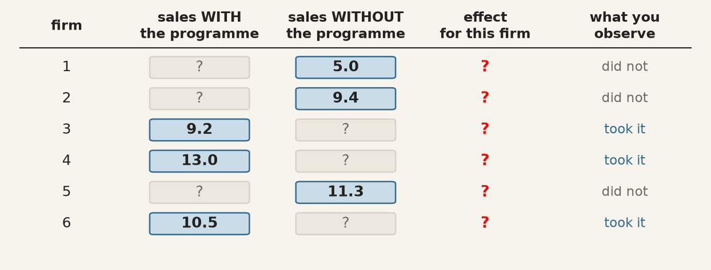{.mid fig-alt="Six firms, each with sales growth with and without the programme. For each firm only one of the two is observed; the other, and the effect, are question marks."}

For firm $i$: $Y_i(1)$ is its sales growth **with** the programme, $Y_i(0)$ **without**. The effect
for that firm is $\tau_i = Y_i(1) - Y_i(0)$. A firm either joins or does not, so one of the two is
**always missing**, and so is $\tau_i$.

## The fundamental problem, and what we estimate instead {.scrollable}

::: {.warn}
**No individual effect is ever observed** (Holland, 1986). Causal inference is a **missing-data
problem**: we fill in the missing column with *other firms* who look like this one, and the whole
method is in choosing those other firms well.
:::

What we can hope to estimate is an **average**:

| Name | Formula | In words | When you want it |
|---|---|---|---|
| **ATE** · average treatment effect | $\mathrm{E}[Y(1) - Y(0)]$ | the effect if **every** firm joined | rolling the programme out to all |
| **ATT** · average treatment effect on the treated | $\mathrm{E}[Y(1) - Y(0) \mid T = 1]$ | the effect on the firms **that joined** | was it worth it for those who used it? |

::: {.muted}
$T$ is the treatment: 1 if the firm joined, 0 if not. Matching, today's method, estimates the **ATT**.
:::

## Words you will need {.scrollable}

| Term | What it is | In this session's examples |
|---|---|---|
| **Treatment** / **control** | the group that got the programme / the group that did not | firms that joined; trainees; employees who took the course |
| **Potential outcomes** | $Y(1)$ and $Y(0)$: what would happen with and without treatment. The one not observed is the **counterfactual** | sales growth with and without the programme |
| **Confounder** | a variable, fixed before treatment, that drives **both** who is treated and the outcome | productivity; past earnings; motivation |
| **Selection bias** | how differently the two groups would have done **without** treatment | 3.33 points for the firms |
| **Propensity score** | $e(x) = P(T = 1 \mid X = x)$: the probability of being treated, given the confounders | the logit of Example 2 |
| **Balance** | the treated and control groups look alike on every confounder (standardised differences within ±0.1) | the love plot |
| **Overlap** | for every treated unit there are controls with a similar score | the log-scale histogram |
| **Conditional independence** | given the measured $X$, who was treated is as good as random. **Untestable** | what fails in Example 3 |

## Why the naive comparison fails, in one line {.scrollable}

$$
\underbrace{\mathrm{E}[Y \mid T{=}1] - \mathrm{E}[Y \mid T{=}0]}_{\text{what you compute}}
=
\underbrace{\mathrm{E}[Y(1) - Y(0) \mid T{=}1]}_{\text{ATT: what you want}}
+
\underbrace{\mathrm{E}[Y(0) \mid T{=}1] - \mathrm{E}[Y(0) \mid T{=}0]}_{\text{selection bias}}
$$

{.wide fig-alt="A bar of 5.33 split into the effect, 2.00, and selection bias, 3.33."}

::: {.check}
**Selection bias** is how differently the two groups would have done **without** the programme. Here
(from Example 1) the firms that joined would have grown 3.33 points faster anyway.
:::

## The picture behind the bias: a back door {.scrollable}

{.mid fig-alt="Left: productivity causes both joining the programme and sales growth. Right: a coin decides who joins, and productivity no longer reaches the programme."}

::: {.check}
**Left:** productive firms join more *and* grow more, so the comparison picks up both paths.
**Right:** a coin cannot know which firms are productive, so the back door is shut, and the
difference in means measures the programme alone. That is the whole case for **randomisation**.
:::

## Example 1 · Did the export programme work? {.center}

## The data: 1,000 firms, both columns written down {.scrollable}

In a simulation we can do what real data never allows: write down **both** potential outcomes.

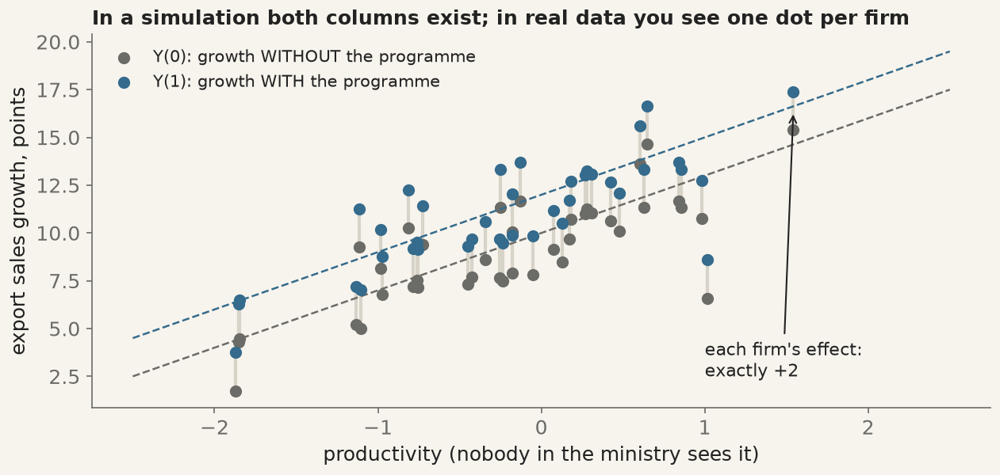{.big fig-alt="Forty firms, each with a grey dot for growth without the programme and a blue dot two points above for growth with it; both rise with productivity."}

::: columns
::: {.column width="50%"}
$$
\begin{aligned}
Y_i(0) &= 10 + 3\,\text{productivity}_i + \text{noise}_i \\
Y_i(1) &= Y_i(0) + 2
\end{aligned}
$$
:::
::: {.column width="50%"}
::: {.check}
**Read the picture:** every firm has **two** dots, 2 apart: that gap is the effect. Both dots climb with
productivity: better firms grow faster **whatever** they do.
:::
:::
:::

## The question: who joins? {.scrollable}

::: {.step .question}
**The question:** the same 1,000 firms, the same true effect of +2. Decide who joins in two ways:
**a coin**, or **the firms themselves**. Which comparison of joiners with non-joiners finds the +2?
:::

::: columns
::: {.column width="50%"}
::: {.step}
**Predict first.** Before the next slides, write down a number for each:

- the difference in means when a coin decides: about ___
- the difference in means when firms decide: about ___
:::
:::
::: {.column width="50%"}
::: {.muted}
Hint: think about which firms would apply for an export programme if nobody forced them, and what those
firms' sales would have done anyway.
:::
:::
:::

## A coin decides {.scrollable}

| | Joined (heads) | Did not join (tails) |
|---|---|---|
| mean productivity, before the programme | −0.04 | −0.10 |
| outcome you observe | sales **with** the programme | sales **without** it |

::: {.check}
**One experiment:** the plain difference in means gives **2.15**, close to the true +2. The two groups have
nearly the same productivity: the coin balanced it **without anyone measuring it**. The 0.15 is luck,
not bias, as a thousand experiments show:
:::

{.mid fig-alt="Histogram of 1,000 differences in means, centred on the true effect of 2, with a spread of about 0.23."}

::: {.muted}
That spread is what a **standard error** measures: randomisation turns bias into noise, and noise is what
confidence intervals are for.
:::

## Now the firms choose {.scrollable}

Same firms, same true effect of +2, but now each firm **decides for itself**, and the better firms are keener:

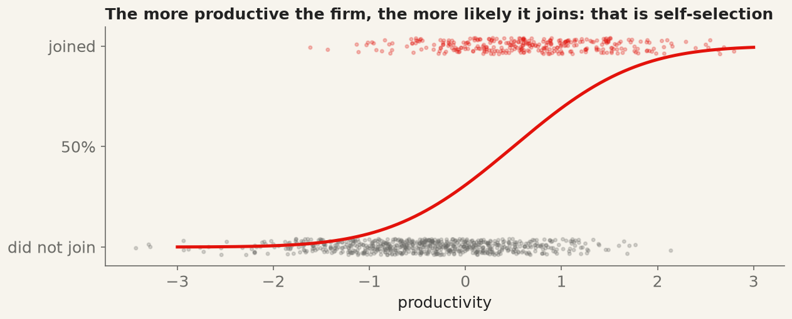{.mid fig-alt="An S-shaped curve: the probability of joining rises from near 0 for unproductive firms to near 1 for productive ones; joiners in red at the top, non-joiners in grey at the bottom."}

::: {.check}
**Read the picture:** red dots (joiners) sit mostly to the **right**; grey dots (non-joiners) to the
**left**. Productivity decides who joins, and productivity also raises sales. That is the back door of
Part 1, now in data.
:::

## What the naive comparison says {.scrollable}

{.wide fig-alt="A bar of 5.33 split into the effect, 2.00, and selection bias, 3.33."}

::: {.warn}
**The naive comparison says 5.33.** The gap, **3.33**, is exactly the selection bias of the formula: the
firms that joined would have grown 3.33 points faster without the programme. In real data that number
cannot be computed, because it needs the column you never see.
:::

::: {.muted}
Check your prediction: how close were you for the coin (2.15), and for the choice (5.33)?
:::

## You *can* see that the groups differ {.scrollable}

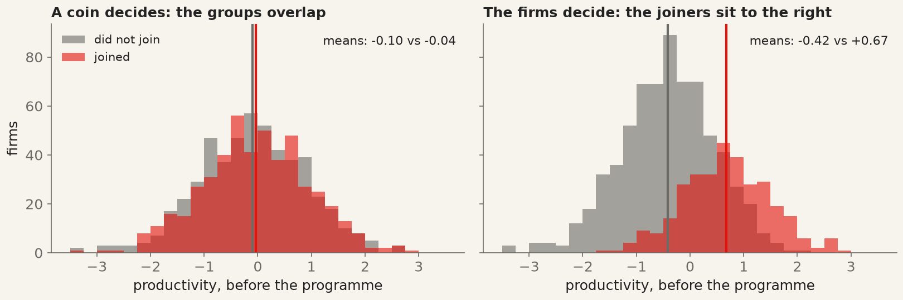{fig-alt="Two histograms of productivity: with a coin the joiners and non-joiners overlap, means −0.04 and −0.10; with choice the joiners sit to the right, means +0.67 and −0.42."}

::: columns
::: {.column width="50%"}
::: {.check}
**Left, a coin:** the two groups are the same shape, in the same place. Any difference in sales afterwards
can only be the programme.
:::
:::
::: {.column width="50%"}
::: {.warn}
**Right, a choice:** the joiners were about **one standard deviation** more productive before the
programme existed. Their higher sales afterwards are partly the programme, partly themselves.
:::
:::
:::

::: {.step}
This is the **balance check**: compare the groups on what was fixed **before** treatment. In real data you
cannot see the bias, but you can see this, and it tells you the naive comparison is not to be trusted.
:::

## What randomisation buys, and what it costs {.scrollable}

::: columns
::: {.column width="50%"}
::: {.check}
**Buys:**

- balance on **everything**, measured or not
- an unbiased estimate from a **difference in means**
- a standard error that means what it says
:::
:::
::: {.column width="50%"}
::: {.warn}
**Costs:**

- often impossible: you cannot randomise which **countries** sign a trade agreement
- sometimes unethical, often expensive
- tells you about the people in the trial: **external validity** is argued, not estimated
:::
:::
:::

## Example 1 · Plain summary {.scrollable}

- With a coin, the difference in means finds the truth on average (2.15 once; 2 over a thousand tries).
- When firms choose, the same difference says **5.33**: 2 of programme, 3.33 of selection.
- The selection bias itself is invisible; the **imbalance** that causes it is not.

::: {.step}
**What this example teaches:** without a coin, the question becomes *can we build a control group that
looks like the treated group?* Example 2 tests that where the right answer is known.
:::

## Example 2 · LaLonde's test {.center}

## The data: a training lottery, and a survey {.scrollable}

{.mid fig-alt="Left: the experiment, 185 trained and 260 untrained by lottery. Right: the same 185 trained compared with 15,992 people from a survey."}

The **National Supported Work** programme (US, 1976–77) gave disadvantaged workers a job-training
placement **by lottery**. LaLonde (1986) kept the trainees, threw away the lottery's controls, and
asked whether the methods economists use on survey data would recover the experiment's answer.

| Column | Meaning | Column | Meaning |
|---|---|---|---|
| `treat` | 1 = trained | `married`, `nodegree` | 1 = married; 1 = no high-school diploma |
| `age`, `education` | years | `re74`, `re75` | earnings in 1974 and 1975, **before** training, in dollars |
| `black`, `hispanic` | 1 = yes | `re78` | earnings in 1978, **after**: the outcome, in dollars |

## The answer, and the naive estimate {.scrollable}

::: {.step .question}
**The question:** using only the 185 trainees and a national survey, can we recover the experiment's answer?
:::

| Comparison | Estimate | Reading |
|---|---|---|
| **the experiment**: trainees vs the lottery's losers | **+\$1,794** (s.e. \$633, p = 0.005) | the benchmark every method must hit |
| **naive**: trainees vs 15,992 survey people | **−\$8,498** | the wrong sign, five times too large |

::: {.warn}
**Nothing is wrong with the arithmetic.** The survey's average worker earned far more than these trainees
ever would have: that is selection bias, about \$10,000 of it.
:::

## How different are the groups? {.scrollable}

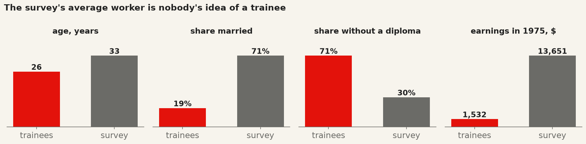{.wide fig-alt="Bars comparing trainees and survey people: age 26 against 33, 19% against 71% married, 71% against 30% without a diploma, earnings in 1975 of $1,532 against $13,651."}

| | Trained | Survey | Standardised difference |
|---|---|---|---|
| age | 25.8 | 33.2 | −0.80 |
| education (years) | 10.4 | 12.0 | −0.68 |
| black | 0.84 | 0.07 | **2.43** |
| hispanic | 0.06 | 0.07 | −0.05 |
| married | 0.19 | 0.71 | −1.23 |
| no diploma | 0.71 | 0.30 | 0.90 |
| earnings 1974 | \$2,096 | \$14,017 | −1.57 |
| earnings 1975 | \$1,532 | \$13,651 | −1.75 |

::: {.check}
**The standardised difference** is the gap in means in standard deviations, so years and dollars compare.
Below **0.1** is balanced; seven of eight are out by **0.7 to 2.4**.
:::

## The idea of matching: one number to compare on {.scrollable}

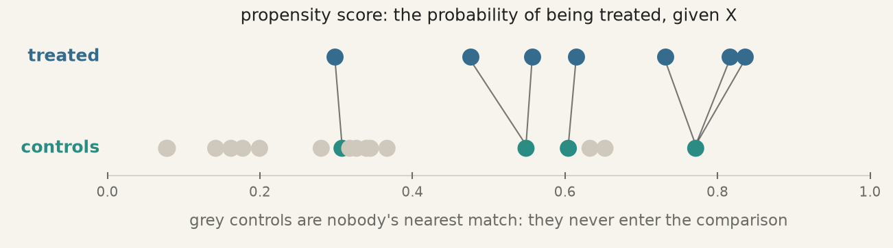{.wide fig-alt="Treated people on top, controls below, on a propensity-score axis. Each treated person is joined by a line to the control with the closest score; controls far from every treated person are grey and unused."}

::: columns
::: {.column width="50%"}
**Propensity score** $e(x) = P(T = 1 \mid X = x)$: the probability of being trained, given the eight
characteristics. Fit it with a **logit** (session 4).
:::
::: {.column width="50%"}
**Rosenbaum and Rubin (1983):** if the eight $X$ explain who got trained, comparing people with the
**same score** is as good as comparing people with the same eight $X$. Eight dimensions become one.
:::
:::

::: {.check}
**Matching:** pair each trainee with the survey person whose score is **closest**: the nearest
neighbour of session 8, on one number. The matched controls fill in the missing column.
:::

## The score, and overlap {.scrollable}

::: columns
::: {.column width="55%"}
{.mid fig-alt="Histograms of the propensity score on a log scale: almost all survey people near zero, but survey people present in every bar where trainees are."}
:::

::: {.column width="45%"}
::: {.check}
**The score:** a trainee's median score is **0.26**; a survey person's is **0.0001**.
:::

::: {.step}
**Overlap:** almost all 15,992 survey people sit in the first bar. But **every bar where trainees are
also has survey people**, 534 with a score above 0.05: there is someone to compare with.
:::

::: {.muted}
The logit's coefficients are *not* the result and are never reported: the score is a tool, judged only
by the balance it produces.
:::
:::
:::

## Match, then check balance, before the outcome {.scrollable}

::: columns
::: {.column width="55%"}
{.big fig-alt="Love plot: red dots before matching far from zero, gold after the first score all close except age at 0.31, blue after the improved score all within plus or minus 0.1."}
:::

::: {.column width="45%"}
**First score** (gold): each trainee paired with the closest survey person; 185 trainees use 124
distinct controls (**with replacement**). Earnings, race and diploma are balanced; **age is off by 0.31**.

**Fixed score** (blue): add $\text{age}^2$ and "earned nothing in 1974 / 1975". Every difference is now
**inside ±0.1**.

::: {.warn}
**All of this is decided before anyone looks at 1978 earnings.** Choosing the score by balance, not by
the answer, is what makes the estimate defensible.
:::
:::
:::

## What a match looks like {.scrollable}

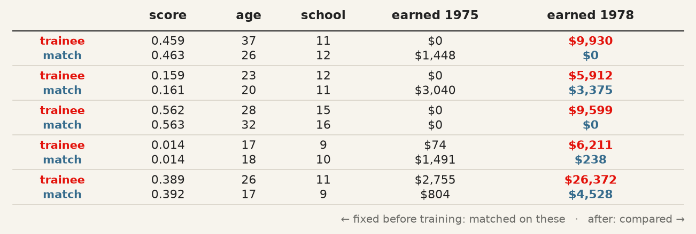{.mid fig-alt="Five trainees, each above the survey person matched to them: nearly identical scores, similar ages, schooling and 1975 earnings; then their 1978 earnings."}

::: columns
::: {.column width="50%"}
::: {.check}
**Read each pair:** the trainee and the survey person have almost the **same score**, and therefore similar
age, schooling and earnings **before** training. The match is the trainee's stand-in: what the trainee would
probably have earned in 1978 without training.
:::
:::
::: {.column width="50%"}
::: {.warn}
**One pair proves nothing.** The first trainee earned \$9,930 and the match \$0; the last, \$26,372 against
\$4,528. Individual outcomes are noisy; only the **average** over all 185 pairs is the estimate.
:::
:::
:::

## Only now, the outcome {.scrollable}

::: {.muted}
**Predict first:** the experiment says +\$1,794. Will the matched estimate be close? Above or below?
:::


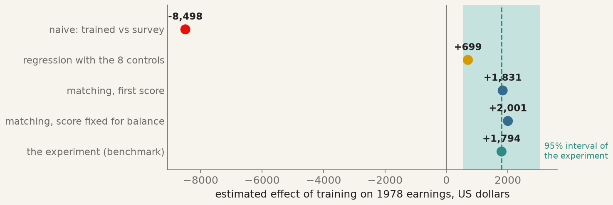{.mid fig-alt="Five estimates on one axis: naive −8,498, regression +699, first matching +1,831, balanced matching +2,001, and the experiment +1,794 with its 95% interval."}

::: columns
::: {.column width="50%"}
::: {.check}
**Matching gives +\$2,001**, within a third of a standard error of the experiment's **+\$1,794**. From
−\$8,498 to the right answer, using only survey data. The first score gave +\$1,831: balance moved the
estimate by \$170, and it is the balance check, not the number, that makes it defensible.
:::
:::
::: {.column width="50%"}
::: {.warn}
**Regression with the same eight controls gives +\$699.** A linear model compares trainees with survey
people earning \$14,000, by extrapolating along a straight line. Matching only compares like with like.
:::
:::
:::

## Example 2 · Plain summary {.scrollable}

- The experiment says training raised 1978 earnings by about **\$1,800**.
- Against survey controls, the naive comparison says **−\$8,500**: selection, not training.
- A propensity score, an overlap check and a balance check, all **before** the outcome, bring matching to
  **+\$2,001**, inside the experiment's interval. Regression with the same variables misses.

::: {.step}
**What this example teaches:** matching can recover an experiment's answer from observational data, when
the variables that drove selection are in the data. Example 3 asks what happens when they are not.
:::

## Example 3 · Does analytics training raise performance? {.center}

## The case: an HR analytics team {.scrollable}

A large public-sector organisation offers its employees an **advanced data-analytics course**. Taking it is
voluntary. The human-resources (HR) analytics team wants to know whether it raises **job performance**, a standardised
annual score.

| Column | Meaning |
|---|---|
| `age`, `education`, `experience` | from the HR file: years |
| `treat` | 1 = took the course |
| `performance` | the annual score, **after** the course |
| `motivation` | **not in the HR file**: nobody measures it |

::: {.step .question}
**The question:** does the course raise performance, and can matching on the HR file tell?
:::

::: {.muted}
**Simulated**, 800 employees, so we know the truth: the course adds **+5 points** to everyone. Older and more
educated employees are more likely to sign up.
:::

## Two versions of who signs up {.scrollable}

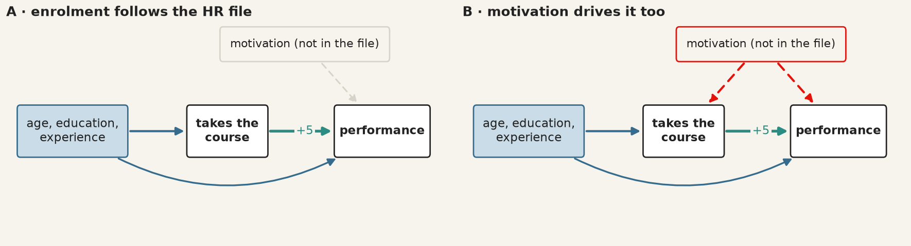{.mid fig-alt="Version A: age, education and experience drive both taking the course and performance; motivation affects only performance. Version B: motivation, not in the file, also drives taking the course."}

::: columns
::: {.column width="50%"}
::: {.check}
**A:** everything that decides who signs up is **in the HR file**. Matching on the file closes every back
door.
:::
:::
::: {.column width="50%"}
::: {.warn}
**B:** **motivation** also decides who signs up, and raises performance on its own. It is a back door the
file does not record.
:::
:::
:::

::: {.muted}
**Predict first:** in which version will matching find +5? In the other, will it say more or less than 5?
:::

## The results, against the truth {.scrollable}

{.mid fig-alt="Version A: naive 8.6, matched 5.3; version B: naive 11.5, matched 9.0; truth 5."}

::: columns
::: {.column width="50%"}
::: {.check}
**Version A:** the naive comparison says **8.6**; matching on age, education and experience gives **5.3**,
close to the truth. Exactly what Example 2 showed on real data.
:::
:::
::: {.column width="50%"}
::: {.warn}
**Version B:** the same steps, the same balance, and matching says **9.0**. Most of the bias survives,
and nothing in the output warns you.
:::
:::
:::

## Why version B fails: the love plot you cannot draw {.scrollable}

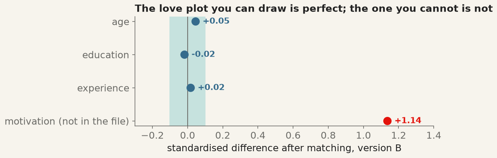{.mid fig-alt="After matching in version B: age, education and experience within 0.1; motivation, not in the file, off by 1.14."}

::: {.warn}
**Balance can only be checked on what you measured.** On age, education and experience the match is
perfect. On motivation, which drove both sign-up and performance, the trainees are **1.14 standard
deviations** ahead of their matches. The assumption that nothing unmeasured matters, **conditional
independence**, can never be tested from the data.
:::

## Not every variable belongs in the score {.scrollable}

{.mid fig-alt="Left: firm size before the programme causes both joining and growth; control for it. Right: new export contracts are caused by the programme and cause growth; do not control for them."}

::: {.check}
**The rule:** match and control only on variables fixed **before** treatment. A variable the programme
itself changes (new contracts, a promotion after the course, the trainee's 1978 job) is part of the
effect: controlling for it removes some of what you are trying to measure.
:::

## Example 3 · Plain summary {.scrollable}

- When sign-up depends on what the HR file records, matching recovers the course's **+5**.
- When motivation also drives it, matching still balances everything **in the file** and still reports a
  number, **9.0**, nearly double the truth.
- The difference between the two versions is invisible in the data. It is an **argument** about who signs
  up and why.

::: {.step}
**What this example teaches:** matching fixes the comparison on what you measured. Whether that is enough
is a claim you defend with knowledge of the setting, not with a table.
:::

## Wrapping up · What matching does not fix {.center}

## Why regression missed in Example 2 {.scrollable}

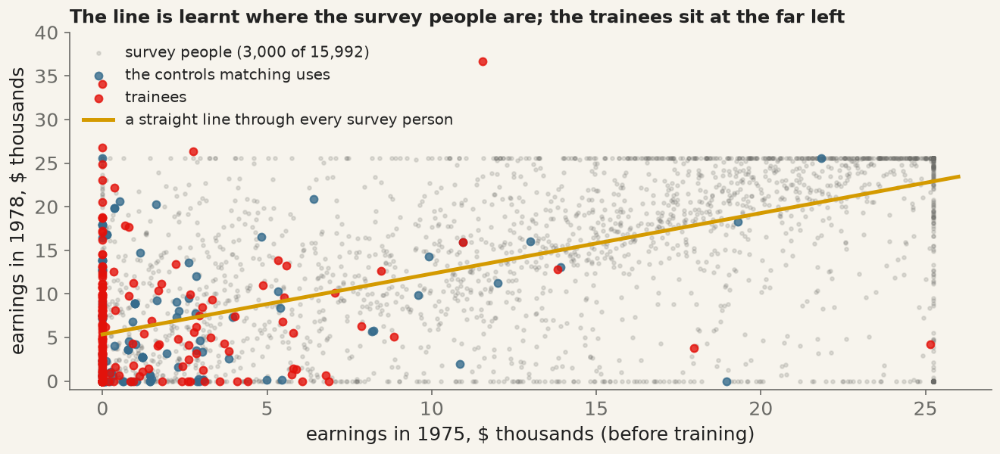{.mid fig-alt="Earnings in 1978 against 1975: thousands of survey people spread up to $25,000, the trainees bunched near zero, the matched controls among them, and a straight line fitted through all survey people."}

::: columns
::: {.column width="50%"}
::: {.check}
**Regression** fits **one line** through all 15,992 survey people, most earning \$10,000–25,000, then reads
off what the line says at the trainees' earnings, near zero. Its answer depends on that line being right
where almost **no** survey person lives.
:::
:::
::: {.column width="50%"}
::: {.step}
**Matching** ignores the grey cloud and uses only the **blue** survey people, those who look like the
trainees. That is why it found +\$2,001 and regression +\$699.
:::
:::
:::

## Matching or regression? {.scrollable}

Both rest on the **same assumption**: every confounder is measured. They differ in how they use it.

| | Regression on the confounders | Matching on the propensity score |
|---|---|---|
| **Comparison** | every treated unit against a line fitted through all controls | each treated unit against the controls most like it |
| **Overlap** | not checked: extrapolates where there are no comparable controls | visible: the score's histogram shows who has a match |
| **Functional form** | must be right: linear, unless you say otherwise | needs only a good score, judged by balance |
| **Order of work** | the outcome is in the same model as the controls | the design is fixed, by balance, **before** the outcome is seen |
| **In this session** | Example 2: +\$699 | Example 2: +\$2,001 (truth \$1,794) |

::: columns
::: {.column width="50%"}
::: {.check}
**When regression is enough:** good overlap and roughly linear relations. In Example 3A it gives 4.6
against matching's 5.3 and the truth's 5.
:::
:::
::: {.column width="50%"}
::: {.warn}
**When neither works:** an unmeasured confounder (Example 3B). Then you need a design, not an
estimator: sessions 11 (difference-in-differences) and beyond.
:::
:::
:::

## What matching does not fix {.scrollable}

- **Unmeasured confounders.** Matching is regression's assumption in a different form: everything that
  drives both treatment and outcome is in $X$. If it is not, both are biased, in the same direction (Example 3B).
- **No overlap.** Treated units with no comparable control cannot be matched honestly. Drop them, and say
  that the estimate now applies only to the rest.
- **A lucky data set.** Smith and Todd (2005) showed the LaLonde result moves with the sample and the score.
  One success is evidence the method *can* work, not that it did in your project.
- **Standard errors.** The OLS (ordinary least squares) standard error on a matched sample ignores that the score was estimated and
  the controls reused; bootstrap it, or report it as approximate.
- **The order of work.** Choose the score by balance **before** looking at the outcome. Trying scores until
  the ATT looks good is p-hacking with extra steps.

## Seven steps, the same in every example {.scrollable}

{fig-alt="Seven steps from the question to the ATT, with an arrow from the balance check back to the score."}

| Step | What you do | In Python |
|---|---|---|
| 1–2 | name the estimand; argue which pre-treatment variables drive treatment | on paper |
| 3 | the naive difference, as the size of the problem | `.groupby("treat")["y"].mean()` |
| 4 | the propensity score | `smf.logit(...).fit()`, `.predict()` |
| 5 | match, and check overlap | `NearestNeighbors(n_neighbors=1)`, `.kneighbors()`, `plt.hist` |
| 6 | balance: every standardised difference inside ±0.1 | `.mean()`, `.var()`, `plt.scatter` |
| 7 | the ATT, **last** | `treated["y"].mean() - matched["y"].mean()` |

## In class · The two solutions, done in Python {.center}

## One problem, two solutions {.scrollable}

The three examples showed **one problem**: the treated and the untreated differed **before** the
treatment, so their difference in outcomes mixes the effect with selection. There are two ways out.

| | **Solution 1 · Randomised controlled trial** | **Solution 2 · Propensity-score matching** |
|---|---|---|
| When | **you** decide who is treated, before it happens | treatment has **already been chosen** by the units |
| The idea | let **chance** pick the treated: nothing about a firm can influence the draw | for each treated unit, find untreated units that were **as likely to be treated** |
| Why it removes selection | the two groups are alike on **everything**, measured or not | the two groups are alike on **what you measured** |
| What you must assume | that the draw was respected | that nothing **unmeasured** drives both treatment and outcome |
| What you check | balance (a check of the draw) | overlap, then balance (a check of the match) |
| The estimate | a difference in means | treated mean minus matched-control mean (the ATT) |

::: {.step}
A trial solves the problem **by design**; matching solves it **by assumption**. Use the first whenever
you can; the second is for the many questions where nobody will let you draw.
:::

## How this part works {.scrollable}

::: columns
::: {.column width="50%"}
You now **do** each solution from start to finish, on **new data**, not the lecture's examples. The
packages, by name: `numpy`, `pandas`, `statsmodels`, `scikit-learn`, `matplotlib`.

Each solution is one short piece of work in steps. Its **first cell writes a small data file** in your
folder; every later cell starts by reading that file, so each cell runs on its own once the first has run.
:::

::: {.column width="50%"}
::: {.step}
**For each solution:**

1. run the cells in order, and say what each step is **for** before reading its output;
2. do the **Your turn** task under the last cell;
3. keep the file: it is the template for your project.
:::
:::
:::

## Solution 1 · A trial, step by step {.scrollable}

**The case.** An export agency can place foreign orders with **200 of the 400** small workshops that
applied. Does receiving export orders raise a workshop's monthly profit? This is the design of the
article you read for today (Atkin, Khandelwal and Osman, 2017), here on simulated data so that the
true effect, **+\$150 a month**, is known.

| Step | What you do | Why | In Python |
|---|---|---|---|
| 1 | assemble the **baseline file** | everything known before treatment: for the draw, the check, the precision | `pd.DataFrame`, `.to_csv` |
| 2 | **power**: are 400 firms enough? | a trial too small to see the effect is wasted | `TTestIndPower().solve_power` |
| 3 | **randomise**, once, with a seed | chance, not the firms or you, picks the treated | `rng.permutation`, `.groupby().transform` |
| 4 | **check balance** | confirms the draw worked as a draw | standardised differences |
| 5 | **estimate** when the follow-up arrives | difference in means, with a confidence interval | `smf.ols("y ~ treat")`, `.conf_int()` |
| 6 | handle firms that **refuse** | compare by what was **drawn**, not by what was taken | `smf.ols("y ~ treat")` again |

## Trial · Step 1 · The baseline file {.scrollable}

```{python}
#| echo: true

# Trial, step 1 · Everything you know about the applicants BEFORE anyone is treated
import numpy as np
import pandas as pd

rng = np.random.default_rng(10)                 # simulated here; in a real trial, your applicant list
n = 400
firms = pd.DataFrame({"firm": np.arange(1, n + 1),
                      "sector": rng.choice(["rugs", "garments", "ceramics"], n),
                      "employees": rng.integers(2, 40, n),
                      "profit_before": rng.gamma(4, 250, n).round()})   # dollars a month
firms.to_csv("trial_baseline.csv", index=False)

print(firms.head())
print(firms["profit_before"].describe().round(0))
```

::: {.step}
Collect the baseline **before** the draw. You will use it three times: to randomise within sectors,
to check balance, and to make the estimate more precise.
:::

## Trial · Step 2 · Are 400 firms enough? {.scrollable}

```{python}
#| echo: true

# Trial, step 2 · Power: the chance of detecting the effect if it is really there
from statsmodels.stats.power import TTestIndPower

power = TTestIndPower()
effect_size = 150 / 500            # the effect you hope for, in standard deviations of the outcome

needed = power.solve_power(effect_size=effect_size, alpha=0.05, power=0.80)
have = power.solve_power(effect_size=effect_size, nobs1=200, alpha=0.05)
smallest = power.solve_power(nobs1=200, alpha=0.05, power=0.80)

print(f"firms needed per group for 80% power:  {needed:.0f}")
print(f"power with 200 per group:              {have:.2f}")
print(f"smallest effect 200 per group detects: {smallest:.2f} sd = {smallest * 500:.0f} dollars")
```

::: {.step}
`solve_power` takes three of *effect size, sample per group, significance level, power* and returns the
fourth. Do this **before** the trial: afterwards, the sample size can no longer be changed.
:::

## Trial · Step 3 · Randomise, once {.scrollable}

```{python}
#| echo: true

# Trial, step 3 · Chance picks 200 firms: half of each sector
import numpy as np
import pandas as pd

firms = pd.read_csv("trial_baseline.csv")
rng = np.random.default_rng(2026)              # write the seed down: anyone can redo your draw


def half(group):                               # shuffle one sector, treat the first half
    return rng.permutation(len(group)) < len(group) // 2


firms["treat"] = firms.groupby("sector")["firm"].transform(half).astype(int)
firms.to_csv("trial_assigned.csv", index=False)   # saved once, never redrawn

print(pd.crosstab(firms["sector"], firms["treat"]))
```

::: {.step}
`rng.permutation(n) < n // 2` shuffles the list and treats exactly half. Doing it **within each sector**
(stratifying) guarantees that sectors are split evenly, which a single shuffle only does on average.
:::

::: {.warn}
One draw, saved. Redrawing until the groups "look right" is choosing the treated yourself.
:::

## Trial · Step 4 · Check the draw {.scrollable}

```{python}
#| echo: true

# Trial, step 4 · Balance: are the two groups alike BEFORE treatment?
import numpy as np
import pandas as pd
import statsmodels.formula.api as smf

firms = pd.read_csv("trial_assigned.csv")
X = ["employees", "profit_before"]

treated, control = firms[firms["treat"] == 1], firms[firms["treat"] == 0]
sd = np.sqrt((treated[X].var() + control[X].var()) / 2)
balance = pd.DataFrame({"treated": treated[X].mean(), "control": control[X].mean()})
balance["std. diff."] = (treated[X].mean() - control[X].mean()) / sd
print(balance.round(2))

joint = smf.ols("treat ~ employees + profit_before + C(sector)", data=firms).fit()
print(f"do the characteristics predict the draw?  p = {joint.f_pvalue:.2f}")
```

::: {.step}
The same standardised difference as in the lecture, with the same reading: inside ±0.1 is balanced.
The regression asks the question for all characteristics at once: a **large** p-value means they do not
predict who was drawn. In a trial this checks that the draw was carried out; it is not an assumption.
:::

## Trial · Step 5 · The estimate, and its precision {.scrollable}

```{python}
#| echo: true

# Trial, step 5 · The follow-up arrives: difference in means, then the same with baseline controls
import numpy as np
import pandas as pd
import statsmodels.formula.api as smf

firms = pd.read_csv("trial_assigned.csv")
rng = np.random.default_rng(11)                # stands in for the follow-up survey; true effect +150
firms["profit_after"] = (300 + 0.8 * firms["profit_before"] + 150 * firms["treat"]
                         + rng.normal(0, 300, len(firms))).round()

simple = smf.ols("profit_after ~ treat", data=firms).fit(cov_type="HC2")
adjusted = smf.ols("profit_after ~ treat + profit_before + employees + C(sector)",
                   data=firms).fit(cov_type="HC2")

for name, fit in [("difference in means", simple), ("with baseline controls", adjusted)]:
    low, high = fit.conf_int().loc["treat"]
    print(f"{name:23s} {fit.params['treat']:5.0f}   se {fit.bse['treat']:3.0f}   95% CI [{low:.0f}, {high:.0f}]")
```

::: {.step}
`profit_after ~ treat` **is** the difference in means; the regression adds its standard error and
confidence interval (`cov_type="HC2"` lets the two groups have different variances). Adding baseline
variables is **not** needed to remove bias, the draw did that: it removes noise, so the interval narrows.
:::

## Trial · Step 6 · When firms refuse {.scrollable}

```{python}
#| echo: true

# Trial, step 6 · Some drawn firms decline the orders: compare by the DRAW, not by who took them
import numpy as np
import pandas as pd
import statsmodels.formula.api as smf

firms = pd.read_csv("trial_assigned.csv")
rng = np.random.default_rng(11)
ready = firms["profit_before"] + rng.normal(0, 400, len(firms)) > 800     # stronger firms accept
firms["took_up"] = ((firms["treat"] == 1) & ready).astype(int)
firms["profit_after"] = (300 + 0.8 * firms["profit_before"] + 150 * firms["took_up"]
                         + rng.normal(0, 300, len(firms))).round()

share = firms.loc[firms["treat"] == 1, "took_up"].mean()
offered = smf.ols("profit_after ~ treat", data=firms).fit().params["treat"]
took = smf.ols("profit_after ~ took_up", data=firms).fit().params["took_up"]

print(f"share of drawn firms that took the orders:  {share:.2f}")
print(f"by who took the orders (selection is back): {took:5.0f}")
print(f"by the draw (effect of being OFFERED):      {offered:5.0f}")
print(f"draw effect / share (effect of TAKING):     {offered / share:5.0f}   truth 150")
```

::: {.step}
Taking up the orders is a **choice**, so comparing takers with everyone else brings selection back.
The draw is still random: comparing by the draw gives the effect of the **offer** (the *intention to
treat*). Dividing by the take-up share recovers the effect on those who took it: that is next
session's instrument.
:::

## Your turn · The trial {.scrollable}

::: {.step}
1. **Too small a trial.** In step 2, how many firms per group would a true effect of \$75 need? Then set
   the effect to `75` in step 5: does the difference-in-means interval still exclude zero?
2. **A bad draw.** In step 3, replace the draw by a choice:
   `firms["treat"] = (firms["profit_before"] > firms["profit_before"].median()).astype(int)`.
   Rerun steps 4 and 5. What does the balance table say, and what happens to the difference in means?
   What happens to the estimate with baseline controls, and why can you not count on that in real data?
3. **No stratification.** Replace the draw by `(rng.permutation(len(firms)) < 200).astype(int)`. Is each
   sector still split evenly? The draw is still random: what exactly did stratifying add?
:::

## Solution 2 · Matching, step by step {.scrollable}

**The case.** Of 4,000 manufacturing firms, some **chose** to obtain a quality certification (ISO 9001).
Does certification raise export sales two years later? Nobody drew anything: larger, foreign-owned and
already-exporting firms certify more often. Simulated data again, so the true effect, **+8**
(\$ thousand), is known, and so is the fact that only recorded variables drive the choice.

| Step | What you do | Why | In Python |
|---|---|---|---|
| 1 | list the **pre-treatment** variables that drive the choice | this list *is* the assumption | on paper, then a list `X` |
| 2 | estimate the **propensity score** | one number per firm: its probability of being treated | `smf.logit(...).fit()`, `.predict()` |
| 3 | look at **overlap** | a treated firm with no similar control cannot be matched | `plt.hist` |
| 4 | **match**, within a caliper | each treated firm gets its closest control, or is set aside | `NearestNeighbors`, `.kneighbors()` |
| 5 | check **balance** | the matched groups must look alike; if not, back to step 2 | standardised differences |
| 6 | the **ATT**, with a bootstrap interval, **last** | the estimate, and how sure you are | `.sample(replace=True)`, `np.percentile` |
| 7 | **robustness** | a result that changes with every choice is not a result | change the caliper, the neighbours |

## Matching · Step 1 · The data, and the naive answer {.scrollable}

```{python}
#| echo: true

# Matching, step 1 · 4,000 firms that chose for themselves; certification adds exactly +8
import numpy as np
import pandas as pd

rng = np.random.default_rng(10)                 # simulated here; in your project, the file you were given
n = 4000
firms = pd.DataFrame({"employees": rng.lognormal(3.5, 0.8, n).round() + 1,
                      "age": rng.integers(1, 40, n),
                      "foreign": rng.binomial(1, 0.2, n),
                      "exports_before": rng.gamma(2, 20, n).round()})
choice = -14 + 3 * np.log(firms["employees"]) + 0.8 * firms["foreign"] + 0.02 * firms["exports_before"]
firms["certified"] = (rng.uniform(size=n) < 1 / (1 + np.exp(-choice))).astype(int)
firms["exports_after"] = (5 + 0.6 * firms["exports_before"] + 4 * np.log(firms["employees"])
                          + 6 * firms["foreign"] + 8 * firms["certified"] + rng.normal(0, 8, n)).round()
firms.to_csv("certification.csv", index=False)

print(firms["certified"].value_counts())
print(firms.groupby("certified")[["employees", "foreign", "exports_before", "exports_after"]].mean().round(1))
```

::: {.step}
The naive answer is the gap in `exports_after`. The other three columns say why it cannot be trusted:
the certified firms were larger, more often foreign-owned, and exported more **before** certifying.
:::

## Matching · Steps 2 and 3 · The score, and overlap {.scrollable}

```{python}
#| echo: true
#| output-location: column
#| fig-width: 5.4
#| fig-height: 4.0

# Matching, steps 2-3 · Each firm's probability of certifying, given what it looked like before
import numpy as np
import pandas as pd
import matplotlib.pyplot as plt
import statsmodels.formula.api as smf

firms = pd.read_csv("certification.csv")
score = smf.logit("certified ~ np.log(employees) + age + foreign + exports_before",
                  data=firms).fit(disp=0)
firms["pscore"] = score.predict(firms)

treated, control = firms[firms["certified"] == 1], firms[firms["certified"] == 0]
bins = np.linspace(0, 1, 26)
plt.hist(control["pscore"], bins=bins, alpha=0.6, label="not certified")
plt.hist(treated["pscore"], bins=bins, alpha=0.6, label="certified")
plt.yscale("log")
plt.xlabel("propensity score")
plt.legend()
plt.show()

print("highest score, not certified:", round(control["pscore"].max(), 3))
print("certified firms above it:    ", (treated["pscore"] > control["pscore"].max()).sum())
```

::: {.step}
Only **pre-treatment** variables go in the score: never `exports_after`, never anything certification
could have changed. Where the two histograms overlap, comparable firms exist; a certified firm far to
the right of every uncertified one has nobody to be compared with.
:::

## Matching · Step 4 · Match, within a caliper {.scrollable}

```{python}
#| echo: true

# Matching, step 4 · Closest control for each certified firm; set aside those with none close enough
import numpy as np
import pandas as pd
import statsmodels.formula.api as smf
from sklearn.neighbors import NearestNeighbors

firms = pd.read_csv("certification.csv")
p = smf.logit("certified ~ np.log(employees) + age + foreign + exports_before",
              data=firms).fit(disp=0).predict(firms)
firms["logit"] = np.log(p / (1 - p))           # match on the logit of the score: it spreads out the tails

treated, control = firms[firms["certified"] == 1], firms[firms["certified"] == 0]
nn = NearestNeighbors(n_neighbors=1).fit(control[["logit"]])
distance, index = nn.kneighbors(treated[["logit"]])

caliper = 0.2 * firms["logit"].std()           # "close enough": a fifth of a standard deviation
keep = distance.ravel() <= caliper
kept, matched = treated[keep], control.iloc[index.ravel()[keep]]

print(f"certified firms: {len(treated)}   matched: {keep.sum()}   set aside: {(~keep).sum()}")
print(f"different controls used: {matched.index.nunique()}")
print("employees, matched firms:  ", round(kept["employees"].mean()))
print("employees, set-aside firms:", round(treated[~keep]["employees"].mean()))
```

::: {.step}
Without a caliper every treated firm gets a match, however far away. With one, a firm with no control
within reach is **set aside**, and you say so: the estimate then describes the certified firms **that
have a comparable firm**, here all but the very largest.
:::

## Matching · Step 5 · Balance, before the outcome {.scrollable}

```{python}
#| echo: true
#| output-location: column
#| fig-width: 5.0
#| fig-height: 4.0

# Matching, step 5 · Standardised differences: before, matched with no caliper, matched within it
import numpy as np
import pandas as pd
import matplotlib.pyplot as plt
import statsmodels.formula.api as smf
from sklearn.neighbors import NearestNeighbors

firms = pd.read_csv("certification.csv")
X = ["employees", "age", "foreign", "exports_before"]
p = smf.logit("certified ~ np.log(employees) + age + foreign + exports_before",
              data=firms).fit(disp=0).predict(firms)
firms["logit"] = np.log(p / (1 - p))

treated, control = firms[firms["certified"] == 1], firms[firms["certified"] == 0]
nn = NearestNeighbors(n_neighbors=1).fit(control[["logit"]])
distance, index = nn.kneighbors(treated[["logit"]])
keep = distance.ravel() <= 0.2 * firms["logit"].std()

sd = np.sqrt((treated[X].var() + control[X].var()) / 2)
balance = pd.DataFrame({
    "before": (treated[X].mean() - control[X].mean()) / sd,
    "no caliper": (treated[X].mean() - control.iloc[index.ravel()][X].mean()) / sd,
    "caliper": (treated[keep][X].mean() - control.iloc[index.ravel()[keep]][X].mean()) / sd})
print(balance.round(2))

plt.scatter(balance["before"], X, label="before")
plt.scatter(balance["caliper"], X, label="matched, caliper")
plt.axvline(-0.1, color="grey", linestyle="--")
plt.axvline(0.1, color="grey", linestyle="--")
plt.xlabel("standardised difference")
plt.legend()
plt.show()
```

::: {.step}
This is the only check matching offers, so it comes **before** the outcome. If a difference stays outside
±0.1, go back: tighten the caliper, or add terms to the score (a square, a log, an interaction), and
check again. The outcome column has not been touched yet.
:::

## Matching · Step 6 · The ATT, and how sure you are {.scrollable}

```{python}
#| echo: true

# Matching, step 6 · The estimate, then a bootstrap: redo score AND match on 200 resampled files
import numpy as np
import pandas as pd
import statsmodels.formula.api as smf
from sklearn.neighbors import NearestNeighbors

firms = pd.read_csv("certification.csv")


def att(data, neighbours=1, caliper=0.2):
    p = smf.logit("certified ~ np.log(employees) + age + foreign + exports_before",
                  data=data).fit(disp=0).predict(data)
    data = data.assign(logit=np.log(p / (1 - p)))
    treated, control = data[data["certified"] == 1], data[data["certified"] == 0]
    nn = NearestNeighbors(n_neighbors=neighbours).fit(control[["logit"]])
    distance, index = nn.kneighbors(treated[["logit"]])
    keep = distance[:, 0] <= caliper * data["logit"].std()
    return treated[keep]["exports_after"].mean() - control.iloc[index[keep].ravel()]["exports_after"].mean()


naive = firms.groupby("certified")["exports_after"].mean().diff().iloc[-1]
draws = [att(firms.sample(len(firms), replace=True, random_state=draw)) for draw in range(200)]
low, high = np.percentile(draws, [2.5, 97.5])

print(f"naive difference:  {naive:5.1f}")
print(f"ATT (matching):    {att(firms):5.1f}   truth 8")
print(f"bootstrap 95% CI:  [{low:.1f}, {high:.1f}]   se {np.std(draws):.1f}")
```

::: {.step}
Wrapping the steps in a function, `att(data)`, lets you rerun **all** of them on each resampled file:
the score is re-estimated and the match redone every time, which a plain OLS standard error on the
matched sample ignores. Report the interval as **approximate**: it is a guide to precision, not a proof.
:::

## Matching · Step 7 · Does it survive other reasonable choices? {.scrollable}

```{python}
#| echo: true

# Matching, step 7 · The same estimate under other defensible choices, and regression beside it
import numpy as np
import pandas as pd
import statsmodels.formula.api as smf
from sklearn.neighbors import NearestNeighbors

firms = pd.read_csv("certification.csv")


def att(data, neighbours=1, caliper=0.2):
    p = smf.logit("certified ~ np.log(employees) + age + foreign + exports_before",
                  data=data).fit(disp=0).predict(data)
    data = data.assign(logit=np.log(p / (1 - p)))
    treated, control = data[data["certified"] == 1], data[data["certified"] == 0]
    nn = NearestNeighbors(n_neighbors=neighbours).fit(control[["logit"]])
    distance, index = nn.kneighbors(treated[["logit"]])
    keep = distance[:, 0] <= caliper * data["logit"].std()
    return treated[keep]["exports_after"].mean() - control.iloc[index[keep].ravel()]["exports_after"].mean()


ols = smf.ols("exports_after ~ certified + np.log(employees) + age + foreign + exports_before",
              data=firms).fit()

print(f"1 neighbour, caliper 0.2:   {att(firms):5.1f}")
print(f"1 neighbour, caliper 0.1:   {att(firms, caliper=0.1):5.1f}")
print(f"1 neighbour, no caliper:    {att(firms, caliper=np.inf):5.1f}")
print(f"5 neighbours, caliper 0.2:  {att(firms, neighbours=5):5.1f}")
print(f"regression, same variables: {ols.params['certified']:5.1f}")
```

::: {.step}
Report the main estimate **and** this table. Estimates that stay inside the bootstrap interval say the
conclusion does not hang on one choice. None of them tests the assumption itself: a firm
characteristic you did not record (Example 3, version B) would move every line together.
:::

## Your turn · The match {.scrollable}

::: {.step}
1. **A variable left out.** Remove `np.log(employees)` from the score in steps 5 and 6. Which
   standardised difference gives it away? How far does the ATT move from 8?
2. **A bad control.** Add `+ exports_after` to the score in step 6. What happens to the ATT? Which rule
   from the lecture did you break?
3. **A hidden cause.** In step 1, add `ambition = rng.normal(0, 1, n)`, then `+ 1.5 * ambition` to
   `choice` and `+ 6 * ambition` to `exports_after`, without saving `ambition`. Rerun steps 5 to 7. Does
   any check warn you?
:::

## Your turn · Both solutions on real data {.scrollable}

LaLonde's job-training data from Example 2 holds both designs. Load it with:

```python
import pandas as pd
url = "https://users.nber.org/~rdehejia/data/"
trial = pd.read_stata(url + "nsw_dw.dta")                  # the lottery: 185 trained, 260 controls
survey = pd.concat([trial[trial["treat"] == 1],            # the trainees, with a second survey
                    pd.read_stata(url + "psid_controls.dta")], ignore_index=True)
```

1. **As a trial** (`trial`): run steps 4 and 5 with `re78` as the outcome and `age`, `education`, `re74`,
   `re75` as baseline. Is the lottery balanced? What is the effect, and its 95% interval? Does adding the
   baseline narrow it?
2. **As a match** (`survey`): the 2,490 controls come from the Panel Study of Income Dynamics, not the
   CPS (Current Population Survey) of the lecture. Run steps 2 to 7 with `treat` as the treatment.
   How many trainees does the caliper set aside? Fix balance **before** printing the ATT.
3. How far is your ATT from the trial's answer in 1? Is the trial's answer inside your bootstrap interval?

::: {.muted}
Work in pairs; one shares their screen at the end. The point is the order of work, not the number.
:::

## What to report {.scrollable}

::: columns
::: {.column width="50%"}
**For a trial**

1. **How the draw was made**: the unit, the strata, the seed, and that it was made once.
2. **The sample size, and the power** it gave for the effect you expected.
3. **Balance at baseline**, as standardised differences.
4. **The difference in means** with its confidence interval; the adjusted estimate beside it.
5. **Who dropped out or refused**, and that the comparison is by the draw.
:::

::: {.column width="50%"}
**For a match**

1. **The estimand**, named: ATT, and for which treated units (after the caliper).
2. **The assumption, in words**: which variables explain who was treated, and why nothing else does.
3. **The naive estimate** beside the matched one.
4. **Overlap**, and how many units were set aside.
5. **Balance before and after**, every covariate (the love plot), fixed **before** the outcome was read.
6. **The ATT with an interval**, and the table of other choices.
:::
:::

::: {.warn}
**A trial is balanced on everything. A match is balanced on what you measured, and says nothing about what you did not.**
:::

## Before the next session {.scrollable}

::: {.warn}
**Required:** the next session's article, its Dataverse package, and the
self-check. That is the pre-session deck.
:::

::: {.step}
**Optional:** the **QMIB Lab** for this session — a knowledge check on the hour
you have just sat through: **[warin.ca/qmib-labs](https://warin.ca/qmib-labs/qmib-lab-10.html)**
:::

::: {.muted}
Never a prerequisite, never marked for correctness. A completed report counts
toward participation because attempting it is the engagement being measured.
:::
