<!-- The deck teaches through three examples first, with no code on screen: a
     simulated affordable-housing policy in two periods (the two differences),
     the same city over six years (parallel trends, and an event study that
     catches its failure), and the course's own data on national AI strategies
     adopted in different years (TWFE against Callaway-Sant'Anna, and a
     Rambachan-Roth sensitivity analysis). The code comes last, in the in-class
     part, and does not replay those examples: the students carry out a
     difference-in-differences from start to finish on new simulated data, a
     staggered rollout of export desks across 40 regions (panel and adoption
     table, the plot, one clean 2x2, an event study by regression, TWFE against
     Callaway-Sant'Anna, the Bacon decomposition, sensitivity). Every cell is
     live: it executes at render time. The first cell writes a small CSV
     (export_desks.csv) and the later cells read it, so each runs on its own
     once the first has run; the CSV is git-ignored.
     The charts of the three examples are drawn by
     economist-assets/build_did_figures.py, from the examples' own simulations
     and data. -->
```{python}
#| label: setup
#| echo: false

# Hidden: keep library warnings off the slides, print tables wide, and let
# `import qmib` find the repository root, as it does for a student working there.
import sys
import warnings
warnings.filterwarnings("ignore")
sys.path.insert(0, "../..")
import pandas as pd
pd.set_option("display.width", 96)
pd.set_option("display.max_columns", 10)
```

<!-- BEGIN deck-frontmatter · scripts/build_deck_frontmatter.py -->

## Outline · The hour ahead {.center .scrollable}

1. Part 1 · The language of difference-in-differences
2. Example 1 · Did affordable housing lower nearby prices?
3. Example 2 · Were the trends parallel?
4. Example 3 · Do national AI strategies raise firms' AI use?
5. Wrapping up · What the design cannot fix
6. In class · A difference-in-differences, done in Python

## What session 11 is for {.scrollable}
::::: columns

:::: {.column width="33%"}

### The mathematics

- Set up a **difference-in-differences** design and identify the four cells
- Read the **interaction coefficient** as the estimate
- State the **parallel-trends** assumption and how you would probe it
- Explain why **two-way fixed effects** can mislead under staggered adoption (the **forbidden comparison**)
- Say what difference-in-differences **cannot** fix, and what to report

::::

:::: {.column width="33%"}

### The Python

- Print the adoption table and plot each cohort before estimating anything
- Build the four cells, then get the same number from an interaction in `smf.ols`, clustered by unit
- Estimate an event study by regression and let the pre-period speak for the design
- Handle staggered adoption with `diff_diff.CallawaySantAnna`, open up TWFE with `BaconDecomposition`, and test sturdiness with `HonestDiD`
- Write up the estimate with its objective, its evidence and its breakdown value

::::

:::: {.column width="33%"}

### The international business

- Evaluate a policy that arrived in different countries at different times
- Defend parallel trends as an argument, not as a test that passed
- Say plainly what the design cannot rescue

::::

:::::

## Your Python so far {.scrollable}

Everything you need to type is on one sheet — how to start Python in VS Codium on
your platform, how to make a file and run it, the DataFrame basics, and every name from sessions 1 to 11, each with a line showing it in use.

> **[Python Cheatsheet · Session 11](https://warint.github.io/quantitative-methods/python-cheatsheet-11.pdf)** (PDF) ·
> in the repository at `11-…/PYTHON-CHEATSHEET.pdf`

**One sheet per package, functions explained with pictures:** [pandas](https://warint.github.io/quantitative-methods/python-cheatsheets/pandas.pdf) · [NumPy](https://warint.github.io/quantitative-methods/python-cheatsheets/numpy.pdf) · [matplotlib](https://warint.github.io/quantitative-methods/python-cheatsheets/matplotlib.pdf) · [statsmodels](https://warint.github.io/quantitative-methods/python-cheatsheets/statsmodels.pdf) · [diff-diff](https://warint.github.io/quantitative-methods/python-cheatsheets/diffdiff.pdf)

::: {.muted}
Print it, or keep it open beside the editor. Nothing on it is examinable; all of it is
assumed.
:::

<!-- END deck-frontmatter -->

## Part 1 · The language of difference-in-differences {.center}

## Did the policy work, if you cannot match on the reason? {.scrollable}

Session 10 removed selection bias by **measuring** the confounders and comparing like with like. Its last
example showed the limit: one unmeasured trait, and matching fails without a warning.

::: columns
::: {.column width="50%"}
::: {.step}
**Today's idea:** do not measure the confounders. Use **time**. If what makes the treated units different is
**stable**, comparing each unit with *itself* before and after removes it, observed or not.
:::
:::
::: {.column width="50%"}
::: {.warn}
**The catch:** things change over time for everyone. So compare the change among the treated with the change
among units that were **not** treated. Two differences, hence the name.
:::
:::
:::

::: {.check}
**Three examples:** a housing policy in two periods (the idea), the same city over six years (the
assumption, and how it fails), and national AI strategies adopted in different years (the method, on the
course's own data).
:::

::: {.muted}
**Why a whole session on it:** difference-in-differences is the fastest-growing quasi-experimental method
in economics, from about 5% of NBER working papers around 2000 to about 25% around 2024
(Goldsmith-Pinkham, 2024). Every such study answers one question: *what would have happened otherwise?*
:::

## The two differences {.scrollable}

Let $\bar Y_{g,t}$ be the average outcome of group $g$ (treated or control) in period $t$ (pre or post):

$$
\widehat{\text{DiD}}
=
\underbrace{\big(\bar Y_{\text{treated, post}} - \bar Y_{\text{treated, pre}}\big)}_{\text{change among the treated}}
-
\underbrace{\big(\bar Y_{\text{control, post}} - \bar Y_{\text{control, pre}}\big)}_{\text{change among the controls}}
$$

::: columns
::: {.column width="50%"}
::: {.step}
**Why one difference is not enough.**

- **After only** (treated minus control, after): mixes the effect with how different the groups **always**
  were.
- **Before–after** (treated, after minus before): mixes the effect with everything else that happened
  **over the same period**.
:::
:::
::: {.column width="50%"}
::: {.check}
**Why two differences work.** The first difference compares each group with **itself**, so what is fixed
about it cancels. The second subtracts the controls' change, which stands for **what time alone did**.
What is left is the change that only the treated experienced: the effect, *if* time alone would have moved
both groups alike.
:::
:::
:::

::: {.muted}
Four numbers, two subtractions: that is the whole estimator. Everything that follows in this session is
about when those two subtractions can be trusted.
:::

## The two differences, drawn {.scrollable}

::: columns
::: {.column width="60%"}
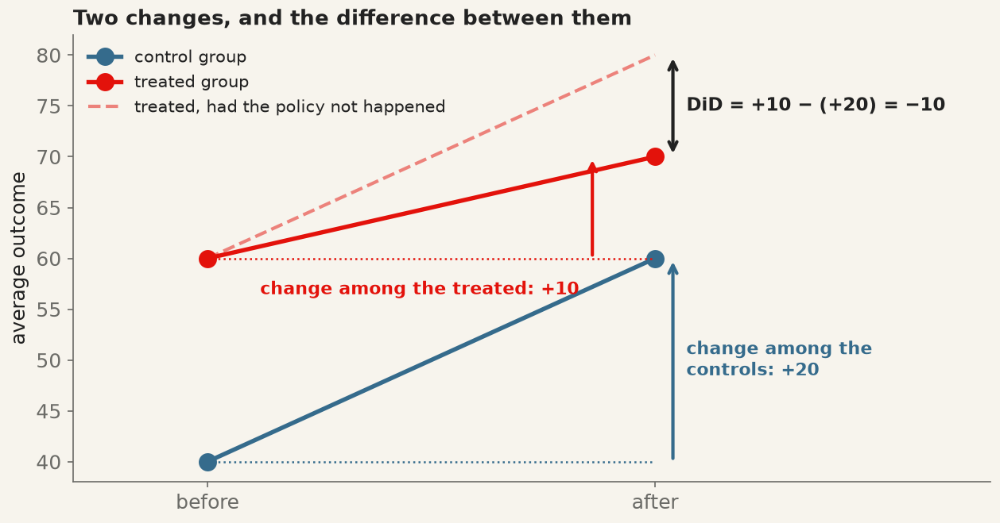{.big fig-alt="Control rises from 40 to 60, treated from 60 to 70; had nothing happened the treated would have reached 80; the gap of −10 is the DiD."}
:::
::: {.column width="40%"}
::: {.check}
**Read the picture:**

1. the treated rose by **+10**;
2. the controls rose by **+20**: that is what time alone did;
3. so the treated would have reached **80** (dashed); they reached 70. The policy: **−10**.
:::

::: {.step}
**The first difference** removes everything **constant** about the treated group: its location, its
institutions, its wealth. **The second** removes everything **common** to both groups: the market, the
business cycle.
:::
:::
:::

## The canonical real case: the minimum wage {.scrollable}

On 1 April 1992 **New Jersey** raised its minimum wage from \$4.25 to \$5.05; next door, **Pennsylvania**
did not. Card and Krueger (1994) phoned the same 410 fast-food restaurants (331 in New Jersey, 79 in eastern
Pennsylvania) **before** (February–March) and **after** (November–December).

::: {.muted}
**Predict first:** the textbook says a higher price of labour means fewer workers hired. What sign do you
expect for the effect on employment?
:::

::: columns
::: {.column width="56%"}
| Full-time-equivalent staff per restaurant | Before | After | Change |
|---|---|---|---|
| New Jersey (treated) | 20.44 | 21.03 | **+0.59** |
| Pennsylvania (control) | 23.33 | 21.17 | **−2.16** |
| Difference | −2.89 | −0.14 | **+2.76** (s.e. 1.36) |

$$
\text{DiD} = 0.59 - (-2.16) = +2.76
$$
:::
::: {.column width="44%"}
::: {.check}
**Read it like the picture.** Employment in New Jersey barely moved. The estimate is positive because
Pennsylvania **fell**: had New Jersey followed it, it would have ended at $20.44 - 2.16 = 18.28$, and it
ended at 21.03.
:::

::: {.warn}
**What carries the result** is not the data but the assumption: without the rise, New Jersey would have
moved like Pennsylvania. The control group's change is half of every DiD.
:::
:::
:::

::: {.muted}
Means from Card and Krueger (1994), Table 3; the change in the difference is computed on unrounded means.
:::

## As a regression: the interaction is the estimate {.scrollable}

$$
Y = \beta_0 + \beta_1\,\text{Treated} + \beta_2\,\text{Post} + \beta_3\,(\text{Treated} \times \text{Post}) + e
$$

| Coefficient | Equals | In words |
|---|---|---|
| $\beta_0$ | $\bar Y_{\text{control, pre}}$ | the control group, before |
| $\beta_1$ | $\bar Y_{\text{treated, pre}} - \bar Y_{\text{control, pre}}$ | how different the groups were **before**: allowed to be anything |
| $\beta_2$ | $\bar Y_{\text{control, post}} - \bar Y_{\text{control, pre}}$ | what happened to everyone over time |
| $\beta_3$ | $(\bar Y_{\text{tr, post}} - \bar Y_{\text{tr, pre}}) - (\bar Y_{\text{co, post}} - \bar Y_{\text{co, pre}})$ | **the effect**: the extra change among the treated, the DiD |

::: {.muted}
`Post` is 1 for **every** unit after the policy date. Why a regression, if four means suffice? It gives
the same number **plus** a standard error, and it accepts control variables and more than two periods.
:::

::: {.warn}
**`Treated`, not "treatment".** `Treated` labels the **group**: it is 1 for those units in **every**
period, even before the policy, when nothing has happened to them yet. Being **under** treatment is
`Treated × Post`: 1 only for the treated group after the policy. That product is the $D_{it}$ of two-way
fixed effects later in the session.
:::

**`Treated × Post` is a product of two 0/1 dummies**, so it equals 1 in **one cell only**, and 0 in the other three:

| | Treated | Post | Treated × Post | Expected $Y$ in this cell |
|---|---|---|---|---|
| control, before | 0 | 0 | **0** | $\beta_0$ |
| control, after | 0 | 1 | **0** | $\beta_0 + \beta_2$ |
| treated, before | 1 | 0 | **0** | $\beta_0 + \beta_1$ |
| treated, after | 1 | 1 | **1** | $\beta_0 + \beta_1 + \beta_2 + \beta_3$ |

::: {.check}
Change among the treated: $\beta_2 + \beta_3$. Change among the controls: $\beta_2$. Their difference is
$\beta_3$: the difference in differences. The counterfactual for the treated after is
$\beta_0 + \beta_1 + \beta_2$; what they actually reached is that plus $\beta_3$.
:::

## Words you will need {.scrollable}

| Term | What it is | In this session's examples |
|---|---|---|
| **DiD** · difference-in-differences | the change among the treated minus the change among the controls | the housing sites; the AI strategies |
| **Pre** / **post** period | before / after the policy starts | before / after a site opens |
| **Counterfactual** | what the treated would have reached **without** the policy; here, their start plus the controls' change | the dashed line |
| **Parallel trends** | without treatment, the treated would have followed the **same trajectory** as the controls. **Untestable** | what fails in Example 2B |
| **Event study** | the DiD estimated year by year, relative to the last pre-period | the plot of Example 2 |
| **Pre-trend** | a gap that was already moving **before** the policy: evidence against parallel trends | Example 2B |
| **Staggered adoption** · **cohort** | units treated in different years; a cohort is the units first treated in the same year | the AI strategies, 2021–2023 |
| **TWFE** · two-way fixed effects | a regression with a dummy per unit and per year, plus the treatment | Example 3 |
| **ATT** · average treatment effect on the treated | the effect on those who got the policy (session 10) | what DiD estimates |

## The assumption, stated exactly {.scrollable}

::: {.warn}
**Parallel trends:** in the absence of treatment, the **change** among the treated would have equalled the
change among the controls,
$$
\mathrm{E}[Y_{\text{tr,post}}(0) - Y_{\text{tr,pre}}(0)] = \mathrm{E}[Y_{\text{co,post}}(0) - Y_{\text{co,pre}}(0)] .
$$
:::

::: {.muted}
**Reading the notation** (session 10): $Y(0)$ is the outcome a unit would have **without** the treatment,
$Y(1)$ the outcome **with** it. For the treated after the policy we see only $Y(1)$; their $Y(0)$ is the
counterfactual, the dashed line. The assumption is about that unseen quantity, which is why no test can
prove it.
:::

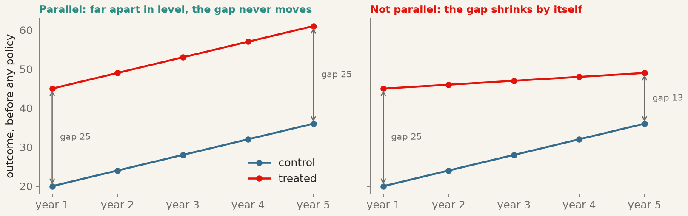{.wide fig-alt="Left: two lines 25 apart, both rising by 4 a year: the gap never moves. Right: the treated line rises more slowly, so the gap shrinks from 25 to 13 with no policy at all."}

::: columns
::: {.column width="50%"}
::: {.check}
**It is not** that the groups are similar. **Left:** they are 25 apart, and that is fine; only the **gap**
must stay constant.
:::
:::
::: {.column width="50%"}
::: {.step}
**Right:** the gap shrinks by itself. A DiD would call that shrinkage a policy effect. The assumption is
about the years **after** the policy, which nobody sees: it is **untestable**. What you **can** look at is
whether the trends were parallel **before**.
:::
:::
:::

::: {.muted}
**What the estimate contains:** $\widehat{\text{DiD}} = \text{ATT} + (\text{the difference in the two groups' changes had nobody been treated})$.
Parallel trends says the second term is zero. Two companions travel with it: **no anticipation** (nobody
reacts before the policy starts) and **no spillovers** (the policy does not reach the controls).
:::

## Example 1 · Did affordable housing lower nearby prices? {.center}

## The case {.scrollable}

Governments subsidise **affordable-housing projects**. Critics argue they lower the value of nearby homes:
neighbours' preferences, congestion, buildings that do not match the street (Ellen et al., 2007).

::: columns
::: {.column width="55%"}
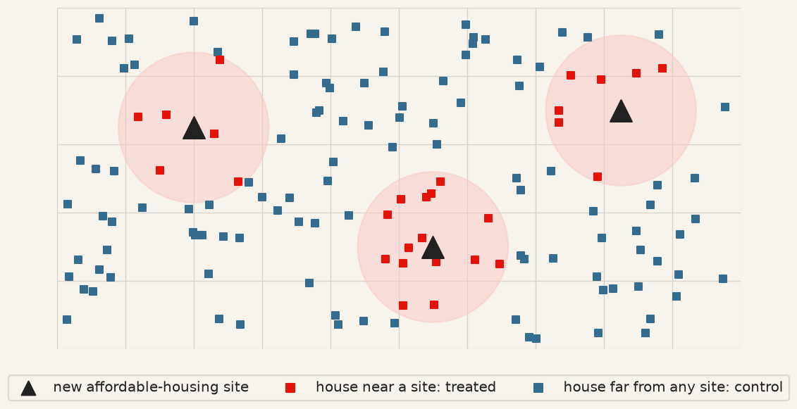{fig-alt="A schematic city: three new sites, each with a shaded circle; houses inside the circles are treated (red), houses outside are controls (blue)."}
:::
::: {.column width="45%"}
| Column | Meaning |
|---|---|
| `near` | 1 = near a new site (treated), 0 = far (control) |
| `post` | 1 = after the site opened, 0 = before |
| `price` | the sale price, \$ thousands |
:::
:::

::: {.step .question}
**The question:** did the sites lower the prices of nearby houses, and by how much?
:::

::: {.muted}
**Simulated**, 1,000 houses, so we know the truth: a site lowers nearby prices by **\$10,000**. Near houses
were cheaper to begin with (by about \$15,000), and the whole market rose by \$30,000.
:::

::: {.muted}
**Predict first:** comparing near and far houses *after* the sites opened, will you find more or less than
−10? And comparing near houses *before and after*?
:::

## Three ways to answer, one of them right {.scrollable}

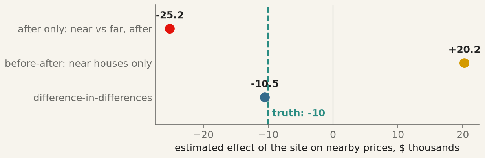{.wide fig-alt="After-only comparison −25.2, before-after +20.2, difference-in-differences −10.5, truth −10."}

| Comparison | Estimate | What it gets wrong |
|---|---|---|
| **after only**: near vs far, after the sites opened | **−25.2** | mixes the effect with the **\$15,000 gap that was always there** |
| **before–after**: near houses, after vs before | **+20.2** | mixes the effect with the **market's \$30,000 rise** |
| **difference-in-differences** | **−10.5** | removes both: the truth is −10 |

## The four means, and the counterfactual {.scrollable}

::: columns
::: {.column width="58%"}
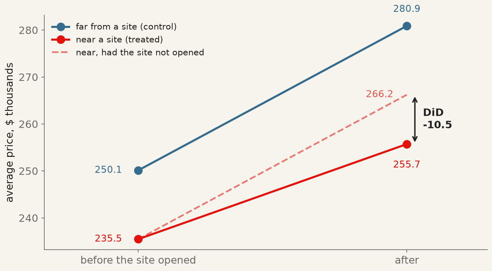{.big fig-alt="Far houses rise from 250.1 to 280.9; near houses from 235.5 to 255.7; had the site not opened they would have reached 266.2; the gap is −10.5."}
:::

::: {.column width="42%"}
$$
\begin{aligned}
\text{DiD} &= (255.7 - 235.5) - (280.9 - 250.1) \\
&= 20.2 - 30.8 = -10.5
\end{aligned}
$$

::: {.check}
**The dashed line** is the counterfactual: near houses start at 235.5 and, without the site, would have risen
like the far ones, by 30.8, to **266.2**. They reached 255.7. The difference is the effect.
:::
:::
:::

## The same number from a regression {.scrollable}

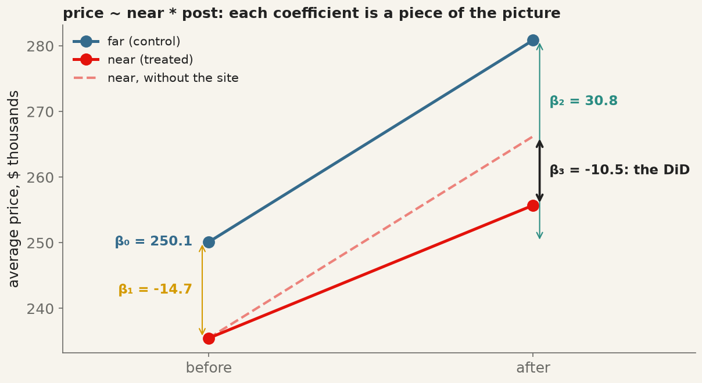{.wide fig-alt="The four means with each coefficient drawn: β0 the far houses before, β1 the gap before, β2 the far houses' rise, β3 the gap between near-after and its counterfactual."}

`price ~ near * post`, standard errors clustered by house:

| | Coefficient | Std. error | Reading |
|---|---|---|---|
| Intercept $\beta_0$ | 250.12 | 1.03 | far houses, before |
| `near` $\beta_1$ | −14.65 | 1.43 | near houses were \$14,650 cheaper **before**: allowed |
| `post` $\beta_2$ | 30.76 | 0.64 | the market rose by \$30,760 for everyone |
| `near:post` $\beta_3$ | **−10.51** | 0.92 | **the effect**: the DiD |

::: {.check}
**Check:** $\beta_0 + \beta_1 = 235.47$, the near houses before; $\beta_0 + \beta_1 + \beta_2 = 266.23$, the
counterfactual. The regression adds what the four means cannot: a **standard error**, covariates, and more
than two periods.
:::

## Example 1 · Plain summary {.scrollable}

- Comparing near and far houses **after** the sites opened says −25: the gap that was always there.
- Comparing near houses **before and after** says +20: the market's rise.
- The **difference of the two changes** says −10.5, against a truth of −10. In a regression, it is the
  coefficient on the interaction.

::: {.step}
**What this example teaches:** DiD needs no measure of *why* near houses were cheaper; it needs only that,
without the sites, both groups would have **moved together**. Example 2 asks what happens when they would not.
:::

## Example 2 · Were the trends parallel? {.center}

## The case: the same city, six years {.scrollable}

The sites open in **2006**. We now have prices from **2003 to 2008**: three years before, three after. The
truth is the same −10. Two versions of the city:

- **A:** without the sites, near and far houses would have risen **together**.
- **B:** near neighbourhoods were **already slipping**, losing \$3,000 a year on far ones before any site opened.

::: {.step .question}
**The question:** can the data tell the two cities apart, and what does the DiD say in each?
:::

::: {.muted}
**Predict first:** in city B, will the DiD say more than −10, less, or the same? Why?
:::

## The raw prices {.scrollable}

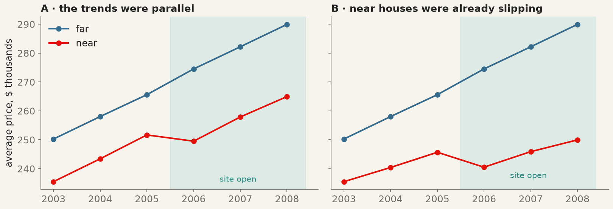{fig-alt="Two panels of prices from 2003 to 2008: in A the near and far lines run parallel before 2006; in B the near line rises more slowly from the start."}

::: {.check}
**Look before the shaded years.** In A, the two lines run parallel until 2005: the gap is constant. In B, the
gap is already **widening** from 2003, before any site exists.
:::

## The event study: the DiD, year by year {.scrollable}

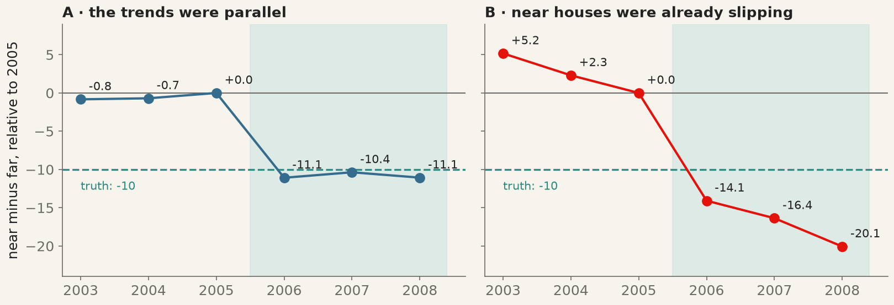{fig-alt="Event studies: in A the pre-2006 points sit at zero and the post points at about −11; in B the pre points are +5.2 and +2.3, falling to −20.1 by 2008."}

::: columns
::: {.column width="50%"}
::: {.check}
**A:** before 2006 the points sit at **0** (−0.8, −0.7): no pre-trend. After, about **−11** each year.
The two-period DiD, 2005 to 2008, says **−11.1**.
:::
:::
::: {.column width="50%"}
::: {.warn}
**B:** the points before 2006 are **+5.2, +2.3, 0**: a line already falling. The two-period DiD says
**−20.1**, double the truth: the pre-existing slide, \$3,000 a year, is counted as the policy.
:::
:::
:::

::: {.muted}
2005 is the **reference year**: zero by construction, not by evidence. The other pre-years are the evidence.
:::

## Why B's estimate is wrong: two counterfactuals {.scrollable}

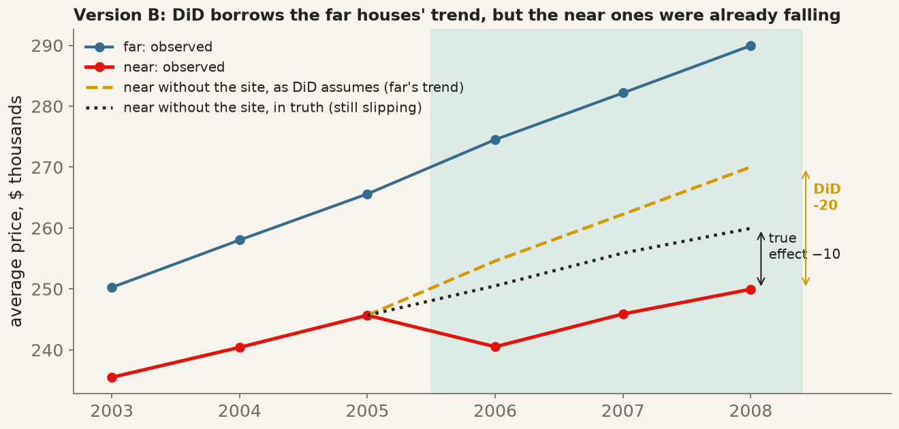{.mid fig-alt="City B: near houses observed in red; the gold dashed line is the counterfactual DiD assumes, following the far houses' rise; the black dotted line is the true counterfactual, still slipping; DiD measures −20, the truth is −10."}

::: columns
::: {.column width="50%"}
::: {.check}
**Gold, dashed:** what DiD assumes the near houses would have done without the sites: rise **like the far
ones**. **Black, dotted:** what they would really have done: keep **slipping**, as they had since 2003.
:::
:::
::: {.column width="50%"}
::: {.warn}
The true effect is the gap to the **black** line, −10. DiD measures the gap to the **gold** line, −20: it
adds the slide that was already under way to the policy.
:::
:::
:::

::: {.muted}
**The estimate, taken apart:** DiD = effect + trend difference. Here about −11 (what the same comparison
measured in city A) plus −9 (three more years of the \$3,000 slide) gives the −20.
:::

## Example 2 · Plain summary {.scrollable}

- When the trends were parallel, the DiD finds the effect, and the years **before** the policy are flat.
- When the treated group was already on a different path, the DiD **doubles** the effect, and the years before
  the policy show it.
- A flat pre-trend is **evidence**, not proof: parallel trends is about the years *after*, which nobody sees.
- So the pre-period is a **falsification test**: a slope refutes the assumption; a flat line only survives
  the test, and with few or noisy pre-years it can miss a slope that is there (Roth, 2022).

::: {.step}
**What this example teaches:** with several pre-periods, plot them first. Example 3 shows what to do when
there is only one.
:::

## Example 3 · Do national AI strategies raise firms' AI use? {.center}

## The case: the course's own data {.scrollable}

Between 2021 and 2023, **18 European countries** adopted a national **AI strategy**; 12 did not. Did firms
in adopting countries start **using AI** more? The outcome, `ai_use_any`, is the share of firms using any AI
technology, in percentage points; `qmib.load("angle_c_country")` gives it by country and year.

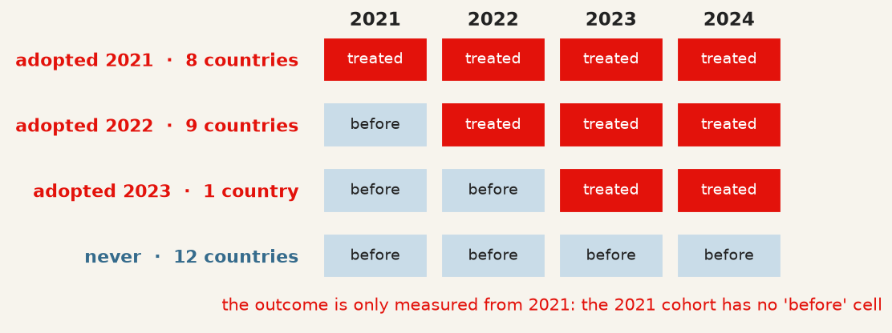{.mid fig-alt="A grid of cohorts by year: the 2021 cohort is treated in every observed year; the 2022 cohort has one year before; the 2023 cohort, one country, has two; the 12 never-adopters are never treated."}

::: {.step .question}
**The question:** what did adopting a strategy do to firms' AI use, and how much can 30 countries over four
years establish?
:::

::: {.muted}
The course data are generated with a known effect, **+2.4 points**, so every estimate can be scored, as in
sessions 9 and 10.
:::

## What the adoption table already decides {.scrollable}

::: columns
::: {.column width="50%"}
::: {.warn}
**The 2021 cohort cannot be used at all.** No year before adoption: no before, no difference. Not weak
evidence: **no** evidence for this design.
:::

::: {.warn}
**The 2023 cohort is one country.** Its estimate is one country's trajectory.
:::
:::
::: {.column width="50%"}
::: {.check}
**The 2022 cohort has one pre-period.** Enough to compute a DiD, **not** enough to see a pre-trend: a trend
needs at least two points.
:::

::: {.step}
**With staggered adoption, which controls?** Only countries **not yet** or **never** treated. A country that
adopted in 2021 is not a control for one that adopted in 2022.
:::
:::
:::

## The raw data {.scrollable}

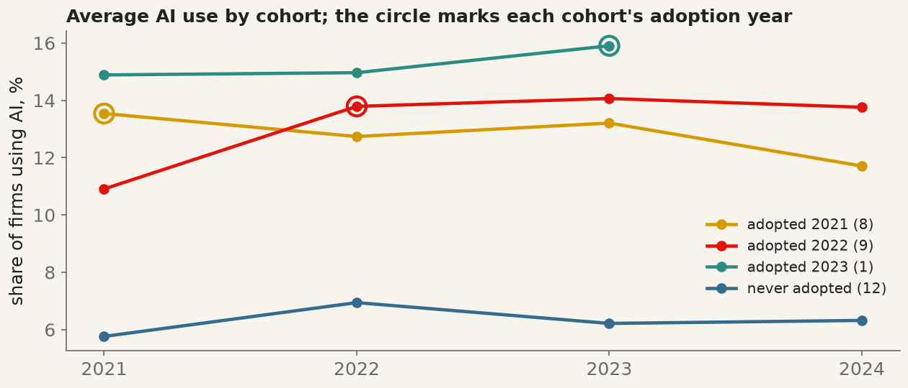{.mid fig-alt="Average AI use by cohort, 2021 to 2024: adopters use more AI than never-adopters throughout; the 2022 cohort rises from 10.9 to 13.8 in its adoption year."}

::: columns
::: {.column width="50%"}
::: {.check}
**Levels differ a lot:** adopters used AI about twice as much as never-adopters, even **before** adopting.
That is allowed: DiD only needs the **gap** to have been stable.
:::
:::
::: {.column width="50%"}
::: {.step}
**Look at the 2022 cohort (red):** a jump in its adoption year, while the never-adopters (blue) barely move.
That jump, minus the never-adopters' change, is its DiD.
:::
:::
:::

## Why not one big regression? {.scrollable}

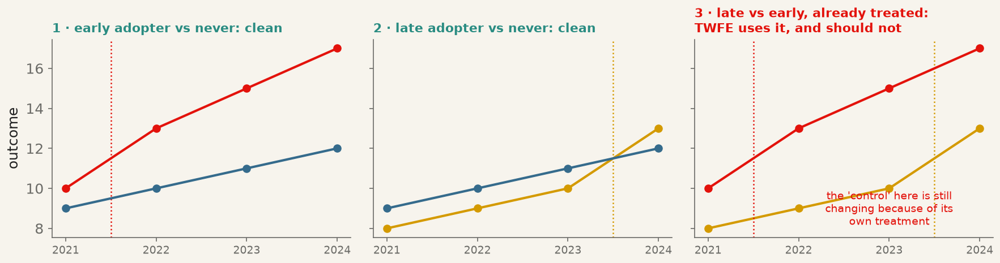{fig-alt="Three schematic comparisons: early adopter against never-treated, clean; late adopter against never-treated, clean; late adopter against the already-treated early adopter, which TWFE also uses and should not."}

::: columns
::: {.column width="50%"}
::: {.check}
**Panels 1 and 2** are clean: the comparison group has **no** policy, so its change is what time did.
:::
:::
::: {.column width="50%"}
::: {.warn}
**Panel 3:** two-way fixed effects also compares a late adopter with an **early** one that is still
adjusting to its **own** policy. Its change is not "time alone", and subtracting it can bias the estimate,
even flip its sign when effects grow over time.
:::
:::
:::

## The forbidden comparison, in numbers {.scrollable}

$$
Y_{it} = \alpha_i + \lambda_t + \beta\, D_{it} + \varepsilon_{it}
$$

::: {.muted}
Two-way fixed effects: $\alpha_i$ is a dummy per unit (everything constant about it), $\lambda_t$ a dummy per
year (what hit everyone), $D_{it} = 1$ once unit $i$ is treated. With two groups and two periods, $\beta$ is
exactly the interaction $\beta_3$.
:::

::: {.check}
**Goodman-Bacon (2021):** with several adoption dates, $\widehat\beta$ is a **weighted average of every
2×2 comparison in the data**, including the one in panel 3: a late adopter against an early one.
:::

A late adopter goes from 2 to 5: its true effect is **+3**. Its "control" adopted years ago. Nothing else
moves, so parallel trends holds exactly:

| The early adopter's own effect is | Its outcome over the same window | The 2×2: late's change − early's change | |
|---|---|---|---|
| **constant** | 4 → 4 | $(5-2) - (4-4) = +3$ | right |
| **still growing** | 4 → 8 | $(5-2) - (8-4) = -1$ | **wrong sign** |

::: {.warn}
The early adopter's growing effect is subtracted **as if it were a trend**. This is not a failure of
parallel trends: it is a failure of the control group.
:::

## When does it matter? {.scrollable}

| Treatment timing | Treatment effects | One TWFE coefficient |
|---|---|---|
| everyone treated on the same date | anything | fine |
| staggered | constant over time **and** the same for every cohort | fine |
| staggered | changing with time since treatment, **or** different across cohorts | **biased** |

::: columns
::: {.column width="50%"}
::: {.check}
**A real case.** Unilateral-divorce laws, 37 US states, 1969–85, and female suicide (Stevenson and Wolfers,
2006). TWFE says **−3.08** per million. A quarter of its weight sits on late-against-early comparisons,
which average **+3.51**; without them, **−5.44**. The forbidden comparisons hid about 40% of the effect
(Goodman-Bacon, 2021).
:::
:::
::: {.column width="50%"}
::: {.step}
**How often?** Re-estimating some 300 staggered TWFE estimates from 24 papers in five leading journals,
Hull (2026) finds 8% to 14% of point estimates significantly different under a robust estimator, with
standard errors 26% to 49% larger. Often the same answer with a wider interval; you only know by running both.
:::
:::
:::

::: {.muted}
Table condensed from Baker, Larcker and Wang (2022). **Predict first:** will TWFE land above or below the
truth of 2.4 here? And Callaway–Sant'Anna?
:::

## The estimates, against the truth {.scrollable}

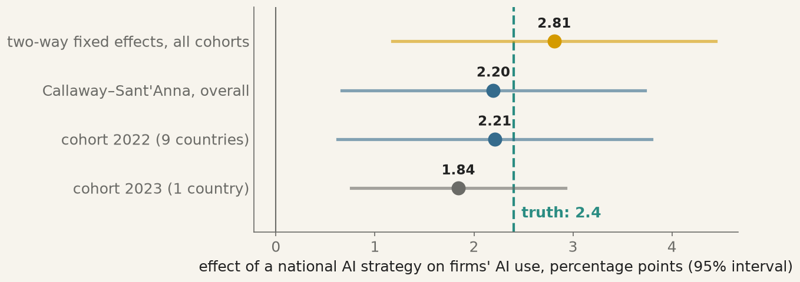{.mid fig-alt="Two-way fixed effects 2.81, Callaway–Sant'Anna overall 2.20, cohort 2022 2.21, cohort 2023 1.84 from one country; truth 2.4."}

::: columns
::: {.column width="50%"}
::: {.check}
**TWFE** (two-way fixed effects: a dummy per country and per year) gives **2.81**. Close, but it silently
uses already-treated countries as controls for later ones, and with staggered timing its weights can even
be **negative** (Goodman-Bacon, 2021; de Chaisemartin and D'Haultfœuille, 2020).
:::
:::
::: {.column width="50%"}
::: {.step}
**Callaway and Sant'Anna (2021)** estimate each cohort against clean controls, then average: **2.20**
(standard error 0.78, 30 clusters). The 2021 cohort is dropped, **out loud**. The one-country cohort's
narrow interval is not precision: there is no variation left to measure.
:::
:::
:::

## Callaway–Sant'Anna is one repair among several {.scrollable}

$$
ATT(g,t) = \mathrm{E}[\,Y_t - Y_{g-1} \mid \text{cohort } g\,] - \mathrm{E}[\,Y_t - Y_{g-1} \mid \text{clean controls}\,]
$$

::: {.muted}
One 2×2 for each cohort $g$ and each year $t$, from the cohort's last untreated year $g-1$, against units
never or not yet treated. Then average the blocks: overall, by cohort, or by years since treatment.
:::

| Route | The idea | Reach for it when | What it costs |
|---|---|---|---|
| **Stacked DiD** (Cengiz et al., 2019) | **restrict the data**: one stack per cohort with its clean controls, then ordinary least squares | you want your own event window or hand-picked controls | duplicated rows; the default weights need care |
| **Extended TWFE** (Wooldridge, 2021) | **free the model**: one coefficient per cohort and post-year, averaged afterwards | the outcome is a count or a yes/no; the panel is small or noisy | many coefficients; a stronger baseline assumption |
| **Callaway and Sant'Anna** (2021) | **build from the blocks**: every $ATT(g,t)$, then aggregate | the default benchmark; covariates; arguing pre-trends cohort by cohort | wider standard errors; treatment must be on/off and permanent |

::: {.step}
All three do the same thing: **keep already-treated units out of the control group**. They differ in how,
and in which average they report by default. `diff_diff` has each (`StackedDiD`, `WooldridgeDiD`,
`CallawaySantAnna`), and also Sun and Abraham (2021), de Chaisemartin and D'Haultfœuille (2020) for
treatments that switch off, and Borusyak, Jaravel and Spiess (2024).
:::

::: {.muted}
A **different** question is whether to believe parallel trends at all, whatever the estimator: next slide.
One reference for all of it: Baker, Callaway, Cunningham, Goodman-Bacon and Sant'Anna (2026),
"Difference-in-Differences Designs: A Practitioner's Guide", *Journal of Economic Literature*.
:::

## One pre-period: how much violation does the result survive? {.scrollable}

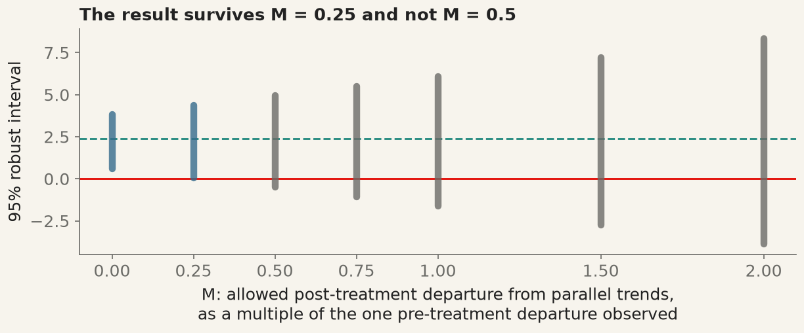{.mid fig-alt="Robust 95% intervals widening with M; they exclude zero at M = 0 and 0.25 and include it from M = 0.5."}

::: columns
::: {.column width="50%"}
::: {.check}
**The only pre-treatment evidence** is one country (the 2023 cohort) in one year: −1.13 against the
never-treated. The 2022 cohort's single pre-period is its reference year, zero by construction.
:::
:::
::: {.column width="50%"}
::: {.warn}
**Rambachan and Roth (2023):** allow post-treatment departures from parallel trends up to $M$ times that
pre-treatment one. The effect stays positive up to $M = 0.25$, not at $0.5$. That is a **low breakdown
point**, and it should be: it rests on one country's single year.
:::
:::
:::

::: {.step}
**How to read $M$.** The data show one departure from parallel trends **before** adoption: 1.13 points.
$M = 1$ says "after adoption, the trends could drift apart by as much as that". $M = 0.5$, by half of it.
For each $M$ the interval is widened to cover every such drift. The **breakdown value** is the largest $M$
at which the interval still excludes zero: the larger it is, the less the conclusion depends on parallel
trends holding exactly.
:::

## Example 3 · Plain summary {.scrollable}

- The adoption table decides what can be estimated before any regression: one cohort is unusable, one is a
  single country.
- TWFE gives 2.81; the staggered-robust estimator gives **2.20 ± 1.5**, covering the truth of 2.4.
- Parallel trends **cannot be examined** here; a sensitivity analysis says how much of it the result needs:
  not much violation before the interval reaches zero.

::: {.step}
**What this example teaches:** with real panels, the design is decided by **who was treated when**. Report
the adoption structure, a staggered-robust estimate beside TWFE, and how much violation the result survives.
:::

## Wrapping up · What the design cannot fix {.center}

## Matching or difference-in-differences? {.scrollable}

| | Matching (session 10) | Difference-in-differences |
|---|---|---|
| **Removes** | differences in what you **measured** | everything **constant** about a unit, measured or not |
| **Assumes** | no unmeasured confounder | parallel trends |
| **Needs** | rich covariates, overlap | data before and after |
| **Checkable part** | balance, overlap | pre-trends, with several pre-periods |
| **Fails when** | an unmeasured trait drives selection | the treated were already on a different path (Ex. 2B) |

::: {.check}
**They answer different worries**, and each rests on an assumption the data cannot test. Choose the design
whose assumption you can **argue** best for your setting, and say which assumption that is.
:::

## What difference-in-differences cannot fix {.scrollable}

- **Anything that changes at the same time as treatment.** A shock hitting only the treated in the treatment
  year is indistinguishable from the treatment. Countries adopting an AI strategy may do other things that year.
- **Anticipation.** If units react before the policy starts, the "before" is already contaminated.
- **Composition change.** If the units in the panel change, the first difference compares different
  populations, not the same one over time.
- **Spillovers.** If the policy affects the controls too (neighbouring houses, neighbouring countries), the
  estimate shrinks toward zero.
- **Standard errors.** DiD data are panels: cluster by unit, and say how many clusters you have.

## Seven steps for a DiD study {.scrollable}

| Step | What you do | In Python |
|---|---|---|
| 1 | name the policy, the treated, the controls, the dates | on paper |
| 2 | the **adoption table**: cohorts, and how many pre-periods each has | `.groupby("geo")["time"].min()` |
| 3 | plot the outcome over time for each group | `.groupby(["time", "group"]).mean()`, `plt.plot` |
| 4 | the four means, then the interaction regression | `smf.ols("y ~ treated * post")` |
| 5 | standard errors clustered by unit | `.fit(cov_type="cluster", cov_kwds={"groups": ...})` |
| 6 | the event study: is the pre-period flat? | the DiD year by year |
| 7 | staggered timing: a robust estimator beside TWFE; then sensitivity | `diff_diff.CallawaySantAnna`, `HonestDiD` |

## In class · A difference-in-differences, done in Python {.center}

## A third solution to the same problem {.scrollable}

Session 10 gave two solutions to selection: a trial, and matching on what you measured. Today's is for when
the reason units were treated is **not measured** and you could not draw.

| | **Solution 3 · Difference-in-differences** |
|---|---|
| When | you observe treated and untreated units **before and after** the policy |
| The idea | compare **changes**, not levels: the control group's change stands in for what the treated would have done |
| Why it removes selection | anything **constant** about a unit cancels in its own change |
| What you must assume | **parallel trends**: without the policy, both groups would have changed alike |
| What you check | the years **before** the policy |
| The estimate | the interaction of *treated* and *after* |

::: {.step}
It does not need the confounder to be measured. It replaces "nothing unmeasured matters" with a different
assumption, **parallel trends**, which is an **argument**, with one part you can check.
:::

## How this part works {.scrollable}

You now **do** the design from start to finish, on **new data**, not the lecture's examples. The packages,
by name: `numpy`, `pandas`, `statsmodels`, `matplotlib`, `diff_diff`.

::: columns
::: {.column width="52%"}
**Every step is one slide, always in the same four parts:**

| Part | What it tells you |
|---|---|
| **Objective** | the question this step must answer, and why the study needs the answer |
| **The code** | one cell, short enough to type |
| **What the code does** | each instruction, and how it serves the objective |
| **Read the output** | the numbers you should see, and what they let you conclude |
:::

::: {.column width="48%"}
::: {.step}
**How to work through a step:**

1. read the **objective**, and say what output would answer it;
2. run the cell;
3. match each line to its row in **what the code does**;
4. check your output against **read the output**, then say the conclusion in one sentence.
:::

::: {.check}
The **first cell** writes a small data file in your folder; every later cell starts by
reading it, so each cell runs on its own once the first has run. Keep the file: it is the template for
your project.
:::
:::
:::

## Solution 3 · A difference-in-differences study, step by step {.scrollable}

**The case.** A government opens **export desks**, one-stop offices for customs paperwork, in 12 regions in
2018 and in 10 more in 2021; 18 regions never get one. Does a desk raise the share of a region's firms that
export? Regions with a desk already exported more, for reasons nobody recorded. Simulated data, so the truth
is known: a desk adds **2 points for every year it has been open**, 6.1 on average over the years observed.

::: {.how}
| Step | Objective: the question it answers | What the code does | You are done when |
|----|------------|------------|----------|
| 1 | **Who** was treated, **when**, and how many years do I see before? | builds the panel, prints the adoption table | you can name each cohort, its size and its years before |
| 2 | Does the design **look** right, before any estimate? | averages by cohort and year, draws the lines | you have judged the levels, the pre-trends and the break |
| 3 | What is **one** effect I can compute by hand? | four means, then the interaction regression | the subtraction and `treated:post` give the same number |
| 4 | Were the groups **moving alike before**, and how does the effect evolve? | one DiD per year, each against the last year before | the pre-years include zero, the post-years tell a story |
| 5 | What is the effect over the **whole rollout**? | Callaway–Sant'Anna beside two-way fixed effects, then the big regression opened up | you can say why the two numbers differ |
| 6 | How **wrong** could parallel trends be before the result goes? | Rambachan–Roth robust intervals | you can report a breakdown value |
:::

::: {.step}
**The whole study's objective:** one sentence you can defend, of the form *"a desk raised the share of
exporting firms by … points (interval …); the groups moved alike before; the conclusion survives a violation
of parallel trends up to …"*. Each step supplies one piece of it.
:::

## DiD · Step 1 · The panel, and the adoption table {.scrollable}

::: {.step}
**Objective.** Before estimating anything, establish **who was treated, when, and how many years you observe
each group before its treatment**. A cohort with no year before has no first difference; a study with no
untreated units has no second. This step decides which comparisons exist.
:::

```{python}
#| echo: true

# DiD, step 1 · 40 regions, 2014-2023: one row per region and year
import numpy as np
import pandas as pd

rng = np.random.default_rng(11)                 # simulated here; in your project, the panel you were given
regions = 40
opened = np.r_[np.full(12, 2018), np.full(10, 2021), np.zeros(18)].astype(int)   # 0 = never
level = rng.normal(30, 6, regions) + 4 * (opened > 0)   # regions with a desk exported more already
rows = []
for year in range(2014, 2024):
    years_open = np.where((opened > 0) & (year >= opened), year - opened + 1, 0)
    exporters = level + 1.0 * (year - 2014) + 2.0 * years_open + rng.normal(0, 1.5, regions)
    rows.append(pd.DataFrame({"region": np.arange(regions), "year": year, "opened": opened,
                              "desk": (years_open > 0).astype(int), "exporters": exporters.round(1)}))
panel = pd.concat(rows, ignore_index=True)
panel.to_csv("export_desks.csv", index=False)

print(panel.head(3))
print(panel.groupby("opened")["region"].nunique().rename(index={0: "never"}))
```

::: {.how}
| What the code does | Instruction | How it serves the objective |
|-----------|-----------|-----------|
| gives every region its opening year: 12 in 2018, 10 in 2021, 18 never (coded 0) | `opened = np.r_[...]` | defines the **cohorts**, the groups the whole design compares |
| starts regions that will get a desk 4 points higher | `level = ... + 4 * (opened > 0)` | builds in the **selection** a naive comparison would mistake for an effect |
| adds +1 a year for everyone, and +2 for each year a desk has been open | `exporters = level + 1.0 * ... + 2.0 * years_open` | the common trend (parallel trends hold by construction) and the **truth** to recover |
| stacks the ten yearly tables into one long table and saves it | `pd.concat(rows)`, `.to_csv(...)` | the **panel**: one row per region and year, the shape every later step reads |
| counts the distinct regions for each opening year | `.groupby("opened")["region"].nunique()` | the **adoption table**: the answer to this step's question |
:::

::: {.check}
**Read the output.** 400 rows: 40 regions × 10 years. Three groups: **18** never, **12** in 2018, **10** in
2021. The 2018 cohort has **four** years before its desk (2014–17) and six after; the 2021 cohort **seven**
before and three after; the 18 never-treated regions are a clean control throughout. Every comparison this
study needs exists. `desk` is the $D_{it}$ of the two-way regression: 1 once a region's desk is open.
:::

::: {.muted}
In your project the simulation lines disappear: you start at `pd.read_csv(...)`, and the adoption table is
the first thing you print.
:::

## DiD · Step 2 · Look before you estimate {.scrollable}

::: {.step}
**Objective.** **See** the design before any regression. Three things to judge by eye: are the groups at
different **levels** (selection)? Were they **moving alike before** the desks (the only part of parallel
trends the data can show)? Is there a **break** when a desk opens?
:::

```{python}
#| echo: true
#| output-location: column
#| fig-width: 5.4
#| fig-height: 4.0

# DiD, step 2 · The average outcome of each cohort, year by year
import pandas as pd
import matplotlib.pyplot as plt

panel = pd.read_csv("export_desks.csv")
by_year = panel.groupby(["year", "opened"])["exporters"].mean().unstack()
by_year.columns = ["never", "desk in 2018", "desk in 2021"]

by_year.plot(marker="o")
plt.axvline(2017.5, color="grey", linestyle="--")
plt.axvline(2020.5, color="grey", linestyle="--")
plt.ylabel("firms exporting, %")
plt.show()

print(by_year.loc[[2014, 2017, 2020, 2023]].round(1))
```

::: {.how}
| What the code does | Instruction | How it serves the objective |
|-----------|-----------|-----------|
| averages the outcome for each cohort in each year: 30 means | `.groupby(["year", "opened"])["exporters"].mean()` | group means over time are the raw material of every DiD |
| turns the cohorts into columns: one row per year, one column per cohort | `.unstack()` | one column becomes one line on the plot |
| draws the three lines | `by_year.plot(marker="o")` | levels, slopes and breaks become visible at once |
| marks the gap between the last year without a desk and the first year with one | `plt.axvline(2017.5)`, `plt.axvline(2020.5)` | separates **before** from **after** for each cohort |
| prints four of the ten rows | `by_year.loc[[2014, 2017, 2020, 2023]]` | numbers to check the picture against |
:::

::: {.check}
**Read the output.** **Levels:** desk regions start 5 to 6 points above the others (35.0 and 33.8 against
28.8): selection, and it does not matter, because a DiD compares changes. **Before:** from 2014 to 2017 the
three groups rise by +2.1, +3.1 and +3.0: alike, give or take a point, and step 4 will put an interval on
that point. **Break:** by 2020 the 2018 cohort has gained 9.3 where the never-treated gained 3.7; the 2021
cohort follows the never-treated until 2020, then jumps.
:::

## DiD · Step 3 · One clean 2×2 {.scrollable}

::: {.step}
**Objective.** Compute **one** effect you understand completely: what the first year of a desk did to the
2018 cohort. First by subtraction, from four means; then by a regression, which gives the same number and
adds what subtraction cannot: a **confidence interval**.
:::

```{python}
#| echo: true

# DiD, step 3 · The 2018 cohort against the never-treated, 2017 against 2018
import pandas as pd
import statsmodels.formula.api as smf

panel = pd.read_csv("export_desks.csv")
two = panel[panel["opened"].isin([0, 2018]) & panel["year"].isin([2017, 2018])].copy()
two["treated"] = (two["opened"] == 2018).astype(int)
two["post"] = (two["year"] == 2018).astype(int)

means = two.groupby(["treated", "post"])["exporters"].mean().unstack()
print(means.round(2))
print("change, treated:", round(means.loc[1, 1] - means.loc[1, 0], 2),
      "  change, control:", round(means.loc[0, 1] - means.loc[0, 0], 2))

did = smf.ols("exporters ~ treated * post", data=two).fit(
    cov_type="cluster", cov_kwds={"groups": two["region"]})      # each region is seen twice
low, high = did.conf_int().loc["treated:post"]
print(f"DiD = {did.params['treated:post']:.2f}   95% CI [{low:.2f}, {high:.2f}]   truth, first year: 2")
```

::: {.how}
| What the code does | Instruction | How it serves the objective |
|-----------|-----------|-----------|
| keeps two groups and two years: 30 regions × 2 = 60 rows | `panel[... .isin([0, 2018]) & ... .isin([2017, 2018])]` | a **clean** comparison: the control is never treated, and the 2021 cohort is left out |
| makes the two 0/1 columns: which group, which period | `two["treated"]`, `two["post"]` | the two dummies of the 2×2 |
| computes the four means, groups in rows, periods in columns | `.groupby(["treated", "post"]).mean().unstack()` | the DiD **by subtraction**: you can check it with a pencil |
| fits `treated`, `post` and their product | `smf.ols("exporters ~ treated * post")` | the coefficient on `treated:post` **is** the difference of the two changes |
| lets a region's two rows be correlated | `cov_type="cluster"`, `cov_kwds={"groups": two["region"]}` | an honest standard error: 30 regions, not 60 independent rows |
| reads the interval of the interaction | `did.conf_int().loc["treated:post"]` | the uncertainty the four means cannot give |
:::

::: {.check}
**Read the output.** Treated regions rose by **3.23**, controls by **0.97**: the DiD is $3.23 - 0.97 =$
**2.26**, and the regression prints the same 2.26 with an interval of **[0.80, 3.71]**: it covers the truth
of 2 and excludes zero. The gap **before**, $38.11 - 30.93 = 7.2$, appears nowhere in the estimate: it
cancelled.
:::

::: {.muted}
Choose the comparison **yourself**: one cohort, a control group that is never treated, one year before and
one after. Every larger DiD is built from blocks like this one.
:::

## DiD · Step 4 · The event study, by regression {.scrollable}

::: {.step}
**Objective.** Two questions, one picture. **Before** the desks: were the two groups moving alike? That is
the checkable part of parallel trends. **After**: is the effect immediate, constant, growing? The tool is
step 3 repeated for **every** year, each compared with 2017, the last year before.
:::

```{python}
#| echo: true
#| output-location: column
#| fig-width: 5.4
#| fig-height: 4.0

# DiD, step 4 · The same DiD for every year, each against 2017, the last year before the desks
import pandas as pd
import matplotlib.pyplot as plt
import statsmodels.formula.api as smf

panel = pd.read_csv("export_desks.csv")
clean = panel[panel["opened"].isin([0, 2018])].copy()
clean["treated"] = (clean["opened"] == 2018).astype(int)

fit = smf.ols("exporters ~ treated * C(year, Treatment(reference=2017))", data=clean).fit(
    cov_type="cluster", cov_kwds={"groups": clean["region"]})
rows = [name for name in fit.params.index if name.startswith("treated:")]
study = pd.DataFrame({"year": [int(name[-5:-1]) for name in rows],
                      "effect": fit.params[rows].values,
                      "low": fit.conf_int().loc[rows, 0].values,
                      "high": fit.conf_int().loc[rows, 1].values}).set_index("year")
print(study.round(2))

plt.errorbar(study.index, study["effect"], yerr=[study["effect"] - study["low"],
             study["high"] - study["effect"]], fmt="o", capsize=3)
plt.axhline(0, color="grey")
plt.axvline(2017.5, color="grey", linestyle="--")
plt.ylabel("gap, relative to 2017")
plt.show()
```

::: {.how}
| What the code does | Instruction | How it serves the objective |
|-----------|-----------|-----------|
| keeps the 2018 cohort and the never-treated, all ten years | `clean = panel[... .isin([0, 2018])]` | the clean comparison of step 3, with every year |
| makes a dummy for each year except 2017, and multiplies each by `treated` | `treated * C(year, Treatment(reference=2017))` | one coefficient per year: the gap between the groups that year **minus the gap in 2017** |
| picks the nine interaction coefficients out of the results | `[name ... if name.startswith("treated:")]` | these nine numbers are the event study |
| reads the year at the end of each coefficient's name | `int(name[-5:-1])` | the horizontal axis |
| gathers estimate and interval, year by year | `study = pd.DataFrame({...})` | the table behind the plot |
| draws points with their intervals, a line at zero, a line at the opening | `plt.errorbar`, `plt.axhline(0)`, `plt.axvline(2017.5)` | before and after, read at a glance |
:::

::: {.check}
**Read the output.** **Before** (2014–16): −0.94, −0.72, −0.95, and every interval includes zero: nothing
here contradicts parallel trends. **After**: 2.26 in 2018 (step 3's number), then 3.87, 5.55, 7.87, 9.37,
11.93: about 2 more each year, as the truth says (2, 4, …, 12). 2017 has no point: it is the reference,
zero by construction.
:::

::: {.warn}
A flat pre-period is a test the design **survived**, not a proof: it says nothing about what the groups
would have done after 2017. Step 6 takes up that objection.
:::

## DiD · Step 5 · All cohorts, with staggered timing {.scrollable}

::: {.step}
**Objective.** **One number for the whole rollout**: both cohorts, every year, with a standard error, and
without ever using an already-treated region as a control. Beside it, the regression most studies run, to
see whether the shortcut would have mattered.
:::

```{python}
#| echo: true

# DiD, step 5 · The one big regression (TWFE) beside an estimator built for staggered adoption
import pandas as pd
import statsmodels.formula.api as smf
import diff_diff as dd

panel = pd.read_csv("export_desks.csv")

twfe = smf.ols("exporters ~ desk + C(region) + C(year)", data=panel).fit(
    cov_type="cluster", cov_kwds={"groups": panel["region"]})
cs = dd.CallawaySantAnna(cluster="region").fit(
    panel, outcome="exporters", unit="region", time="year", first_treat="opened")   # 0 = never

print(f"two-way fixed effects:  {twfe.params['desk']:.2f}  (SE {twfe.bse['desk']:.2f})")
print(f"Callaway-Sant'Anna:     {cs.overall_att:.2f}  (SE {cs.overall_se:.2f}, {cs.n_clusters} clusters)")
print("truth, average over the treated years: 6.12")
print(cs.aggregate("event_study").to_dataframe()[["event_time", "att", "se"]].round(2).to_string(index=False))
```

::: {.how}
| What the code does | Instruction | How it serves the objective |
|-----------|-----------|-----------|
| fits one coefficient on `desk`, with a dummy per region and per year | `smf.ols("exporters ~ desk + C(region) + C(year)")` | **two-way fixed effects**, $Y_{it} = \alpha_i + \lambda_t + \beta D_{it}$: the usual shortcut, kept as the benchmark |
| names the four columns the estimator needs; `opened` = 0 means never treated | `.fit(panel, outcome=, unit=, time=, first_treat=)` | computes an $ATT(g,t)$ for **each cohort and year**, against the regions that never get a desk: step 3, repeated |
| clusters by region | `dd.CallawaySantAnna(cluster="region")` | the same honest standard errors as steps 3 and 4 |
| averages those blocks over all treated cohort-years | `cs.overall_att`, `cs.overall_se` | **the number this step is for** |
| averages them by years since opening instead | `cs.aggregate("event_study")` | step 4's picture, for both cohorts together |
:::

::: {.check}
**Read the output.** Callaway–Sant'Anna: **6.38** (SE 0.45), next to the truth of 6.12. Two-way fixed
effects: **5.18** (SE 0.49), almost two standard errors too low. The event study agrees with step 4: the
six years before are within one standard error of zero (−0.28 to 0.40), and the effect then climbs from 2.9
to 11.9. Report both numbers: when they differ, the difference is a finding, and the next slide explains it.
:::

## DiD · Step 5, continued · Open up the big regression {.scrollable}

::: {.step}
**Objective.** Explain **why** two-way fixed effects came out low. Its single coefficient is a weighted
average of every 2×2 comparison in the panel (Goodman-Bacon, 2021). List them, with their weights, and find
the one that should not be there.
:::

```{python}
#| echo: true

# DiD, step 5, continued · The 2x2 comparisons inside the two-way fixed effects coefficient
import pandas as pd
import diff_diff as dd

panel = pd.read_csv("export_desks.csv")
bacon = dd.BaconDecomposition().fit(
    panel, outcome="exporters", unit="region", time="year", first_treat="opened")

table = bacon.to_dataframe()[["treated_group", "control_group", "estimate", "weight"]]
print(table.round(2).to_string(index=False))
print(f"weighted sum: {(table['estimate'] * table['weight']).sum():.2f}   = the two-way fixed effects coefficient")
```

::: {.how}
| What the code does | Instruction | How it serves the objective |
|-----------|-----------|-----------|
| splits the panel into every pair of groups with different opening dates | `dd.BaconDecomposition().fit(...)` | makes visible the comparisons the regression made silently |
| lists, for each pair, who plays treated, who plays control, the 2×2 estimate and its weight | `bacon.to_dataframe()[[...]]` | lets you judge each comparison on its merits |
| multiplies each estimate by its weight and adds them up | `(table["estimate"] * table["weight"]).sum()` | proves the four pieces **are** the 5.18 of step 5 |
:::

::: {.check}
**Read the output.** Four comparisons. Each cohort against the never-treated (**7.46** and **4.28**, 78% of
the weight) and the 2018 cohort against the not-yet-treated 2021 regions (**4.45**): all clean. The fourth
uses the **2018 regions as controls for the 2021 regions** and gives **−1.60**: a negative "effect" of a
desk that adds 2 points a year, because the 2018 regions' own effect was still growing and was subtracted
as if it were a trend. It carries 9% of the weight, and helps drag the coefficient down to 5.18, below
the truth of 6.12.
:::

::: {.muted}
This is the −1 of *The forbidden comparison, in numbers*, found in data. Callaway–Sant'Anna never makes it.
:::

## DiD · Step 6 · How wrong could parallel trends be? {.scrollable}

::: {.step}
**Objective.** Answer the objection that survives step 4: *"flat before does not mean parallel after."* Find
**how large** a departure from parallel trends, after the desks open, it would take to overturn the
conclusion, measured against the largest movement seen before.
:::

```{python}
#| echo: true

# DiD, step 6 · Rambachan-Roth: allow a violation up to M times the largest pre-period wobble
import pandas as pd
import diff_diff as dd

panel = pd.read_csv("export_desks.csv")
cs = dd.CallawaySantAnna(cluster="region").fit(
    panel, outcome="exporters", unit="region", time="year", first_treat="opened")
study = cs.aggregate("event_study")

for M in (0, 1, 2, 4, 8):
    honest = dd.HonestDiD(method="relative_magnitude", M=M).fit(study)
    print(f"M = {M}   95% robust interval [{honest.ci_lb:5.2f}, {honest.ci_ub:5.2f}]   "
          f"rules out zero: {'yes' if honest.is_significant else 'no'}")
```

::: {.how}
| What the code does | Instruction | How it serves the objective |
|-----------|-----------|-----------|
| recomputes step 5's event study | `study = cs.aggregate("event_study")` | supplies both ingredients: how much the groups wobbled **before**, and the effects **after** |
| tries five sizes of violation | `for M in (0, 1, 2, 4, 8)` | `M` is a multiple of the largest pre-period movement; `M = 0` is exact parallel trends |
| builds an interval that stays valid if the post-period violation is at most `M` times that movement | `dd.HonestDiD(method="relative_magnitude", M=M).fit(study)` | turns "what if the trends had diverged?" into a number |
| prints the bounds, and whether they exclude zero | `honest.ci_lb`, `honest.ci_ub`, `honest.is_significant` | the largest `M` that still says "yes" is the **breakdown value** to report |
:::

::: {.check}
**Read the output.** At `M = 0` the interval is **[6.26, 8.02]**; it widens as `M` grows, still excludes
zero at `M = 4` (**[2.41, 11.88]**) and includes it at `M = 8`. The conclusion survives trends diverging,
after the desks, by **four times** anything seen before them. Compare Example 3, where the result was gone
by `M = 0.5`: same method, far less evidence behind it.
:::

::: {.muted}
The interval is for the average effect over the six years after opening, whose true value is 7.
:::

## Your turn · The difference-in-differences {.scrollable}

| | Objective | What to change | What to look for |
|--|--------|-----------|-----------|
| **1** | **See the two wrong comparisons fail.** | In step 3, compute the after-only gap (treated minus control, 2018) and the before-after change of the treated alone, from `means`. | How far is each from 2, and what does each mix in? |
| **2** | **Recognise a pre-trend.** | In step 1, add `+ 0.8 * (opened == 2018) * (year - 2014)` to `exporters`, so that the 2018 regions were already pulling away. Rerun steps 2 to 4. | Where do you see it first: the plot, the 2×2 or the event study? What does the 2×2 now say, against a truth of 2? |
| **3** | **Make the forbidden comparison yourself.** | In step 3, estimate the first-year effect for the **2021** cohort (2020 against 2021), once with the never-treated as controls (`[0, 2021]`) and once with the **2018** regions (`[2018, 2021]`, and `treated` is `opened == 2021`). | By how much does the estimate fall, and what were the 2018 regions doing between 2020 and 2021? |
| **4** | **Check when the shortcut is safe.** | In step 1, replace `2.0 * years_open` by `6.0 * (years_open > 0)`: a constant effect. Rerun both step 5 cells. | Do the two estimators still disagree? What has become of the fourth comparison? |

::: {.step}
For each task, write one sentence beginning *"This shows that …"* before moving to the next.
:::

## What to report {.scrollable}

**For a difference-in-differences**

1. **The adoption structure**: units per cohort, years before and after, and which cohorts are unusable.
2. **The parallel-trends argument**, as an argument: why would the gap have stayed constant?
3. **The plot** of each group over time, and **an event study** with the reference year marked.
4. **A staggered-robust estimator beside TWFE.** If they disagree, that is the finding.
5. **Standard errors clustered by unit**, with the number of clusters.
6. **What else changed at the same time**, and **how much violation** the result survives.

::: {.warn}
**A flat pre-trend makes parallel trends plausible. It does not make the design true.**
:::

## Before the next session {.scrollable}

::: {.warn}
**Required:** the next session's article, its Dataverse package, and the
self-check. That is the pre-session deck.
:::

::: {.step}
**Optional:** the **QMIB Lab** for this session — a knowledge check on the hour
you have just sat through: **[warin.ca/qmib-labs](https://warin.ca/qmib-labs/qmib-lab-11.html)**
:::

::: {.muted}
Never a prerequisite, never marked for correctness. A completed report counts
toward participation because attempting it is the engagement being measured.
:::
