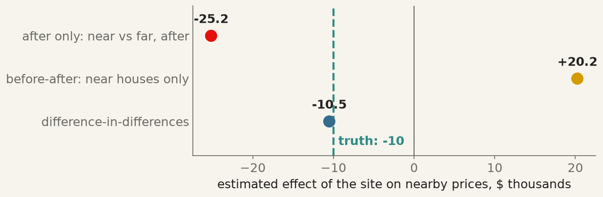
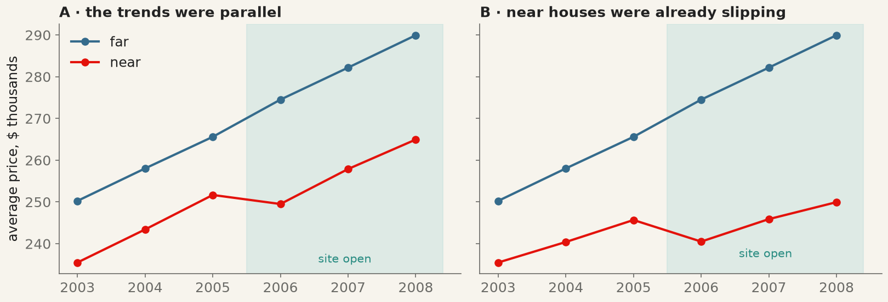
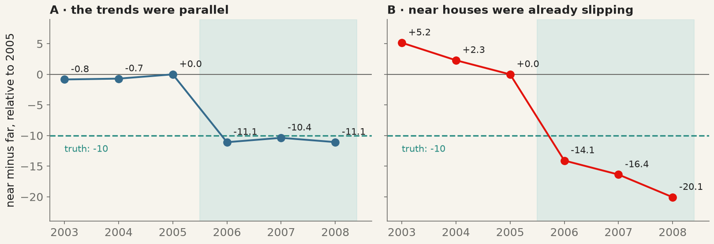
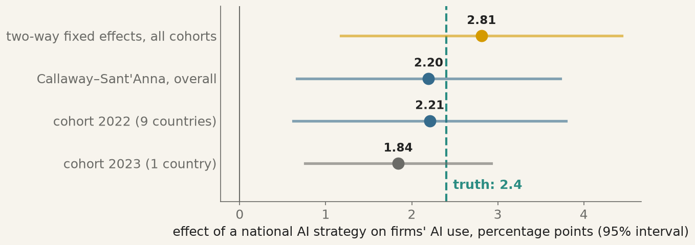
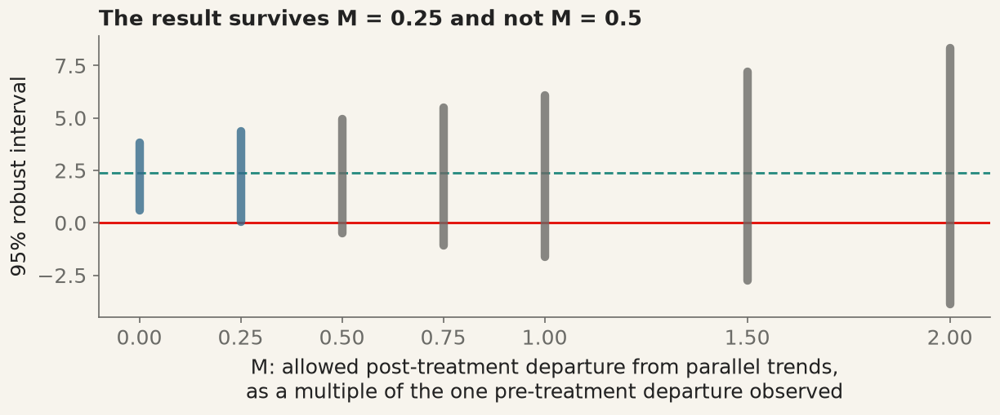
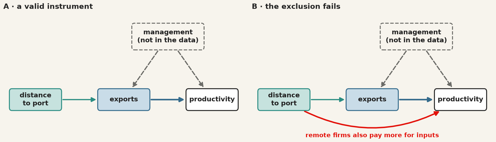
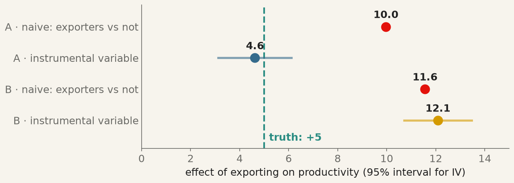

<!-- The deck teaches through four examples first, with no code on screen: a
     simulated affordable-housing policy in two periods (the two differences),
     the same city over six years (parallel trends, and an event study that
     catches its failure), and the course's own data on national AI strategies
     adopted in different years (TWFE against Callaway-Sant'Anna, and a
     Rambachan-Roth sensitivity analysis), and simulated exporters where neither
     design applies and an instrument does, then fails its exclusion. The code
     comes last, in the in-class
     part, where every cell is live: it executes at render time, so the output on
     the slides is the output the students' own machines produce. Examples 1 and
     2 simulate their data in the cell; Example 3 loads it with qmib.load, which
     a student runs from the repository root.
     The charts are drawn by economist-assets/build_did_figures.py, from the same
     simulations and the same data, so every number on a picture is the number
     the matching cell prints. -->
```{python}
#| label: setup
#| echo: false

# Hidden: keep library warnings off the slides, print tables wide, and let
# `import qmib` find the repository root, as it does for a student working there.
import sys
import warnings
warnings.filterwarnings("ignore")
sys.path.insert(0, "../..")
import pandas as pd
pd.set_option("display.width", 96)
pd.set_option("display.max_columns", 10)
```

<!-- BEGIN deck-frontmatter · scripts/build_deck_frontmatter.py -->

## Outline · The hour ahead {.center .scrollable}

1. Part 1 · The language of difference-in-differences
2. Example 1 · Did affordable housing lower nearby prices?
3. Example 2 · Were the trends parallel?
4. Example 3 · Do national AI strategies raise firms' AI use?
5. Example 4 · Does exporting raise productivity?
6. Wrapping up · What the design cannot fix
7. In class · The code behind the four examples

## What session 11 is for {.scrollable}
::::: columns

:::: {.column width="33%"}

### The mathematics

- Set up a **difference-in-differences** design and identify the four cells
- Read the **interaction coefficient** as the estimate
- State the **parallel-trends** assumption and how you would probe it
- Explain why **two-way fixed effects** can mislead under staggered adoption
- Say what an **instrument** must satisfy, and why good ones are rare

::::

:::: {.column width="33%"}

### The Python

- Build the four cells, then get the same number from an interaction in `smf.ols`
- Plot an event study and let the pre-period speak for the design
- Handle staggered adoption without letting the cohorts blur, with `diff_diff.CallawaySantAnna`
- Ask how much violation of parallel trends a result survives, with `HonestDiD`

::::

:::: {.column width="33%"}

### The international business

- Evaluate a policy that arrived in different countries at different times
- Defend parallel trends as an argument, not as a test that passed
- Say plainly what the design cannot rescue

::::

:::::

## Your Python so far {.scrollable}

Everything you need to type is on one sheet — how to start Python in VS Codium on
your platform, how to make a file and run it, the DataFrame basics, and every name from sessions 1 to 11, each with a line showing it in use.

> **[Python Cheatsheet · Session 11](https://warint.github.io/quantitative-methods/python-cheatsheet-11.pdf)** (PDF) ·
> in the repository at `11-…/PYTHON-CHEATSHEET.pdf`

**One sheet per package, functions explained with pictures:** [pandas](https://warint.github.io/quantitative-methods/python-cheatsheets/pandas.pdf) · [NumPy](https://warint.github.io/quantitative-methods/python-cheatsheets/numpy.pdf) · [matplotlib](https://warint.github.io/quantitative-methods/python-cheatsheets/matplotlib.pdf) · [statsmodels](https://warint.github.io/quantitative-methods/python-cheatsheets/statsmodels.pdf) · [diff-diff](https://warint.github.io/quantitative-methods/python-cheatsheets/diffdiff.pdf)

::: {.muted}
Print it, or keep it open beside the editor. Nothing on it is examinable; all of it is
assumed.
:::

<!-- END deck-frontmatter -->

## Part 1 · The language of difference-in-differences {.center}

## Did the policy work, if you cannot match on the reason? {.scrollable}

Session 10 removed selection bias by **measuring** the confounders and comparing like with like. Its last
example showed the limit: one unmeasured trait, and matching fails without a warning.

::: columns
::: {.column width="50%"}
::: {.step}
**Today's idea:** do not measure the confounders. Use **time**. If what makes the treated units different is
**stable**, comparing each unit with *itself* before and after removes it, observed or not.
:::
:::
::: {.column width="50%"}
::: {.warn}
**The catch:** things change over time for everyone. So compare the change among the treated with the change
among units that were **not** treated. Two differences, hence the name.
:::
:::
:::

::: {.check}
**Four examples:** a housing policy in two periods (the idea), the same city over six years (the
assumption, and how it fails), national AI strategies adopted in different years (the method, on the
course's own data), and exporting firms, where neither matching nor DiD can work and an **instrument**
does, until its key condition fails.
:::

## The two differences {.scrollable}

Let $\bar Y_{g,t}$ be the average outcome of group $g$ (treated or control) in period $t$ (pre or post):

$$
\widehat{\text{DiD}}
=
\underbrace{\big(\bar Y_{\text{treated, post}} - \bar Y_{\text{treated, pre}}\big)}_{\text{change among the treated}}
-
\underbrace{\big(\bar Y_{\text{control, post}} - \bar Y_{\text{control, pre}}\big)}_{\text{change among the controls}}
$$

::: columns
::: {.column width="50%"}
::: {.check}
**The first difference** removes everything **constant** about the treated group, measured or not: its
location, its institutions, its wealth.
:::
:::
::: {.column width="50%"}
::: {.check}
**The second difference** removes everything **common** to both groups over time: the market, the business
cycle, inflation.
:::
:::
:::

## As a regression: the interaction is the estimate {.scrollable}

$$
Y = \beta_0 + \beta_1\,\text{Treated} + \beta_2\,\text{Post} + \beta_3\,(\text{Treated} \times \text{Post}) + e
$$

| Coefficient | Equals | In words |
|---|---|---|
| $\beta_0$ | $\bar Y_{\text{control, pre}}$ | the control group, before |
| $\beta_1$ | $\bar Y_{\text{treated, pre}} - \bar Y_{\text{control, pre}}$ | how different the groups were **before**: allowed to be anything |
| $\beta_2$ | $\bar Y_{\text{control, post}} - \bar Y_{\text{control, pre}}$ | what happened to everyone over time |
| $\beta_3$ | the DiD | **the effect**: the extra change among the treated |

::: {.muted}
`Treated × Post` is 1 only for treated units after the policy. The counterfactual for the treated after is
$\beta_0 + \beta_1 + \beta_2$; what they actually reached is that plus $\beta_3$.
:::

## Words you will need {.scrollable}

| Term | What it is | In this session's examples |
|---|---|---|
| **DiD** · difference-in-differences | the change among the treated minus the change among the controls | the housing sites; the AI strategies |
| **Pre** / **post** period | before / after the policy starts | before / after a site opens |
| **Counterfactual** | what the treated would have reached **without** the policy; here, their start plus the controls' change | the dashed line |
| **Parallel trends** | without treatment, the treated would have followed the **same trajectory** as the controls. **Untestable** | what fails in Example 2B |
| **Event study** | the DiD estimated year by year, relative to the last pre-period | the plot of Example 2 |
| **Pre-trend** | a gap that was already moving **before** the policy: evidence against parallel trends | Example 2B |
| **Staggered adoption** · **cohort** | units treated in different years; a cohort is the units first treated in the same year | the AI strategies, 2021–2023 |
| **TWFE** · two-way fixed effects | a regression with a dummy per unit and per year, plus the treatment | Example 3 |
| **ATT** · average treatment effect on the treated | the effect on those who got the policy (session 10) | what DiD estimates |
| **Instrument** · IV, instrumental variable | a variable that moves the treatment and touches the outcome **only through it** | distance to port, Example 4 |
| **First stage** / **reduced form** | the instrument's effect on the treatment / on the outcome; IV = their ratio | Example 4 |

## The assumption, stated exactly {.scrollable}

::: {.warn}
**Parallel trends:** in the absence of treatment, the **change** among the treated would have equalled the
change among the controls,
$$
\mathrm{E}[Y_{\text{tr,post}}(0) - Y_{\text{tr,pre}}(0)] = \mathrm{E}[Y_{\text{co,post}}(0) - Y_{\text{co,pre}}(0)] .
$$
:::

::: columns
::: {.column width="50%"}
::: {.check}
**It is not** that the groups are similar. They may differ by any amount in **level**; only the **gap**
must stay constant.
:::
:::
::: {.column width="50%"}
::: {.step}
**It is untestable**, for the same reason as session 10's conditional independence: it is about $Y(0)$ for
the treated after treatment, the column nobody sees. What you **can** look at is whether the trends were
parallel **before**.
:::
:::
:::

## Example 1 · Did affordable housing lower nearby prices? {.center}

## The case {.scrollable}

Governments subsidise **affordable-housing projects**. Critics argue they lower the value of nearby homes:
neighbours' preferences, congestion, buildings that do not match the street (Ellen et al., 2007).

| Column | Meaning |
|---|---|
| `near` | 1 = the house is near a new subsidised site (treated), 0 = far from any (control) |
| `post` | 1 = observed after the site opened, 0 = before |
| `price` | the sale price, in \$ thousands |

::: {.step .question}
**The question:** did the sites lower the prices of nearby houses, and by how much?
:::

::: {.muted}
**Simulated**, 1,000 houses, so we know the truth: a site lowers nearby prices by **\$10,000**. Near houses
were cheaper to begin with (by about \$15,000), and the whole market rose by \$30,000.
:::

## Three ways to answer, one of them right {.scrollable}

{.wide fig-alt="After-only comparison −25.2, before-after +20.2, difference-in-differences −10.5, truth −10."}

| Comparison | Estimate | What it gets wrong |
|---|---|---|
| **after only**: near vs far, after the sites opened | **−25.2** | mixes the effect with the **\$15,000 gap that was always there** |
| **before–after**: near houses, after vs before | **+20.2** | mixes the effect with the **market's \$30,000 rise** |
| **difference-in-differences** | **−10.5** | removes both: the truth is −10 |

## The four means, and the counterfactual {.scrollable}

::: columns
::: {.column width="58%"}
{.big fig-alt="Far houses rise from 250.1 to 280.9; near houses from 235.5 to 255.7; had the site not opened they would have reached 266.2; the gap is −10.5."}
:::

::: {.column width="42%"}
$$
\begin{aligned}
\text{DiD} &= (255.7 - 235.5) - (280.9 - 250.1) \\
&= 20.2 - 30.8 = -10.5
\end{aligned}
$$

::: {.check}
**The dashed line** is the counterfactual: near houses start at 235.5 and, without the site, would have risen
like the far ones, by 30.8, to **266.2**. They reached 255.7. The difference is the effect.
:::
:::
:::

## The same number from a regression {.scrollable}

`price ~ near * post`, standard errors clustered by house:

| | Coefficient | Std. error | Reading |
|---|---|---|---|
| Intercept $\beta_0$ | 250.12 | 1.03 | far houses, before |
| `near` $\beta_1$ | −14.65 | 1.43 | near houses were \$14,650 cheaper **before**: allowed |
| `post` $\beta_2$ | 30.76 | 0.64 | the market rose by \$30,760 for everyone |
| `near:post` $\beta_3$ | **−10.51** | 0.92 | **the effect**: the DiD |

::: {.check}
**Check:** $\beta_0 + \beta_1 = 235.47$, the near houses before; $\beta_0 + \beta_1 + \beta_2 = 266.23$, the
counterfactual. The regression adds what the four means cannot: a **standard error**, covariates, and more
than two periods.
:::

## Example 1 · Plain summary {.scrollable}

- Comparing near and far houses **after** the sites opened says −25: the gap that was always there.
- Comparing near houses **before and after** says +20: the market's rise.
- The **difference of the two changes** says −10.5, against a truth of −10. In a regression, it is the
  coefficient on the interaction.

::: {.step}
**What this example teaches:** DiD needs no measure of *why* near houses were cheaper; it needs only that,
without the sites, both groups would have **moved together**. Example 2 asks what happens when they would not.
:::

## Example 2 · Were the trends parallel? {.center}

## The case: the same city, six years {.scrollable}

The sites open in **2006**. We now have prices from **2003 to 2008**: three years before, three after. The
truth is the same −10. Two versions of the city:

- **A:** without the sites, near and far houses would have risen **together**.
- **B:** near neighbourhoods were **already slipping**, losing \$3,000 a year on far ones before any site opened.

::: {.step .question}
**The question:** can the data tell the two cities apart, and what does the DiD say in each?
:::

## The raw prices {.scrollable}

{fig-alt="Two panels of prices from 2003 to 2008: in A the near and far lines run parallel before 2006; in B the near line rises more slowly from the start."}

::: {.check}
**Look before the shaded years.** In A, the two lines run parallel until 2005: the gap is constant. In B, the
gap is already **widening** from 2003, before any site exists.
:::

## The event study: the DiD, year by year {.scrollable}

{fig-alt="Event studies: in A the pre-2006 points sit at zero and the post points at about −11; in B the pre points are +5.2 and +2.3, falling to −20.1 by 2008."}

::: columns
::: {.column width="50%"}
::: {.check}
**A:** before 2006 the points sit at **0** (−0.8, −0.7): no pre-trend. After, about **−11** each year.
The two-period DiD, 2005 to 2008, says **−11.1**.
:::
:::
::: {.column width="50%"}
::: {.warn}
**B:** the points before 2006 are **+5.2, +2.3, 0**: a line already falling. The two-period DiD says
**−20.1**, double the truth: the pre-existing slide, \$3,000 a year, is counted as the policy.
:::
:::
:::

::: {.muted}
2005 is the **reference year**: zero by construction, not by evidence. The other pre-years are the evidence.
:::

## Example 2 · Plain summary {.scrollable}

- When the trends were parallel, the DiD finds the effect, and the years **before** the policy are flat.
- When the treated group was already on a different path, the DiD **doubles** the effect, and the years before
  the policy show it.
- A flat pre-trend is **evidence**, not proof: parallel trends is about the years *after*, which nobody sees.

::: {.step}
**What this example teaches:** with several pre-periods, plot them first. Example 3 shows what to do when
there is only one.
:::

## Example 3 · Do national AI strategies raise firms' AI use? {.center}

## The case: the course's own data {.scrollable}

Between 2021 and 2023, **18 European countries** adopted a national **AI strategy**; 12 did not. Did firms
in adopting countries start **using AI** more? The outcome, `ai_use_any`, is the share of firms using any AI
technology, in percentage points; `qmib.load("angle_c_country")` gives it by country and year.

| Adopted in | Countries | Years observed **before** adopting |
|---|---|---|
| 2021 | 8 | **none**: the outcome starts in 2021 |
| 2022 | 9 | one: 2021 |
| 2023 | 1 | two: 2021, 2022 |
| never | 12 | (the controls) |

::: {.step .question}
**The question:** what did adopting a strategy do to firms' AI use, and how much can 30 countries over four
years establish?
:::

::: {.muted}
The course data are generated with a known effect, **+2.4 points**, so every estimate can be scored, as in
sessions 9 and 10.
:::

## What the adoption table already decides {.scrollable}

::: columns
::: {.column width="50%"}
::: {.warn}
**The 2021 cohort cannot be used at all.** No year before adoption: no before, no difference. Not weak
evidence: **no** evidence for this design.
:::

::: {.warn}
**The 2023 cohort is one country.** Its estimate is one country's trajectory.
:::
:::
::: {.column width="50%"}
::: {.check}
**The 2022 cohort has one pre-period.** Enough to compute a DiD, **not** enough to see a pre-trend: a trend
needs at least two points.
:::

::: {.step}
**With staggered adoption, which controls?** Only countries **not yet** or **never** treated. A country that
adopted in 2021 is not a control for one that adopted in 2022.
:::
:::
:::

## The estimates, against the truth {.scrollable}

{.mid fig-alt="Two-way fixed effects 2.81, Callaway–Sant'Anna overall 2.20, cohort 2022 2.21, cohort 2023 1.84 from one country; truth 2.4."}

::: columns
::: {.column width="50%"}
::: {.check}
**TWFE** (two-way fixed effects: a dummy per country and per year) gives **2.81**. Close, but it silently
uses already-treated countries as controls for later ones, and with staggered timing its weights can even
be **negative** (Goodman-Bacon, 2021; de Chaisemartin and D'Haultfœuille, 2020).
:::
:::
::: {.column width="50%"}
::: {.step}
**Callaway and Sant'Anna (2021)** estimate each cohort against clean controls, then average: **2.20**
(standard error 0.78, 30 clusters). The 2021 cohort is dropped, **out loud**. The one-country cohort's
narrow interval is not precision: there is no variation left to measure.
:::
:::
:::

## One pre-period: how much violation does the result survive? {.scrollable}

{.mid fig-alt="Robust 95% intervals widening with M; they exclude zero at M = 0 and 0.25 and include it from M = 0.5."}

::: columns
::: {.column width="50%"}
::: {.check}
**The only pre-treatment evidence** is one country (the 2023 cohort) in one year: −1.13 against the
never-treated. The 2022 cohort's single pre-period is its reference year, zero by construction.
:::
:::
::: {.column width="50%"}
::: {.warn}
**Rambachan and Roth (2023):** allow post-treatment departures from parallel trends up to $M$ times that
pre-treatment one. The effect stays positive up to $M = 0.25$, not at $0.5$. That is a **low breakdown
point**, and it should be: it rests on one country's single year.
:::
:::
:::

## Example 3 · Plain summary {.scrollable}

- The adoption table decides what can be estimated before any regression: one cohort is unusable, one is a
  single country.
- TWFE gives 2.81; the staggered-robust estimator gives **2.20 ± 1.5**, covering the truth of 2.4.
- Parallel trends **cannot be examined** here; a sensitivity analysis says how much of it the result needs:
  not much violation before the interval reaches zero.

::: {.step}
**What this example teaches:** with real panels, the design is decided by **who was treated when**. Report
the adoption structure, a staggered-robust estimate beside TWFE, and how much violation the result survives.
:::

## Example 4 · Does exporting raise productivity? {.center}

## The case: learning by exporting {.scrollable}

Exporters are more productive than non-exporters, everywhere it has been measured. Does **exporting make
firms more productive** (they learn from foreign buyers and competitors), or do the **better firms export**?

| Column | Meaning |
|---|---|
| `exports` | 1 = the firm exports |
| `productivity` | a productivity index |
| `distance` | km from the firm to the nearest port |
| `management` | the quality of management: **not in the data** |

::: {.step .question}
**The question:** how much does exporting itself raise a firm's productivity, when the firms that export
are the better-managed ones?
:::

::: {.muted}
**Simulated**, 2,000 firms, so we know the truth: exporting adds **+5**. Well-managed firms export more *and*
are more productive anyway.
:::

## Why neither matching nor DiD can help {.scrollable}

::: columns
::: {.column width="50%"}
::: {.warn}
**Matching** (session 10) needs the confounder in the data. Management is not: exporters are 0.8 standard
deviations better managed, and no score built from what we have can see it.
:::
:::
::: {.column width="50%"}
::: {.warn}
**DiD** needs a before and an after. This is one year of data: no firm is seen switching, so there is no
first difference to take.
:::
:::
:::

::: {.check}
**The naive comparison** of exporters and non-exporters says **+10.0**: double the truth. Half of it is
management.
:::

## The instrument: distance to the nearest port {.scrollable}

{.wide fig-alt="Distance to port causes exports, which cause productivity; management, unobserved, causes both. In B, distance also affects productivity directly."}

| An instrument must be | Here | Testable? |
|---|---|---|
| **relevant**: it moves the treatment | firms far from a port export less: shipping costs more | **yes**: the first stage |
| **independent**: as good as random | where a firm sits was decided by history, not by its managers | no: an argument |
| **excludable**: it affects the outcome **only through** the treatment | distance matters for productivity only by changing who exports | no: an argument |

## Two regressions and a ratio {.scrollable}

{fig-alt="Left: the share exporting falls by 27 points per 100 km. Right: average productivity falls by 1.24 per 100 km."}

::: columns
::: {.column width="50%"}
**First stage:** each extra 100 km cuts the share of firms exporting by **27 points** (F = 543: strong).

**Reduced form:** each extra 100 km cuts productivity by **1.24**.
:::
::: {.column width="50%"}
::: {.check}
**If distance touches productivity only through exporting**, the 1.24 is the effect of 27 points of
exporting, so
$$
\widehat{\beta}_{\text{IV}} = \frac{\text{reduced form}}{\text{first stage}} = \frac{-0.0124}{-0.0027} = 4.6 .
$$
Two-stage least squares gives the same number, with a standard error: **4.6 (0.76)**.
:::
:::
:::

## The results, against the truth, and when exclusion fails {.scrollable}

{.mid fig-alt="Version A: naive 10.0, IV 4.6 with interval covering 5. Version B: naive 11.6, IV 12.1."}

::: columns
::: {.column width="50%"}
::: {.check}
**Version A:** the instrument is valid, and IV gives **4.6**, its interval covering the truth of 5. The
naive comparison said 10.0.
:::
:::
::: {.column width="50%"}
::: {.warn}
**Version B:** remote firms also pay more for their inputs, so distance lowers productivity **directly**.
The first stage is just as strong (F = 543), and IV says **12.1**: worse than the naive comparison. Nothing
in the output warns you.
:::
:::
:::

## Example 4 · Plain summary {.scrollable}

- When the confounder is not measured and there is no before and after, a variable that moves the
  treatment **from outside** can still identify the effect.
- IV is the reduced form divided by the first stage: **4.6** against a truth of 5, where the naive gap said 10.
- The only checkable condition is the first stage. **Exclusion is an argument**, and when it fails, IV can be
  further from the truth than the naive comparison.

::: {.step}
**What this example teaches:** instruments are rare because the conditions that matter most cannot be tested.
Lotteries, distances, rainfall and birth dates have all been used, and each has been argued to fail the
exclusion. Optional practice: [an IV example (R, RPubs)](https://rpubs.com/Sternonyos/913599).
:::

## Wrapping up · What the design cannot fix {.center}

## Matching, DiD or an instrument? {.scrollable}

| | Matching (session 10) | Difference-in-differences | Instrumental variable |
|---|---|---|---|
| **Removes** | differences in what you **measured** | everything **constant** about a unit | it uses **only** the variation in treatment the instrument causes |
| **Assumes** | no unmeasured confounder | parallel trends | relevance, independence, **exclusion** |
| **Needs** | rich covariates, overlap | data before and after | a variable that moves treatment from outside |
| **Checkable part** | balance, overlap | pre-trends, with several pre-periods | the first stage |
| **Fails when** | an unmeasured trait drives selection | the treated were already on a different path (Ex. 2B) | the instrument has its own path to the outcome (Ex. 4B) |

::: {.check}
**They answer different worries**, and each rests on an assumption the data cannot test. Choose the design
whose assumption you can **argue** best for your setting, and say which assumption that is.
:::

## What difference-in-differences cannot fix {.scrollable}

- **Anything that changes at the same time as treatment.** A shock hitting only the treated in the treatment
  year is indistinguishable from the treatment. Countries adopting an AI strategy may do other things that year.
- **Anticipation.** If units react before the policy starts, the "before" is already contaminated.
- **Composition change.** If the units in the panel change, the first difference compares different
  populations, not the same one over time.
- **Spillovers.** If the policy affects the controls too (neighbouring houses, neighbouring countries), the
  estimate shrinks toward zero.
- **Standard errors.** DiD data are panels: cluster by unit, and say how many clusters you have.

## Seven steps for a DiD study {.scrollable}

| Step | What you do | In Python |
|---|---|---|
| 1 | name the policy, the treated, the controls, the dates | on paper |
| 2 | the **adoption table**: cohorts, and how many pre-periods each has | `.groupby("geo")["time"].min()` |
| 3 | plot the outcome over time for each group | `.groupby(["time", "group"]).mean()`, `plt.plot` |
| 4 | the four means, then the interaction regression | `smf.ols("y ~ treated * post")` |
| 5 | standard errors clustered by unit | `.fit(cov_type="cluster", cov_kwds={"groups": ...})` |
| 6 | the event study: is the pre-period flat? | the DiD year by year |
| 7 | staggered timing: a robust estimator beside TWFE; then sensitivity | `diff_diff.CallawaySantAnna`, `HonestDiD` |

## In class · The code behind the four examples {.center}

## How this part works {.scrollable}

::: columns
::: {.column width="50%"}
Every cell that follows **runs on its own**: copy it into a new file in VS Codium, run it **from the
repository's root folder**, and you should see exactly the numbers from the lecture. Examples 1, 2 and 4
simulate their data in the cell; Example 3 loads the course data with `qmib.load`.
:::

::: {.column width="50%"}
::: {.step}
**For each example:**

1. run the cells and check you get the numbers from the lecture;
2. do the **Your turn** task under the last cell, changing one thing at a time.
:::
:::
:::

## Example 1 in Python · Simulate, then the four means {.scrollable}

```{python}
#| echo: true

# Example 1 · 1,000 houses, half near a new site; the site lowers nearby prices by 10 ($ thousands)
import numpy as np
import pandas as pd

rng = np.random.default_rng(11)
n = 1000
near = (np.arange(n) < 500).astype(int)
base = 250 - 15 * near + rng.normal(0, 20, n)          # near houses were cheaper already
before = base + rng.normal(0, 10, n)
after = base + 30 - 10 * near + rng.normal(0, 10, n)   # +30 for everyone; -10 near the site

houses = pd.DataFrame({"house": np.r_[np.arange(n), np.arange(n)],
                       "near": np.r_[near, near],
                       "post": np.r_[np.zeros(n), np.ones(n)].astype(int),
                       "price": np.r_[before, after]})

means = houses.groupby(["near", "post"])["price"].mean().unstack()
print(means.round(1))
print("after only:  ", round(means.loc[1, 1] - means.loc[0, 1], 1))
print("before-after:", round(means.loc[1, 1] - means.loc[1, 0], 1))
print("DiD:         ", round((means.loc[1, 1] - means.loc[1, 0]) - (means.loc[0, 1] - means.loc[0, 0]), 1))
```

## Example 1 in Python · The interaction regression {.scrollable}

```{python}
#| echo: true

# Example 1 · near * post expands to near + post + near:post; the interaction is the DiD
import numpy as np
import pandas as pd
import statsmodels.formula.api as smf

rng = np.random.default_rng(11)
n = 1000
near = (np.arange(n) < 500).astype(int)
base = 250 - 15 * near + rng.normal(0, 20, n)
before = base + rng.normal(0, 10, n)
after = base + 30 - 10 * near + rng.normal(0, 10, n)
houses = pd.DataFrame({"house": np.r_[np.arange(n), np.arange(n)],
                       "near": np.r_[near, near],
                       "post": np.r_[np.zeros(n), np.ones(n)].astype(int),
                       "price": np.r_[before, after]})

did = smf.ols("price ~ near * post", data=houses).fit(
    cov_type="cluster", cov_kwds={"groups": houses["house"]})   # each house is seen twice
print(did.summary().tables[1])
```

::: {.step}
**Your turn.** (1) Change the market's rise from `+ 30` to `+ 60`: which of the three comparisons moves, and
which does not? (2) Make near houses **more** expensive before (`+ 15 * near`): does the DiD change? Why not?
:::

## Example 2 in Python · Six years, and the event study {.scrollable}

```{python}
#| echo: true

# Example 2 · 2003-2008, sites open in 2006; B adds a pre-existing slide of -3 a year near the sites
import numpy as np
import pandas as pd
import statsmodels.formula.api as smf

n = 1000
near = (np.arange(n) < 500).astype(int)
for version, drift in [("A", 0.0), ("B", -3.0)]:
    rng = np.random.default_rng(12)
    house_effect = rng.normal(0, 20, n)
    rows = []
    for year in range(2003, 2009):
        price = (250 - 15 * near + house_effect + 8 * (year - 2003)
                 + drift * near * (year - 2003)
                 - 10 * near * (year >= 2006) + rng.normal(0, 10, n))
        rows.append(pd.DataFrame({"house": np.arange(n), "near": near, "year": year, "price": price}))
    prices = pd.concat(rows, ignore_index=True)

    by_year = prices.groupby(["year", "near"])["price"].mean().unstack()
    gap = by_year[1] - by_year[0]
    event_study = gap - gap[2005]                       # relative to the last year before the sites

    two = prices[prices["year"].isin([2005, 2008])].copy()
    two["post"] = (two["year"] == 2008).astype(int)
    estimate = smf.ols("price ~ near * post", data=two).fit().params["near:post"]
    print(f"version {version}: DiD 2005->2008 = {estimate:.1f}   (truth -10)")
    print("   event study:", event_study.round(1).to_dict())
```

::: {.step}
**Your turn.** (1) In version B, compute the DiD from **2003** to 2008 instead of 2005: is it better or worse,
and why? (2) Add the line `print(by_year.round(1))` and plot it with `by_year.plot()`: can you see the
pre-trend by eye?
:::

## Example 3 in Python · The adoption table {.scrollable}

```{python}
#| echo: true

# Example 3 · Who adopted a national AI strategy, and when
import qmib

Y, D = "ai_use_any", "has_ai_strategy"
wide = qmib.load("angle_c_country")

# The adoption year comes from the full treatment series, not from the rows with an outcome
adopted = wide[wide[D] == 1].groupby("geo")["time"].min()
panel = wide[(wide["time"] >= 2021) & wide[Y].notna()].copy()
panel["cohort"] = panel["geo"].map(adopted).fillna(9999).astype(int)    # 9999 = never

table = panel.groupby("cohort")["geo"].nunique()
print(table.rename(index={9999: "never"}))
```

## Example 3 in Python · TWFE against Callaway–Sant'Anna {.scrollable}

```{python}
#| echo: true

# Example 3 · The regression two decades of papers used, and the staggered-robust estimator
import pandas as pd
import statsmodels.formula.api as smf
import diff_diff as dd
import qmib

Y, D = "ai_use_any", "has_ai_strategy"
wide = qmib.load("angle_c_country")
adopted = wide[wide[D] == 1].groupby("geo")["time"].min()
panel = wide[(wide["time"] >= 2021) & wide[Y].notna()].copy()
panel["cohort"] = panel["geo"].map(adopted).fillna(9999).astype(int)

twfe = smf.ols(f"{Y} ~ {D} + C(geo) + C(time)", data=panel).fit(
    cov_type="cluster", cov_kwds={"groups": panel["geo"]})
print(f"TWFE:                {twfe.params[D]:.2f}  (SE {twfe.bse[D]:.2f})   truth 2.4")

panel["g"] = panel["cohort"].replace(9999, 0)          # the package wants 0 for never-treated
cs = dd.CallawaySantAnna(cluster="geo").fit(panel, outcome=Y, unit="geo", time="time", first_treat="g")
print(f"Callaway-Sant'Anna:  {cs.overall_att:.2f}  (SE {cs.overall_se:.2f}, {cs.n_clusters} clusters)")
print(cs.to_dataframe()[["group", "time", "effect", "se", "skip_reason"]].round(2))
```

## Example 3 in Python · How much violation does it survive? {.scrollable}

```{python}
#| echo: true

# Example 3 · Rambachan-Roth sensitivity, from the Callaway-Sant'Anna event study
import diff_diff as dd
import qmib

Y, D = "ai_use_any", "has_ai_strategy"
wide = qmib.load("angle_c_country")
adopted = wide[wide[D] == 1].groupby("geo")["time"].min()
panel = wide[(wide["time"] >= 2021) & wide[Y].notna()].copy()
panel["g"] = panel["geo"].map(adopted).fillna(0).astype(int)

cs = dd.CallawaySantAnna(cluster="geo").fit(panel, outcome=Y, unit="geo", time="time", first_treat="g")
es = cs.aggregate("event_study")
for M in (0.0, 0.25, 0.5, 1.0):
    h = dd.HonestDiD(method="relative_magnitude", M=M).fit(es)
    print(f"M = {M:4.2f}   95% robust interval [{h.ci_lb:6.2f}, {h.ci_ub:6.2f}]   "
          f"rules out zero: {'yes' if h.is_significant else 'no'}")
```

::: {.step}
**Your turn.** (1) In the TWFE cell, drop the 2021 cohort (`panel[panel["cohort"] != 2021]`) and refit: how
far does TWFE move? (2) Why does the one-country cohort report a **smaller** standard error than the
nine-country one? Is it more precise?
:::

## Example 4 in Python · The two stages, by hand {.scrollable}

```{python}
#| echo: true

# Example 4 · 2,000 firms; exporting adds +5; management is never observed
import numpy as np
import pandas as pd
import statsmodels.formula.api as smf

rng = np.random.default_rng(13)
n = 2000
management = rng.normal(0, 1, n)                     # not in the data
distance = rng.uniform(0, 300, n)                    # km to the nearest port: the instrument
exports = (0.8 * management - 0.01 * distance + rng.normal(0, 1, n) > -1.5).astype(int)
productivity = 100 + 5 * exports + 6 * management + rng.normal(0, 5, n)
firms = pd.DataFrame({"exports": exports, "distance": distance, "productivity": productivity})

naive = firms.groupby("exports")["productivity"].mean()
print(f"naive: exporters minus non-exporters = {naive[1] - naive[0]:.2f}   (truth 5)")

first = smf.ols("exports ~ distance", data=firms).fit()          # does distance move exporting?
reduced = smf.ols("productivity ~ distance", data=firms).fit()  # does distance move productivity?
print(f"first stage:  {first.params['distance']:.4f} per km   F = {first.tvalues['distance'] ** 2:.0f}")
print(f"reduced form: {reduced.params['distance']:.4f} per km")
print(f"IV = reduced / first = {reduced.params['distance'] / first.params['distance']:.2f}")
```

## Example 4 in Python · Two-stage least squares, with a standard error {.scrollable}

```{python}
#| echo: true

# Example 4 · statsmodels' IV2SLS: outcome, then [constant + treatment], then [constant + instrument]
import numpy as np
import pandas as pd
import statsmodels.api as sm
from statsmodels.sandbox.regression.gmm import IV2SLS

for version, direct in [("A", 0.0), ("B", -0.02)]:   # B: distance also lowers productivity directly
    rng = np.random.default_rng(13)
    n = 2000
    management = rng.normal(0, 1, n)
    distance = rng.uniform(0, 300, n)
    exports = (0.8 * management - 0.01 * distance + rng.normal(0, 1, n) > -1.5).astype(int)
    productivity = 100 + 5 * exports + 6 * management + direct * distance + rng.normal(0, 5, n)
    firms = pd.DataFrame({"exports": exports, "distance": distance, "productivity": productivity})

    iv = IV2SLS(firms["productivity"],
                sm.add_constant(firms[["exports"]]),
                sm.add_constant(firms[["distance"]])).fit()
    print(f"version {version}: IV {iv.params['exports']:.2f}  (SE {iv.bse['exports']:.2f})   truth 5")
```

::: {.warn}
**Do not run the second stage yourself with `smf.ols`.** Regressing productivity on the *predicted*
exports gives the right number and the **wrong standard error**: it ignores that the prediction was
estimated. `IV2SLS` does both stages and corrects it.
:::

::: {.step}
**Your turn.** (1) Weaken the instrument: change `- 0.01 * distance` to `- 0.001 * distance`. What happens
to the F statistic, to the IV estimate and to its standard error? (2) In version B, is there anything in the
output that tells you the exclusion fails?
:::

## What to report {.scrollable}

1. **The adoption structure**: units per cohort, years before and after, and which cohorts are unusable.
2. **The parallel-trends argument**, as an argument: why would the gap have stayed constant?
3. **An event study**, with the reference year marked; if there are too few pre-periods, say so.
4. **A staggered-robust estimator beside TWFE.** If they agree, show it; if they disagree, that is the finding.
5. **Standard errors clustered by unit**, with the number of clusters.
6. **What else changed at the same time**, and why it is not the explanation.
7. **How much violation the result survives**, when the pre-trend evidence is thin.
8. **For an instrument:** the first stage and its F statistic, and the **argument** for exclusion, in words.

::: {.warn}
**A flat pre-trend makes parallel trends plausible. It does not make it true.**
:::

## Before the next session {.scrollable}

::: {.warn}
**Required:** the next session's article, its Dataverse package, and the
self-check. That is the pre-session deck.
:::

::: {.step}
**Optional:** the **QMIB Lab** for this session — a knowledge check on the hour
you have just sat through: **[warin.ca/qmib-labs](https://warin.ca/qmib-labs/qmib-lab-11.html)**
:::

::: {.muted}
Never a prerequisite, never marked for correctness. A completed report counts
toward participation because attempting it is the engagement being measured.
:::
