<!-- The deck teaches through four examples first, with no code on screen: a
     simulated affordable-housing policy in two periods (the two differences),
     the same city over six years (parallel trends, and an event study that
     catches its failure), and the course's own data on national AI strategies
     adopted in different years (TWFE against Callaway-Sant'Anna, and a
     Rambachan-Roth sensitivity analysis), and simulated exporters where neither
     design applies and an instrument does, then fails its exclusion. The code
     comes last, in the in-class part, and does not replay those examples: it
     explains the two designs and has the students carry each one out on new
     simulated data. A difference-in-differences: a staggered rollout of export
     desks across 40 regions (panel and adoption table, the plot, one clean
     2x2, an event study by regression, TWFE against Callaway-Sant'Anna,
     sensitivity). An instrument: a randomly drawn trade-fair voucher (naive,
     balance and first stage, reduced form and ratio, IV2SLS, whom the estimate
     describes). Every cell is live: it executes at render time. The first cell
     of each design writes a small CSV (export_desks.csv, trade_fair.csv) and
     the later cells read it, so each runs on its own once the first has run;
     the CSVs are git-ignored.
     The charts of the four examples are drawn by
     economist-assets/build_did_figures.py, from the examples' own simulations
     and data. -->
```{python}
#| label: setup
#| echo: false

# Hidden: keep library warnings off the slides, print tables wide, and let
# `import qmib` find the repository root, as it does for a student working there.
import sys
import warnings
warnings.filterwarnings("ignore")
sys.path.insert(0, "../..")
import pandas as pd
pd.set_option("display.width", 96)
pd.set_option("display.max_columns", 10)
```

<!-- BEGIN deck-frontmatter · scripts/build_deck_frontmatter.py -->

## Outline · The hour ahead {.center .scrollable}

1. Part 1 · The language of difference-in-differences
2. Example 1 · Did affordable housing lower nearby prices?
3. Example 2 · Were the trends parallel?
4. Example 3 · Do national AI strategies raise firms' AI use?
5. Example 4 · Does exporting raise productivity?
6. Wrapping up · What the design cannot fix
7. In class · The two designs, done in Python

## What session 11 is for {.scrollable}
::::: columns

:::: {.column width="33%"}

### The mathematics

- Set up a **difference-in-differences** design and identify the four cells
- Read the **interaction coefficient** as the estimate
- State the **parallel-trends** assumption and how you would probe it
- Explain why **two-way fixed effects** can mislead under staggered adoption
- Say what an **instrument** must satisfy, and why good ones are rare

::::

:::: {.column width="33%"}

### The Python

- Print the adoption table and plot each cohort before estimating anything
- Build the four cells, then get the same number from an interaction in `smf.ols`, clustered by unit
- Estimate an event study by regression and let the pre-period speak for the design
- Handle staggered adoption with `diff_diff.CallawaySantAnna`, and test its sturdiness with `HonestDiD`
- Check an instrument's first stage, then estimate with `IV2SLS`

::::

:::: {.column width="33%"}

### The international business

- Evaluate a policy that arrived in different countries at different times
- Defend parallel trends as an argument, not as a test that passed
- Say plainly what the design cannot rescue

::::

:::::

## Your Python so far {.scrollable}

Everything you need to type is on one sheet — how to start Python in VS Codium on
your platform, how to make a file and run it, the DataFrame basics, and every name from sessions 1 to 11, each with a line showing it in use.

> **[Python Cheatsheet · Session 11](https://warint.github.io/quantitative-methods/python-cheatsheet-11.pdf)** (PDF) ·
> in the repository at `11-…/PYTHON-CHEATSHEET.pdf`

**One sheet per package, functions explained with pictures:** [pandas](https://warint.github.io/quantitative-methods/python-cheatsheets/pandas.pdf) · [NumPy](https://warint.github.io/quantitative-methods/python-cheatsheets/numpy.pdf) · [matplotlib](https://warint.github.io/quantitative-methods/python-cheatsheets/matplotlib.pdf) · [statsmodels](https://warint.github.io/quantitative-methods/python-cheatsheets/statsmodels.pdf) · [diff-diff](https://warint.github.io/quantitative-methods/python-cheatsheets/diffdiff.pdf)

::: {.muted}
Print it, or keep it open beside the editor. Nothing on it is examinable; all of it is
assumed.
:::

<!-- END deck-frontmatter -->

## Part 1 · The language of difference-in-differences {.center}

## Did the policy work, if you cannot match on the reason? {.scrollable}

Session 10 removed selection bias by **measuring** the confounders and comparing like with like. Its last
example showed the limit: one unmeasured trait, and matching fails without a warning.

::: columns
::: {.column width="50%"}
::: {.step}
**Today's idea:** do not measure the confounders. Use **time**. If what makes the treated units different is
**stable**, comparing each unit with *itself* before and after removes it, observed or not.
:::
:::
::: {.column width="50%"}
::: {.warn}
**The catch:** things change over time for everyone. So compare the change among the treated with the change
among units that were **not** treated. Two differences, hence the name.
:::
:::
:::

::: {.check}
**Four examples:** a housing policy in two periods (the idea), the same city over six years (the
assumption, and how it fails), national AI strategies adopted in different years (the method, on the
course's own data), and exporting firms, where neither matching nor DiD can work and an **instrument**
does, until its key condition fails.
:::

## The two differences {.scrollable}

Let $\bar Y_{g,t}$ be the average outcome of group $g$ (treated or control) in period $t$ (pre or post):

$$
\widehat{\text{DiD}}
=
\underbrace{\big(\bar Y_{\text{treated, post}} - \bar Y_{\text{treated, pre}}\big)}_{\text{change among the treated}}
-
\underbrace{\big(\bar Y_{\text{control, post}} - \bar Y_{\text{control, pre}}\big)}_{\text{change among the controls}}
$$

## The two differences, drawn {.scrollable}

::: columns
::: {.column width="60%"}
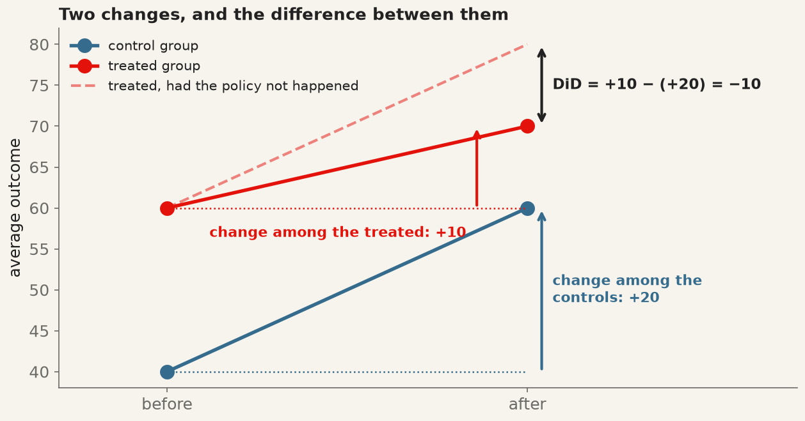{.big fig-alt="Control rises from 40 to 60, treated from 60 to 70; had nothing happened the treated would have reached 80; the gap of −10 is the DiD."}
:::
::: {.column width="40%"}
::: {.check}
**Read the picture:**

1. the treated rose by **+10**;
2. the controls rose by **+20**: that is what time alone did;
3. so the treated would have reached **80** (dashed); they reached 70. The policy: **−10**.
:::

::: {.step}
**The first difference** removes everything **constant** about the treated group: its location, its
institutions, its wealth. **The second** removes everything **common** to both groups: the market, the
business cycle.
:::
:::
:::

## As a regression: the interaction is the estimate {.scrollable}

$$
Y = \beta_0 + \beta_1\,\text{Treated} + \beta_2\,\text{Post} + \beta_3\,(\text{Treated} \times \text{Post}) + e
$$

| Coefficient | Equals | In words |
|---|---|---|
| $\beta_0$ | $\bar Y_{\text{control, pre}}$ | the control group, before |
| $\beta_1$ | $\bar Y_{\text{treated, pre}} - \bar Y_{\text{control, pre}}$ | how different the groups were **before**: allowed to be anything |
| $\beta_2$ | $\bar Y_{\text{control, post}} - \bar Y_{\text{control, pre}}$ | what happened to everyone over time |
| $\beta_3$ | the DiD | **the effect**: the extra change among the treated |

::: {.muted}
`Treated × Post` is 1 only for treated units after the policy. The counterfactual for the treated after is
$\beta_0 + \beta_1 + \beta_2$; what they actually reached is that plus $\beta_3$.
:::

## Words you will need {.scrollable}

| Term | What it is | In this session's examples |
|---|---|---|
| **DiD** · difference-in-differences | the change among the treated minus the change among the controls | the housing sites; the AI strategies |
| **Pre** / **post** period | before / after the policy starts | before / after a site opens |
| **Counterfactual** | what the treated would have reached **without** the policy; here, their start plus the controls' change | the dashed line |
| **Parallel trends** | without treatment, the treated would have followed the **same trajectory** as the controls. **Untestable** | what fails in Example 2B |
| **Event study** | the DiD estimated year by year, relative to the last pre-period | the plot of Example 2 |
| **Pre-trend** | a gap that was already moving **before** the policy: evidence against parallel trends | Example 2B |
| **Staggered adoption** · **cohort** | units treated in different years; a cohort is the units first treated in the same year | the AI strategies, 2021–2023 |
| **TWFE** · two-way fixed effects | a regression with a dummy per unit and per year, plus the treatment | Example 3 |
| **ATT** · average treatment effect on the treated | the effect on those who got the policy (session 10) | what DiD estimates |
| **Instrument** · IV, instrumental variable | a variable that moves the treatment and touches the outcome **only through it** | distance to port, Example 4 |
| **First stage** / **reduced form** | the instrument's effect on the treatment / on the outcome; IV = their ratio | Example 4 |

## The assumption, stated exactly {.scrollable}

::: {.warn}
**Parallel trends:** in the absence of treatment, the **change** among the treated would have equalled the
change among the controls,
$$
\mathrm{E}[Y_{\text{tr,post}}(0) - Y_{\text{tr,pre}}(0)] = \mathrm{E}[Y_{\text{co,post}}(0) - Y_{\text{co,pre}}(0)] .
$$
:::

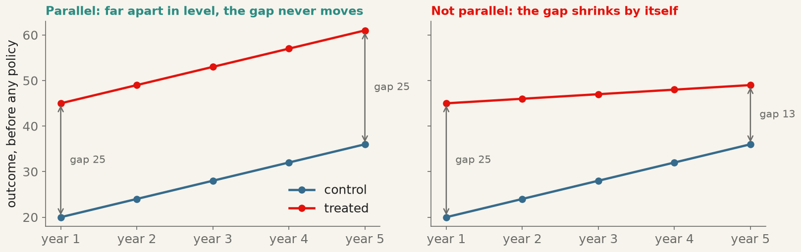{.wide fig-alt="Left: two lines 25 apart, both rising by 4 a year: the gap never moves. Right: the treated line rises more slowly, so the gap shrinks from 25 to 13 with no policy at all."}

::: columns
::: {.column width="50%"}
::: {.check}
**It is not** that the groups are similar. **Left:** they are 25 apart, and that is fine; only the **gap**
must stay constant.
:::
:::
::: {.column width="50%"}
::: {.step}
**Right:** the gap shrinks by itself. A DiD would call that shrinkage a policy effect. The assumption is
about the years **after** the policy, which nobody sees: it is **untestable**. What you **can** look at is
whether the trends were parallel **before**.
:::
:::
:::

## Example 1 · Did affordable housing lower nearby prices? {.center}

## The case {.scrollable}

Governments subsidise **affordable-housing projects**. Critics argue they lower the value of nearby homes:
neighbours' preferences, congestion, buildings that do not match the street (Ellen et al., 2007).

::: columns
::: {.column width="55%"}
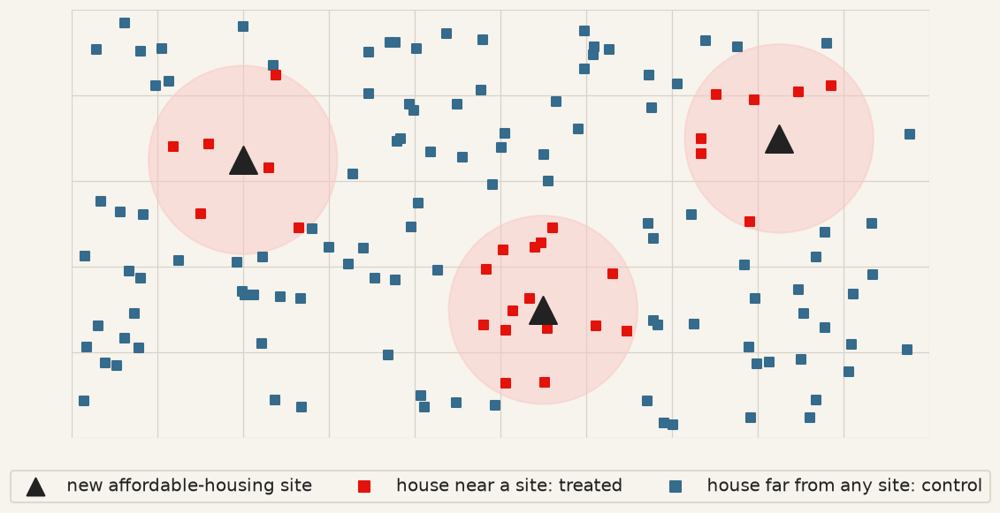{fig-alt="A schematic city: three new sites, each with a shaded circle; houses inside the circles are treated (red), houses outside are controls (blue)."}
:::
::: {.column width="45%"}
| Column | Meaning |
|---|---|
| `near` | 1 = near a new site (treated), 0 = far (control) |
| `post` | 1 = after the site opened, 0 = before |
| `price` | the sale price, \$ thousands |
:::
:::

::: {.step .question}
**The question:** did the sites lower the prices of nearby houses, and by how much?
:::

::: {.muted}
**Simulated**, 1,000 houses, so we know the truth: a site lowers nearby prices by **\$10,000**. Near houses
were cheaper to begin with (by about \$15,000), and the whole market rose by \$30,000.
:::

::: {.muted}
**Predict first:** comparing near and far houses *after* the sites opened, will you find more or less than
−10? And comparing near houses *before and after*?
:::

## Three ways to answer, one of them right {.scrollable}

{.wide fig-alt="After-only comparison −25.2, before-after +20.2, difference-in-differences −10.5, truth −10."}

| Comparison | Estimate | What it gets wrong |
|---|---|---|
| **after only**: near vs far, after the sites opened | **−25.2** | mixes the effect with the **\$15,000 gap that was always there** |
| **before–after**: near houses, after vs before | **+20.2** | mixes the effect with the **market's \$30,000 rise** |
| **difference-in-differences** | **−10.5** | removes both: the truth is −10 |

## The four means, and the counterfactual {.scrollable}

::: columns
::: {.column width="58%"}
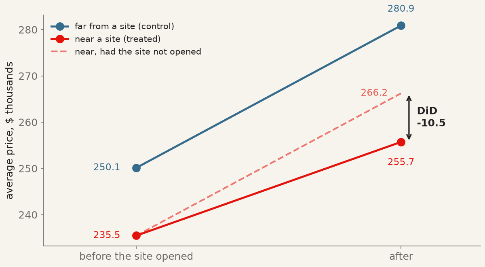{.big fig-alt="Far houses rise from 250.1 to 280.9; near houses from 235.5 to 255.7; had the site not opened they would have reached 266.2; the gap is −10.5."}
:::

::: {.column width="42%"}
$$
\begin{aligned}
\text{DiD} &= (255.7 - 235.5) - (280.9 - 250.1) \\
&= 20.2 - 30.8 = -10.5
\end{aligned}
$$

::: {.check}
**The dashed line** is the counterfactual: near houses start at 235.5 and, without the site, would have risen
like the far ones, by 30.8, to **266.2**. They reached 255.7. The difference is the effect.
:::
:::
:::

## The same number from a regression {.scrollable}

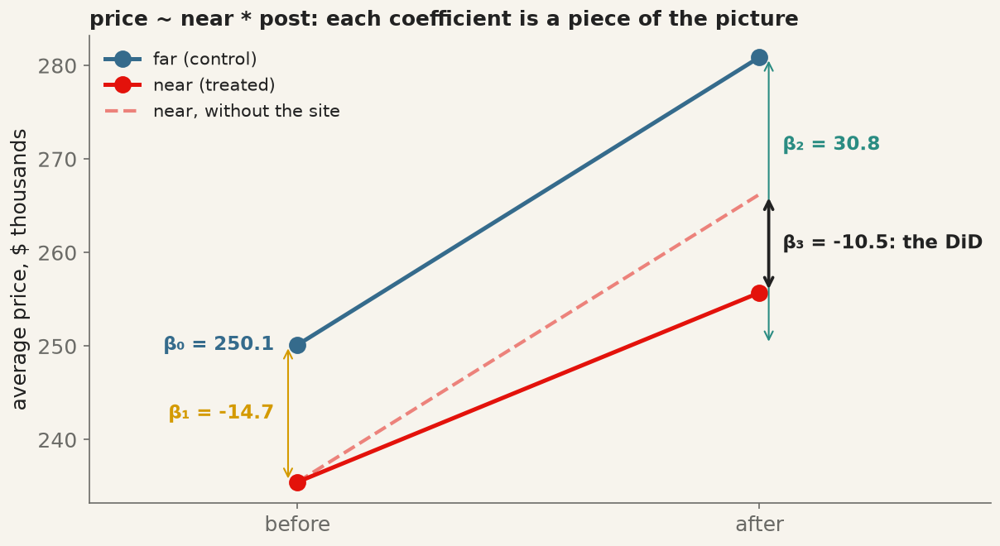{.wide fig-alt="The four means with each coefficient drawn: β0 the far houses before, β1 the gap before, β2 the far houses' rise, β3 the gap between near-after and its counterfactual."}

`price ~ near * post`, standard errors clustered by house:

| | Coefficient | Std. error | Reading |
|---|---|---|---|
| Intercept $\beta_0$ | 250.12 | 1.03 | far houses, before |
| `near` $\beta_1$ | −14.65 | 1.43 | near houses were \$14,650 cheaper **before**: allowed |
| `post` $\beta_2$ | 30.76 | 0.64 | the market rose by \$30,760 for everyone |
| `near:post` $\beta_3$ | **−10.51** | 0.92 | **the effect**: the DiD |

::: {.check}
**Check:** $\beta_0 + \beta_1 = 235.47$, the near houses before; $\beta_0 + \beta_1 + \beta_2 = 266.23$, the
counterfactual. The regression adds what the four means cannot: a **standard error**, covariates, and more
than two periods.
:::

## Example 1 · Plain summary {.scrollable}

- Comparing near and far houses **after** the sites opened says −25: the gap that was always there.
- Comparing near houses **before and after** says +20: the market's rise.
- The **difference of the two changes** says −10.5, against a truth of −10. In a regression, it is the
  coefficient on the interaction.

::: {.step}
**What this example teaches:** DiD needs no measure of *why* near houses were cheaper; it needs only that,
without the sites, both groups would have **moved together**. Example 2 asks what happens when they would not.
:::

## Example 2 · Were the trends parallel? {.center}

## The case: the same city, six years {.scrollable}

The sites open in **2006**. We now have prices from **2003 to 2008**: three years before, three after. The
truth is the same −10. Two versions of the city:

- **A:** without the sites, near and far houses would have risen **together**.
- **B:** near neighbourhoods were **already slipping**, losing \$3,000 a year on far ones before any site opened.

::: {.step .question}
**The question:** can the data tell the two cities apart, and what does the DiD say in each?
:::

::: {.muted}
**Predict first:** in city B, will the DiD say more than −10, less, or the same? Why?
:::

## The raw prices {.scrollable}

{fig-alt="Two panels of prices from 2003 to 2008: in A the near and far lines run parallel before 2006; in B the near line rises more slowly from the start."}

::: {.check}
**Look before the shaded years.** In A, the two lines run parallel until 2005: the gap is constant. In B, the
gap is already **widening** from 2003, before any site exists.
:::

## The event study: the DiD, year by year {.scrollable}

{fig-alt="Event studies: in A the pre-2006 points sit at zero and the post points at about −11; in B the pre points are +5.2 and +2.3, falling to −20.1 by 2008."}

::: columns
::: {.column width="50%"}
::: {.check}
**A:** before 2006 the points sit at **0** (−0.8, −0.7): no pre-trend. After, about **−11** each year.
The two-period DiD, 2005 to 2008, says **−11.1**.
:::
:::
::: {.column width="50%"}
::: {.warn}
**B:** the points before 2006 are **+5.2, +2.3, 0**: a line already falling. The two-period DiD says
**−20.1**, double the truth: the pre-existing slide, \$3,000 a year, is counted as the policy.
:::
:::
:::

::: {.muted}
2005 is the **reference year**: zero by construction, not by evidence. The other pre-years are the evidence.
:::

## Why B's estimate is wrong: two counterfactuals {.scrollable}

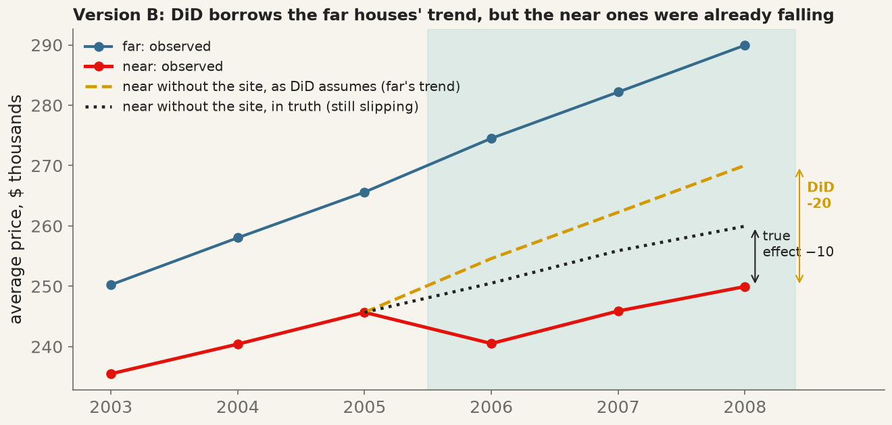{.mid fig-alt="City B: near houses observed in red; the gold dashed line is the counterfactual DiD assumes, following the far houses' rise; the black dotted line is the true counterfactual, still slipping; DiD measures −20, the truth is −10."}

::: columns
::: {.column width="50%"}
::: {.check}
**Gold, dashed:** what DiD assumes the near houses would have done without the sites: rise **like the far
ones**. **Black, dotted:** what they would really have done: keep **slipping**, as they had since 2003.
:::
:::
::: {.column width="50%"}
::: {.warn}
The true effect is the gap to the **black** line, −10. DiD measures the gap to the **gold** line, −20: it
adds the slide that was already under way to the policy.
:::
:::
:::

## Example 2 · Plain summary {.scrollable}

- When the trends were parallel, the DiD finds the effect, and the years **before** the policy are flat.
- When the treated group was already on a different path, the DiD **doubles** the effect, and the years before
  the policy show it.
- A flat pre-trend is **evidence**, not proof: parallel trends is about the years *after*, which nobody sees.

::: {.step}
**What this example teaches:** with several pre-periods, plot them first. Example 3 shows what to do when
there is only one.
:::

## Example 3 · Do national AI strategies raise firms' AI use? {.center}

## The case: the course's own data {.scrollable}

Between 2021 and 2023, **18 European countries** adopted a national **AI strategy**; 12 did not. Did firms
in adopting countries start **using AI** more? The outcome, `ai_use_any`, is the share of firms using any AI
technology, in percentage points; `qmib.load("angle_c_country")` gives it by country and year.

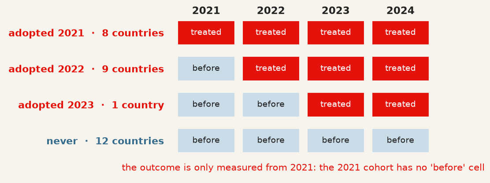{.mid fig-alt="A grid of cohorts by year: the 2021 cohort is treated in every observed year; the 2022 cohort has one year before; the 2023 cohort, one country, has two; the 12 never-adopters are never treated."}

::: {.step .question}
**The question:** what did adopting a strategy do to firms' AI use, and how much can 30 countries over four
years establish?
:::

::: {.muted}
The course data are generated with a known effect, **+2.4 points**, so every estimate can be scored, as in
sessions 9 and 10.
:::

## What the adoption table already decides {.scrollable}

::: columns
::: {.column width="50%"}
::: {.warn}
**The 2021 cohort cannot be used at all.** No year before adoption: no before, no difference. Not weak
evidence: **no** evidence for this design.
:::

::: {.warn}
**The 2023 cohort is one country.** Its estimate is one country's trajectory.
:::
:::
::: {.column width="50%"}
::: {.check}
**The 2022 cohort has one pre-period.** Enough to compute a DiD, **not** enough to see a pre-trend: a trend
needs at least two points.
:::

::: {.step}
**With staggered adoption, which controls?** Only countries **not yet** or **never** treated. A country that
adopted in 2021 is not a control for one that adopted in 2022.
:::
:::
:::

## The raw data {.scrollable}

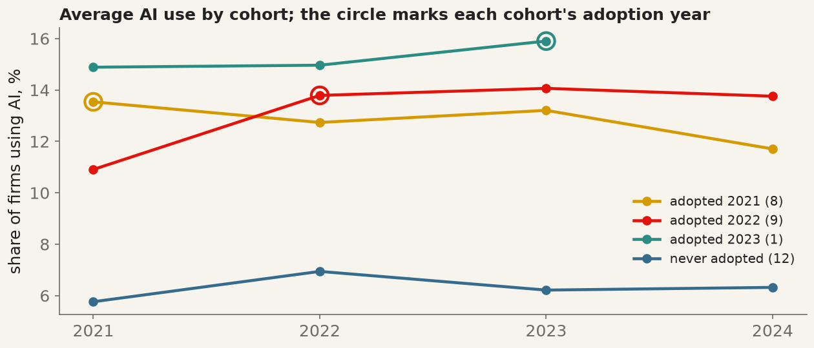{.mid fig-alt="Average AI use by cohort, 2021 to 2024: adopters use more AI than never-adopters throughout; the 2022 cohort rises from 10.9 to 13.8 in its adoption year."}

::: columns
::: {.column width="50%"}
::: {.check}
**Levels differ a lot:** adopters used AI about twice as much as never-adopters, even **before** adopting.
That is allowed: DiD only needs the **gap** to have been stable.
:::
:::
::: {.column width="50%"}
::: {.step}
**Look at the 2022 cohort (red):** a jump in its adoption year, while the never-adopters (blue) barely move.
That jump, minus the never-adopters' change, is its DiD.
:::
:::
:::

## Why not one big regression? {.scrollable}

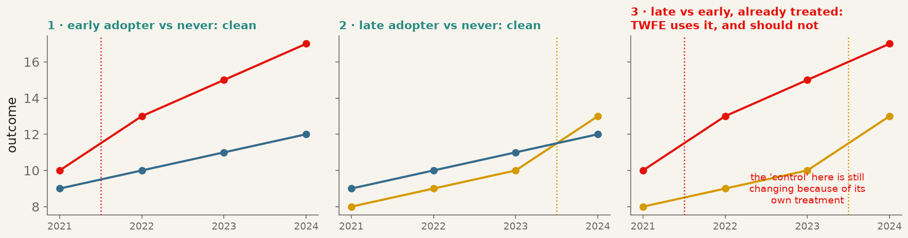{fig-alt="Three schematic comparisons: early adopter against never-treated, clean; late adopter against never-treated, clean; late adopter against the already-treated early adopter, which TWFE also uses and should not."}

::: columns
::: {.column width="50%"}
::: {.check}
**Panels 1 and 2** are clean: the comparison group has **no** policy, so its change is what time did.
:::
:::
::: {.column width="50%"}
::: {.warn}
**Panel 3:** two-way fixed effects also compares a late adopter with an **early** one that is still
adjusting to its **own** policy. Its change is not "time alone", and subtracting it can bias the estimate,
even flip its sign when effects grow over time.
:::
:::
:::

::: {.muted}
**Predict first:** will TWFE land above or below the truth of 2.4 here? And Callaway–Sant'Anna?
:::

## The estimates, against the truth {.scrollable}

{.mid fig-alt="Two-way fixed effects 2.81, Callaway–Sant'Anna overall 2.20, cohort 2022 2.21, cohort 2023 1.84 from one country; truth 2.4."}

::: columns
::: {.column width="50%"}
::: {.check}
**TWFE** (two-way fixed effects: a dummy per country and per year) gives **2.81**. Close, but it silently
uses already-treated countries as controls for later ones, and with staggered timing its weights can even
be **negative** (Goodman-Bacon, 2021; de Chaisemartin and D'Haultfœuille, 2020).
:::
:::
::: {.column width="50%"}
::: {.step}
**Callaway and Sant'Anna (2021)** estimate each cohort against clean controls, then average: **2.20**
(standard error 0.78, 30 clusters). The 2021 cohort is dropped, **out loud**. The one-country cohort's
narrow interval is not precision: there is no variation left to measure.
:::
:::
:::

## One pre-period: how much violation does the result survive? {.scrollable}

{.mid fig-alt="Robust 95% intervals widening with M; they exclude zero at M = 0 and 0.25 and include it from M = 0.5."}

::: columns
::: {.column width="50%"}
::: {.check}
**The only pre-treatment evidence** is one country (the 2023 cohort) in one year: −1.13 against the
never-treated. The 2022 cohort's single pre-period is its reference year, zero by construction.
:::
:::
::: {.column width="50%"}
::: {.warn}
**Rambachan and Roth (2023):** allow post-treatment departures from parallel trends up to $M$ times that
pre-treatment one. The effect stays positive up to $M = 0.25$, not at $0.5$. That is a **low breakdown
point**, and it should be: it rests on one country's single year.
:::
:::
:::

## Example 3 · Plain summary {.scrollable}

- The adoption table decides what can be estimated before any regression: one cohort is unusable, one is a
  single country.
- TWFE gives 2.81; the staggered-robust estimator gives **2.20 ± 1.5**, covering the truth of 2.4.
- Parallel trends **cannot be examined** here; a sensitivity analysis says how much of it the result needs:
  not much violation before the interval reaches zero.

::: {.step}
**What this example teaches:** with real panels, the design is decided by **who was treated when**. Report
the adoption structure, a staggered-robust estimate beside TWFE, and how much violation the result survives.
:::

## Example 4 · Does exporting raise productivity? {.center}

## The case: learning by exporting {.scrollable}

Exporters are more productive than non-exporters, everywhere it has been measured. Does **exporting make
firms more productive** (they learn from foreign buyers and competitors), or do the **better firms export**?

| Column | Meaning |
|---|---|
| `exports` | 1 = the firm exports |
| `productivity` | a productivity index |
| `distance` | km from the firm to the nearest port |
| `management` | the quality of management: **not in the data** |

::: {.step .question}
**The question:** how much does exporting itself raise a firm's productivity, when the firms that export
are the better-managed ones?
:::

::: {.muted}
**Simulated**, 2,000 firms, so we know the truth: exporting adds **+5**. Well-managed firms export more *and*
are more productive anyway.
:::

## Why neither matching nor DiD can help {.scrollable}

::: columns
::: {.column width="50%"}
::: {.warn}
**Matching** (session 10) needs the confounder in the data. Management is not: exporters are 0.8 standard
deviations better managed, and no score built from what we have can see it.
:::
:::
::: {.column width="50%"}
::: {.warn}
**DiD** needs a before and an after. This is one year of data: no firm is seen switching, so there is no
first difference to take.
:::
:::
:::

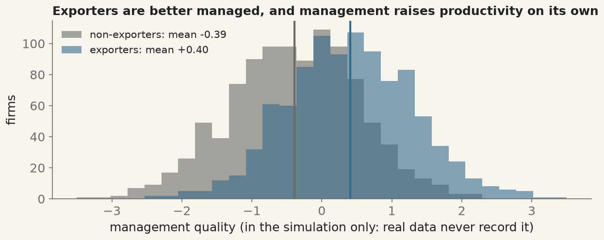{.wide fig-alt="Histograms of management quality: exporters average +0.40, non-exporters −0.39."}

::: {.check}
**The naive comparison** of exporters and non-exporters says **+10.0**: double the truth. Half of it is
management: the gap in the picture, which real data never record.
:::

## The instrument: distance to the nearest port {.scrollable}

{.wide fig-alt="Distance to port causes exports, which cause productivity; management, unobserved, causes both. In B, distance also affects productivity directly."}

| An instrument must be | Here | Testable? |
|---|---|---|
| **relevant**: it moves the treatment | firms far from a port export less: shipping costs more | **yes**: the first stage |
| **independent**: as good as random | where a firm sits was decided by history, not by its managers | no: an argument |
| **excludable**: it affects the outcome **only through** the treatment | distance matters for productivity only by changing who exports | no: an argument |

## Two regressions and a ratio {.scrollable}

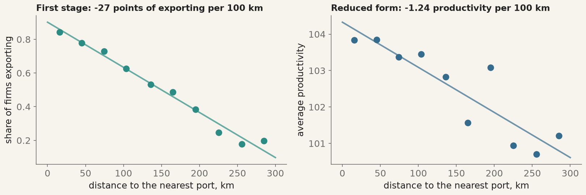{fig-alt="Left: the share exporting falls by 27 points per 100 km. Right: average productivity falls by 1.24 per 100 km."}

::: columns
::: {.column width="50%"}
**First stage:** each extra 100 km cuts the share of firms exporting by **27 points** (F = 543: strong).

**Reduced form:** each extra 100 km cuts productivity by **1.24**.
:::
::: {.column width="50%"}
::: {.check}
**If distance touches productivity only through exporting**, the 1.24 is the effect of 27 points of
exporting, so
$$
\widehat{\beta}_{\text{IV}} = \frac{\text{reduced form}}{\text{first stage}} = \frac{-0.0124}{-0.0027} = 4.6 .
$$
Two-stage least squares gives the same number, with a standard error: **4.6 (0.76)**.
:::
:::
:::

## The results, against the truth, and when exclusion fails {.scrollable}

::: {.muted}
**Predict first:** in version B the first stage is exactly as strong. Will IV be closer to the truth than
the naive 10, or further?
:::


{.mid fig-alt="Version A: naive 10.0, IV 4.6 with interval covering 5. Version B: naive 11.6, IV 12.1."}

::: columns
::: {.column width="50%"}
::: {.check}
**Version A:** the instrument is valid, and IV gives **4.6**, its interval covering the truth of 5. The
naive comparison said 10.0.
:::
:::
::: {.column width="50%"}
::: {.warn}
**Version B:** remote firms also pay more for their inputs, so distance lowers productivity **directly**.
The first stage is just as strong (F = 543), and IV says **12.1**: worse than the naive comparison. Nothing
in the output warns you.
:::
:::
:::

## Example 4 · Plain summary {.scrollable}

- When the confounder is not measured and there is no before and after, a variable that moves the
  treatment **from outside** can still identify the effect.
- IV is the reduced form divided by the first stage: **4.6** against a truth of 5, where the naive gap said 10.
- The only checkable condition is the first stage. **Exclusion is an argument**, and when it fails, IV can be
  further from the truth than the naive comparison.

::: {.step}
**What this example teaches:** instruments are rare because the conditions that matter most cannot be tested.
Lotteries, distances, rainfall and birth dates have all been used, and each has been argued to fail the
exclusion. Optional practice: [an IV example (R, RPubs)](https://rpubs.com/Sternonyos/913599).
:::

## Wrapping up · What the design cannot fix {.center}

## Matching, DiD or an instrument? {.scrollable}

| | Matching (session 10) | Difference-in-differences | Instrumental variable |
|---|---|---|---|
| **Removes** | differences in what you **measured** | everything **constant** about a unit | it uses **only** the variation in treatment the instrument causes |
| **Assumes** | no unmeasured confounder | parallel trends | relevance, independence, **exclusion** |
| **Needs** | rich covariates, overlap | data before and after | a variable that moves treatment from outside |
| **Checkable part** | balance, overlap | pre-trends, with several pre-periods | the first stage |
| **Fails when** | an unmeasured trait drives selection | the treated were already on a different path (Ex. 2B) | the instrument has its own path to the outcome (Ex. 4B) |

::: {.check}
**They answer different worries**, and each rests on an assumption the data cannot test. Choose the design
whose assumption you can **argue** best for your setting, and say which assumption that is.
:::

## What difference-in-differences cannot fix {.scrollable}

- **Anything that changes at the same time as treatment.** A shock hitting only the treated in the treatment
  year is indistinguishable from the treatment. Countries adopting an AI strategy may do other things that year.
- **Anticipation.** If units react before the policy starts, the "before" is already contaminated.
- **Composition change.** If the units in the panel change, the first difference compares different
  populations, not the same one over time.
- **Spillovers.** If the policy affects the controls too (neighbouring houses, neighbouring countries), the
  estimate shrinks toward zero.
- **Standard errors.** DiD data are panels: cluster by unit, and say how many clusters you have.

## Seven steps for a DiD study {.scrollable}

| Step | What you do | In Python |
|---|---|---|
| 1 | name the policy, the treated, the controls, the dates | on paper |
| 2 | the **adoption table**: cohorts, and how many pre-periods each has | `.groupby("geo")["time"].min()` |
| 3 | plot the outcome over time for each group | `.groupby(["time", "group"]).mean()`, `plt.plot` |
| 4 | the four means, then the interaction regression | `smf.ols("y ~ treated * post")` |
| 5 | standard errors clustered by unit | `.fit(cov_type="cluster", cov_kwds={"groups": ...})` |
| 6 | the event study: is the pre-period flat? | the DiD year by year |
| 7 | staggered timing: a robust estimator beside TWFE; then sensitivity | `diff_diff.CallawaySantAnna`, `HonestDiD` |

## In class · The two designs, done in Python {.center}

## Two more solutions to the same problem {.scrollable}

Session 10 gave two solutions to selection: a trial, and matching on what you measured. Today's two are for
when the reason units were treated is **not measured** and you could not draw.

| | **Solution 3 · Difference-in-differences** | **Solution 4 · An instrument** |
|---|---|---|
| When | you observe treated and untreated units **before and after** | no before and after, but something **outside** pushed some units into treatment |
| The idea | compare **changes**, not levels: the control group's change stands in for what the treated would have done | use **only** the part of treatment that the outside push caused |
| Why it removes selection | anything **constant** about a unit cancels in its own change | the push is unrelated to the unit's hidden traits |
| What you must assume | **parallel trends**: without the policy, both groups would have changed alike | **exclusion**: the push affects the outcome only through the treatment |
| What you check | the years **before** the policy | the **first stage**: does the push move the treatment? |
| The estimate | the interaction of *treated* and *after* | reduced form divided by first stage |

::: {.step}
Neither needs the confounder to be measured. Each replaces "nothing unmeasured matters" with a different
assumption, and each assumption is an **argument**, with one part you can check.
:::

## How this part works {.scrollable}

::: columns
::: {.column width="50%"}
You now **do** each design from start to finish, on **new data**, not the lecture's examples. The
packages, by name: `numpy`, `pandas`, `statsmodels`, `matplotlib`, `diff_diff`.

Each design is one short piece of work in steps. Its **first cell writes a small data file** in your
folder; every later cell starts by reading that file, so each cell runs on its own once the first has run.
:::

::: {.column width="50%"}
::: {.step}
**For each design:**

1. run the cells in order, and say what each step is **for** before reading its output;
2. do the **Your turn** task under the last cell;
3. keep the file: it is the template for your project.
:::
:::
:::

## Solution 3 · A difference-in-differences study, step by step {.scrollable}

**The case.** A government opens **export desks**, one-stop offices for customs paperwork, in 12 regions in
2018 and in 10 more in 2021; 18 regions never get one. Does a desk raise the share of a region's firms that
export? Regions with a desk already exported more, for reasons nobody recorded. Simulated data, so the truth
is known: a desk adds **2 points for every year it has been open**, 6.1 on average over the years observed.

| Step | What you do | Why | In Python |
|---|---|---|---|
| 1 | the **panel file** and the **adoption table** | who was treated, when, and how many years before | `.groupby("opened")["region"].nunique()` |
| 2 | **plot** the outcome by group over time | the design, and its assumption, are visible before any regression | `.groupby([...]).mean().unstack().plot()` |
| 3 | one **clean 2×2**: four means, then the interaction | every DiD is this comparison underneath | `smf.ols("y ~ treated * post")`, clustered |
| 4 | the **event study** | the checkable part: were the groups moving alike before? | `treated * C(year, Treatment(reference=2017))` |
| 5 | **all cohorts**, with an estimator built for staggered timing | one big regression mixes in comparisons it should not make | `dd.CallawaySantAnna` beside TWFE |
| 6 | **sensitivity** | how wrong could parallel trends be before the result goes? | `dd.HonestDiD` |

## DiD · Step 1 · The panel, and the adoption table {.scrollable}

```{python}
#| echo: true

# DiD, step 1 · 40 regions, 2014-2023: one row per region and year
import numpy as np
import pandas as pd

rng = np.random.default_rng(11)                 # simulated here; in your project, the panel you were given
regions = 40
opened = np.r_[np.full(12, 2018), np.full(10, 2021), np.zeros(18)].astype(int)   # 0 = never
level = rng.normal(30, 6, regions) + 4 * (opened > 0)   # regions with a desk exported more already
rows = []
for year in range(2014, 2024):
    years_open = np.where((opened > 0) & (year >= opened), year - opened + 1, 0)
    exporters = level + 1.0 * (year - 2014) + 2.0 * years_open + rng.normal(0, 1.5, regions)
    rows.append(pd.DataFrame({"region": np.arange(regions), "year": year, "opened": opened,
                              "desk": (years_open > 0).astype(int), "exporters": exporters.round(1)}))
panel = pd.concat(rows, ignore_index=True)
panel.to_csv("export_desks.csv", index=False)

print(panel.head(3))
print(panel.groupby("opened")["region"].nunique().rename(index={0: "never"}))
```

::: {.step}
A DiD needs a **panel**: the same units, several dates, one row per unit and date. The adoption table is
the first thing to print: it says which comparisons exist. Here both cohorts have years before their desk
(four and seven), and 18 regions are never treated, so there is always a clean control group.
:::

## DiD · Step 2 · Look before you estimate {.scrollable}

```{python}
#| echo: true
#| output-location: column
#| fig-width: 5.4
#| fig-height: 4.0

# DiD, step 2 · The average outcome of each cohort, year by year
import pandas as pd
import matplotlib.pyplot as plt

panel = pd.read_csv("export_desks.csv")
by_year = panel.groupby(["year", "opened"])["exporters"].mean().unstack()
by_year.columns = ["never", "desk in 2018", "desk in 2021"]

by_year.plot(marker="o")
plt.axvline(2017.5, color="grey", linestyle="--")
plt.axvline(2020.5, color="grey", linestyle="--")
plt.ylabel("firms exporting, %")
plt.show()

print(by_year.loc[[2014, 2017, 2020, 2023]].round(1))
```

::: {.step}
Two things to read. The lines are at **different heights** before any desk opens: that is selection, and it
does not matter, because a DiD compares changes. The lines are **parallel** before each dashed line: that
is what matters, and it is the only part of the assumption the data can show.
:::

## DiD · Step 3 · One clean 2×2 {.scrollable}

```{python}
#| echo: true

# DiD, step 3 · The 2018 cohort against the never-treated, 2017 against 2018
import pandas as pd
import statsmodels.formula.api as smf

panel = pd.read_csv("export_desks.csv")
two = panel[panel["opened"].isin([0, 2018]) & panel["year"].isin([2017, 2018])].copy()
two["treated"] = (two["opened"] == 2018).astype(int)
two["post"] = (two["year"] == 2018).astype(int)

means = two.groupby(["treated", "post"])["exporters"].mean().unstack()
print(means.round(2))
print("change, treated:", round(means.loc[1, 1] - means.loc[1, 0], 2),
      "  change, control:", round(means.loc[0, 1] - means.loc[0, 0], 2))

did = smf.ols("exporters ~ treated * post", data=two).fit(
    cov_type="cluster", cov_kwds={"groups": two["region"]})      # each region is seen twice
low, high = did.conf_int().loc["treated:post"]
print(f"DiD = {did.params['treated:post']:.2f}   95% CI [{low:.2f}, {high:.2f}]   truth, first year: 2")
```

::: {.step}
Choose the comparison **yourself**: one cohort, a control group that is never treated, one year before
and one after. The interaction `treated:post` is the difference of the two changes; clustering by region
tells the standard error that a region's two rows are not independent.
:::

## DiD · Step 4 · The event study, by regression {.scrollable}

```{python}
#| echo: true
#| output-location: column
#| fig-width: 5.4
#| fig-height: 4.0

# DiD, step 4 · The same DiD for every year, each against 2017, the last year before the desks
import pandas as pd
import matplotlib.pyplot as plt
import statsmodels.formula.api as smf

panel = pd.read_csv("export_desks.csv")
clean = panel[panel["opened"].isin([0, 2018])].copy()
clean["treated"] = (clean["opened"] == 2018).astype(int)

fit = smf.ols("exporters ~ treated * C(year, Treatment(reference=2017))", data=clean).fit(
    cov_type="cluster", cov_kwds={"groups": clean["region"]})
rows = [name for name in fit.params.index if name.startswith("treated:")]
study = pd.DataFrame({"year": [int(name[-5:-1]) for name in rows],
                      "effect": fit.params[rows].values,
                      "low": fit.conf_int().loc[rows, 0].values,
                      "high": fit.conf_int().loc[rows, 1].values}).set_index("year")
print(study.round(2))

plt.errorbar(study.index, study["effect"], yerr=[study["effect"] - study["low"],
             study["high"] - study["effect"]], fmt="o", capsize=3)
plt.axhline(0, color="grey")
plt.axvline(2017.5, color="grey", linestyle="--")
plt.ylabel("gap, relative to 2017")
plt.show()
```

::: {.step}
`treated * C(year, ...)` gives one interaction per year: the gap between the groups in that year, minus the
gap in 2017. **Before** the desks, the intervals should include zero: the groups were moving alike. **After**,
the points are the effect, year by year, and here they grow, as the truth says they should.
:::

## DiD · Step 5 · All cohorts, with staggered timing {.scrollable}

```{python}
#| echo: true

# DiD, step 5 · The one big regression (TWFE) beside an estimator built for staggered adoption
import pandas as pd
import statsmodels.formula.api as smf
import diff_diff as dd

panel = pd.read_csv("export_desks.csv")

twfe = smf.ols("exporters ~ desk + C(region) + C(year)", data=panel).fit(
    cov_type="cluster", cov_kwds={"groups": panel["region"]})
cs = dd.CallawaySantAnna(cluster="region").fit(
    panel, outcome="exporters", unit="region", time="year", first_treat="opened")   # 0 = never

print(f"two-way fixed effects:  {twfe.params['desk']:.2f}  (SE {twfe.bse['desk']:.2f})")
print(f"Callaway-Sant'Anna:     {cs.overall_att:.2f}  (SE {cs.overall_se:.2f}, {cs.n_clusters} clusters)")
print("truth, average over the treated years: 6.12")
print(cs.aggregate("event_study").to_dataframe()[["event_time", "att", "se"]].round(2).to_string(index=False))
```

::: {.step}
`CallawaySantAnna` does step 3 for **every** cohort and year, always against regions not yet treated, then
averages. Two-way fixed effects also uses the 2018 regions, whose effect is still growing, as controls for
the 2021 regions, and so comes out too low. Report both: if they differ, the difference is a finding.
:::

## DiD · Step 6 · How wrong could parallel trends be? {.scrollable}

```{python}
#| echo: true

# DiD, step 6 · Rambachan-Roth: allow a violation up to M times the largest pre-period wobble
import pandas as pd
import diff_diff as dd

panel = pd.read_csv("export_desks.csv")
cs = dd.CallawaySantAnna(cluster="region").fit(
    panel, outcome="exporters", unit="region", time="year", first_treat="opened")
study = cs.aggregate("event_study")

for M in (0, 1, 2, 4, 8):
    honest = dd.HonestDiD(method="relative_magnitude", M=M).fit(study)
    print(f"M = {M}   95% robust interval [{honest.ci_lb:5.2f}, {honest.ci_ub:5.2f}]   "
          f"rules out zero: {'yes' if honest.is_significant else 'no'}")
```

::: {.step}
A flat pre-period does not prove the trends would have **stayed** parallel. This asks: if they had drifted
apart afterwards by up to `M` times the largest movement seen before, would the conclusion survive? `M = 0`
is exact parallel trends. Report the largest `M` at which zero is still ruled out. (The interval is for the
average effect over the six years after opening, whose true value is 7.)
:::

## Your turn · The difference-in-differences {.scrollable}

::: {.step}
1. **The wrong comparison.** In step 3, compute the after-only gap (treated minus control, 2018) and the
   before-after change of the treated alone. How far is each from 2, and what does each mix in?
2. **A pre-trend.** In step 1, add `+ 0.8 * (opened == 2018) * (year - 2014)` to `exporters`, so that the
   2018 regions were already pulling away. Rerun steps 2 to 4. Where do you see it first: the plot, the
   2×2 or the event study? What does the 2×2 now say, against a truth of 2?
3. **The comparison the big regression should not make.** In step 3, estimate the first-year effect for the
   **2021** cohort (2020 against 2021), once with the never-treated as controls (`[0, 2021]`) and once with
   the **2018** regions as controls (`[2018, 2021]`, and `treated` is `opened == 2021`). By how much does the
   estimate fall, and what were the 2018 regions doing between 2020 and 2021?
:::

## Solution 4 · An instrument, step by step {.scrollable}

**The case.** Does attending an international **trade fair** raise a firm's export sales? Ambitious firms
attend more and export more, and ambition is in no file; there is no before and after. But the trade
agency once mailed a **voucher** for a free stand to 1,500 of 3,000 firms, **drawn at random**. Simulated
data, so the truth is known: attending adds **+12** (\$ thousand).

| An instrument must be | Here | Checkable? |
|---|---|---|
| **relevant**: it moves the treatment | firms with a voucher attend more often | **yes**: the first stage |
| **independent**: as good as random | the vouchers were drawn | **partly**: balance on what was fixed before |
| **excludable**: it affects the outcome **only through** the treatment | a voucher changes exports only by getting a firm to the fair | no: an argument |

| Step | What you do | In Python |
|---|---|---|
| 1 | the file, and the naive answer | `.groupby("attends")["exports"].mean()` |
| 2 | check the instrument: **balance**, then the **first stage** | `smf.ols("attends ~ voucher")`, its F |
| 3 | the **reduced form**, and the ratio | `smf.ols("exports ~ voucher")` |
| 4 | **two-stage least squares**, for the standard error | `IV2SLS` |
| 5 | say **whom** the estimate describes, and argue exclusion | on paper |

## Instrument · Step 1 · The file, and the naive answer {.scrollable}

```{python}
#| echo: true

# Instrument, step 1 · 3,000 firms; attending the fair adds exactly +12; ambition is never recorded
import numpy as np
import pandas as pd
import statsmodels.formula.api as smf

rng = np.random.default_rng(13)                 # simulated here; in your project, the file you were given
n = 3000
ambition = rng.normal(0, 1, n)                                   # in no file
employees = rng.lognormal(3, 0.7, n).round() + 1
voucher = (rng.permutation(n) < n // 2).astype(int)              # the agency drew who received one
attends = (0.9 * ambition + 1.2 * voucher + rng.normal(0, 1, n) > 0.8).astype(int)
exports = (40 + 12 * attends + 10 * ambition + 5 * np.log(employees) + rng.normal(0, 12, n)).round(1)
firms = pd.DataFrame({"employees": employees, "voucher": voucher, "attends": attends, "exports": exports})
firms.to_csv("trade_fair.csv", index=False)

naive = firms.groupby("attends")["exports"].mean()
controlled = smf.ols("exports ~ attends + np.log(employees)", data=firms).fit()
print(f"naive: attenders minus the rest = {naive[1] - naive[0]:.1f}   (truth 12)")
print(f"regression, controlling for size: {controlled.params['attends']:.1f}")
```

::: {.step}
Controlling for what is in the file does not help, because the confounder is not in the file. Matching
would fail for the same reason, and there is no "before" to difference away. This is the situation an
instrument is for.
:::

## Instrument · Step 2 · Check the instrument {.scrollable}

```{python}
#| echo: true

# Instrument, step 2 · Is the voucher as good as random, and does it move attendance?
import numpy as np
import pandas as pd
import statsmodels.formula.api as smf

firms = pd.read_csv("trade_fair.csv")
print(firms.groupby("voucher")[["employees", "attends"]].mean().round(2))

balance = smf.ols("np.log(employees) ~ voucher", data=firms).fit()
first = smf.ols("attends ~ voucher", data=firms).fit()

print(f"does the voucher predict firm size?  p = {balance.pvalues['voucher']:.2f}")
print(f"first stage: a voucher raises attendance by {first.params['voucher']:.2f}   "
      f"F = {first.tvalues['voucher'] ** 2:.0f}")
```

::: {.step}
**Independence** can be checked only on what was fixed before: firms with and without a voucher should
look alike, and they do. **Relevance** is the first stage: the voucher must move attendance, strongly. The
usual rule asks for an F statistic above 10; a weak instrument gives an estimate that is noisy and biased.
:::

## Instrument · Step 3 · The reduced form, and the ratio {.scrollable}

```{python}
#| echo: true

# Instrument, step 3 · What the voucher did to exports, divided by what it did to attendance
import pandas as pd
import statsmodels.formula.api as smf

firms = pd.read_csv("trade_fair.csv")
first = smf.ols("attends ~ voucher", data=firms).fit().params["voucher"]
reduced = smf.ols("exports ~ voucher", data=firms).fit().params["voucher"]

print(f"reduced form: a voucher raises exports by     {reduced:.2f}")
print(f"first stage:  a voucher raises attendance by  {first:.2f}")
print(f"instrument estimate = reduced / first =       {reduced / first:.1f}   (truth 12)")
```

::: {.step}
Both regressions compare firms by the **draw**, so both are free of selection. A voucher raised exports a
little, and it did so by sending about a third of the firms to the fair. **If** that is the only way it
acts, the effect of attending is the first number divided by the second.
:::

## Instrument · Step 4 · Two-stage least squares {.scrollable}

```{python}
#| echo: true

# Instrument, step 4 · The same estimate with a correct standard error, then with a control
import numpy as np
import pandas as pd
import statsmodels.api as sm
from statsmodels.sandbox.regression.gmm import IV2SLS

firms = pd.read_csv("trade_fair.csv")
firms["log_employees"] = np.log(firms["employees"])

# IV2SLS(outcome, [constant + treatment + controls], [constant + instrument + controls])
iv = IV2SLS(firms["exports"],
            sm.add_constant(firms[["attends"]]),
            sm.add_constant(firms[["voucher"]])).fit()
with_size = IV2SLS(firms["exports"],
                   sm.add_constant(firms[["attends", "log_employees"]]),
                   sm.add_constant(firms[["voucher", "log_employees"]])).fit()

for name, fit in [("instrument only", iv), ("with firm size", with_size)]:
    low, high = fit.conf_int().loc["attends"]
    print(f"{name:16s} {fit.params['attends']:5.1f}   se {fit.bse['attends']:.1f}   95% CI [{low:.1f}, {high:.1f}]")
```

::: {.step}
A control goes in **both** lists: it is its own instrument. The interval is much wider than a regression's
would be: the instrument uses only the part of attendance that the voucher caused, about a third of it.
That is the price of the design.
:::

::: {.warn}
**Do not run the second stage yourself with `smf.ols`** on predicted attendance: the number is right and
the standard error is wrong. `IV2SLS` does both stages and corrects it.
:::

## Instrument · Step 5 · What the number means, and what could break it {.scrollable}

::: columns
::: {.column width="50%"}
::: {.check}
**Whom it describes.** The estimate is the effect of the fair on firms that attended **because of** the
voucher. Firms that would have gone anyway, and firms that would never go, contribute nothing: the voucher
did not change what they did. Say so when you report it.
:::
:::
::: {.column width="50%"}
::: {.warn}
**What could break it.** Exclusion: does a voucher change exports in **any other way**? If the letter
also advertised the agency's export loans, it does, and the ratio is wrong by an amount no output shows.
This step is written, not computed.
:::
:::
:::

::: {.step}
The link with session 10: firms that refused the treatment in a trial. There, the **draw** was the
instrument for **taking** the treatment. An encouragement, a lottery, a distance, an eligibility rule:
every instrument is an attempt to find a draw that someone else made.
:::

## Your turn · The instrument {.scrollable}

::: {.step}
1. **A weak instrument.** In step 1, change `1.2 * voucher` to `0.1 * voucher` and rerun steps 1, 2 and 4.
   What happens to the F statistic, to the estimate and to its interval?
2. **Exclusion fails.** Back at `1.2`, add `+ 3 * voucher` to `exports` in step 1: the letter helped firms
   directly. Rerun steps 2 to 4. Does any check in step 2 warn you? How far is the estimate from 12?
3. **The second stage by hand.** In step 4, save the first stage's `.fittedvalues` as a column and run
   `smf.ols("exports ~ fitted")`. Compare the coefficient and the standard error with `IV2SLS`.
:::

## What to report {.scrollable}

::: columns
::: {.column width="50%"}
**For a difference-in-differences**

1. **The adoption structure**: units per cohort, years before and after, and which cohorts are unusable.
2. **The parallel-trends argument**, as an argument: why would the gap have stayed constant?
3. **The plot** of each group over time, and **an event study** with the reference year marked.
4. **A staggered-robust estimator beside TWFE.** If they disagree, that is the finding.
5. **Standard errors clustered by unit**, with the number of clusters.
6. **What else changed at the same time**, and **how much violation** the result survives.
:::

::: {.column width="50%"}
**For an instrument**

1. **The naive estimate**, and why it cannot be trusted.
2. **Why the instrument is as good as random**, with balance on what was fixed before.
3. **The first stage** and its F statistic.
4. **The reduced form**, then the two-stage estimate with its interval.
5. **Whom the estimate describes**: the units the instrument moved.
6. **The argument for exclusion**, in words.
:::
:::

::: {.warn}
**A flat pre-trend makes parallel trends plausible, and a strong first stage makes an instrument relevant. Neither makes the design true.**
:::

## Before the next session {.scrollable}

::: {.warn}
**Required:** the next session's article, its Dataverse package, and the
self-check. That is the pre-session deck.
:::

::: {.step}
**Optional:** the **QMIB Lab** for this session — a knowledge check on the hour
you have just sat through: **[warin.ca/qmib-labs](https://warin.ca/qmib-labs/qmib-lab-11.html)**
:::

::: {.muted}
Never a prerequisite, never marked for correctness. A completed report counts
toward participation because attempting it is the engagement being measured.
:::
