## The question the first nine chapters could not answer

Every method so far has described an association and then, carefully, declined
to call it an effect. Chapter 2 insisted on "associated with" rather than
"causes". Chapter 6 showed the same association taking four different values
depending on which variation identified it. Chapter 9 produced two models with
identical fit and opposite causal arrows.

The reason for all that caution is that the question — *did the policy do
anything?* — is not a question about the data you have. It is a question about
data you do not have and cannot get.

This chapter answers it through three examples, each adding one idea. A
thousand simulated firms, where both answers are written down and a coin flip
can be watched beating self-selection. A real job-training programme, run as a
lottery, whose experimental answer lets matching on survey data be checked. And
a simulated training scheme in which matching first works and then, with one
unmeasured trait added, fails without any warning.

The examples show the two solutions, a randomised trial and propensity-score
matching, at work. Two later sections then carry each one out from start to
finish on new data, a trial that is designed, drawn and analysed and a match
that is built and checked, because knowing why a method works and knowing how
to do it are different skills.

::: {.plate}
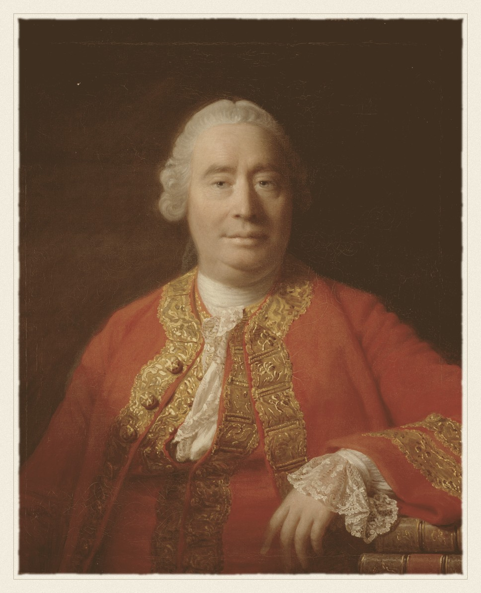{fig-alt="David Hume** · **1711–1776."}

**David Hume** · **1711–1776**

Asked what entitles us to say one thing causes another, and did not find a satisfying answer. Neither has anyone since.

[Allan Ramsay, 1766. Public domain, via Wikimedia Commons.]{.plate-credit}
:::


::: {.archive}
[From the archive · Hume, 1739]{.archive-label}

David Hume asked what we actually observe when we say one thing causes another,
and answered: contiguity, succession, and constant conjunction. The billiard
ball moves; another moves after it; this has always happened. What we never
observe is the *necessary connection* — the thing that would make the second
event have to follow.

His second formulation is the one that founded modern causal inference, though
it took two centuries to be taken up. A cause, he wrote, is an object followed
by another, *and where, if the first object had not been, the second never had
existed*. That subordinate clause is a counterfactual: a statement about a world
that did not happen. It cannot be observed, in principle, for the same reason a
road not taken has no destination.

Hume treated this as a sceptical problem about knowledge. Modern statistics
treats it as a *missing data* problem, which turns out to be the more productive
framing — because missing data can sometimes be recovered, under assumptions you
can state, defend and occasionally test.
:::

## Potential outcomes

The framework that formalises Hume's clause is due to Neyman and, in its modern
form, to Rubin [@rubin1974]. For each unit $i$ define two quantities:

$$
Y_i(1) = \text{the outcome if unit } i \text{ is treated},
\qquad
Y_i(0) = \text{the outcome if it is not}.
$$

Both are properties of the unit, defined whether or not the treatment happens.
The causal effect *for that unit* is the difference

$$
\tau_i \thickspace=\thickspace Y_i(1) - Y_i(0),
$$

and it is exactly what Hume said we cannot observe: whichever treatment the unit
receives, the other potential outcome is missing, permanently and by
construction. This is the **fundamental problem of causal inference**
[@holland1986], and it means that no individual causal effect is ever
identified. What we can hope for is an *average*.

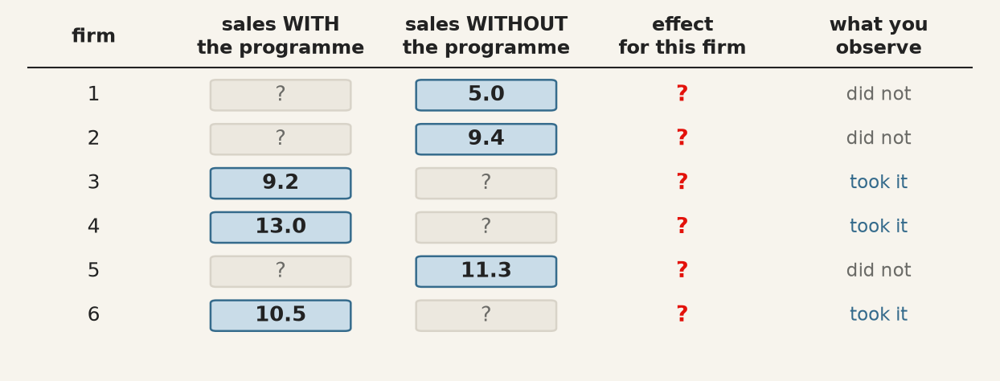{fig-alt="Six firms, each with sales growth with and without the programme. For each firm only one of the two is observed."}

::: {.definition}
[**ATE**]{.term} — average treatment effect, $\mathrm{E}[Y(1) - Y(0)]$
over the whole population. What would happen if everyone were treated versus no
one.
:::

::: {.definition}
[**ATT**]{.term} — average treatment effect on the treated,
$\mathrm{E}[Y(1) - Y(0) \mid T = 1]$. What the treatment did for those who
actually received it. Usually the policy-relevant quantity, and usually not
equal to the ATE.
:::

Now the arithmetic that explains why naive comparisons fail. What you can compute
from data is the difference in observed means. Add and subtract the same term:

$$
\underbrace{\mathrm{E}[Y \mid T{=}1] - \mathrm{E}[Y \mid T{=}0]}_{\text{what you can compute}}
=
\underbrace{\mathrm{E}[Y(1) - Y(0) \mid T{=}1]}_{\text{ATT}}
+
\underbrace{\mathrm{E}[Y(0) \mid T{=}1] - \mathrm{E}[Y(0) \mid T{=}0]}_{\text{selection bias}} .
$$

The second term is the difference between the treated and untreated groups *in
the absence of treatment*. If countries that adopt a policy would have differed
from those that did not even without it, the observed difference is the effect
plus that gap, and nothing in the data separates them.

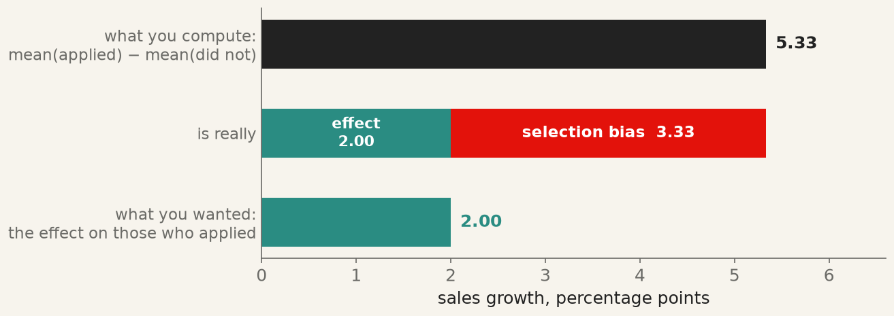{fig-alt="A bar of 5.33 split into the effect, 2.00, and selection bias, 3.33."}

## Randomisation, and what it buys

Randomised assignment sets the selection term to zero, and it is worth being
precise about why. If treatment is assigned by a coin flip, then $T$ is
independent of everything about the unit — including $Y(0)$ and $Y(1)$ — so
$\mathrm{E}[Y(0) \mid T{=}1] = \mathrm{E}[Y(0) \mid T{=}0]$ and the
bias term vanishes.

Note what randomisation does *not* do. It does not make the groups identical; in
any finite sample they will differ, sometimes substantially. It makes them differ
*in a way unrelated to the outcome*, so the difference is noise rather than bias
— and noise is what standard errors are for. It also balances variables nobody
measured or thought of, which is the property no observational method can
replicate.

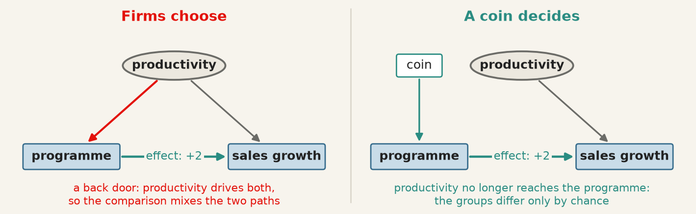{fig-alt="Two causal diagrams: self-selection with a back door through productivity, and randomisation with a coin."}

When randomisation is unavailable, and in international business it usually is —
countries are not randomly assigned national strategies — the alternative is to
assume something strong enough to recover the same result.

::: {.definition}
[**Conditional independence**]{.term} (unconfoundedness, ignorability) — given a
set of covariates $X$, treatment is as good as random:
$\lbrace Y(0), Y(1)\rbrace \perp T \mid X$. Every determinant of both treatment and outcome
is in $X$. **This assumption is not testable**, because it concerns the missing
potential outcome.
:::

::: {.definition}
[**Overlap**]{.term} (common support) — for every value of $X$, the probability
of treatment is strictly between 0 and 1. If some countries would never adopt
under any circumstances, there is no comparison to be made for them, and an
estimate that includes them is extrapolating rather than comparing. Unlike
conditional independence, overlap **is** checkable.
:::

## Example 1 · Did the export programme work?

Everything above can be watched happening in a simulation, which is the one
setting where both potential outcomes exist. A thousand firms; a programme that
adds exactly two points to every firm's export growth; and a productivity that
nobody in the ministry observes, which raises growth with or without the
programme.

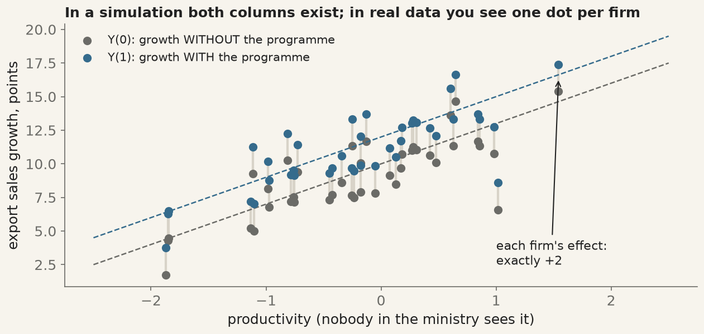{fig-alt="Forty firms, each with a grey dot for growth without the programme and a blue dot two points above for growth with it; both rise with productivity."}

```{python}
#| label: check-sim
#| code-summary: "Run it: a coin flip against self-selection, with the truth known"

import warnings
warnings.filterwarnings("ignore")
import numpy as np
import pandas as pd
import matplotlib.pyplot as plt
import statsmodels.formula.api as smf
from sklearn.neighbors import NearestNeighbors

rng = np.random.default_rng(10)
n = 1000
productivity = rng.normal(0, 1, n)
sales_without = 10 + 3 * productivity + rng.normal(0, 2, n)
sales_with = sales_without + 2                         # the true effect, for every firm
applies = (productivity + rng.normal(0, 1, n) > 0.5).astype(int)

observed = np.where(applies == 1, sales_with, sales_without)
naive = observed[applies == 1].mean() - observed[applies == 0].mean()
bias = sales_without[applies == 1].mean() - sales_without[applies == 0].mean()
print(f"self-selection   naive {naive:.2f} = effect 2.00 + selection bias {bias:.2f}")

draws = []
for _ in range(1000):                                  # a thousand randomised experiments
    coin = rng.integers(0, 2, n)
    seen = np.where(coin == 1, sales_with, sales_without)
    draws.append(seen[coin == 1].mean() - seen[coin == 0].mean())
print(f"coin flip        mean of 1,000 estimates {np.mean(draws):.2f}, spread {np.std(draws):.2f}")
```

The two lines are the chapter's argument in miniature. Self-selection
overstates the effect by a factor of more than two and a half, and the excess is
exactly the selection term: the joining firms would have grown 3.33 points
faster without the programme. The coin is right on average and wrong in any
single draw by about a quarter of a point, which is noise, which a standard
error describes. The selection term cannot be computed in real data, since it
needs the column nobody sees; what *can* be computed is how different the groups
were before treatment, here about one standard deviation of productivity. That
comparison — balance — is the diagnostic the rest of the chapter is built on.

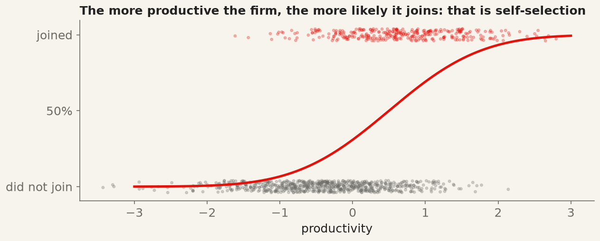{fig-alt="An S-shaped curve: the probability of joining rises with productivity."}

{fig-alt="Two histograms of productivity: overlapping under a coin, shifted under choice."}

**Example 1 in three sentences.** With a coin, the difference in means finds the
truth on average. When firms choose, the same difference says 5.33, of which 2 is
programme and 3.33 is selection. The selection bias itself is invisible; the
imbalance that causes it is not.

## Example 2 · LaLonde's test

The simulation knows the answer because it wrote it. A real data set that knows
the answer is rarer, and the most famous one is a job-training experiment.

The National Supported Work demonstration, run in the United States in
1976–77, assigned disadvantaged workers to a training placement **by lottery**.
The lottery's estimate of the effect on 1978 earnings is therefore credible.
LaLonde (1986) then did something that has shaped the field since: he kept the
trainees, threw away the lottery's controls, replaced them with people from
national surveys, and asked whether the estimators economists applied to survey
data would recover the experiment's answer. They did not, and the paper became
the standard argument for experiments. @dehejia1999 returned to the same data
with propensity-score matching and recovered it, and @smith2005 showed how
fragile that recovery is. The data are on Rajeev Dehejia's page at the NBER (National Bureau of Economic Research), and
`pd.read_stata` reads them directly.

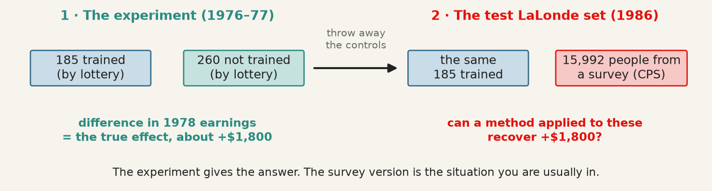{fig-alt="Left: the experiment, 185 trained and 260 untrained by lottery. Right: the same 185 trained compared with 15,992 people from a survey."}

```{python}
#| label: check-nsw-naive
#| code-summary: "Run it: the experiment's answer, and the naive survey comparison"

url = "https://users.nber.org/~rdehejia/data/"
nsw = pd.read_stata(url + "nsw_dw.dta")
cps = pd.read_stata(url + "cps_controls.dta")
X = ["age", "education", "black", "hispanic", "married", "nodegree", "re74", "re75"]

experiment = smf.ols("re78 ~ treat", data=nsw).fit()
print(f"experiment:  {experiment.params['treat']:+,.0f}  (SE {experiment.bse['treat']:,.0f})")

data = pd.concat([nsw[nsw["treat"] == 1], cps], ignore_index=True)
treated, control = data[data["treat"] == 1], data[data["treat"] == 0]
print(f"naive:       {treated['re78'].mean() - control['re78'].mean():+,.0f}")

regression = smf.ols("re78 ~ treat + " + " + ".join(X), data=data).fit()
print(f"regression:  {regression.params['treat']:+,.0f}   (same eight controls, linear)")

sd = np.sqrt((treated[X].var() + control[X].var()) / 2)
print("\nstandardised differences before matching:")
print(((treated[X].mean() - control[X].mean()) / sd).astype(float).round(2).to_string())
```

Training raised 1978 earnings by about \$1,800 in the experiment. Against the
survey, the naive comparison says it *cut* them by \$8,500: the wrong sign and
five times too large, because the survey's average worker earned \$14,000 a year
before the programme and the trainees under \$2,100. The standardised
differences put that in common units — the gap in means divided by the pooled
standard deviation — and most are between 0.7 and 2.4, against a convention
that calls anything under 0.1 balanced.

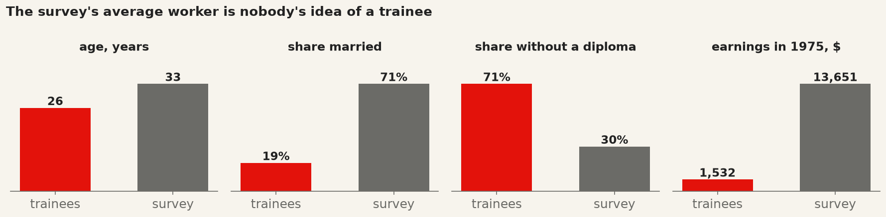{fig-alt="Bars: age 26 against 33, 19% against 71% married, 71% against 30% without a diploma, 1975 earnings $1,532 against $13,651."}

Regression with all eight characteristics does much better, and is still off by
more than half. The reason is worth understanding, because it is what matching
fixes. A linear regression uses *every* survey respondent, including the
thousands earning \$20,000 and more who resemble no trainee, and lets a straight
line carry the comparison from them to the trainees. The estimate depends on that
line being right far outside the region where the trainees live.

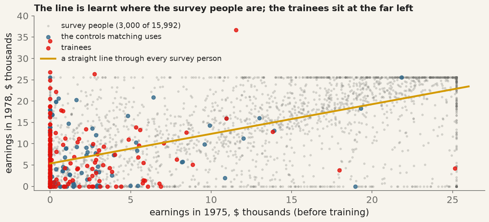{fig-alt="Scatter of survey people, trainees and matched controls, with a regression line through all survey people."}

## The propensity score, and a match that fails its check

@rosenbaum1983 proved that if treatment is as good as random given $X$, it is
as good as random given the single number $e(X) = P(T = 1 \mid X)$, the
**propensity score**. Eight dimensions collapse to one, and matching becomes the
nearest-neighbour problem of chapter 8 on one column.

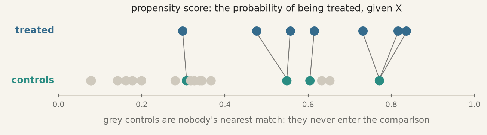{fig-alt="Treated units above, controls below, on a propensity-score axis, each treated unit joined to its nearest control."}

```{python}
#| label: fig-nsw-overlap
#| code-summary: "Run it: estimate the score and check overlap"
#| fig-cap: "The propensity score in the two groups, on a logarithmic scale. Almost every survey respondent has a score near zero, but every bin that contains trainees also contains some survey respondents: the overlap needed for matching exists."

first = "treat ~ " + " + ".join(X)
data["pscore"] = smf.logit(first, data=data).fit(disp=0).predict(data)
treated, control = data[data["treat"] == 1], data[data["treat"] == 0]

bins = np.linspace(0, 0.5, 26)
plt.figure(figsize=(7, 3.4))
plt.hist(control["pscore"], bins=bins, alpha=0.6, label="survey (control)")
plt.hist(treated["pscore"], bins=bins, alpha=0.6, label="trained")
plt.yscale("log")
plt.xlabel("propensity score")
plt.legend()
plt.show()

print(f"score range, trained: {treated['pscore'].min():.3f} – {treated['pscore'].max():.3f}")
print(f"survey respondents with a score above 0.05: {(control['pscore'] > 0.05).sum()}")
```

Overlap is the checkable half of the identifying assumptions, and here it
holds, barely: of almost sixteen thousand survey respondents, a few hundred look
anything like a trainee. That is enough, because matching needs only one good
control per trainee.

```{python}
#| label: check-nsw-match1
#| code-summary: "Run it: match on the first score, then check balance"

nn = NearestNeighbors(n_neighbors=1).fit(control[["pscore"]])
distance, index = nn.kneighbors(treated[["pscore"]])
matched = control.iloc[index.ravel()]

print(f"{len(treated)} trainees, {matched.index.nunique()} distinct controls, "
      f"largest score gap {distance.max():.4f}")
print(((treated[X].mean() - matched[X].mean()) / sd).astype(float).round(2).to_string())
```

Matching with replacement lets a good control serve more than once, which is
why 185 trainees use fewer distinct controls. Balance has improved enormously
on earnings, race and schooling, but age is still out by 0.31: the logit has
treated the probability of training as moving in one direction with age, and it
does not. **This is the moment the procedure is designed for.** The response is
to change the score and check again, and to do it *without looking at the
outcome*, because a score chosen for the estimate it produces is a specification
search with a respectable name.

## A score that balances, and only then the outcome

```{python}
#| label: fig-nsw-balance
#| code-summary: "Run it: a better score, the balance check, and the ATT"
#| fig-cap: "Standardised differences before matching (blue) and after matching on the improved score (orange). The dashed lines mark ±0.1. Every covariate ends inside them."

better = first + " + I(age**2) + I(re74 == 0) + I(re75 == 0)"
data["pscore"] = smf.logit(better, data=data).fit(disp=0).predict(data)
treated, control = data[data["treat"] == 1], data[data["treat"] == 0]
nn = NearestNeighbors(n_neighbors=1).fit(control[["pscore"]])
distance, index = nn.kneighbors(treated[["pscore"]])
matched = control.iloc[index.ravel()]

before = (treated[X].mean() - control[X].mean()) / sd
after = (treated[X].mean() - matched[X].mean()) / sd
plt.figure(figsize=(7, 3.6))
plt.scatter(before, X, label="before")
plt.scatter(after, X, label="after")
plt.axvline(-0.1, color="grey", linestyle="--")
plt.axvline(0.1, color="grey", linestyle="--")
plt.xlabel("standardised difference")
plt.legend()
plt.show()

att = treated["re78"].mean() - matched["re78"].mean()
print(f"largest |difference| after matching: {after.abs().max():.2f}")
print(f"ATT by matching: {att:+,.0f}    experiment: {experiment.params['treat']:+,.0f}")
```

Age squared lets the probability of training rise and fall with age; the two
indicators mark people who earned nothing in 1974 or 1975, which is most
trainees and few survey respondents. With them, every standardised difference
sits inside 0.1. The figure — a **love plot** — is the evidence a reader needs,
and it is the evidence to report, rather than the logit's coefficients or fit,
which are a means and not an end.

Only now is the outcome looked at. The matched ATT is about \$2,000, within a
third of a standard error of the experiment.

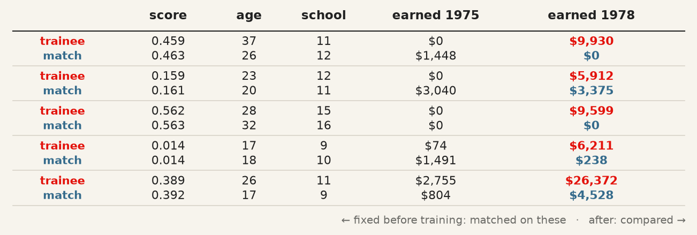{fig-alt="Five trainee and match pairs with their scores, ages, schooling and earnings in 1975 and 1978."}

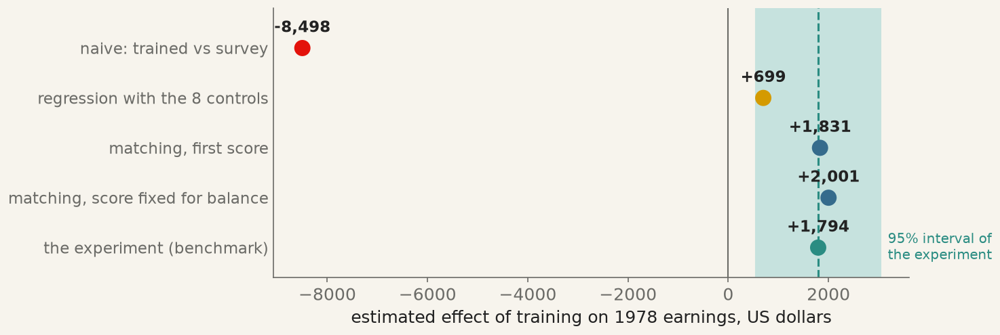{fig-alt="Five estimates on one axis: naive −8,498, regression +699, first matching +1,831, balanced matching +2,001, and the experiment +1,794 with its 95% interval."}

Two cautions keep this from being a triumph. The first is uncertainty. The
standard error printed by a regression on the matched sample ignores that the
score was estimated and that controls were reused; a bootstrap that redoes the
whole procedure is the honest version.

```{python}
#| label: check-nsw-bootstrap
#| code-summary: "Run it: bootstrap the whole matching procedure"

estimates = []
for b in range(200):
    t = treated.sample(len(treated), replace=True, random_state=b)
    c = control.sample(len(control), replace=True, random_state=1000 + b)
    nn_b = NearestNeighbors(n_neighbors=1).fit(c[["pscore"]])
    _, idx = nn_b.kneighbors(t[["pscore"]])
    estimates.append(t["re78"].mean() - c.iloc[idx.ravel()]["re78"].mean())
print(f"bootstrap standard error of the ATT: {np.std(estimates):,.0f}")
print(f"95% interval: {np.percentile(estimates, 2.5):+,.0f} to {np.percentile(estimates, 97.5):+,.0f}")
```

(Strictly the score should be re-estimated inside each replication too; holding
it fixed, as here, keeps the cell short and understates the spread a little.)
The interval is wide — the matched estimate rests on 185 trainees and a much
smaller number of distinct controls — and it comfortably contains the
experimental answer. It also, worth saying plainly, reaches zero: on the survey
data alone, matching cannot rule out that training did nothing, which the
experiment, with its own controls, could.

The second caution is that one success is not a guarantee. LaLonde's paper used
a second survey, the Panel Study of Income Dynamics, and the same procedure
there tells a less tidy story.

```{python}
#| label: check-nsw-psid
#| code-summary: "Run it: the same recipe with the other survey"

psid = pd.read_stata(url + "psid_controls.dta")
data2 = pd.concat([nsw[nsw["treat"] == 1], psid], ignore_index=True)
data2["pscore"] = smf.logit(better, data=data2).fit(disp=0).predict(data2)
t2, c2 = data2[data2["treat"] == 1], data2[data2["treat"] == 0]
nn2 = NearestNeighbors(n_neighbors=1).fit(c2[["pscore"]])
_, idx2 = nn2.kneighbors(t2[["pscore"]])
m2 = c2.iloc[idx2.ravel()]
sd2 = np.sqrt((t2[X].var() + c2[X].var()) / 2)

print(f"naive {t2['re78'].mean() - c2['re78'].mean():+,.0f}   "
      f"ATT {t2['re78'].mean() - m2['re78'].mean():+,.0f}   "
      f"distinct controls {m2.index.nunique()}")
print(((t2[X].mean() - m2[X].mean()) / sd2).astype(float).round(2).to_string())
```

The estimate is again close to the experiment, but balance is not achieved:
four covariates stay outside 0.1, schooling and the no-diploma indicator by the
most, and the whole match rests on a few dozen distinct controls. A careful analyst would report that, and
would not present the closeness of the number as vindication, because in real
work there is no experiment to compare with. @smith2005 make the general point:
the Dehejia–Wahba success depends on which subsample and which score, and the
lesson is about the conditions under which matching works — rich pre-treatment
earnings, comparison groups from the same labour market — rather than about
matching as such.

**Example 2 in three sentences.** The experiment says training raised 1978
earnings by about \$1,800; against survey controls, the naive comparison says
−\$8,500. A propensity score, an overlap check and a balance check, all settled
before the outcome is seen, bring matching to about \$2,000, while a linear
regression on the same variables misses by more than half. It worked because two
years of pre-programme earnings capture most of what decided who enrolled.

## The control that changes the question

Deciding what goes into the score is a claim about causal structure. The rule
is to condition only on variables fixed **before** treatment, and the reason is
clearest when it is broken.

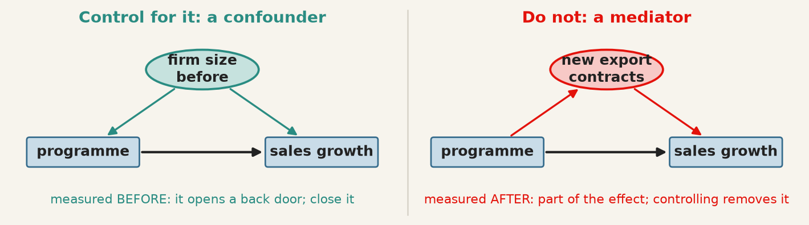{fig-alt="Left: firm size before the programme causes both joining and growth. Right: new export contracts are caused by the programme and cause growth."}

```{python}
#| label: check-mediator
#| code-summary: "Run it: controlling for a mediator"

rng = np.random.default_rng(10)
size = rng.normal(0, 1, n)                                  # before the programme
joins = (size + rng.normal(0, 1, n) > 0.5).astype(int)
contracts = 1.5 * joins + rng.normal(0, 1, n)               # created by the programme
growth = 10 + 2 * size + 0.5 * joins + 1.0 * contracts + rng.normal(0, 2, n)
firms = pd.DataFrame({"size": size, "joins": joins, "contracts": contracts, "growth": growth})

for formula in ["growth ~ joins", "growth ~ joins + size", "growth ~ joins + size + contracts"]:
    print(f"{formula:36} {smf.ols(formula, data=firms).fit().params['joins']:.2f}")
print("true total effect: 0.5 direct + 1.5 × 1.0 through contracts = 2.0")
```

Without controls, selection on size inflates the estimate. Controlling for size
— a confounder, fixed before the programme — recovers the total effect of 2.
Adding new export contracts, which the programme itself creates, drops the
estimate to the direct effect alone, because conditioning on a mediator holds
fixed the channel through which most of the effect travels. The regression is
not wrong; it answers a different and usually uninteresting question. The
related case of a **collider**, a common consequence of treatment and outcome,
is worse: conditioning on it *creates* an association that does not exist
[@elwert2014]. @cinelli2022 is the short guide worth keeping beside the
keyboard.

::: {.warn}
**"Closer to the right answer" is not the same as "the right method."** In real
work the truth is unknown, so the only evidence available is whether the
procedure is justified. A procedure that is wrong for a reason you can state will
be wrong by an unknown amount in the next dataset, and no diagnostic will
announce it.
:::

## Example 3 · Does analytics training raise performance?

Matching came within \$210 of the experiment on the CPS, the Current Population Survey. The third example shows
why that is not the same as solving the problem, in a setting from the
human-resources side of international business. A large organisation offers its
employees an advanced data-analytics course; taking it is voluntary; the human-resources (HR)
analytics team wants to know whether it raises a standardised annual performance
score. The HR file records age, education and experience. It does not record
motivation.

The data are simulated, 800 employees, so the truth is known: the course adds 5
points to everyone. Older and more educated employees are more likely to enrol.
In version A that is all that drives enrolment. In version B motivated employees
also enrol more, and motivation raises performance on its own. The same matching
procedure — a logit score on the three recorded variables, one nearest neighbour,
a balance check — is applied to both.

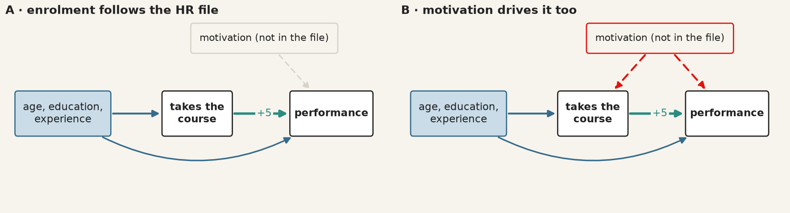{fig-alt="Two causal diagrams for versions A and B of the HR example."}

```{python}
#| label: check-hr
#| code-summary: "Run it: the same matching, with and without an unmeasured confounder"

rng = np.random.default_rng(10)
n_staff = 800
age = rng.normal(40, 10, n_staff).round()
education = rng.normal(14, 2, n_staff).round()
experience = np.clip(age - 6 - education + rng.normal(0, 3, n_staff), 0, None).round()
motivation = rng.normal(0, 1, n_staff)                          # never in the HR file
perf_without = (50 + 0.3 * experience + 1.5 * (education - 14) + 4 * motivation
                + rng.normal(0, 5, n_staff))
perf_with = perf_without + 5                                    # the truth: +5

records = -1 + 0.05 * (age - 40) + 0.4 * (education - 14) + 0.03 * (experience - 20)
cols = ["age", "education", "experience"]
for version, index_ in [("A", records), ("B", records + 1.2 * motivation)]:
    draw = np.random.default_rng(11)
    enrol = (draw.uniform(size=n_staff) < 1 / (1 + np.exp(-index_))).astype(int)
    staff = pd.DataFrame({"age": age, "education": education, "experience": experience,
                          "treat": enrol, "motivation": motivation,
                          "performance": np.where(enrol == 1, perf_with, perf_without)})
    staff["pscore"] = smf.logit("treat ~ age + education + experience",
                                data=staff).fit(disp=0).predict(staff)
    t, c = staff[staff["treat"] == 1], staff[staff["treat"] == 0]
    _, idx = NearestNeighbors(n_neighbors=1).fit(c[["pscore"]]).kneighbors(t[["pscore"]])
    m = c.iloc[idx.ravel()]
    sd_s = np.sqrt((t[cols + ["motivation"]].var() + c[cols + ["motivation"]].var()) / 2)
    gaps = (t[cols + ["motivation"]].mean() - m[cols + ["motivation"]].mean()) / sd_s
    print(f"version {version}: naive {t['performance'].mean() - c['performance'].mean():5.2f}"
          f"   matched {t['performance'].mean() - m['performance'].mean():5.2f}   (truth 5)")
    print("   standardised differences after matching:", gaps.round(2).to_dict())
```

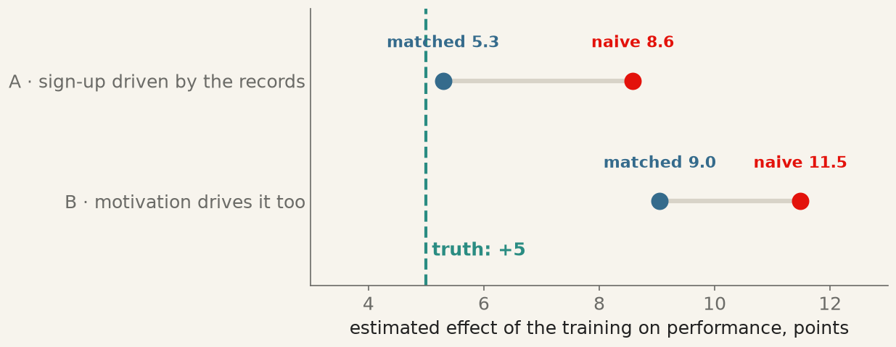{fig-alt="Version A: naive 8.6, matched 5.3; version B: naive 11.5, matched 9.0; truth 5."}

In version A, matching does what it did on LaLonde's data: the naive comparison
says 8.6 and the matched estimate 5.3. In version B, the same steps produce the
same reassuring balance table and an estimate of 9.0, nearly double the truth.
The reason is in the last column of the balance check, the one the analyst cannot
compute.

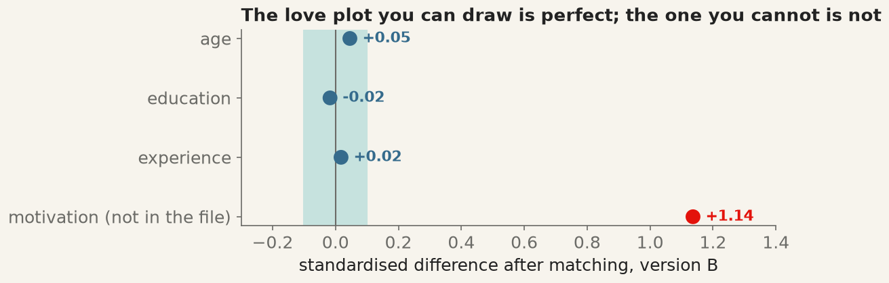{fig-alt="Age, education and experience within 0.1 after matching; motivation off by 1.14."}

Balance can only be checked on what was measured, and conditional independence
is a claim about everything else. On LaLonde's data, matching worked because the
survey records two years of earnings before the programme, which capture most of
what decided who enrolled. Here nothing in the file captures motivation, and no
score built from the file can recover the experiment that was never run.

**Example 3 in three sentences.** When enrolment depends on what the HR file
records, matching recovers the course's effect. When motivation also drives it,
matching still balances everything in the file and still reports a number, nearly
double the truth. The difference between the two versions is invisible in the
data; it is an argument about who enrols and why.

## Matching or regression?

Matching and regression adjustment are the *same assumption* in different
clothing: both require that conditioning on the observed covariates suffices.
They differ in how they use it.

| | Regression on the confounders | Matching on the propensity score |
|---|---|---|
| **Comparison** | every treated unit against a line fitted through all controls | each treated unit against the controls most like it |
| **Overlap** | not checked; extrapolates where no comparable control exists | visible in the score's distribution |
| **Functional form** | must be right — linear unless specified otherwise | needs only a score that balances |
| **Order of work** | the outcome sits in the same model as the controls | the design is fixed, by balance, before the outcome is seen |
| **In this chapter** | LaLonde: +\$699 | LaLonde: +\$2,001 (experiment +\$1,794) |

When overlap is good and the relations are close to linear, the two agree: in
version A of Example 3 a regression on the three recorded variables gives about
4.6. When overlap is poor, as with LaLonde's survey, regression's line carries
the comparison into regions with no trainees and matching is the safer device.
When the assumption itself fails, as in version B, neither helps, and both fail
in the same direction.

## One problem, two solutions

The three examples showed one problem from three sides: the treated and the
untreated differed before the treatment, so the difference in their outcomes
mixes the effect with selection. There are two ways out of it, and they are
different kinds of thing.

| | Randomised controlled trial | Propensity-score matching |
|---|---|---|
| **When** | you decide who is treated, before it happens | treatment has already been chosen by the units |
| **The idea** | chance picks the treated, so nothing about a unit can influence the draw | for each treated unit, find untreated units that were as likely to be treated |
| **Why selection goes** | the groups are alike on everything, measured or not | the groups are alike on what was measured |
| **What is assumed** | that the draw was respected | that nothing unmeasured drives both treatment and outcome |
| **What is checked** | balance, as a check of the draw | overlap, then balance, as a check of the match |
| **The estimate** | a difference in means | treated mean minus matched-control mean, the ATT |

A trial solves the problem **by design**, matching **by assumption**. The first
is to be preferred whenever it is available; the second exists for the many
questions where nobody will let you draw. The examples showed both *working*.
The next two sections show both being *done*, from the first file to the
reported number, on data that appear nowhere else in the chapter, because the
order of the steps is most of the method and it is easier to see on a clean
case.

## Doing it · A trial, from the baseline file to the estimate

An export agency can place foreign orders with 200 of the 400 small workshops
that applied for them. Does receiving export orders raise a workshop's monthly
profit? This is the design of @atkin2017, who had export orders offered to a randomly
chosen subset of small rug producers in Egypt. The data here are simulated, so
that the true effect, \$150 a month, is known.

A trial has six steps, and four of them happen before any outcome exists.

**Step 1 · The baseline file.** Everything known about the applicants before
anyone is treated. It is used three times: to draw within sectors, to check the
draw, and to make the estimate more precise.

**Step 2 · Power.** A trial too small to detect the effect it is looking for is
wasted, and the sample size cannot be changed afterwards. Power is the
probability of detecting an effect that is really there. It depends on the
effect measured in standard deviations of the outcome, here 150 against a
standard deviation of about 500, on the sample in each group, and on the
significance level; fix any three and the fourth follows.

```{python}
#| label: check-trial-power
#| code-summary: "Run it: the baseline file, and whether 400 firms are enough"

from statsmodels.stats.power import TTestIndPower

rng = np.random.default_rng(10)
n_firms = 400
workshops = pd.DataFrame({"firm": np.arange(1, n_firms + 1),
                          "sector": rng.choice(["rugs", "garments", "ceramics"], n_firms),
                          "employees": rng.integers(2, 40, n_firms),
                          "profit_before": rng.gamma(4, 250, n_firms).round()})   # dollars a month
print(workshops["profit_before"].describe().round(0)[["mean", "std"]].to_string())

power = TTestIndPower()
effect_size = 150 / 500
print(f"\nfirms needed per group for 80% power:  "
      f"{power.solve_power(effect_size=effect_size, alpha=0.05, power=0.80):.0f}")
print(f"power with 200 per group:              "
      f"{power.solve_power(effect_size=effect_size, nobs1=200, alpha=0.05):.2f}")
smallest = power.solve_power(nobs1=200, alpha=0.05, power=0.80)
print(f"smallest effect 200 per group detects: {smallest:.2f} sd = {smallest * 500:.0f} dollars")
```

Two hundred firms a group is enough, with a little to spare: 175 would give the
conventional 80%, and 200 give 85%. The last line is the one to take to whoever
funds the trial. An effect smaller than about \$140 would probably go
undetected, and a true effect of \$75 would need some 700 firms a group.

**Step 3 · The draw.** Chance picks the treated, once, with a seed written
down so that anyone can redo it. Shuffling the list and treating the first half
gives two groups of exactly equal size. Doing so *within each sector*,
stratifying, guarantees that every sector is split evenly, which a single
shuffle achieves only on average.

**Step 4 · The balance check.** The same standardised differences as in
Example 2, with a different status. After matching, balance is the only evidence
the comparison is fair. After a draw it is a check that the draw was carried out
as a draw: the groups are known to be comparable in expectation, on everything,
and the table confirms that nothing went wrong in the field.

```{python}
#| label: check-trial-draw
#| code-summary: "Run it: draw half of each sector, then check the draw"

rng = np.random.default_rng(2026)              # write the seed down: anyone can redo the draw


def half(group):                               # shuffle one sector, treat the first half
    return rng.permutation(len(group)) < len(group) // 2


workshops["treat"] = workshops.groupby("sector")["firm"].transform(half).astype(int)
print(pd.crosstab(workshops["sector"], workshops["treat"]))

base = ["employees", "profit_before"]
drawn, not_drawn = workshops[workshops["treat"] == 1], workshops[workshops["treat"] == 0]
sd_w = np.sqrt((drawn[base].var() + not_drawn[base].var()) / 2)
print("\nstandardised differences at baseline:")
print(((drawn[base].mean() - not_drawn[base].mean()) / sd_w).round(2).to_string())

joint = smf.ols("treat ~ employees + profit_before + C(sector)", data=workshops).fit()
print(f"do the characteristics predict the draw?  p = {joint.f_pvalue:.2f}")
```

Both differences are inside 0.1, and a regression of the draw on every baseline
characteristic at once finds nothing to explain, as it should when a shuffle
decided. One rule matters more than the code: **one draw, saved**. Redrawing
until the groups "look right" is choosing the treated yourself, by another name.

**Step 5 · The estimate.** When the follow-up survey arrives, the effect is the
difference in mean outcomes between the two groups. A regression of the outcome
on the treatment indicator computes exactly that difference and adds its
standard error and confidence interval.

```{python}
#| label: check-trial-estimate
#| code-summary: "Run it: the difference in means, then the same with baseline controls"

rng = np.random.default_rng(11)                # stands in for the follow-up survey; true effect +150
workshops["profit_after"] = (300 + 0.8 * workshops["profit_before"] + 150 * workshops["treat"]
                             + rng.normal(0, 300, n_firms)).round()

simple = smf.ols("profit_after ~ treat", data=workshops).fit(cov_type="HC2")
adjusted = smf.ols("profit_after ~ treat + profit_before + employees + C(sector)",
                   data=workshops).fit(cov_type="HC2")
for name, fit in [("difference in means", simple), ("with baseline controls", adjusted)]:
    low, high = fit.conf_int().loc["treat"]
    print(f"{name:23s} {fit.params['treat']:5.0f}   se {fit.bse['treat']:3.0f}   "
          f"95% CI [{low:.0f}, {high:.0f}]")
```

The difference in means is \$167, with an interval from 68 to 266 that contains
the truth and excludes zero. Adding the baseline variables gives \$135 and an
interval a little more than half as wide. The controls are not there to remove
bias, which the draw already did; they absorb variation in the outcome that has
nothing to do with the treatment, so what is left is measured more precisely.
This is the one place in the chapter where adding controls is safe by
construction, provided they were measured before the draw.

**Step 6 · Firms that refuse.** In the field, some of the firms drawn will
decline the orders. Suppose the stronger ones accept. Taking the orders is then
a choice again, and comparing the takers with everyone else brings back
precisely the selection the draw was meant to remove.

```{python}
#| label: check-trial-takeup
#| code-summary: "Run it: compare by the draw, not by who took the treatment"

rng = np.random.default_rng(11)
ready = workshops["profit_before"] + rng.normal(0, 400, n_firms) > 800     # stronger firms accept
field = workshops.assign(took_up=((workshops["treat"] == 1) & ready).astype(int))
field["profit_after"] = (300 + 0.8 * field["profit_before"] + 150 * field["took_up"]
                         + rng.normal(0, 300, n_firms)).round()

share = field.loc[field["treat"] == 1, "took_up"].mean()
offered = smf.ols("profit_after ~ treat", data=field).fit().params["treat"]
took = smf.ols("profit_after ~ took_up", data=field).fit().params["took_up"]
print(f"share of drawn firms that took the orders:  {share:.2f}")
print(f"by who took the orders (selection is back): {took:5.0f}")
print(f"by the draw (effect of being offered):      {offered:5.0f}")
print(f"draw effect / share (effect of taking):     {offered / share:5.0f}   truth 150")
```

Comparing by who took the orders says \$468, three times the truth. Comparing
by the draw says \$109: the effect of being *offered* the orders, the
**intention-to-treat** effect, which is smaller than 150 because 38% of the
firms offered them took nothing. It is an honest answer to a slightly different
question, and often the one a policy-maker needs, since a programme can only
offer. Dividing it by the take-up share gives \$175, an estimate of the effect
on the firms that took the orders. That division is an instrumental-variables
estimate with the draw as the instrument [@angrist1996], and chapter 11 returns
to it.

**The trial in three sentences.** Size it before it starts, draw once with a
seed, and check the draw on the baseline file. The estimate is a difference in
means with an interval, made more precise, not less biased, by baseline
controls. Whatever happens in the field, compare by the draw.

## Doing it · A match, from the score to the interval

Of 4,000 manufacturing firms, some chose to obtain a quality certification
(ISO 9001). Does certification raise export sales two years later? Nobody drew
anything: larger, foreign-owned and already-exporting firms certify more often.
The data are simulated again, so the true effect, 8 (\$ thousand), is known,
and so is something no real analyst knows: that only the four recorded
variables drive the choice. The assumption therefore holds by construction, and
what follows is about carrying the method out. Example 3 was about the
assumption failing.

```{python}
#| label: check-cert-data
#| code-summary: "Run it: 4,000 firms that chose for themselves, and the naive answer"

rng = np.random.default_rng(10)
n_cert = 4000
cert = pd.DataFrame({"employees": rng.lognormal(3.5, 0.8, n_cert).round() + 1,
                     "age": rng.integers(1, 40, n_cert),
                     "foreign": rng.binomial(1, 0.2, n_cert),
                     "exports_before": rng.gamma(2, 20, n_cert).round()})
choice = (-14 + 3 * np.log(cert["employees"]) + 0.8 * cert["foreign"]
          + 0.02 * cert["exports_before"])
cert["certified"] = (rng.uniform(size=n_cert) < 1 / (1 + np.exp(-choice))).astype(int)
cert["exports_after"] = (5 + 0.6 * cert["exports_before"] + 4 * np.log(cert["employees"])
                         + 6 * cert["foreign"] + 8 * cert["certified"]
                         + rng.normal(0, 8, n_cert)).round()

print(cert.groupby("certified")[["employees", "foreign", "exports_before", "exports_after"]]
      .mean().round(1).to_string())
print(f"\ncertified firms: {cert['certified'].sum()}   "
      f"naive difference: {cert.groupby('certified')['exports_after'].mean().diff().iloc[-1]:.1f}")
```

The naive answer is 18.3, more than twice the truth, and the other columns say
why: the certified firms were nearly three times as large, more often
foreign-owned, and exported more before certifying.

**Step 1 · The list.** Which pre-treatment variables drive the choice? The list
*is* the identifying assumption, written down. It is made on paper, from
knowledge of how firms decide, and every variable on it must have been fixed
before certification.

**Steps 2 and 3 · The score, and overlap.** A logit of the treatment on the
list gives each firm its probability of certifying. The first thing to do with
it is to look at where the two groups' scores lie.

```{python}
#| label: fig-cert-overlap
#| code-summary: "Run it: estimate the score and look at overlap"
#| fig-cap: "The propensity score among certified and uncertified firms, on a logarithmic scale. The two overlap over almost the whole range. At the far right there are certified firms and almost no uncertified ones: very large firms nearly all certify, so there is nobody to compare them with."

SCORE = "certified ~ np.log(employees) + age + foreign + exports_before"
cert["pscore"] = smf.logit(SCORE, data=cert).fit(disp=0).predict(cert)
cert["logit"] = np.log(cert["pscore"] / (1 - cert["pscore"]))
got, not_got = cert[cert["certified"] == 1], cert[cert["certified"] == 0]

bins = np.linspace(0, 1, 26)
plt.figure(figsize=(7, 3.4))
plt.hist(not_got["pscore"], bins=bins, alpha=0.6, label="not certified")
plt.hist(got["pscore"], bins=bins, alpha=0.6, label="certified")
plt.yscale("log")
plt.xlabel("propensity score")
plt.legend()
plt.show()

print(f"highest score among uncertified firms: {not_got['pscore'].max():.3f}")
print(f"certified firms above it: {(got['pscore'] > not_got['pscore'].max()).sum()}")
```

**Step 4 · The match, within a caliper.** Each certified firm is given the
uncertified firm with the closest score. Left at that, every treated firm gets
a match, however far away it is. A **caliper** sets a limit on "close": a
common choice is a fifth of a standard deviation of the logit of the score, the
logit being used because it spreads out the scores near 0 and 1. A treated firm
with no control inside the caliper is set aside rather than badly matched.

```{python}
#| label: check-cert-match
#| code-summary: "Run it: nearest neighbour within a caliper"

nn = NearestNeighbors(n_neighbors=1).fit(not_got[["logit"]])
distance, index = nn.kneighbors(got[["logit"]])
keep = distance.ravel() <= 0.2 * cert["logit"].std()
kept, partners = got[keep], not_got.iloc[index.ravel()[keep]]

print(f"certified firms: {len(got)}   matched: {keep.sum()}   set aside: {(~keep).sum()}")
print(f"different controls used: {partners.index.nunique()}")
print(f"employees, matched firms: {kept['employees'].mean():.0f}   "
      f"set-aside firms: {got[~keep]['employees'].mean():.0f}")
```

Seventeen firms are set aside, and they are not a random seventeen: they average
313 employees against 87 for the rest. Setting them aside changes what is
estimated, and that has to be said. The estimate is now the effect of
certification on certified firms *that have a comparable uncertified firm*,
which here means all but the very largest. Nothing in these data can say what
certification did for those.

**Step 5 · Balance, before the outcome.**

```{python}
#| label: fig-cert-balance
#| code-summary: "Run it: balance before matching, without the caliper, and within it"
#| fig-cap: "Standardised differences before matching (blue) and after matching within the caliper (orange). The dashed lines mark ±0.1. Firm size starts 1.27 standard deviations apart and ends at 0.03."

cols = ["employees", "age", "foreign", "exports_before"]
sd_c = np.sqrt((got[cols].var() + not_got[cols].var()) / 2)
balance = pd.DataFrame({
    "before": (got[cols].mean() - not_got[cols].mean()) / sd_c,
    "no caliper": (got[cols].mean() - not_got.iloc[index.ravel()][cols].mean()) / sd_c,
    "caliper": (kept[cols].mean() - partners[cols].mean()) / sd_c})
print(balance.round(2).to_string())

plt.figure(figsize=(7, 3.2))
plt.scatter(balance["before"], cols, label="before")
plt.scatter(balance["caliper"], cols, label="matched, caliper")
plt.axvline(-0.1, color="grey", linestyle="--")
plt.axvline(0.1, color="grey", linestyle="--")
plt.xlabel("standardised difference")
plt.legend()
plt.show()
```

Without the caliper, firm size is still out by 0.12, because the largest
certified firms were matched to much smaller ones. Within it, every difference
is inside 0.1. Had one stayed outside, the response would be the one from
Example 2: change the score, with a square, a logarithm or an interaction, or
tighten the caliper, and check again. The outcome column has not been touched
yet, and that is the discipline that makes the next number worth reading.

**Step 6 · The ATT, and how sure you are.** The estimate is the mean outcome of
the matched certified firms minus that of their partners. For its uncertainty,
the whole procedure is wrapped in a function, so that it can be rerun from the
score onwards on each of 200 resampled data sets.

```{python}
#| label: check-cert-att
#| code-summary: "Run it: the ATT, a bootstrap of the whole procedure, and other choices"

def att(data, neighbours=1, caliper=0.2):
    p = smf.logit(SCORE, data=data).fit(disp=0).predict(data)
    data = data.assign(logit=np.log(p / (1 - p)))
    t, c = data[data["certified"] == 1], data[data["certified"] == 0]
    d, i = NearestNeighbors(n_neighbors=neighbours).fit(c[["logit"]]).kneighbors(t[["logit"]])
    ok = d[:, 0] <= caliper * data["logit"].std()
    return t[ok]["exports_after"].mean() - c.iloc[i[ok].ravel()]["exports_after"].mean()


draws = [att(cert.sample(len(cert), replace=True, random_state=b)) for b in range(200)]
low, high = np.percentile(draws, [2.5, 97.5])
print(f"ATT (matching):    {att(cert):5.1f}   truth 8")
print(f"bootstrap 95% CI:  [{low:.1f}, {high:.1f}]   se {np.std(draws):.1f}")

ols = smf.ols("exports_after ~ certified + np.log(employees) + age + foreign + exports_before",
              data=cert).fit()
print(f"\n1 neighbour, caliper 0.1:   {att(cert, caliper=0.1):5.1f}")
print(f"1 neighbour, no caliper:    {att(cert, caliper=np.inf):5.1f}")
print(f"5 neighbours, caliper 0.2:  {att(cert, neighbours=5):5.1f}")
print(f"regression, same variables: {ols.params['certified']:5.1f}")
```

Matching says 7.7 against a truth of 8 and a naive 18.3. Unlike the bootstrap
in Example 2, this one re-estimates the score inside every replication, which
is what the function is for. The interval, 5.2 to 11.3, is wide for 810 matched
firms: one nearest neighbour, drawn with replacement from 387 distinct
controls, is a noisy device. It should be reported as approximate, since the
bootstrap is known to be imperfect for nearest-neighbour matching, and as a
guide to precision it is far better than the standard error of a regression run
on the matched sample.

**Step 7 · Other reasonable choices.** The last four lines redo the estimate
under choices another analyst could defend equally well: a tighter caliper,
none, five neighbours, and a regression on the same variables. They range from
7.0 to 8.8, all inside the interval. That is what a result which does not hang
on one decision looks like, and the table belongs in the report beside the main
estimate. It is not a test of the assumption. A characteristic of the firms
that was never recorded would move every line together, exactly as motivation
did in Example 3, and no line would show it.

**The match in three sentences.** Write down the list of pre-treatment
variables, estimate the score, and look at overlap before anything else. Match
within a caliper, say who was set aside, and settle balance before the outcome
is read. Report the ATT with an interval from a bootstrap of the whole
procedure, and beside it the estimates under other defensible choices.

## What none of this fixes

The failure in Example 3 cannot be diagnosed from the data, so the honest response
is to ask how wrong the assumption could be. Sensitivity
analysis asks how strong an unobserved confounder would have to be — how
strongly associated with both treatment and outcome — to overturn the
conclusion. If the answer is "about as strong as the covariates already
controlled for", the finding is fragile. If it is "stronger than any known
determinant", it is robust. Either way the reader learns something a point
estimate does not tell them.

One caution about the method itself. Propensity-score matching is the most
popular approach here and not the best one: matching on a scalar score discards
information and can *increase* imbalance as the caliper tightens, a pathology
documented at length by @king2019. Matching directly on the covariates, or
weighting rather than matching, generally does better. The score remains a good
diagnostic for overlap even where it is a poor matching device.

Chapter 11 takes the other route: rather than assuming the confounders are all
observed, it uses the structure of *when* treatment arrived to difference the
unobserved ones away.

## A short review of the literature

::: {.lit}
The potential-outcomes notation is @rubin1974, though the idea traces to Neyman's
1923 work on agricultural experiments. @holland1986 named the fundamental problem
and drew the boundary the discipline still uses — "no causation without
manipulation" — which remains contested and clarifying.

@atkin2017 is the trial this chapter's worked example imitates: export orders
offered to a randomly chosen subset of small rug producers, so that the effect of
exporting on the firm can be read from a difference in means. When some of those
drawn do not take the treatment, the draw can serve as an instrument for it, and
@angrist1996 is the paper that says what that estimates.

LaLonde's 1986 comparison of experimental and non-experimental estimates of a
job-training programme is the benchmark the matching literature is still judged
against; @dehejia1999 showed propensity-score matching recovering the
experimental answer, and @smith2005 showed how much that depends on the sample
and the specification.

@rosenbaum1983 proved the result that made observational adjustment tractable:
if treatment is unconfounded given a covariate vector, it is unconfounded given
the scalar propensity score alone, so a many-dimensional matching problem
collapses to one dimension. @imbens2004 surveys the estimators that followed and
@stuart2010 is the practical review, covering matching, weighting and the
diagnostics that should accompany them.

The corrective literature is as important as the constructive one. @king2019
argues that propensity-score matching specifically — as opposed to matching in
general — often increases imbalance and should be replaced by methods that match
on covariates directly. @elwert2014 sets out endogenous selection bias, the
family of errors created by conditioning on colliders, and @cinelli2022 gives the
compact treatment of which controls help and which do damage.
:::

## What to report

**For a trial**

1. **How the draw was made.** The unit, the strata, the seed, and that it was
   made once.
2. **The sample size and the power** it gave for the effect that was expected,
   computed before the trial.
3. **Balance at baseline**, as standardised differences.
4. **The difference in means with its confidence interval**, and the estimate
   with baseline controls beside it.
5. **Who dropped out or refused**, and that the comparison is by the draw.

**For a match**

1. **The estimand, named.** ATE or ATT — they answer different questions and
   matching usually estimates the second. If a caliper set units aside, say
   which treated units the estimate now describes.
2. **The identifying assumption, in words.** Which variables are claimed to
   close every path from treatment to outcome, and why that list is complete.
   This is an argument, not a table.
3. **Balance before and after**, for every covariate, with standardised
   differences — a love plot. Not the propensity model's coefficients or its
   fit. And say that the score was settled before the outcome was looked at.
4. **Overlap**, with the range of the score in both groups, and how many units
   were outside common support or set aside by the caliper.
5. **The naive estimate alongside the adjusted one.** The distance between them
   is the size of the selection problem, and hiding it hides the reason for the
   analysis.
6. **The ATT with an interval**, from a bootstrap of the whole procedure, and
   the estimates under other defensible choices beside it.
7. **A sensitivity analysis.** How strong an unobserved confounder would need to
   be to overturn the result.
8. **That every control is pre-treatment**, and that you know it. If a covariate
   is measured after treatment, say why it is not a mediator or a collider — and
   if you cannot, drop it, even when it improves the number.
