## What would have happened otherwise

Chapter 10 recovered a causal effect by assuming that the variables driving
treatment were all observed, and then conditioning on them. That assumption is
untestable and, in most settings, false — countries do not adopt policies for
reasons that are fully captured by three indicators.

This chapter takes the opposite route. Rather than measuring the confounders, it
uses *timing* to remove them: if a country's unobserved characteristics are
stable over a short window, then comparing that country to itself before and
after differences them away. The remaining problem — that things change over
time for everyone — is handled by a second comparison, against units that did
not adopt.

Two differences, hence the name.

The chapter works through four examples, each adding one idea. A simulated
affordable-housing policy observed in two periods, where the two differences can
be seen doing their work against a known answer. The same city over six years, in
two versions — one where the assumption holds and one where it fails — to show
what an event study can and cannot reveal. And the course's own data on national
AI strategies, adopted by different countries in different years, where the
modern estimators earn their place and the assumption cannot be examined at all.
And simulated exporting firms, where neither matching nor difference-in-differences
can work and a third design, an instrument, can — until its key condition fails.

::: {.plate}
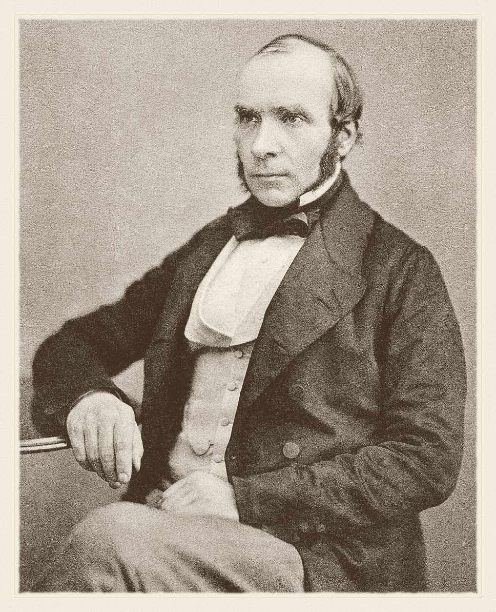{fig-alt="John Snow** · **1813–1858."}

**John Snow** · **1813–1858**

Mapped cholera deaths in 1854 and read a natural experiment off the water supply — before the statistics existed to justify it.

[unknown, Autotype 1856, published in 1887. Public domain, via Wikimedia Commons.]{.plate-credit}
:::


::: {.archive}
[From the archive · Snow, 1855]{.archive-label}

John Snow is remembered for the Broad Street pump, which is the wrong story. The
map of cholera deaths clustered around one pump was suggestive, but a sceptic
could reply that the people near the pump were poorer, more crowded, and
different in a dozen ways from those further off — the selection problem of
chapter 10, in 1854.

His second study answered that objection, and it is the one that matters here.
Two companies supplied water to overlapping districts of south London, their
pipes running down the same streets so that neighbouring houses drew from
different sources. In 1852 one of them, Lambeth, moved its intake upstream of
the sewage outflows; the other, Southwark and Vauxhall, did not. Snow could
therefore compare cholera mortality in households that differed in water supply
but not, in any systematic way, in anything else — and compare the change over
time between the two.

He called it "an experiment on the grandest scale", and was explicit that its
force came from the *assignment*: no one chose their supplier, the pipes had been
laid years earlier for commercial reasons unrelated to the disease. That is the
argument every difference-in-differences paper is still making. Snow made it
before the germ theory of disease existed — he had no mechanism, only a design.
:::

## The two differences

Let $\bar Y_{g,t}$ be the average outcome for group $g$ in period $t$, with
$g \in \lbrace\text{treated}, \text{control}\rbrace$ and $t \in \lbrace\text{pre}, \text{post}\rbrace$.
The estimator is

$$
\widehat{\text{DiD}}
=
\underbrace{\big(\bar Y_{\text{tr,post}} - \bar Y_{\text{tr,pre}}\big)}_{\text{change among the treated}}
-
\underbrace{\big(\bar Y_{\text{co,post}} - \bar Y_{\text{co,pre}}\big)}_{\text{change among the controls}} .
$$

The first difference removes everything time-invariant about the treated group,
observed or not — its wealth, its institutions, its geography. The second
estimates what would have happened anyway, and subtracting it removes any shock
common to both groups.

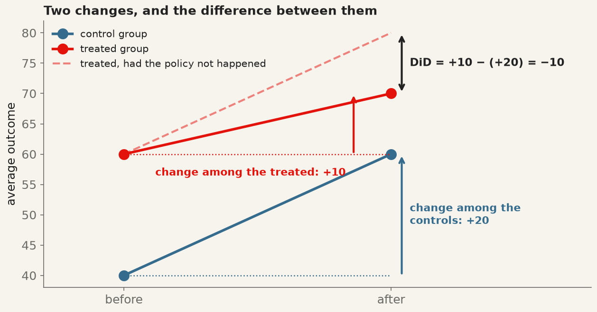{fig-alt="Control from 40 to 60, treated from 60 to 70, counterfactual 80; DiD −10."}

What licenses the subtraction is a single assumption, and it is worth stating in
its exact form because the loose version is misleading.

::: {.definition}
[**Parallel trends**]{.term} — in the absence of treatment, the average outcome
of the treated group would have followed the same *trajectory* as the control
group. Formally,
$$
\mathrm{E}[Y_{\text{tr,post}}(0) - Y_{\text{tr,pre}}(0)]
=
\mathrm{E}[Y_{\text{co,post}}(0) - Y_{\text{co,pre}}(0)] .
$$
It is not an assumption that the groups are *similar* — they may differ by any
amount in level — only that the gap between them would have stayed constant.
:::

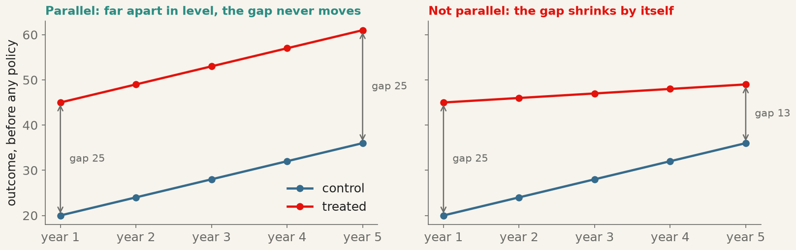{fig-alt="Left: two parallel lines 25 apart. Right: the treated line rises more slowly, the gap shrinking from 25 to 13."}

The assumption concerns $Y(0)$ for the treated group in the post period, which
is precisely the counterfactual that does not exist. **Parallel trends is
therefore untestable**, in the same way and for the same reason as chapter 10's
conditional independence. What can be examined is whether the trends were
parallel *before* treatment, which is evidence about plausibility rather than a
test of the assumption itself.

Note also that parallel trends is not invariant to how the outcome is measured.
If two groups have parallel trends in levels they generally do not in logs, and
vice versa, so the choice of scale is part of the identifying assumption rather
than a presentational detail.

## As a regression

The two-by-two table is easier to work with as a regression, and the regression
form is one you have already met. With unit and period fixed effects,

$$
Y_{it} \thickspace=\thickspace \alpha_i + \gamma_t + \delta \thinspace D_{it} + \varepsilon_{it},
$$

where $D_{it}$ is 1 when unit $i$ is treated in period $t$, the coefficient
$\delta$ *is* the difference-in-differences estimate. That is chapter 6's two-way
fixed effects specification with the treatment indicator in place of a continuous
regressor: the unit effects absorb the first difference, the period effects the
second.

The regression form buys three things — covariates, more than two periods and
more than two groups, and standard errors. On the last, chapter 3's finding
returns with force: DiD data are panels, residuals are serially correlated within
unit, and treating the country-years as independent understates the standard
error badly. Clustering by unit is the minimum, and the classic demonstration of
what happens otherwise is Bertrand, Duflo and Mullainathan's, cited in chapter 3.

## Example 1 · Did affordable housing lower nearby prices?

Governments subsidise affordable-housing projects, and critics argue that they
lower the value of nearby homes [@ellen2007]. Suppose a city opens several
sites. A thousand houses are observed twice, before and after; half are near a
site and half far from any. The data are simulated, so the truth is known: a site
lowers nearby prices by \$10,000. Near houses were cheaper to begin with, by about
\$15,000, and the whole market rose by \$30,000 over the period.

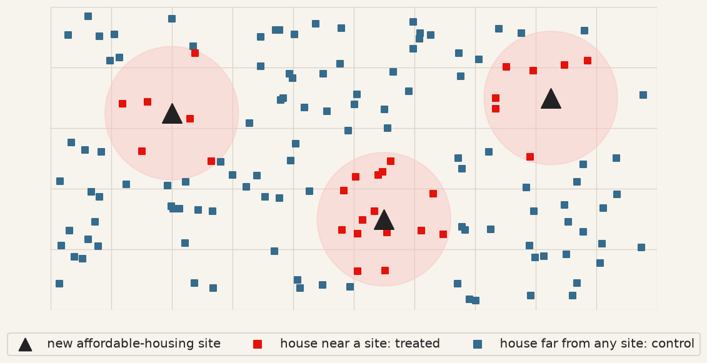{fig-alt="A schematic city with three sites, nearby houses in red and the rest in blue."}

```{python}
#| label: check-housing
#| code-summary: "Run it: three comparisons, and the interaction regression"

import warnings
warnings.filterwarnings("ignore")
import numpy as np
import pandas as pd
import statsmodels.formula.api as smf

rng = np.random.default_rng(11)
n = 1000
near = (np.arange(n) < 500).astype(int)
base = 250 - 15 * near + rng.normal(0, 20, n)          # $ thousands
before = base + rng.normal(0, 10, n)
after = base + 30 - 10 * near + rng.normal(0, 10, n)
houses = pd.DataFrame({"house": np.r_[np.arange(n), np.arange(n)],
                       "near": np.r_[near, near],
                       "post": np.r_[np.zeros(n), np.ones(n)].astype(int),
                       "price": np.r_[before, after]})

m = houses.groupby(["near", "post"])["price"].mean().unstack()
print(f"after only     {m.loc[1, 1] - m.loc[0, 1]:+6.1f}")
print(f"before-after   {m.loc[1, 1] - m.loc[1, 0]:+6.1f}")
print(f"DiD            {(m.loc[1, 1] - m.loc[1, 0]) - (m.loc[0, 1] - m.loc[0, 0]):+6.1f}   (truth -10)")

did = smf.ols("price ~ near * post", data=houses).fit(
    cov_type="cluster", cov_kwds={"groups": houses["house"]})
print(did.params.round(2).to_string())
```

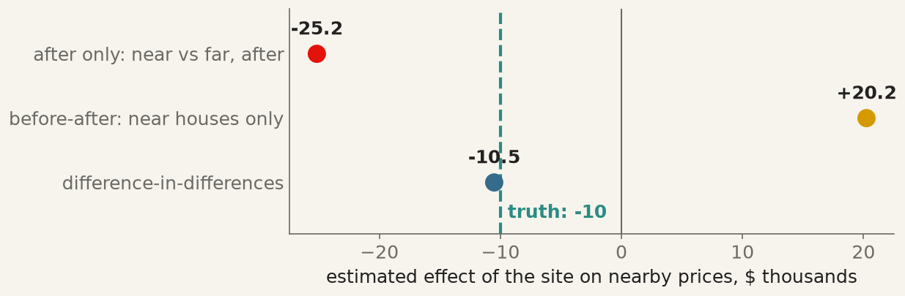{fig-alt="After-only −25.2, before-after +20.2, difference-in-differences −10.5, truth −10."}

Each naive comparison is wrong for a reason the two differences remove.
Comparing near and far houses after the sites opened says −25: the effect plus
the \$15,000 gap that predates the sites. Comparing near houses before and after
says +20: the effect plus the market's rise. The difference of the two changes
says −10.5. The regression returns the same number as the coefficient on
`near:post`, and adds a standard error; the other coefficients are the cells of
the table — $\beta_0$ the far houses before, $\beta_1$ the pre-existing gap,
$\beta_2$ the common change.

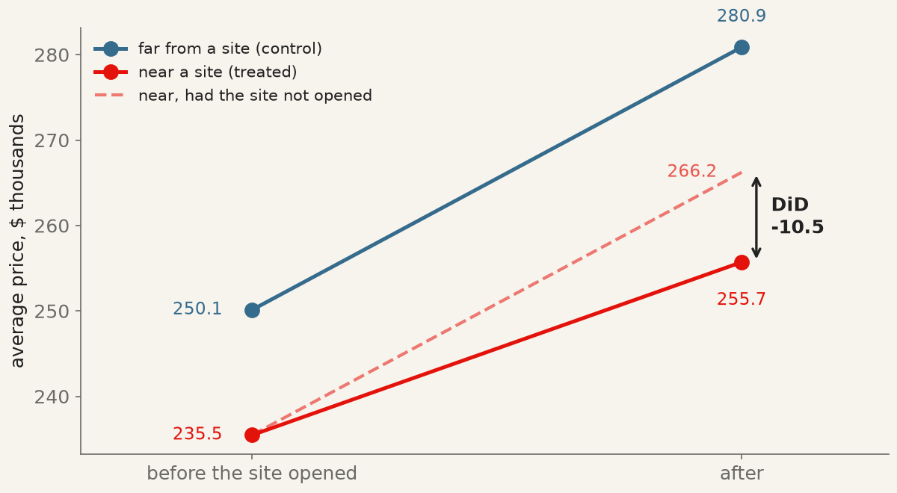{fig-alt="Far houses from 250.1 to 280.9, near houses from 235.5 to 255.7, counterfactual 266.2."}

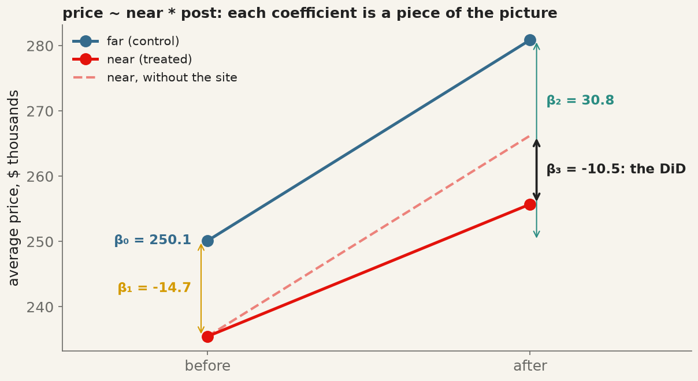{fig-alt="The four means with β0, β1, β2 and β3 drawn on them."}

**Example 1 in three sentences.** The after-only and before-after comparisons are
each biased by something the design removes. The difference of the two changes
recovers the effect, and in a regression it is the interaction. Nothing about *why*
near houses were cheaper had to be measured; only that, without the sites, both
groups would have moved together.

## Example 2 · Were the trends parallel?

The same city, now observed every year from 2003 to 2008, with the sites opening
in 2006 and the same true effect of −10. In version A, near and far houses would
have risen together without the sites. In version B, the near neighbourhoods were
already slipping, by \$3,000 a year relative to the far ones, before any site
existed. The two-period estimate compares 2005 with 2008; an **event study**
estimates the near–far gap year by year, relative to 2005.

```{python}
#| label: check-housing-trends
#| code-summary: "Run it: the event study in both versions"

for version, drift in [("A", 0.0), ("B", -3.0)]:
    rng = np.random.default_rng(12)
    house_effect = rng.normal(0, 20, n)
    rows = []
    for year in range(2003, 2009):
        price = (250 - 15 * near + house_effect + 8 * (year - 2003)
                 + drift * near * (year - 2003)
                 - 10 * near * (year >= 2006) + rng.normal(0, 10, n))
        rows.append(pd.DataFrame({"house": np.arange(n), "near": near, "year": year, "price": price}))
    prices = pd.concat(rows, ignore_index=True)
    by_year = prices.groupby(["year", "near"])["price"].mean().unstack()
    gap = by_year[1] - by_year[0]
    two = prices[prices["year"].isin([2005, 2008])].assign(
        post=lambda d: (d["year"] == 2008).astype(int))
    est = smf.ols("price ~ near * post", data=two).fit().params["near:post"]
    print(f"version {version}: DiD 2005->2008 {est:+.1f}; event study",
          (gap - gap[2005]).round(1).to_dict())
```

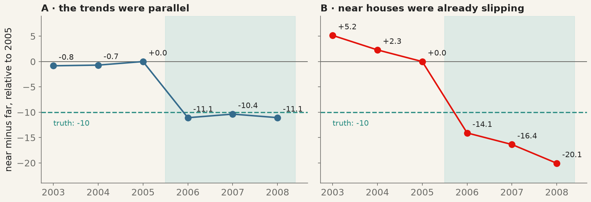{fig-alt="Event studies: A flat before 2006 then about −11; B +5.2 and +2.3 before, falling to −20.1."}

In version A the years before the sites are flat and the estimate is −11. In
version B the same two-period estimate is −20, double the truth, because the
pre-existing slide of \$3,000 a year is counted as the policy — and the event
study shows it, as points that are already falling before 2006. That is what
several pre-periods buy: not a test of parallel trends, which concerns the years
after treatment, but evidence about its plausibility. The reference year is zero
by construction; only the other pre-years are evidence.

{fig-alt="City B: observed prices, the counterfactual DiD assumes, and the true counterfactual; DiD −20 against a true −10."}

**Example 2 in three sentences.** When the trends were parallel, the years before
the policy are flat and the estimate is right. When the treated group was already
on a different path, the estimate absorbs that path, and the years before show it.
A flat pre-trend makes the assumption plausible; it cannot make it true.

## Example 3 · Do national AI strategies raise firms' AI use?

The third example is the course's own data: national AI strategies adopted by
European countries between 2021 and 2023, and the share of firms using AI. It is
generated with a known effect of 2.4 percentage points, so the estimators below
can be scored, and it has the feature that makes modern difference-in-differences
necessary — treatment arrives in different years for different countries.

### When treatment arrives at different times

The clean two-by-two case has one treatment date. Real policies arrive in
different years for different units — which is exactly what the course fixture
contains — and for two decades the profession simply put a treatment dummy into
a two-way fixed effects regression and read off the coefficient.

That turns out to be wrong in a way nobody noticed until recently. With staggered
timing, the TWFE estimate is a *weighted average* of all the two-by-two
comparisons available in the data, and some of those comparisons use
already-treated units as controls for later-treated ones. When effects vary over
time — when the policy's impact grows, say — those comparisons subtract a
treatment effect rather than a counterfactual trend, and the implied weights can
be **negative** [@dechaisemartin2020; @goodmanbacon2021]. A weighted average with
negative weights can lie outside the range of the things being averaged, so the
estimate can have the wrong sign while every underlying effect has the right one.

The remedy is to build the average yourself: estimate each cohort's effect
against clean controls — units not yet treated, or never treated — and aggregate
with weights you chose [@callaway2021; @sun2021].

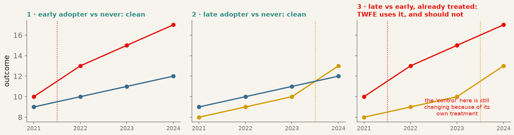{fig-alt="Three schematic comparisons: two clean, one using an already-treated unit as a control."}

### The data, and what it will and will not support

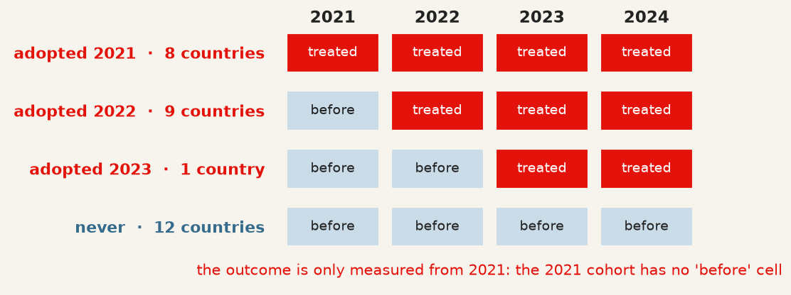{fig-alt="Grid of cohorts by year, treated cells in red, untreated in blue."}

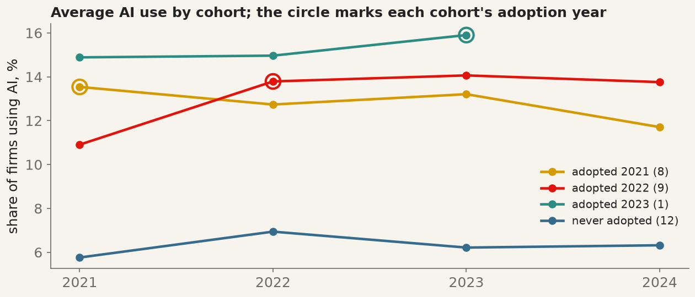{fig-alt="Average AI use for each cohort from 2021 to 2024."}

```{python}
#| label: check-timing
#| code-summary: "Run it: the adoption structure"

import sys, warnings
sys.path.insert(0, "../slides"); sys.path.insert(0, "..")
warnings.filterwarnings("ignore")
from plotstyle import setup, CL
plt = setup()

import numpy as np, pandas as pd, statsmodels.api as sm, qmib

Y, D = "ai_use_any", "has_ai_strategy"
TRUE_EFFECT = 2.4               # from scripts/build_spine/make_fixtures.py

wide = qmib.load("angle_c_country")

# Adoption year must come from the FULL treatment series, not from the rows where
# the outcome happens to be observed. Two countries adopted in 2022 and have a
# missing 2022 outcome; taking the first year they are *seen* treated would put
# them in the 2023 cohort and silently misdate the policy.
adopted = wide[wide[D] == 1].groupby("geo")["time"].min()

panel = wide[(wide["time"] >= 2021) & wide[Y].notna()].copy()
panel["cohort"] = panel["geo"].map(adopted).fillna(9999).astype(int)

print(f"country-years with the outcome observed: {len(panel)}")
print(f"the outcome exists only from {int(panel.time.min())} — "
      f"the AI module did not exist before it\n")
print(f"{'cohort':>10}{'countries':>11}   pre-periods available")
for c in sorted(panel["cohort"].unique()):
    n = panel.loc[panel["cohort"] == c, "geo"].nunique()
    if c == 9999:
        print(f"{'never':>10}{n:>11}   —")
    else:
        pre = [int(t) for t in sorted(panel.time.unique()) if t < c]
        shown = ", ".join(str(t) for t in pre) if pre else "(none)"
        print(f"{c:>10}{n:>11}   {len(pre)}  {shown}")
```

Three facts from that table decide what is possible, and each is a constraint a
real analyst meets constantly.

**The 2021 cohort cannot be used at all.** The outcome series begins in 2021 and
those countries adopted in 2021, so there is no pre-treatment observation. No
before, no difference, no difference-in-differences. Their data are not weak
evidence — they are no evidence for this design.

**The 2023 cohort is one country.** An estimate from it is a single country's
trajectory, and its standard error would be a fiction.

There is a trap in even getting this table right. Two countries adopted in 2022
and have no 2022 outcome recorded, so if the adoption year is taken from the rows
where the outcome is observed — the obvious way to write it — they are assigned to
the 2023 cohort and the policy is misdated by a year. The cohort must be read from
the treatment series, which is complete, rather than from the analysis sample,
which is not.

**The 2022 cohort has exactly one pre-period.** That is enough to compute the
estimator and *not* enough to examine pre-trends, which needs at least two
pre-periods to have a trend to look at.

### The estimates

```{python}
#| label: check-did
#| code-summary: "Run it: TWFE against cohort-by-cohort DiD"

def twoby(cohort, pre, post):
    """Clean 2x2: one cohort against the never-treated, two periods.

    Returns NaN when either group is unobserved in either period — a small
    cohort can simply be absent from a year, and that is not an estimate of zero.
    """
    sub = panel[panel["cohort"].isin([cohort, 9999]) & panel["time"].isin([pre, post])]
    tr = sub[sub["cohort"] == cohort].groupby("time")[Y].mean()
    co = sub[sub["cohort"] == 9999].groupby("time")[Y].mean()
    if not {pre, post} <= set(tr.index) or not {pre, post} <= set(co.index):
        return float("nan")
    return (tr[post] - tr[pre]) - (co[post] - co[pre])

# The specification two decades of papers used.
design = pd.concat([
    panel[[Y, D]].reset_index(drop=True),
    pd.get_dummies(panel["geo"], drop_first=True, dtype=float).reset_index(drop=True),
    pd.get_dummies(panel["time"], prefix="yr", drop_first=True, dtype=float).reset_index(drop=True),
], axis=1)
twfe = sm.OLS(design[Y], sm.add_constant(design.drop(columns=[Y]))).fit(
    cov_type="cluster", cov_kwds={"groups": panel["geo"].reset_index(drop=True)})

print(f"{'estimator':44}{'estimate':>10}{'bias':>9}")
print(f"{'the truth (from the generator)':44}{TRUE_EFFECT:>10.3f}{0.0:>9.3f}")
print(f"{'two-way fixed effects, all cohorts':44}"
      f"{twfe.params[D]:>10.3f}{twfe.params[D] - TRUE_EFFECT:>9.3f}"
      f"   (SE {twfe.bse[D]:.3f})")

print(f"\nclean 2x2 estimates, cohort against never-treated:")
clean = []
for cohort, pre in ((2022, 2021), (2023, 2022)):
    n = panel.loc[panel["cohort"] == cohort, "geo"].nunique()
    for post in range(cohort, 2025):
        v = twoby(cohort, pre, post)
        label = f"   cohort {cohort} ({n} countr{'y' if n == 1 else 'ies'}), {pre}→{post}:"
        if np.isnan(v):
            print(f"{label} not estimable (a group is unobserved that year)")
            continue
        clean.append((cohort, post, v, n))
        print(f"{label} {v:+7.3f}   bias {v - TRUE_EFFECT:+7.3f}")

usable = [v for c, _, v, n in clean if n > 1]
print(f"\naveraging only the cohort with more than one country: "
      f"{np.mean(usable):+.3f}   bias {np.mean(usable) - TRUE_EFFECT:+.3f}")
```

The two-way fixed effects estimate is close to the truth here, and it would be
dishonest to stage a dramatic failure that the data do not produce. With four
periods and effects that are roughly constant once treatment begins, the
negative-weighting problem is mild. The point stands anyway: **the estimate is
close for reasons you can only check by decomposing it**, and a paper reporting
the TWFE coefficient alone offers no way to know whether its weights were benign.

The cohort estimates show what the decomposition looks like. The 2022 cohort —
nine countries with one clean pre-period — gives +1.70, +2.70 and +2.29 in
successive years, averaging +2.23 against a truth of +2.40, with the sampling
noise you would expect from that many units. The 2023 cohort is a single country;
its one estimable comparison happens to land at +1.67, and the second is not
estimable at all because that country is absent from the final year. Both are
reported rather than quietly dropped, because a cohort of one is a fact about the
design and hiding it would make the evidence look stronger than it is.

### The estimator has a name

The loop in that cell is not an improvisation. Estimating each cohort against a
clean comparison group and aggregating with weights you chose is precisely the
procedure of @callaway2021, and there is a Python implementation of it,
`diff-diff`. It is a young package and the reference implementation is still
R's `did`, so the first thing to do with it is what this section does: run it
beside a calculation you already understand, and find out where the two
disagree.

That is worth doing here for three reasons. It states out loud which cells it
refuses to estimate. It attaches standard errors to the cohort estimates, which
the hand-rolled loop had no way to produce. And it does disagree — in a way that
turns out to be the hand-rolled version's fault.

```{python}
#| label: check-cs
#| code-summary: "Run it: Callaway–Sant'Anna on the same panel"

import diff_diff as dd

# The estimator wants one column holding the adoption year, and 0 — not a
# sentinel it would read as a year — for the never-treated.
panel["g"] = panel["cohort"].replace(9999, 0)

cs = dd.CallawaySantAnna(cluster="geo").fit(
    panel, outcome=Y, unit="geo", time="time", first_treat="g")
gt = cs.to_dataframe()

print(f"{'cohort':>7}{'year':>6}{'ATT(g,t)':>10}{'SE':>7}")
for _, r in gt.iterrows():
    g, t = int(r.group), int(r.time)
    if pd.isna(r.effect):
        print(f"{g:>7}{t:>6}{'—':>10}{'—':>7}   dropped: {r.skip_reason}")
    else:
        tag = "  ← pre-treatment, not an effect" if t < g else ""
        print(f"{g:>7}{t:>6}{r.effect:>10.3f}{r.se:>7.3f}{tag}")

print(f"\n{'overall ATT':>18}{cs.overall_att:>10.3f}{cs.overall_se:>7.3f}"
      f"   bias {cs.overall_att - TRUE_EFFECT:+.3f}, {cs.n_clusters} clusters")
for _, r in cs.aggregate("group").to_dataframe().iterrows():
    n = panel.loc[panel["cohort"] == int(r.label), "geo"].nunique()
    print(f"{'cohort ' + str(r.label):>18}{r.att:>10.3f}{r.se:>7.3f}"
          f"   {n} countr{'y' if n == 1 else 'ies'}")

# The hand-rolled estimates and these ones differ. Recomputing each 2x2 over
# only the countries observed in *both* of its two years isolates why.
print("\nthe hand-rolled numbers, and what was wrong with them:")
print(f"{'g,t':>9}{'as written':>12}{'same units':>12}{'ATT(g,t)':>10}")
for g, t in ((2022, 2022), (2022, 2023), (2022, 2024), (2023, 2023)):
    sub = panel[panel["cohort"].isin([g, 9999]) & panel["time"].isin([g - 1, t])]
    seen = sub.groupby("geo")["time"].nunique()
    bal = sub[sub["geo"].isin(seen[seen == 2].index)]
    tr = bal[bal["cohort"] == g].groupby("time")[Y].mean()
    co = bal[bal["cohort"] == 9999].groupby("time")[Y].mean()
    fixed = (tr[t] - tr[g - 1]) - (co[t] - co[g - 1])
    att = gt.loc[(gt.group == g) & (gt.time == t), "effect"].iloc[0]
    print(f"{f'{g},{t}':>9}{twoby(g, g - 1, t):>12.3f}{fixed:>12.3f}{att:>10.3f}")
```

The first table is this chapter's own reasoning, produced by the estimator
rather than argued for in advance. The 2021 cohort is dropped as
`missing_period` — no pre-treatment observation exists, which is the conclusion
reached two sections ago by reading the adoption structure. ATT(2023, 2024) is
dropped as `zero_treated_control`, the same absent country the hand-rolled
version returned `NaN` for. Neither refusal is buried inside a coefficient.

The standard errors are new. They come from the influence function of each
group-time effect, clustered by country, and they carry through to the
aggregate: an overall ATT of +2.20 with a standard error of 0.78, against a
truth of 2.40. The interval covers it, which is the honest summary of what
thirty countries over four years can establish about an effect of this size.

::: {.warn}
**Read the cohort lines again.** The nine-country cohort reports a standard
error of 0.81. The one-country cohort reports 0.55. One country's trajectory is
not measured more precisely than nine countries' — the smaller number is what
comes out when there is no between-country variation left to estimate, and the
software has no way to know that a cohort of one should not be reported at all.
The estimator computes whatever you ask it for. Deciding what is worth asking
for is still yours.
:::

The last table is the uncomfortable one. The hand-rolled estimates and
Callaway–Sant'Anna's differ — +1.70 against +1.74, +2.29 against +2.14 — and
the middle column says why. `twoby` averaged whichever countries happened to be
present in each year, and this panel is not balanced: Malta and Estonia have no
2022 observation, Luxembourg no 2021, Spain no 2023, Croatia neither. The "before"
mean and the "after" mean were therefore computed over different sets of
countries, and part of what looked like an effect was the change in who was
being averaged. Hold the units fixed and the estimator is reproduced to three
decimals.

That failure is on this chapter's own list — it is the **composition change**
warning further down, committed in code written to demonstrate the method,
on a dataset small enough to audit by hand. Which is the argument for using the
package rather than the argument against it: not that it is cleverer, but that
the choices the hand-rolled version made silently are ones it is forced to make
out loud.

### Pre-trends: what this data cannot tell you

```{python}
#| label: fig-event-study
#| code-summary: "Show the code"
#| fig-cap: "Event study for the 2022 cohort against the never-treated. Event time 0 is the year of adoption. The point at $-1$ is the reference period and is zero by construction, not by evidence — with a single pre-period there is no pre-trend to examine."

cohort = 2022
sub = panel[panel["cohort"].isin([cohort, 9999])].copy()
sub["treated"] = (sub["cohort"] == cohort).astype(int)

tr = sub[sub["treated"] == 1].groupby("time")[Y].mean()
co = sub[sub["treated"] == 0].groupby("time")[Y].mean()
years = sorted(sub["time"].unique())
eff = [(t - cohort, (tr[t] - tr[2021]) - (co[t] - co[2021])) for t in years]

fig, ax = plt.subplots(figsize=(6.8, 4.0))
xs = [e for e, _ in eff]; ys = [v for _, v in eff]
ax.axhline(0, color=CL.line, lw=1)
ax.axhline(TRUE_EFFECT, color=CL.good, lw=1.4, ls=":", label="true effect")
ax.axvline(-0.5, color=CL.muted, lw=1.2, ls="--")
ax.plot(xs, ys, marker="o", ms=7, lw=1.8, color=CL.accent, zorder=3)
ax.annotate("reference period\n(zero by construction)", (-1, 0),
            textcoords="offset points", xytext=(6, 26), fontsize=8, color=CL.muted)
ax.set_xlabel("years since adoption"); ax.set_ylabel("estimated effect (pp)")
ax.set_xticks(xs)
ax.legend(frameon=False, fontsize=8.5, loc="lower right")
fig.tight_layout()

print(f"{'event time':>12}{'estimate':>11}")
for e, v in eff:
    note = "  reference — not evidence" if e == -1 else ""
    print(f"{e:>12}{v:>11.3f}{note}")
print(f"\npre-periods available for this cohort: "
      f"{sum(1 for e, _ in eff if e < 0)}")
```

An event study is the standard way to make parallel trends look plausible: plot
the estimated effect at each period relative to adoption, and look for a flat
line before treatment. Here the pre-treatment portion consists of a single point,
which is the reference period and therefore exactly zero by arithmetic.

**A flat pre-trend that contains one mechanically-zero point is not evidence of
anything.** This is not a defect of the analysis; it is a property of the data,
and it means the identifying assumption of this chapter cannot be examined at all
in this dataset. The honest report says so, states the estimate as conditional on
an assumption that could not be checked, and treats the finding accordingly.

It is worth noticing how much weaker that is than what chapter 10 could do. There
the assumption was also untestable, but the covariates could at least be shown to
be balanced. Here, there is nothing to show.

### How large a violation would it take?

"The assumption cannot be checked" is where this dataset leaves you. It is not
where the literature leaves you. @rambachan2023 changes the question: rather
than testing parallel trends, ask how large a violation of it would have to be
before the finding stops holding, and report *that* number. The output is a
family of intervals indexed by how much post-treatment departure from parallel
trends you are prepared to allow — measured, in the relative-magnitudes version,
as a multiple $M$ of the largest departure actually visible before treatment.

```{python}
#| label: check-honest
#| code-summary: "Run it: how much violation does the result survive?"

es = cs.aggregate("event_study")

print("the whole of the pre-treatment evidence in this dataset:")
for _, r in es.to_dataframe().query("event_time < 0").iterrows():
    print(f"   event time {int(r.event_time):>3}: {r.att:+.3f}  "
          f"(SE {r.se:.3f}, p {r.p_value:.3f}), from {int(r.n)} cohort")

print(f"\n{'M':>5}{'identified set':>22}{'95% robust CI':>22}   rules out zero")
for M in (0.0, 0.25, 0.5, 1.0, 2.0):
    h = dd.HonestDiD(method="relative_magnitude", M=M).fit(es)
    print(f"{M:>5.2f}   [{h.lb:>7.3f},{h.ub:>7.3f}]     "
          f"[{h.ci_lb:>7.3f},{h.ci_ub:>7.3f}]   "
          f"{'yes' if h.is_significant else 'no'}")
```

Two things to read off that, and the second matters more.

The pre-treatment evidence is a single number, from a single cohort, and that
cohort is a single country. Germany adopted in 2023, so it is the only unit
whose pre-period is something other than its own reference year, and its
2021→2022 change ran 1.13 points below the never-treated countries'. Everything
in the table below rests on that one comparison. The 2022 cohort, nine countries
strong, contributes nothing here at all — its only pre-period *is* the reference.

The sensitivity table then says: the result survives at $M = 0.25$ and not at
$M = 0.5$. In words, if post-treatment departures from parallel trends could be
as much as half the size of the one pre-treatment departure visible in the data,
the interval already contains zero. That is a low breakdown point, and it ought
to be — it is what an estimate resting on one country's single pre-period is
worth.

::: {.warn}
**This is not a test, and nothing here has been tested.** The honest sentence is
"the finding requires post-treatment violations of parallel trends no larger
than about a quarter of the single pre-treatment deviation we can observe, and
we have one country from which to judge that." A sensitivity analysis converts
an untestable assumption into a statement about how much of it the result needs.
That is real progress over asserting the assumption, and it is not the same
thing as evidence for it.
:::

**Example 3 in three sentences.** The adoption table decides what can be
estimated before any regression is run: one cohort has no pre-period and another
is a single country. Two-way fixed effects gives 2.81 and the staggered-robust
estimator 2.20 with a standard error of 0.78, covering the truth. Parallel trends
cannot be examined here, and the sensitivity analysis says how little violation
the result can absorb.

## Example 4 · Does exporting raise productivity?

Exporters are more productive than non-exporters in almost every economy where
the comparison has been made, and the question that follows is the one
@bernard1999 posed: is exporting the cause of the gap, its effect, or both? Firms
may learn from foreign buyers and competitors; or the better firms may be the
ones that export. The selection runs through something rarely measured well —
the quality of management — and in a single cross-section there is no before and
after to difference. Matching cannot see the confounder and difference-in-
differences has nothing to difference. A third design is needed.

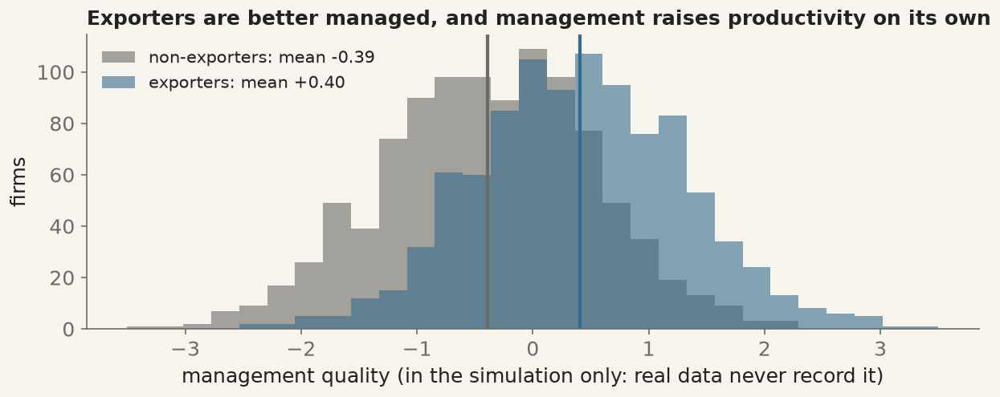{fig-alt="Histograms of management quality for exporters and non-exporters."}

The remaining route is a variable that moves treatment from outside the system:
an **instrumental variable** $Z$. It identifies an effect when it satisfies three
conditions [@angrist1996].

::: {.definition}
[**Relevance**]{.term} — $Z$ actually moves the treatment. This is the first
stage, and it is the only one of the three conditions the data can check.
:::

::: {.definition}
[**Independence**]{.term} — $Z$ is as good as randomly assigned, unrelated to the
unmeasured causes of the outcome.
:::

::: {.definition}
[**Exclusion**]{.term} — $Z$ affects the outcome *only through* the treatment.
:::

Here the candidate is distance to the nearest port. Firms far from a port export
less, because shipping costs more; where a firm sits was settled by history, not
by its managers; and — the claim that carries everything — distance matters for
productivity only by changing who exports. The data are simulated, 2,000 firms,
so the truth is known: exporting adds 5. In version A all three conditions hold.
In version B remote firms also pay more for their inputs, so distance lowers
productivity directly and the exclusion fails.

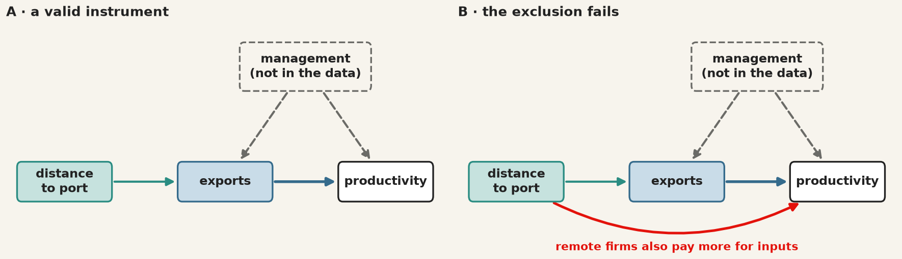{fig-alt="Distance to port → exports → productivity, with unobserved management affecting both; in B a red arrow from distance to productivity."}

If distance touches productivity only through exporting, its effect on
productivity (the **reduced form**) must be its effect on exporting (the **first
stage**) multiplied by the effect of exporting. So the effect is a ratio,

$$
\widehat{\beta}_{\text{IV}} = \frac{\text{reduced form}}{\text{first stage}}
= \frac{\widehat{\operatorname{Cov}}(Y, Z)}{\widehat{\operatorname{Cov}}(D, Z)} ,
$$

and two-stage least squares computes the same number with a correct standard
error.

```{python}
#| label: check-iv
#| code-summary: "Run it: naive, the two stages by hand, and two-stage least squares"

import statsmodels.api as sm
from statsmodels.sandbox.regression.gmm import IV2SLS

for version, direct in [("A", 0.0), ("B", -0.02)]:
    rng = np.random.default_rng(13)
    n_firms = 2000
    management = rng.normal(0, 1, n_firms)                     # never in the data
    distance = rng.uniform(0, 300, n_firms)                    # km to the nearest port
    exports = (0.8 * management - 0.01 * distance + rng.normal(0, 1, n_firms) > -1.5).astype(int)
    productivity = (100 + 5 * exports + 6 * management + direct * distance
                    + rng.normal(0, 5, n_firms))
    firms = pd.DataFrame({"exports": exports, "distance": distance, "productivity": productivity})

    gap = firms.groupby("exports")["productivity"].mean()
    first = smf.ols("exports ~ distance", data=firms).fit()
    reduced = smf.ols("productivity ~ distance", data=firms).fit()
    iv = IV2SLS(firms["productivity"], sm.add_constant(firms[["exports"]]),
                sm.add_constant(firms[["distance"]])).fit()
    print(f"version {version}: naive {gap[1] - gap[0]:5.2f}   "
          f"first stage {first.params['distance']:.4f} (F {first.tvalues['distance'] ** 2:.0f})   "
          f"reduced form {reduced.params['distance']:.4f}   "
          f"IV {iv.params['exports']:.2f} (SE {iv.bse['exports']:.2f})   truth 5")
```

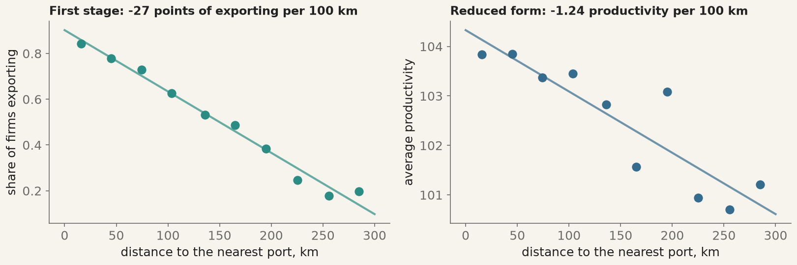{fig-alt="Binned scatter plots: exporting share and productivity both falling with distance to port."}

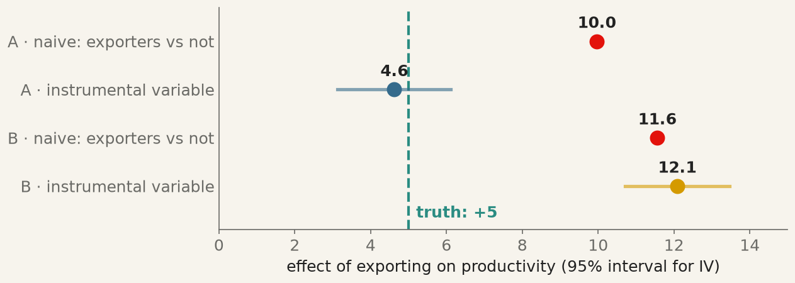{fig-alt="Version A: naive 10.0, IV 4.6 covering 5; version B: naive 11.6, IV 12.1."}

In version A the naive comparison says 10, double the truth, because exporters
are about 0.8 standard deviations better managed; the instrument gives 4.6 with
a standard error of 0.76, covering the truth. In version B the first stage is
exactly as strong — the F statistic of 543 is far above any conventional bar —
and the estimate is 12.1, *further* from the truth than the naive comparison.
Nothing in the output distinguishes the two versions, because the condition that
failed is the one the data cannot test.

Two practical warnings. Running the second stage by hand — regressing the
outcome on the *fitted* treatment with `smf.ols` — gives the right coefficient
and the wrong standard error, since it ignores that the fitted values were
estimated; use a two-stage routine. And what IV identifies is the effect on the
units whose treatment the instrument actually moved — the *compliers*, here the
firms whose export decision depends on their distance to a port — not on every
firm. A weak first stage makes everything worse: the estimate becomes noisy and
biased toward the naive one, which is why the F statistic is reported.

**Example 4 in three sentences.** When the confounder is unmeasured and there is
no before and after, a variable that moves treatment from outside can still
identify the effect, as the ratio of the reduced form to the first stage. With a
valid instrument it recovers the truth where the naive gap was double. Good
instruments are rare because the exclusion restriction is an argument, and when
it fails the estimate can be worse than doing nothing.

## Matching, difference-in-differences or an instrument?

The three designs of chapters 10 and 11 answer different worries, and each rests
on an assumption the data cannot test.

| | Matching (chapter 10) | Difference-in-differences | Instrumental variable |
|---|---|---|---|
| **Uses** | comparisons on what was measured | changes within units over time | only the variation in treatment the instrument causes |
| **Assumes** | conditional independence | parallel trends | relevance, independence, exclusion |
| **Needs** | rich pre-treatment covariates, overlap | observations before and after | a variable that moves treatment from outside |
| **Checkable part** | balance, overlap | pre-trends, with several pre-periods | the first stage |
| **Fails when** | an unmeasured trait drives selection | the treated were already on a different path | the instrument has its own path to the outcome |

Choose the design whose assumption can be argued best in the setting at hand, and
say in words which assumption that is.

## What difference-in-differences cannot fix

**Anything that changes at the same time as treatment.** Fixed effects remove
what is constant; the second difference removes what is common. A shock hitting
only the treated group in the treatment year is indistinguishable from the
treatment, and no amount of data separates them. Countries that adopt an AI
strategy in a given year may be doing several other things that year.

**Anticipation.** If units change behaviour before adoption because they know it
is coming, the pre-period is already contaminated and the "before" is not a
clean baseline. This shows as a non-zero pre-trend, when there are enough
pre-periods to see one.

**Composition change.** If the units in the panel change — countries entering or
leaving the sample, or a survey changing who it asks — the first difference is
comparing different populations rather than the same one over time.

**Spillovers.** The control group must be unaffected. If a national strategy in
one country shifts behaviour in its neighbours, the controls are partially
treated and the estimate is attenuated toward zero.

## A short review of the literature

::: {.lit}
The design is older than its name: @wing2018 traces it to Snow's 1855 water study
and sets out the modern practice, including the pre-trend examination and the
sensitivity checks a credible paper is expected to show.

The last decade has been dominated by a single discovery about staggered
adoption. @goodmanbacon2021 decomposed the two-way fixed effects estimator into
the underlying two-by-two comparisons and showed that some of them use
already-treated units as controls; @dechaisemartin2020 showed that the implied
weights can be negative, so the estimand may lie outside the range of every
underlying effect. Neither paper is a curiosity — between them they called into
question a large body of published work.

The constructive replacements estimate cohort-specific effects against clean
comparison groups and aggregate them explicitly. @callaway2021 gives the
group-time average treatment effects and the aggregation schemes; @sun2021
does the equivalent for event-study specifications, where the same negative
weighting contaminates the coefficients on individual leads and lags.

Where the pre-trend evidence is thin — and outside a handful of long panels it
usually is — @rambachan2023 replaces the ritual pre-trend test with a
sensitivity analysis. Report the range of estimates consistent with violations
of parallel trends up to a stated size, and the reader can see how much of the
assumption the finding actually needs rather than being told it holds.

On inference, the reference remains Bertrand, Duflo and Mullainathan, discussed
in chapter 3: DiD data are serially correlated panels, and standard errors that
ignore it reject true nulls at many times the nominal rate.

For the case where neither design applies, @angrist1996 set out the conditions
under which an instrument identifies a causal effect, and showed that what it
identifies is the effect on the units the instrument moves, not on everyone.
:::

## What to report

1. **The adoption structure.** How many units in each cohort, how many periods
   before and after, and which cohorts are unusable. A table of this is worth
   more than a paragraph asserting the design is sound.
2. **The parallel-trends argument**, as an argument. Why should the gap have
   stayed constant? Institutional reasoning, not a citation to the assumption.
3. **An event study**, with the reference period marked as such — and if there
   are too few pre-periods to see a trend, say that instead of implying the flat
   line is evidence.
4. **A staggered-robust estimator alongside TWFE.** If they agree, the weights
   were benign and you have shown it. If they disagree, the decomposition is the
   finding. `diff-diff`'s `CallawaySantAnna` is the Python route; the `did`
   package is the R one.
5. **Standard errors clustered by unit**, with the number of clusters. Below
   about forty, say what you did about it.
6. **The scale.** Levels or logs is part of the assumption, because parallel
   trends in one is not parallel trends in the other.
7. **What could have moved at the same time.** The most credible DiD papers name
   the confounding events they considered and explain why each is implausible —
   which is the modern version of Snow pointing out that nobody chose their water
   company.
8. **How much violation the result survives.** A breakdown value — the size of
   departure from parallel trends at which the finding stops holding — is worth
   more than a pre-trend $p$-value, and unlike the $p$-value it can be reported
   even when there is nothing to test.
